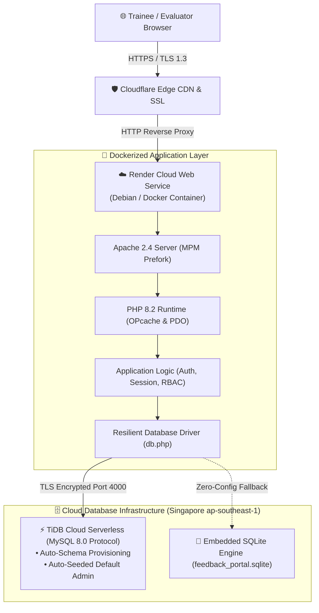
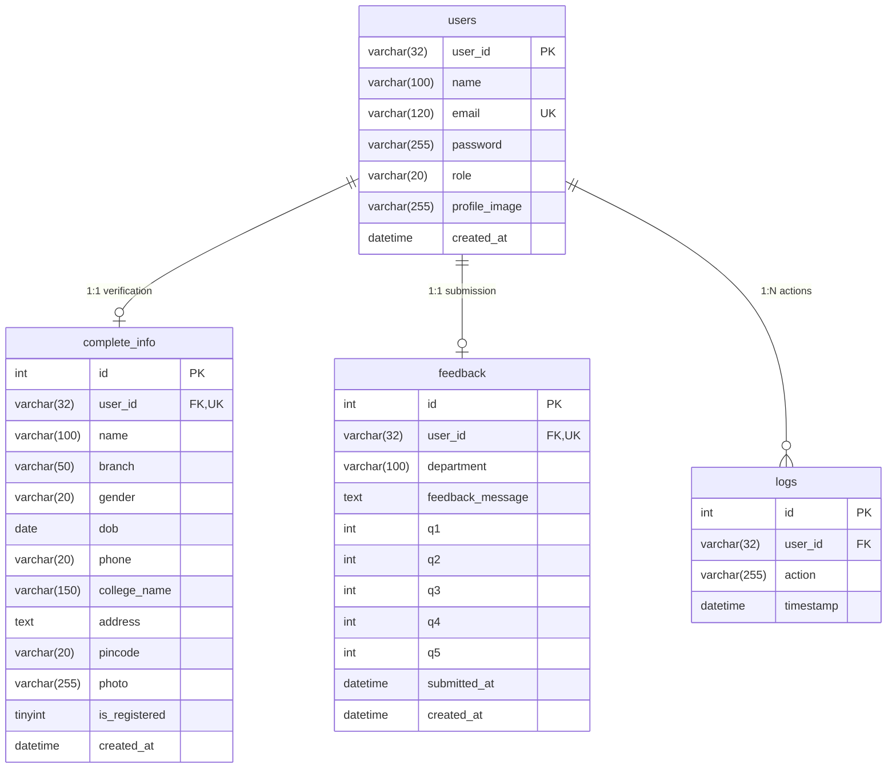

<div align="center">

# 🎓 SNTI Feedback Portal System
### Enterprise Training Evaluation & Quality Analytics Platform for Tata Steel (SNTI)

[](https://snti-feedback-portal.onrender.com)
[](https://github.com/0ANSHKUMARSINGH4/Feedback-Portal/actions)
[](https://www.php.net/)
[](https://tidbcloud.com/)
[](https://www.docker.com/)
[](schema.sql)
[](LICENSE)

<br/>

**A production-ready, full-stack institutional web portal designed for Shavak Nanavati Technical Institute (SNTI, Tata Steel).**  
Empowers engineering trainees with structured evaluation workflows while providing program administrators with real-time analytics and audit-ready reporting.

[Explore Live Portal →](https://snti-feedback-portal.onrender.com) • [Report Issue](https://github.com/0ANSHKUMARSINGH4/Feedback-Portal/issues) • [Request Feature](https://github.com/0ANSHKUMARSINGH4/Feedback-Portal/pulls)

</div>

---

## ⚡ Quick Access & Evaluation Credentials

For evaluators, recruiters, and reviewers:

| Portal Gateway | URL | Test Credentials / Access |
| :--- | :--- | :--- |
| **🌐 Public Landing** | [snti-feedback-portal.onrender.com](https://snti-feedback-portal.onrender.com) | Public Gateway |
| **🛡️ Admin Control** | [Portal Login](https://snti-feedback-portal.onrender.com/login.php?role=admin) | **Email:** `admin@feedbackportal.local`<br/>**Password:** `Admin@12345` *(or use 1-click Demo Pill)* |
| **🎓 Trainee Portal** | [Portal Login](https://snti-feedback-portal.onrender.com/login.php?role=user) | **Email:** `sample@trainee.local`<br/>**Password:** `Trainee@12345` |
| **🔑 Admin Signup Gate** | [Portal Signup](https://snti-feedback-portal.onrender.com/signup.php?role=admin) | **Master Authorization Key:** `SNTI_ADMIN_2026` |

---

## 📑 Table of Contents

- [🏛️ System Architecture](#-system-architecture)
- [✨ Key Features](#-key-features)
  - [🎓 Engineering Trainee Portal](#-engineering-trainee-portal)
  - [🛡️ Administrator Control Center](#️-administrator-control-center)
  - [🔐 Role-Based Access Control (RBAC)](#-role-based-access-control-rbac)
- [🛡️ Security Architecture & OWASP Hardening](#️-security-architecture--owasp-hardening)
- [🗄️ Database Design & Entity Relationship](#️-database-design--entity-relationship)
- [🎨 Enterprise Design System](#-enterprise-design-system)
- [🚀 Local Development Setup](#-local-development-setup)
- [🐳 Docker & Production Deployment](#-docker--production-deployment)
- [👨‍💻 Author & License](#-author--license)

---

## 🏛️ System Architecture

The portal is deployed on a modern, distributed cloud stack engineered for **low latency**, **high availability**, and **zero-downtime automated deployment**:



### Key Architectural Strengths:
* **Data Locality:** Deployed in AWS Singapore (`ap-southeast-1`) matching Render Singapore compute nodes to keep round-trip database queries under 10ms.
* **Resilient Multi-Driver Bootstrapping:** [`db.php`](file:///c:/xampp/htdocs/feedback_portal/db.php) natively parses `MYSQL_URL` and `DATABASE_URL` with TLS certificate auto-negotiation. If remote MySQL is temporarily unreachable, it seamlessly falls back to embedded SQLite without throwing HTTP 500 crashes.

---

## ✨ Key Features

### 🎓 Engineering Trainee Portal
1. **Academic Enrollment & Verification:** Mandatory verification capturing engineering discipline (Computer Science, Electrical, Mechanical, Metallurgy, Civil, Electronics, Safety), college affiliation, phone number, and trainee registration ID.
2. **5-Dimensional Evaluation Widget:** Interactive star rating module capturing granular metrics:
   - Session Quality & Clarity
   - Faculty Technical Mastery & Engagement
   - Hands-on Workshop Equipment Access
   - Industry Applicability & Practical Value
   - Schedule Punctuality & Organization
3. **Personal Trainee Dashboard:** Real-time visibility into enrollment status, submitted evaluation preview, and profile management.
4. **Profile Management:** Secure password updating, contact modification, and avatar photo uploads with client/server validation.

### 🛡️ Administrator Control Center
1. **Executive Quality Analytics:** Real-time summary KPI cards displaying:
   - Total Submitted Feedback Responses
   - Verified Enrolled Trainees
   - Registered User Accounts
   - Overall Weighted Average Satisfaction Rating (out of 5.0 ★)
2. **Interactive Data Tables:** Filterable and paginated tables for comprehensive trainee audits (`view_users.php`), feedback details (`view_feedbacks.php`), and registered user directory (`view_signed_up_users.php`).
3. **1-Click Multi-Section CSV Reporting:** Generates comprehensive audit-ready CSV exports containing complete trainee profiles, rating breakdowns, and submission timestamps (`download_report.php`).

### 🔐 Role-Based Access Control (RBAC)
* **Gated Admin Provisioning:** Prevents public privilege escalation while providing simple onboarding for evaluators. Selecting "Administrator" during signup reveals an **Admin Authorization Key** requirement (`SNTI_ADMIN_2026`, configurable via `.env`).
* **Session Hardening:** Strict role enforcement on all administrative endpoints via `requireAuth('admin')`.

---

## 🛡️ Security Architecture & OWASP Hardening

This project underwent a comprehensive **31-point vulnerability remediation audit**, transforming it from a vulnerable student project into an enterprise-hardened application:

| Vulnerability Vector | Defense Mechanism | Implementation Detail |
| :--- | :--- | :--- |
| **SQL Injection (OWASP A03)** | 100% Prepared Statements | Native PDO parameterized queries with zero string concatenation. |
| **Broken Access Control (OWASP A01)** | Defense-in-Depth RBAC | Session checks on every endpoint (`requireAuth()`), IDOR prevention on profile edits. |
| **CSRF Attacks (OWASP A01)** | Cryptographic Tokens | Dynamic 32-byte hexadecimal CSRF tokens validated on all `POST` operations (`verifyCsrfToken()`). |
| **XSS (OWASP A03)** | Strict Output Encoding | Context-aware `htmlspecialchars(..., ENT_QUOTES, 'UTF-8')` applied to all user-generated content. |
| **Session Fixation & Hijacking** | Regenerated Session IDs | `session_regenerate_id(true)` upon successful login; `HttpOnly`, `SameSite=Lax`, and `Secure` cookie flags. |
| **Inactivity Session Timeout** | Sliding Inactivity Window | Automatic session invalidation and cookie clearing after 30 minutes of inactivity. |
| **Arbitrary File Upload (RCE)** | 4-Tier Upload Verification | Magic-byte MIME checking, strict extension whitelist (`jpg`, `jpeg`, `png`, `webp`), randomized filenames (`bin2hex(random_bytes(16))`), and execution prevention via [`uploads/.htaccess`](file:///c:/xampp/htdocs/feedback_portal/uploads/.htaccess). |
| **Credential Storage** | Bcrypt Hashing | Passwords hashed using `password_hash($pwd, PASSWORD_BCRYPT, ['cost' => 12])`. Plaintext passwords are never logged or stored. |
| **Clickjacking & MIME-Sniffing** | Defensive HTTP Headers | Automatically sends `X-Frame-Options: SAMEORIGIN`, `X-Content-Type-Options: nosniff`, and `Referrer-Policy`. |

---

## 🗄️ Database Design & Entity Relationship



---

## 🎨 Enterprise Design System

The user interface was crafted to reflect the corporate identity of **Tata Steel** and **Shavak Nanavati Technical Institute**:

* **Curated Palette:** Deep Tata Navy (`#07162c`), Electric Azure (`#0284c7`), Soft Sky (`#e0f2fe`), and ambient light-blue gradient canvases.
* **Modern Glassmorphism:** Elevated white card containers (`background: rgba(255, 255, 255, 0.94)`) with backdrop blur filters and crisp border outlines (`--border: #bae6fd`).
* **Typography:** Modern Google Fonts pairing (*Plus Jakarta Sans* for clean legible body typography, *Space Grotesk* for technical metrics and numerical counters).
* **Responsive Layouts:** Mobile-optimized flexbox navigation, adaptive data tables with horizontal scroll wrappers, and accessible form inputs.

---

## 🚀 Local Development Setup

### Prerequisites
* [XAMPP](https://www.apachefriends.org/) (PHP 8.2+ and MySQL/MariaDB) **OR** Docker

### Option 1: Standard XAMPP Setup
1. **Clone the Repository:**
   ```bash
   git clone https://github.com/0ANSHKUMARSINGH4/Feedback-Portal.git
   cd Feedback-Portal
   ```

2. **Copy to your Web Root:**
   Move the `Feedback-Portal` folder into your XAMPP `htdocs` directory:
   ```text
   C:\xampp\htdocs\feedback_portal
   ```

3. **Start Apache & MySQL:**
   Open the XAMPP Control Panel and start **Apache** and **MySQL**.

4. **Launch Application:**
   Navigate to:
   ```text
   http://localhost/feedback_portal/index.html
   ```
   *(Note: The application includes self-healing schema migration. Tables and the default admin account are created automatically on the first visit!)*

---

## 🐳 Docker & Production Deployment

### Running Locally with Docker
You can spin up the production container locally with one command:

```bash
docker build -t snti-feedback-portal .
docker run -p 8080:80 -e DB_DRIVER=sqlite snti-feedback-portal
```
Visit `http://localhost:8080` in your browser.

### Deploying to Render
The repository includes a ready-to-use [`render.yaml`](file:///c:/xampp/htdocs/feedback_portal/render.yaml) blueprint:

1. Push your changes to GitHub.
2. In [Render Dashboard](https://dashboard.render.com/), click **New +** ➔ **Web Service** ➔ Select your repository.
3. Configure the following environment variables:
   * `DB_DRIVER` = `mysql`
   * `DB_HOST` = `<your_cloud_mysql_host>`
   * `DB_PORT` = `4000` *(or 3306)*
   * `DB_NAME` = `test` *(or your db name)*
   * `DB_USER` = `<your_db_username>`
   * `DB_PASS` = `<your_db_password>`
   * `DB_SSL` = `true`
   * `ADMIN_SECRET` = `SNTI_ADMIN_2026`
4. Render will automatically build the container and deploy your live instance!

---

## 👨‍💻 Author & License

**Ansh Kumar Singh**  
* GitHub: [@0ANSHKUMARSINGH4](https://github.com/0ANSHKUMARSINGH4)  
* Project Repository: [Feedback-Portal](https://github.com/0ANSHKUMARSINGH4/Feedback-Portal)  
* Live Deployment: [snti-feedback-portal.onrender.com](https://snti-feedback-portal.onrender.com)

Distributed under the **MIT License**. See [`LICENSE`](file:///c:/xampp/htdocs/feedback_portal/LICENSE) for more details.

---

<div align="center">
  <sub>Developed for Shavak Nanavati Technical Institute (SNTI), Tata Steel Ltd. Built for institutional reliability, security, and continuous training excellence.</sub>
</div>
