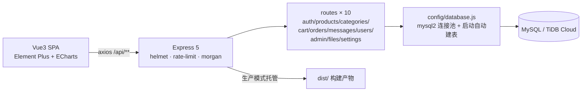

# Shop System — Vue3 + Node 全栈电商后台

> 前后台一体的全栈商城系统：面向顾客的前台（商品浏览/购物车/下单）+ 管理后台（商品、分类、订单、用户、留言、仪表盘图表），后端 Express 提供 JWT 鉴权 REST API，可一键部署到 Render + TiDB Cloud。
>
> **技术栈**：Vue 3 · Vite · Element Plus · ECharts · Vue Router 4 (history) · Vuex 4 ｜ Node · Express 5 · MySQL/TiDB (mysql2) · JWT · bcryptjs · multer · helmet · express-rate-limit ｜ 约 1.35 万行

## 在线演示

**https://shop-admin-b7qv.onrender.com** （Render 免费实例 + TiDB Cloud Serverless；冷启动需等约 1 分钟）

- 管理员：`admin / admin`　普通用户：`user / user`
- 演示数据均为虚构，数据库可能不定期重置

## 功能地图

```
前台                          后台
├── 首页/分类浏览/商品详情      ├── 登录鉴权（JWT + 角色）
├── 购物车 → 下单结算          ├── 仪表盘（ECharts 销售/分类统计）
├── 留言反馈                   ├── 商品管理（CRUD + 图片上传 multer）
└── 注册/登录                  ├── 分类 / 订单 / 用户 / 留言管理
                              └── 个人中心（资料 / 改密）
```

## 架构要点



- **单服务同源部署**：生产构建后由 Express 直接托管 `dist/`，一个进程同时提供静态页与 API（免费档云平台的友好形态）；开发态走 Vite proxy `/api → :3000`。
- **自动初始化**：启动时连接池探活 → `CREATE TABLE IF NOT EXISTS` 建全部业务表，零手工 SQL。
- **安全**：helmet 安全头；`/api/*` 每 IP 15 分钟 1000 次限流；JWT 密钥**无默认值，未配置直接拒绝启动**；密码 bcrypt 哈希存储（兼容历史明文登录时自动升级为哈希）。
- **文件上传**：multer 按类型分目录（商品图/头像/横幅），运行时目录自动创建且不入库。

## 快速开始

```bash
# 1. 安装依赖（根目录 + server 各一份）
npm install
cd server && npm install && cd ..

# 2. 配置环境变量（复制模板，至少填 DB_PASSWORD 与 JWT_SECRET）
copy .env.example .env

# 3a. 开发模式：两个终端
npm run dev          # 前端 http://localhost:5173
npm run server       # 后端 http://localhost:3000

# 3b. 生产模式：构建 + 单进程
npm run build
npm start            # http://localhost:3000 直接访问完整应用
```

数据库使用本地 MySQL（默认 `shop_db`，自动建表）或任意 MySQL 协议兼容云数据库（如 TiDB Cloud Serverless 免费实例，设 `DB_SSL=true` 并填网关地址/端口 4000 即可）。

## API 概览

统一前缀 `/api`，除注册/登录外均需 `Authorization: Bearer <JWT>`；响应统一 `{ code, message, data }`。

| 端点 | 说明 |
|---|---|
| POST `/auth/register` `/auth/login` | 注册（bcrypt 入库）/ 登录（签发 JWT，24h） |
| GET/PUT `/auth/me` `/auth/change-password` | 个人信息 / 改密 |
| GET `/products` `/categories` | 商品、分类列表（分页 + 筛选 + 搜索） |
| POST/PUT/DELETE `/products` | 商品管理（后台，`admin` 角色） |
| POST `/files/upload` | 图片上传（multer，分类目录） |
| POST `/cart` `/orders` | 加入购物车 / 下单结算 |
| GET `/messages` POST `/messages` | 留言板 |
| GET `/admin/dashboard/*` | 仪表盘统计（ECharts 数据源） |
| GET `/health` | 存活探针（uptime/内存） |

## 工程结构

```
├── src/                     # Vue3 前端
│   ├── api/                 # axios 实例（拦截器：token/loading/错误码统一处理）
│   ├── views/admin|front/   # 后台 / 前台页面
│   ├── components/layout/   # AdminLayout / FrontLayout
│   └── router/ store/       # history 路由（守卫）+ Vuex
├── server/                  # Express 后端
│   ├── server.js            # 中间件链 · 静态托管 · SPA 回退 · 优雅关闭
│   ├── config/database.js   # 连接池 · 事务 · 启动自动建表
│   └── routes/              # 10 个路由模块
└── .env.example             # 全部可配置项（凭据不入库）
```

## 说明

- 本项目为《Web 前端框架技术》课程期末大作业（独立开发），演示数据均为虚构。
- 仓库不含任何真实凭据；本地凭据文件已被 gitignore，克隆后按 `.env.example` 配置即可运行。
