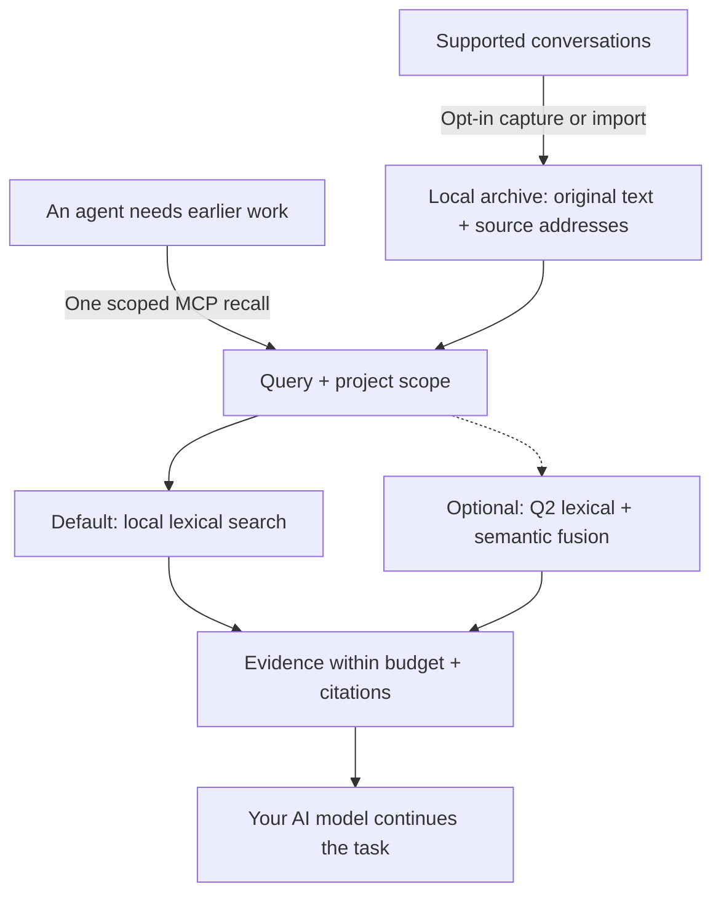

# AI-Memory-Book

**Give your AI agents a shared local memory, with original evidence they can cite.**

Projects become books, tasks become chapters, and earlier decisions stay available across sessions and clients. One MCP call returns relevant evidence within a context budget so the agent can continue your work.

[简体中文](README.zh-CN.md) · [Quick start](#quick-start) · [Measured results](#measured-results) · [Documentation](#documentation) · [v0.3.2 release](https://github.com/Afloat16/AI-Memory-Book/releases/tag/v0.3.2)

**v0.3.2 · Experimental · MIT · Python 3.10+ · Local SQLite**

## How it works



Capture updates the archive independently of retrieval. The agent can recall directly, then open an exact source page when it needs more detail; browsing the book hierarchy is optional. [Agent workflow](docs/agent-guide.md).

## Why use it?

- **Lightweight by default.** Memory writing and lexical retrieval use zero model calls. The core needs Python and SQLite, with no embedding download, database server, or memory-service API key.
- **Evidence you can inspect.** Preserve original text, project/session/turn references and exact source spans. Character limits are built in; optional named-tokenizer limits also count citations and separators.
- **One archive across clients.** MCP configuration profiles cover Claude Code/Desktop, Codex, Gemini, Cursor and more. Explicitly enabled background capture keeps supported transcripts current; the worker is headless by default.
- **Measured efficiency.** The current core returns identical evidence faster; optional indexed references reduce repeated source metadata. The results and their scope are below.

## Quick start

You need **Python 3.10+ with SQLite FTS5**. The installer downloads the release wheel into an isolated environment with MCP/client dependencies. No Git checkout or Node.js is needed.

**macOS / Linux**

```bash
curl -fsSLo install-memory-book.sh https://raw.githubusercontent.com/Afloat16/AI-Memory-Book/v0.3.2/scripts/install.sh
bash install-memory-book.sh
```

**Windows PowerShell**

```powershell
Invoke-WebRequest https://raw.githubusercontent.com/Afloat16/AI-Memory-Book/v0.3.2/scripts/install.py -OutFile install-memory-book.py
py -3 .\install-memory-book.py
```

**Connect your agent**

```bash
memory-book setup --client claude-code --capture --background
memory-book doctor
```

Use the launcher's full path printed by the installer if `memory-book` is not yet on your PATH. Restart the client, then ask: **“Recall our earlier decision about this task, cite the source, and continue.”**

Replace `claude-code` with your [client profile](docs/integrations.md#supported-profiles), or repeat `--client` to share the archive across clients. `--capture` opts in to existing and future supported text transcripts; omit it for MCP access alone. Native capture covers Claude Code, Codex, Gemini and legacy Python Kimi; other profiles use explicit imports or enabled MCP writing. Host permissions and model tool selection still apply.

**Upgrading?** Re-run the installer, then your `setup` command with the same clients and capture options so MCP and any background service use the new environment. Existing memory and the previous environment are retained. [Upgrade details](docs/deployment.md#upgrading).

## Measured results

**v0.3.2 passes its registered efficiency test against published v0.3.1 while preserving complete default retrieval output.** The separate frozen component comparison is also complete. Source identities, full measurements and unsuccessful experiments remain in the [benchmark index](benchmarks/README.md) and [round-four record](docs/optimization-round4.md).

### Efficiency highlights

| Verified improvement | Result | Measurement |
|---|---|---|
| **Identical non-timing output, less tail latency** | Pooled p95 geometric mean **−10.13%** across twelve settings | **56,784 calls**, two old corpora, native/actual SDK MCP, character/token budgets and four balanced rounds. [Formal review](docs/round4-performance-review.md) |
| **Faster public native token recall** | p95 **−19.07% / −18.41% / −18.20%** at 512 / 1,024 / 2,048 tokens | 1,015 public-conversation questions, `cl100k_base`, complete uncached recall; 4,060 calls per version/setting. [Saved measurements](benchmarks/reports/round4-performance-43361086255-1/report.summary.json) |
| **Faster actual MCP token recall** | p95 **4.358 → 3.887 ms (−10.80%)** at 1,024 tokens | Same public cohort, official SDK stdio call including normal server cache writes and roundtrip costs. [Report and boundaries](docs/round4-performance-review.md) |
| **Optional indexed references, historical measurement** | Response-text tokens **−19.63%**; first-call reference total **−8.15%** | Earlier 1,015-question measurement, 4,000 characters, compact responses, `o200k_base`; this option is unchanged and was not remeasured for v0.3.2. [Report](docs/indexed-references.md) |

All **28,392 paired observations** matched on complete non-timing output, and all twelve pooled p50 values improved. Public MCP at 4,000 characters has **1.44% higher p95**. The largest registered resource mean increase is **6.02%**, for public MCP token startup through initialization; every resource mean stays below the 10% review trigger. **All registered formal performance gates passed with no exception or waiver.** The [independent arithmetic audit](benchmarks/reports/round4-performance-independent-audit.json), [strict-ledger audit](benchmarks/reports/round4-performance-local-audit.json) and [full report](benchmarks/reports/round4-performance-43361086255-1/report.json.gz) retain every round, adverse result and resource cost.

The aggregate gain is **10.1294%**, only **0.1294 percentage points** above its registered 10% threshold. These repeated queries on one host establish a narrow observed pass, with no statistical-significance or universal-speedup claim. The paired test measures Book versions; it establishes no whole-product speed ratio against another repository.

Indexed references preserve context and reconstruct every source field. The first-call count includes schema, instructions and arguments; reference-token counts are not provider bills. Sparse references can cost more. The earlier format comparison measured **7.126 → 7.131 ms p95**, with no speedup claim.

**Historical v0.3.1 versus v0.3.0:** the separate 47,320-call run recorded **−11.36%** aggregate p95, **−26.05%** public native character p95 and **−19.87%** actual MCP character p95. Its synthetic token512 p95 increase of **0.125%** and public empty-database opening increase of **4.838 ms (+14.04%)**, explicitly accepted after review, remain unchanged in the [round-three report](docs/round3-performance-review.md). These earlier measurements are not v0.3.2 results.

### Current open-source component comparison

A frozen **256-question HotpotQA** selection excludes all **640 historical question IDs**, with zero overlap. Sources, evaluator, dependencies and models were bound before selection; the manifest was published before scoring. The completed comparison retains **9,216 measured calls: 4,608 native calls and 4,608 component searches**, across **635 required evidence annotations**. The table uses the same supplied pages, top five results and common whole-block packing at **1,024 `cl100k_base` tokens**. It measures source evidence; the [full report](benchmarks/results/round4-comparison-43363060062-1/report.md) retains every budget, native call, gain and loss.

| Measured component | Evidence recall | Complete evidence | Packed MRR | Mean context tokens | Search adapter p95 |
|---|---:|---:|---:|---:|---:|
| **Book v0.3.2 · default lexical** | 75.75% | 53.91% | 0.8578 | 714.8 | 3.488 ms |
| **Book v0.3.2 · optional Q2** | 76.69% | 55.08% | **0.8663** | 730.0 | 20.406 ms |
| claude-mem 15.18.1 · native FTS | 70.39% | 44.53% | 0.8280 | 709.4 | 34.655 ms |
| ai-memory v3.4.5 · local hybrid | 77.48% | 55.86% | 0.8400 | 709.9 | 39.925 ms |
| billion-context `9674cfa` · search kernel | **80.94%** | **60.55%** | 0.8606 | 757.4 | **1.449 ms** |

Book's default returns complete evidence **9.375 percentage points more often than claude-mem FTS** in this slice. Its measured search-adapter p95 is **89.94% lower than claude-mem's and 91.26% lower than ai-memory's**; Q2 also has lower p95 than both and the highest packed MRR among these five components. **ai-memory retains higher evidence recall and completeness than either Book mode; billion-context leads recall, completeness and search latency.** These are scoped component advantages, with no overall winner claimed.

Search p95 pools three searches per question and excludes offline common packing and additional page reads. The adapters use different Python recall/assembly, SQLite/Bun, HTTP/MCP and Node boundaries, so the timings do not establish whole-product speed ratios. ai-memory's first search plus all five source reads has p95 **45.897 ms**; read payloads, native positions and setup costs are recorded separately. Packed MRR measures evidence order after the common packer omits metadata or oversized blocks.

Q2 raises completeness by **1.171875 percentage points** at this budget: **26 questions gain complete evidence and 23 lose it**, a net gain of three. At the native API's 512-token budget, completeness falls from **39.45% to 36.33%** with `cl100k_base` (19 gains, 27 losses), and from **39.45% to 36.72%** with `o200k_base` (19 gains, 26 losses). Its component setup takes **277.60 seconds**, including **275.43 seconds** of index construction; sampled query process-tree peak RSS is **1,247.69 MiB**. Its 20.406 ms search p95 is also higher than default Book's 3.488 ms. Q2 stays opt-in. [Full gains, losses and costs](benchmarks/results/round4-comparison-43363060062-1/report.md)

**The fresh comparison also retains a regression against v0.3.1.** With the component ranker's 100,000-character ceiling, default Book's p95 rises **3.304 → 3.488 ms (+5.56%)**, and p50 rises **2.239 → 2.353 ms (+5.12%)**. Sampled setup process-tree peak RSS rises **548.65 → 943.53 MiB**; query-phase peak RSS falls **529.77 → 524.91 MiB**. These are sequential, unbalanced descriptive component observations, separate from the registered ABBA performance gate above. The RSS samples include evaluator/corpus memory and descendants, can count shared mappings twice, and do not establish the cause of the setup increase. [Detailed evidence and limitations](docs/optimization-round4.md)


The figure uses the same saved measurements as the tables. The completed assessment verifies **1,536 native and 768 component complete-output pairs** between Book versions. [Offline audit](benchmarks/reports/round4-comparison-independent-audit.json) · [Complete comparison and raw results](benchmarks/results/round4-comparison-43363060062-1/report.md) · [Archived v0.3.1 comparison and caveats](docs/round3-continuation.md#published-release-and-supplemental-audit).

All questions are answerable and come from the same public HotpotQA source; disjoint IDs do not establish new-domain generalization. These scored IDs are now regression data. This evaluates returned evidence, not answer generation, hallucinations or private-conversation transfer. No generative model is called by this comparison.

The [deployment and architecture comparison](docs/comparison.md#popular-projects-and-the-workload-they-address) also covers **Mem0, Graphiti, PageIndex and Letta**, clearly separated from executed benchmarks. ai-memory also supports a zero-LLM default; claude-mem supports local model providers.

## Documentation

| What you want to do | Guide |
|---|---|
| Connect another client or import conversations | [Client profiles and formats](docs/integrations.md) |
| Install, upgrade, run Docker or manage background capture | [Deployment](docs/deployment.md) |
| Learn when to recall, use citations and resolve missing evidence | [Agent guide](docs/agent-guide.md) |
| Enable exact token caps, Q2 semantics or indexed references | [Token budgets](docs/token-budget.md) · [Semantic retrieval](docs/semantic-retrieval.md) · [Indexed references](docs/indexed-references.md) |
| Inspect the archive in a browser | Run `memory-book serve`, then open [127.0.0.1:8765](http://127.0.0.1:8765) |
| Review full measurements or contribute | [Benchmarks](benchmarks/README.md) · [Validation](docs/validation.md) · [Contributing](CONTRIBUTING.md) · [Changelog](CHANGELOG.md) |

The optional Q2 runtime opts out of ONNX Runtime telemetry. The archive is local, unencrypted data. Evidence returned to an AI client enters that client's model context. The optional reader is for inspection; normal MCP and capture need no HTTP listener. [Data and configuration](docs/deployment.md#data-and-configuration-paths).

[CI](https://github.com/Afloat16/AI-Memory-Book/actions/workflows/ci.yml) covers Python 3.10/3.12/3.13, actual MCP stdio, the browser reader, Linux/macOS/Windows installers and container persistence. Client configuration fixtures do not certify interactive behavior in every vendor app. Independently implemented under the [MIT License](LICENSE).
