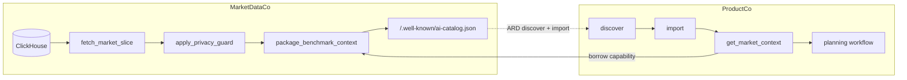

<div align="center">

# Agentic Resource Discovery, by Example

### Learn the ARD protocol through a runnable data-analytics scenario

[](https://agenticresourcediscovery.org/)
[](#what-youll-learn)
[](#quickstart)
[](LICENSE)

<p>
  <a href="#what-is-ard">What is ARD</a> •
  <a href="#what-youll-learn">What you'll learn</a> •
  <a href="#the-example">The example</a> •
  <a href="#quickstart">Quickstart</a> •
  <a href="#lessons">Lessons</a> •
  <a href="#continue-learning">Continue learning</a>
</p>

</div>

<p align="center">
  
</p>

## What is ARD

[**Agentic Resource Discovery (ARD)**](https://agenticresourcediscovery.org/) is a new open protocol for publishing, discovering, and verifying AI capabilities across the open web. It was [announced by Google](https://developers.googleblog.com/announcing-the-agentic-resource-discovery-specification/) together with Microsoft, Snowflake, and other partners, and the working group has shaped it as the discovery layer for AI resources: agents, skills, tools, APIs, and MCP servers, regardless of who runs them.

The spec is intentionally narrow. A provider publishes a machine-readable catalog at `/.well-known/ai-catalog.json`, describing what capabilities exist, how to identify them, and how a caller could reach them. Discovery says what exists. The provider's runtime still decides what may be called, by whom, under what policy, and with which audit trail.

This repository is a hands-on way to internalize that shape. It uses a small data-analytics scenario because data analytics is where the difference between "share access to the system" and "share a bounded answer" matters most.

## What you'll learn

This tutorial is aimed at developers and architects putting agentic systems behind, between, or across real organizational boundaries. It is the place to come if you want hands-on familiarity with the protocol and runtime concepts an enterprise capability network actually depends on:

- **Cross-org agent identity** — how a provider and a consumer identify each other without sharing an identity provider, using DIDs and verifiable credentials carried alongside the call.
- **Policy and access management at the boundary** — how the provider's runtime authorizes a specific external caller for a specific capability under its own policy, independent of who originally issued the consumer's tokens.
- **Discovery vs execution as separate decisions** — why ARD discovery does not imply runtime callability, and what opt-in steps a consumer's control plane has to walk through before a workflow may invoke an external capability.
- **The shape of an ARD catalog** — the intent of `/.well-known/ai-catalog.json`, how a provider describes a capability without exposing its system, and how a consumer searches and imports entries.
- **Capability borrowing inside a multi-agent workflow** — how the imported capability shows up at a normal call site inside a longer planning workflow, and how its result is composed by downstream reasoners on the consumer side.
- **Auditable data and execution boundaries** — what stays on the provider side (rows, credentials, reasoners, policy) versus what crosses (a structured answer plus signed provenance), surfaced as a `data_boundary` field on every consumer response.

The mental model the example is built around is this:

> Expose answers, not databases.

ARD is the part that makes the capability findable. The runtime is the part that makes it safe for an enterprise to use.

## The example

A market data provider, **MarketDataCo**, owns a ClickHouse-backed benchmark dataset. Another company, **ProductCo**, is planning a product launch and needs the benchmark figures, but should never see ClickHouse credentials, raw rows, or MarketDataCo's internal logic. The closest thing to this today is data exports, secure views, or bespoke integrations. ARD reframes the problem.

MarketDataCo publishes a single capability:

```text
market-data.pricing_benchmark
```

It accepts a segment, region, and quarter, and returns an aggregated context object that downstream agents can compose with. Behind that single capability, MarketDataCo runs a provider-owned workflow over ClickHouse:

```text
fetch_market_slice → interpret_market_position → apply_privacy_guard → package_benchmark_context
```

ProductCo discovers the capability through ARD, imports it, marks it callable inside its own control plane, and uses it from inside a launch-planning workflow:

```text
get_market_context → pricing_strategy
                  → launch_motion
                  → risk_review
                  → final_recommendation
```

The result that comes back to ProductCo is an aggregated answer plus enough structure for the planning workflow to act on it. MarketDataCo never ships the database, the credentials, or the implementation. ProductCo never has to ingest, store, or govern data it does not own. That's the business value the protocol is trying to make routine: a capability surface between organizations that does not require either side to give up ownership of their system.

ClickHouse stands in for the larger pattern. The same shape applies to Snowflake, Databricks, BigQuery, ClickHouse Cloud, or an internal analytics platform that wants to expose governed answers to external agents.



## Quickstart

You need Docker Compose, `curl`, `jq`, and open local ports `8081`, `8082`, `8001`, `8002`, and `8123`.

```bash
cp .env.example .env
make smoke
```

That single command starts two local control planes and a ClickHouse instance, registers both agents, publishes the provider capability through ARD, then runs the consumer through search, import, binding, and a planning workflow.

When the smoke run completes, the two control plane UIs are at:

```text
MarketDataCo   http://localhost:8081/ui/
ProductCo      http://localhost:8082/ui/
```

You can also touch the protocol surfaces directly. Inspect the catalog the provider publishes:

```bash
curl -sS http://localhost:8081/.well-known/ai-catalog.json | jq .
```

Then watch the consumer compose it into a real workflow:

```bash
curl -sS -X POST http://localhost:8082/api/v1/execute/product-planning.plan_launch \
  -H "Content-Type: application/json" \
  --data '{"input":{"product":"Workflow Intelligence Suite","segment":"smb","region":"na","quarter":"2026-Q2"}}' | jq .
```

The fields worth looking at in the consumer response are `borrowed_capability`, `market_context`, `data_boundary`, and `call_graph`. They describe which external capability was used, what came back, what stayed on the provider side, and how the local workflow consumed the answer.

## Lessons

The repository is organized so that the run gives you the moving parts, and the lessons explain why those parts exist. Once `make smoke` is green, read [`docs/lessons.md`](docs/lessons.md). It walks through the protocol in seven short lessons:

1. Discovery is not runtime.
2. Opt-in has layers.
3. The provider keeps the system.
4. Both sides can be multi-agent.
5. This is bigger than data connectors.
6. What to inspect after the run.
7. Where to go next.

If you only have time for one, Lesson 1 is the one that changes how you read every ARD document afterwards.

## Code map

A short tour of what is where, so you can read the example like a tutorial rather than spelunking through services.

`docker-compose.yml` brings up the two control planes, ClickHouse, and both agent services. `market-data-co/main.py` is the provider — the multi-step workflow over ClickHouse, the privacy guard, and the registered capability. `product-co/main.py` is the consumer — the wrapper around the borrowed capability, the boundary metadata it captures, and the downstream planning workflow. `scripts/seed_ard.sh` is the lifecycle script: publish → catalog → search → import → bind. `sample_payloads/plan_launch.json` is the default planning input you can edit between runs.

## Continue learning

Start with the protocol, then read enough of the runtime to understand how a discovered capability becomes safe to call.

**The protocol**
- [Agentic Resource Discovery specification](https://agenticresourcediscovery.org/)
- [How to publish an ARD catalog](https://agenticresourcediscovery.org/how_to_publish/)
- [Google announcement](https://developers.googleblog.com/announcing-the-agentic-resource-discovery-specification/) — context for why the spec exists
- [Snowflake's framing](https://www.snowflake.com/en/blog/agentic-resource-discovery-specification/) — capability discovery for enterprise data

**Runtime concepts the tutorial demonstrates**
- [External agent discovery](https://agentfield.ai/docs/quick-guides/external-agent-discovery) — publishing and importing ARD capabilities at the control-plane level
- [Service discovery](https://agentfield.ai/docs/build/coordination/discovery) — runtime discovery of agents, reasoners, and skills
- [Cross-agent calls](https://agentfield.ai/docs/build/coordination/cross-agent-calls) — the call site where a borrowed capability shows up in a workflow
- [Decentralized identity](https://agentfield.ai/docs/build/governance/identity) — how callers and capabilities identify each other across organizational boundaries

The useful sequence is protocol first, runtime second: ARD tells consumers what exists; the runtime decides what can be imported, called, traced, and governed.

---

## The big picture

If you want the less technical overview of why this matters — written for product, platform, and data leaders rather than tutorial readers — start with this essay:

### [Capabilities You Do Not Own](https://www.agentfield.ai/blog/capabilities-you-do-not-own?utm_source=github-readme&utm_campaign=ard-lab-readme&utm_id=ard-lab-readme-blog-capabilities-you-do-not-own)

Twenty years of integration have run on copying data across a boundary. Agents make that trade worse. Agentic Resource Discovery is the visible half of the response, and the runtime layer that has to sit beneath it is the harder half — with data platforms the most natural place to see it land first.

<p align="center">
  <a href="https://www.agentfield.ai/blog/capabilities-you-do-not-own?utm_source=github-readme&utm_campaign=ard-lab-readme&utm_id=ard-lab-readme-blog-capabilities-you-do-not-own">
    
  </a>
</p>

[Read the post →](https://www.agentfield.ai/blog/capabilities-you-do-not-own?utm_source=github-readme&utm_campaign=ard-lab-readme&utm_id=ard-lab-readme-blog-capabilities-you-do-not-own)

---

<sub>This repository is a learning setup. It is not a production authentication, security, or deployment template — use the linked docs for that.</sub>
