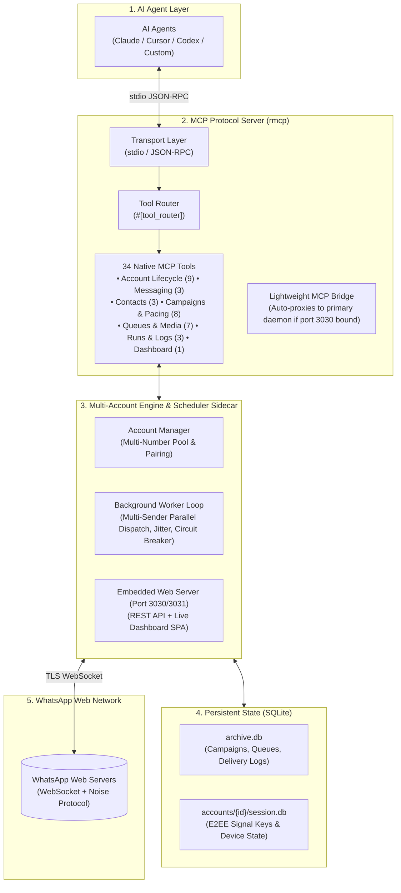

<p align="center">
  
</p>

<h1 align="center">Wasche</h1>

<p align="center">
  <strong>Native WhatsApp Model Context Protocol (MCP) Server, Background Scheduler Sidecar & Multi-Account Engine</strong>
</p>

<p align="center">
  <a href="LICENSE"></a>
  <a href="https://github.com/modelcontextprotocol/rust-sdk"></a>
  <a href="https://www.rust-lang.org"></a>
  <a href="https://solidjs.com"></a>
  <a href="https://m8ven.ai/mcp/akin01-wasche-14ow30?s=readme"></a>
</p>

---

## Overview

**Wasche** is a native Rust-powered **Model Context Protocol (MCP)** server and persistent background scheduler sidecar for WhatsApp. It enables AI agents (Claude, Cursor, Codex, Gemini, etc.) to safely orchestrate multiple WhatsApp phone numbers, query contacts, dispatch interactive media, and execute high-durability broadcast campaigns protected by human behavioral emulation heuristics.

### Key Capabilities

- **34 Native MCP Tools Across 7 Domains**: Full programmatic control over multi-account lifecycles, 1:1 direct messaging, uncompressed document/media attachments, address book contact sync, anti-ban campaign automation, recipient queue manipulation, multi-sender account pooling, and historical run auditing.
- **Primary Daemon & Lightweight MCP Bridge Architecture**: Zero port or database lock collisions across multiple agent sessions or subagents. The first process initializes the primary daemon; concurrent sessions automatically detect the daemon and bridge commands via HTTP REST.
- **Multi-Sender Account Pooling & Load Balancing**: Pool multiple WhatsApp numbers into a single campaign (`account_id: "Grlossy, sales"` or `"all"`) with parallel workers and strict per-account typing mutual exclusion.
- **Anti-Ban Heuristics**: Proportional typing presence (`Chatstate::Composing`), configurable randomized inter-recipient jitter (e.g. 5–15s or 20–45s), single-flight transaction locks, pre-persisted idempotency stanza IDs, and 3-strike circuit breakers with operator-action auto-quarantine reset.
- **Embedded Web Dashboard (SPA)**: Modern client-side SPA (SolidJS v2 + Vite 8) embedded directly into the binary via `rust-embed` (`http://127.0.0.1:3030`), featuring live delivery log streams, automatic run focus on re-run, instant campaign search, inline jitter editor, and multi-account selection popover.
- **SQLite Durability**: Complete local storage for Noise E2EE session keys, campaign queues, contacts, and delivery audit logs with automatic WAL checkpointing.
---

## Architecture



---

## Quick Start

### 1. Using `npx` (No Manual Installation)

Run the server directly through npx:

```bash
npx @akin01/wasche
```

### 2. Configure with MCP Clients

Add Wasche to your MCP client configuration (`claude_desktop_config.json`, Cursor, or `.mcp.json`):

```json
{
  "mcpServers": {
    "wasche": {
      "command": "npx",
      "args": ["-y", "@akin01/wasche"],
      "env": {
        "RUST_LOG": "info"
      }
    }
  }
}
```

### 3. Build from Source

Requirements: **Rust 1.88+ (2024 edition)**, **Node.js 20+**, and **pnpm 9+**.

```bash
# 1. Clone repository
git clone https://github.com/Akin01/wasche.git
cd wasche

# 2. Build web dashboard frontend
cd dashboard
pnpm install
pnpm build
cd ..

# 3. Compile release binary
cargo build --release

# 4. Run Wasche daemon
./target/release/wasche
```

The web dashboard will be available at **`http://127.0.0.1:3030`**.

---

## MCP Tools Catalog (34 Tools)

Wasche provides an official [Model Context Protocol (MCP)](https://modelcontextprotocol.io) interface containing **34 declarative tools** across 7 functional categories:

### 1. Account & Connection Lifecycle (9 Tools)
| Tool Name | Parameters | Description |
| :--- | :--- | :--- |
| `whatsapp_list_accounts` | _none_ | Lists all registered accounts, connection states (`Connected`, `Connecting`, `Disconnected`), phone numbers, and active indicator. |
| `whatsapp_add_account` | `account_id` | Registers a new account identifier and begins pairing. |
| `whatsapp_set_active_account` | `account_id` | Switches the default active account for subsequent operations. |
| `whatsapp_remove_account` | `account_id` | Shuts down account engine, drops connection, and removes local workspace. |
| `whatsapp_rename_account` | `old_id`, `new_id` | Renames an account identifier across databases, directories, and campaigns. |
| `whatsapp_get_status` | `account_id?` | Checks WhatsApp connection status, paired phone number, and push name. |
| `whatsapp_get_qr_code` | `account_id?` | Generates WhatsApp pairing QR code (raw string, terminal ASCII, deep link, local HTML file). |
| `whatsapp_pair_with_phone` | `phone_number`, `account_id?` | Requests an 8-character pairing code to link phone without scanning QR. |
| `whatsapp_reset_account_pairing` | `account_id` | Clears local pairing session and keys for an account, preparing it for re-pairing. |

### 2. Direct Messaging & Media (3 Tools)
| Tool Name | Parameters | Description |
| :--- | :--- | :--- |
| `whatsapp_send_direct` | `recipient`, `message?`, `attachment_path?`, `send_as?`, `account_id?` | Sends an immediate 1:1 message, inline media, or document attachment to a phone number or WhatsApp JID. |
| `whatsapp_send_media` | `recipient`, `file_path`, `caption?`, `account_id?` | Sends an inline photo, video, or audio file (compressed by WhatsApp, max 16MB) with optional caption. |
| `whatsapp_send_document` | `recipient`, `file_path`, `caption?`, `file_name?`, `account_id?` | Sends an uncompressed document or raw file (PDF, spreadsheet, raw 4K video/photo up to 100MB) with optional caption. |

### 3. Contacts & Address Book (3 Tools)
| Tool Name | Parameters | Description |
| :--- | :--- | :--- |
| `whatsapp_list_contacts` | `query?`, `limit?`, `account_id?` | Searches and lists contacts in the WhatsApp archive by name or phone number. |
| `whatsapp_sync_contacts` | `account_id?` | Triggers a Peer AppState contact synchronization (`CriticalUnblockLow`) to fetch address book names from WhatsApp. |
| `whatsapp_get_contact_avatar` | `jid`, `account_id?` | Fetches the high-resolution profile avatar picture URL for a contact JID. |

### 4. Broadcast Campaigns & Anti-Ban Pacing (8 Tools)
| Tool Name | Parameters | Description |
| :--- | :--- | :--- |
| `whatsapp_schedule_broadcast` | `name`, `template`, `recipients`, `attachment_path?`, `send_as?`, `account_id?`, `account_ids?`, `scheduled_at?`, `min_delay_secs?`, `max_delay_secs?` | Schedules or immediately launches a broadcast campaign with human-like anti-ban pacing and multi-sender pooling. |
| `whatsapp_list_broadcasts` | `status?`, `account_id?` | Lists broadcast campaigns filtered by status (`draft`, `running`, `paused`, `completed`, `aborted`) or sender account. |
| `whatsapp_get_broadcast_status` | `campaign_id` | Queries live progress, delivery metrics, recent recipients, and recent logs for a campaign. |
| `whatsapp_control_broadcast` | `campaign_id`, `action` | Controls an active campaign (`pause`, `resume`, `abort`, `delete`, `rerun`, `retry_failed`). |
| `whatsapp_delete_broadcast` | `campaign_id` | Permanently deletes a broadcast campaign and its associated recipient queue from SQLite. |
| `whatsapp_rename_campaign` | `campaign_id`, `name` | Renames an existing broadcast campaign. |
| `whatsapp_update_campaign_template` | `campaign_id`, `template` | Updates the message template body of an existing campaign (supports `{{name}}`, `{{phone}}`, `{{key}}`). |
| `whatsapp_update_campaign_delay_range` | `campaign_id`, `min_delay_secs`, `max_delay_secs` | Updates the anti-ban delay jitter range (minimum and maximum random delay between messages in seconds). |

### 5. Campaign Queue, Attachments & Multi-Sender Pooling (7 Tools)
| Tool Name | Parameters | Description |
| :--- | :--- | :--- |
| `whatsapp_list_campaign_recipients` | `campaign_id`, `query?`, `status?`, `limit?`, `offset?` | Lists target recipient contacts of a campaign with optional search by name/number and status filter (`queued`, `sent`, `failed`, `aborted`). |
| `whatsapp_add_campaign_recipients` | `campaign_id`, `recipients` | Adds target recipient contacts with optional custom variable fields to an existing campaign. |
| `whatsapp_delete_campaign_recipients` | `campaign_id`, `recipient_ids` | Removes target recipient contacts from an existing broadcast campaign queue. |
| `whatsapp_resend_recipient` | `campaign_id`, `recipient_id` | Requeues an individual recipient that previously failed or was aborted. |
| `whatsapp_attach_campaign_media` | `campaign_id`, `file_path`, `send_as?` | Attaches a photo, video, or document to an existing campaign. |
| `whatsapp_remove_campaign_attachments` | `campaign_id`, `file_name?` | Removes specific or all attachments from an existing campaign. |
| `whatsapp_set_campaign_attachment_mode` | `campaign_id`, `file_name`, `send_as` | Toggles delivery mode (`media` for inline playable vs `document` for raw uncompressed file up to 100MB). |
| `whatsapp_add_campaign_sender` | `campaign_id`, `account_id` | Adds a sender WhatsApp account to an existing campaign for multi-account pooling and load balancing. |
| `whatsapp_remove_campaign_sender` | `campaign_id`, `account_id` | Removes a sender WhatsApp account from an existing campaign (enforces at least 1 remaining sender). |

### 6. Execution Runs & Delivery Logs (3 Tools)
| Tool Name | Parameters | Description |
| :--- | :--- | :--- |
| `whatsapp_list_campaign_runs` | `campaign_id`, `limit?` | Lists all execution runs for a campaign (Run #1, Run #2, etc.) with sent/failed counts, status, and duration. |
| `whatsapp_get_campaign_logs` | `campaign_id`, `query?`, `status?`, `limit?` | Retrieves recent delivery logs across all execution runs of a campaign with search and status filtering. |
| `whatsapp_get_run_logs` | `campaign_id`, `run_id?`, `query?`, `status?`, `limit?` | Retrieves detailed delivery logs for a specific run (or latest run) with search and status filter (`sent`, `failed`, `retrying`). |

### 7. Dashboard & Monitoring (1 Tool)
| Tool Name | Parameters | Description |
| :--- | :--- | :--- |
| `whatsapp_open_dashboard` | _none_ | Opens the live web dashboard in the default browser (`http://127.0.0.1:3030`). |
---

## Anti-Abuse Threat Model & Pacing Mechanics

Wasche incorporates multi-layer safeguards against automated rate-limiting:

| Anti-Abuse Layer | Detection Vector | Mitigation Mechanism | Implementation Formula |
| :--- | :--- | :--- | :--- |
| **Typing Presence** | Instantaneous stanzas | Proportional Typing Delays | `t_typing = clamp(len(msg) * U(30..50ms), 1.5s, 8.0s)` |
| **Chatstate Emulation** | Zero-presence outbound | `Chatstate::Composing` Stanzas | Sends explicit typing stanzas followed by paused state. |
| **Inter-Message Pacing**| Rigid periodic intervals | Bounded Jitter Delay Window | Uniform random cooldown: `t_wait ~ U(min_delay, max_delay)` (25s–90s default). |
| **Queue Concurrency** | Socket collision | Strict Single-Flight Queue | Mutex-guarded atomic SQLite checkout per sending SIM card. |
| **Content Variance** | Static content hashes | Template Token Interpolation | Dynamic substitution of `{{name}}`, `{{phone}}`, and custom variables. |
| **Circuit Breakers** | Consecutive dispatches | 3-Strike Exponential Backoff | Quarantines accounts after consecutive protocol errors to protect reputation. |

---

## Data Storage Locations

Wasche stores persistent data in the platform user application data directory:

- **Windows**: `C:\Users\<User>\AppData\Roaming\wasche\wasche\data\`
- **Linux**: `~/.local/share/wasche/`
- **macOS**: `~/Library/Application Support/com.wasche.wasche/`

Override via environment variable:
```bash
export WASCHE_DATA_DIR="/custom/path/to/data"
```

---

## Technical Documentation

Detailed architectural deep dives and durability models are available in [`docs/`](docs/):

- [Architecture Specification](docs/whatsapp-mcp-scheduler-architecture.md)
- [Broadcast Durability & Anti-Abuse Realities](docs/broadcast-durability-and-anti-abuse.md)
- [WhatsApp Media & Multi-Attachment Protocol Realities](docs/whatsapp-media-multi-attachment-realities.md)

---

## License

Licensed under the **Apache License, Version 2.0**. See [LICENSE](LICENSE) for details.
