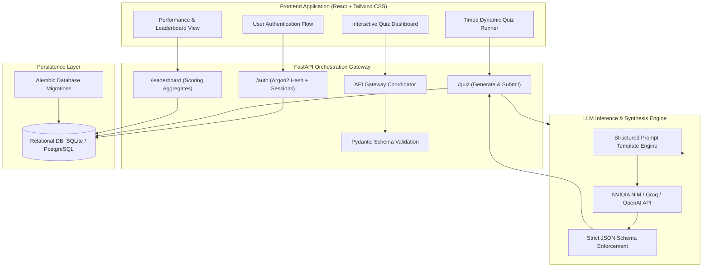

<div align="center">

# QuizGenAI

### AI-Powered Dynamic Assessment & Quiz Generation Engine with Contract-First API Orchestration

[](docs/)
[](https://fastapi.tiangolo.com/)
[](https://react.dev/)
[](https://www.sqlalchemy.org/)
[](https://docs.pydantic.dev/)
[](https://tailwindcss.com/)
[](LICENSE)

**An enterprise-grade assessment platform featuring contract-first API boundaries, structured LLM generation, dynamic quiz progression, and automated scoring heuristics.**

[Architecture](#system-architecture) • [API Endpoints](#core-api-specification) • [Features](#key-capabilities) • [Local Setup](#getting-started) • [Team Attribution](#authors--collaborators)

</div>

---

<div align="center">
  
</div>

---

## 1. Project Overview & Hackathon Recognition

**QuizGenAI** was built during a competitive Hackathon where it secured **🥈 2nd Prize**. The project addresses the limitations of static question banks by generating high-fidelity, adaptive quizzes from open-ended prompts, topic constraints, and uploaded document materials.

The system was architected under strict **API-contract-first** design principles: clear service boundaries decouple the user interface, relational persistence layer, and external LLM inference pipelines, enabling rapid parallel development and resilient error handling.

---

## 2. System Architecture



---

## 3. Key Capabilities

- **Topic & Document-Driven Quiz Synthesis:** Generate multi-question assessments from subject keywords or ingested document text with customizable difficulty curves.
- **Contract-First JSON Schema Output:** LLM responses are strictly validated through Pydantic contracts to guarantee reproducible schemas (questions, options, correct indices, detailed explanations).
- **Secure Authentication & Identity:** Argon2 password hashing, secure session management, and persistent user profile tracking.
- **Interactive Quiz Runner:** Client-side timed progression, countdown timers, instant answer evaluation, and streak indicators.
- **Historical Performance & Leaderboards:** Comprehensive database persistence of user attempts, time-taken metrics, and global leaderboard rankings.

---

## 4. Core API Specification

| Endpoint | Method | Responsibility | Contract / Schema |
| :--- | :---: | :--- | :--- |
| `/health` | `GET` | Service readiness and database connectivity check | Returns `{"status": "ok"}` |
| `/auth/register` | `POST` | Register user with Argon2 password hashing | User model with unique email validation |
| `/auth/login` | `POST` | Authenticate user and initialize session | Session token verification |
| `/quiz/generate` | `POST` | Generate dynamic quiz questions via structured LLM prompt | Topic/document body; returns validated questions |
| `/quiz/submit` | `POST` | Submit completed quiz responses for server-side evaluation | Calculates marks, time-taken, and records attempt |
| `/leaderboard` | `GET` | Retrieve global ranking and score percentiles | Ranked array of top users and score metrics |

*Interactive Swagger / OpenAPI documentation is hosted at: `http://localhost:8000/docs`*

---

## 5. Technology Stack

- **Backend Framework:** Python 3.10+, FastAPI, Uvicorn
- **Validation & Models:** Pydantic v2, Contract-First Schemas
- **Database & ORM:** PostgreSQL / SQLite, SQLAlchemy, Alembic Migrations
- **AI & LLM Services:** Structured Output Generation, NVIDIA NIM / Groq / OpenAI LLM APIs
- **Frontend Framework:** React 18, Vite, JavaScript (ES6+), Tailwind CSS, Lucide Icons
- **Security:** Argon2 password hashing, CORS middleware, typed payload boundaries

---

## 6. Getting Started

### Prerequisites
- Python 3.10+
- Node.js 18+ and npm
- (Optional) PostgreSQL database or default local SQLite

### 1. Backend Setup
```bash
cd backend
python -m venv .venv

# On Linux / macOS:
source .venv/bin/activate
# On Windows:
.venv\Scripts\activate

pip install -r requirements.txt
uvicorn app.main:app --reload --port 8000
```
Interactive API documentation will be accessible at: `http://localhost:8000/docs`.

### 2. Frontend Setup
```bash
cd ../frontend
npm install
npm run dev
```
Navigate to `http://localhost:5173/` in your browser.

---

## 7. Authors & Collaborators

- **Jayaditya Dev** — Backend Architecture, Database Schemas & System Orchestration
- **Jaggu** — LLM Service Pipeline & Prompt Engineering
- **Arun Chavan & Aniket Yadav** — Frontend Engineering, UI Architecture & State Management
