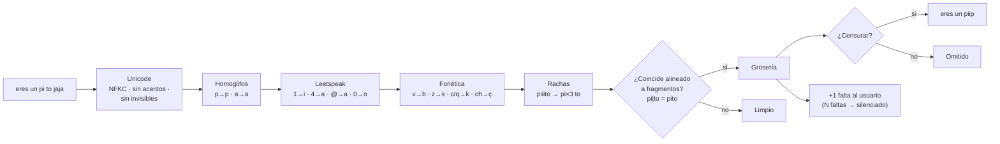
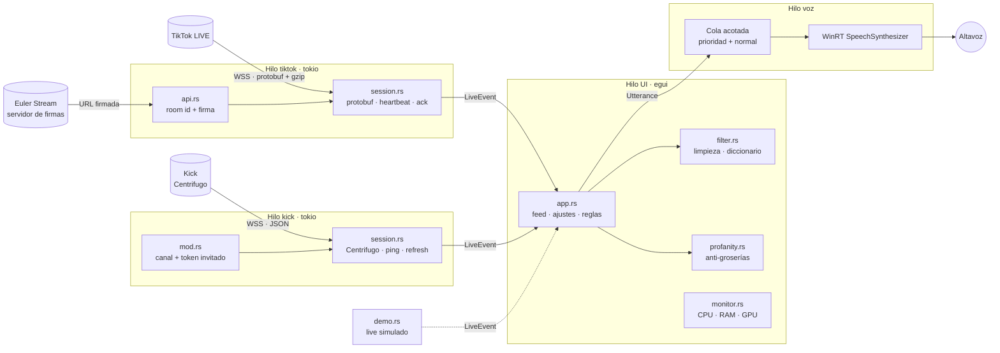
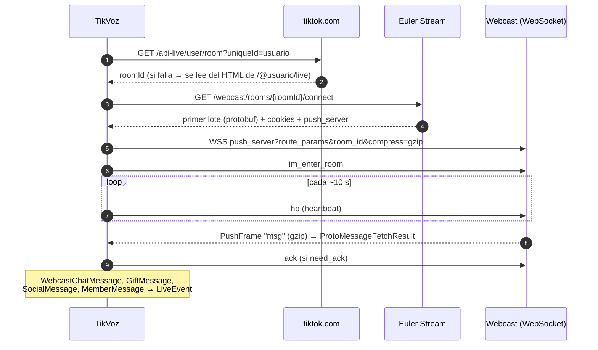
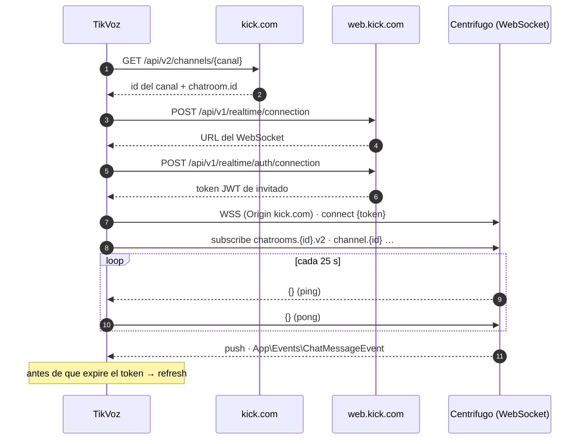
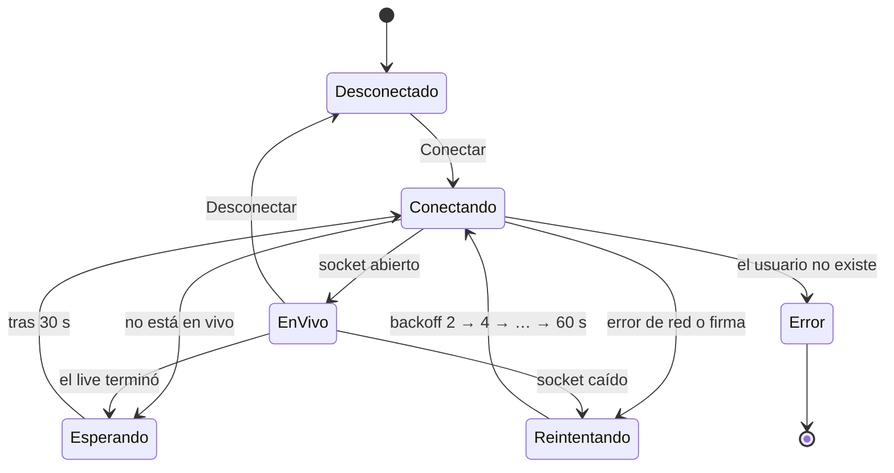
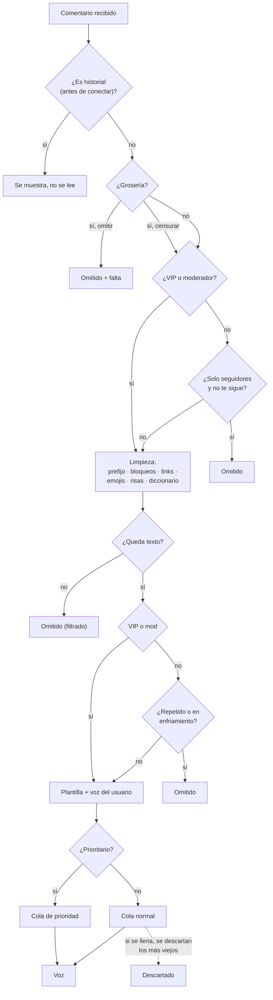

<div align="center">

# TikVoz

**Lee en voz alta el chat de tu live de TikTok y Kick, al mismo tiempo. Gratis, local y casi sin retraso.**

Un solo `.exe` de ~7 MB · Interfaz nativa (sin Electron ni navegador) · Voces de Windows offline


<picture>
  <source media="(prefers-color-scheme: dark)" srcset="docs/captura-oscuro.png">
  
</picture>

<sub>Captura en modo demo con TikTok y Kick a la vez. Los usuarios son ficticios y los mensajes con groserías ofuscadas salen censurados. GitHub muestra la versión clara u oscura según tu tema.</sub>

</div>

---

## Índice

- [¿Por qué TikVoz?](#por-qué-tikvoz)
- [Instalación](#instalación)
- [Uso rápido](#uso-rápido)
- [Funciones](#funciones)
- [Anti-groserías avanzado](#anti-groserías-avanzado)
- [Cómo funciona por dentro](#cómo-funciona-por-dentro)
- [Configuración completa](#configuración-completa)
- [Rendimiento](#rendimiento)
- [Compilar desde el código](#compilar-desde-el-código)
- [Preguntas frecuentes](#preguntas-frecuentes)
- [Hoja de ruta](#hoja-de-ruta)
- [Contribuir](#contribuir)

## ¿Por qué TikVoz?

La mayoría de los lectores de chat para lives son webs, apps Electron de cientos de MB o servicios de suscripción que cobran justo por las funciones útiles. TikVoz las incluye todas, gratis y en un binario nativo:

| | TikVoz | Lectores típicos |
|---|:---:|:---:|
| Precio | **Gratis** | Freemium o suscripción |
| Voz | Local, offline, sin límite | Muchas veces en la nube y con cuota |
| Latencia de la voz | **~140 ms** | 0,5–2 s (ida y vuelta a la nube) |
| RAM | **~85–105 MB** | 250–600 MB (Electron o navegador) |
| TikTok y Kick en la misma cola de voz | Sí | Una plataforma por app |
| Filtro de groserías que resiste `p1to`, `pi to`, `4buso` | Sí | Lista simple de palabras |
| Voz por usuario, VIP, prioridad, diccionario | Sí | Normalmente de pago |
| Código abierto | Sí | No |

## Instalación

Descarga la última versión desde [**Releases**](../../releases/latest). Cada versión trae:

| Archivo | Qué es |
|---|---|
| `tikvoz-vX.Y.Z-windows-x64.exe` | El programa listo para usar. Solo descárgalo y ábrelo. |
| `tikvoz-vX.Y.Z-windows-x64.zip` | El mismo `.exe` con README, licencia y CHANGELOG. |
| `SHA256SUMS.txt` | Sumas de verificación para comprobar que el archivo no fue alterado. |

No necesita instalador, runtimes ni permisos de administrador. Los cambios de cada versión están en el [CHANGELOG](CHANGELOG.md).

<details>
<summary>Verificar la descarga (opcional)</summary>

```powershell
# Compara el resultado con la línea correspondiente de SHA256SUMS.txt
Get-FileHash .\tikvoz-v1.0.0-windows-x64.exe -Algorithm SHA256
```

Cada build lo compila GitHub Actions a partir del código de este repositorio y lleva una **atestación de procedencia** firmada. Con la [CLI de GitHub](https://cli.github.com/) puedes comprobar que el `.exe` salió exactamente de este repo:

```bash
gh attestation verify tikvoz-v1.0.0-windows-x64.exe --repo <dueño>/<repo>
```

</details>

> [!NOTE]
> Al ser un ejecutable nuevo y sin firma digital, Windows SmartScreen o Defender pueden avisar la primera vez. El código está aquí completo; si prefieres, [compílalo tú mismo](#compilar-desde-el-código).

## Uso rápido

1. Escribe tu `@usuario` de **TikTok** y/o tu canal de **Kick** y pulsa **▶ Conectar** en cada uno. Puedes usar los dos a la vez: los mensajes entran a una sola cola y en el feed se distinguen por color.
2. Elige la voz, la velocidad y el volumen. Pulsa **Probar** para escucharla.
3. ¿No estás en vivo? Pulsa **Demo** para simular un live (TikTok + Kick) y ajustar todo con calma.

Accesos directos útiles:

```bash
tikvoz.exe miusuario                   # conecta directo a tu live de TikTok
tikvoz.exe miusuario --kick micanal    # TikTok y Kick a la vez
tikvoz.exe --demo                      # abre el live simulado
tikvoz.exe --config D:\TikVoz          # modo portable: guarda los ajustes en esa carpeta
```

## Funciones

### Qué se lee

- **TikTok:** comentarios, regalos, nuevos seguidores, compartidos y bienvenidas.
- **Kick:** comentarios (los emotes `[emote:…]` se quitan antes de leer), suscripciones, suscripciones regaladas y Kicks.
- **Todo lo anterior** Cada tipo se activa por separado y tiene su propia **plantilla** (`{usuario} dice: {mensaje}`, `{usuario} envió {cantidad} {regalo}`…).
- **Regalos en combo:** se leen una sola vez al final de la racha ("Ana envió 15 Rosa"), no "rosa x1, x2, x3…".
- **Mínimo de diamantes:** ignora los regalos baratos si quieres.
- **Bienvenidas inteligentes:** solo se leen cuando la cola está vacía, para no tapar los comentarios.

### Audiencia y prioridad

- **Voz distinta por usuario:** cada `@usuario` suena siempre con la misma voz, para que se distinga quién habla.
- **Usuarios VIP:** siempre se leen, se saltan los límites y se adelantan en la cola. Se agregan con un clic desde el feed.
- **Moderadores con prioridad**, marcados en el feed.
- **Solo seguidores** (TikTok): lee únicamente a quienes te siguen.
- **Enfriamiento por usuario:** evita que una sola persona acapare la voz.
- **Regalos y seguidores se adelantan** a los comentarios normales.

### Filtros y limpieza

- Quita emojis y símbolos que la voz deletrearía.
- Reemplaza los links por "enlace".
- Acorta `jajajajajaja` a `jajaja` y `holaaaaa` a `holaaa`.
- Corta los mensajes largos sin partir palabras.
- **Anti-spam:** no repite el mismo mensaje del mismo usuario dentro de una ventana configurable.
- **Usuarios silenciados** con un clic desde el feed.
- **Modo prefijo:** solo lee los comentarios que empiezan con, por ejemplo, `!v`.
- **Diccionario de pronunciación** editable: `xd → equis de`, `tqm → te quiero mucho`, `pq → porque`…

### Control y aplicación

- Pausar, saltar, vaciar la cola y volver a leer cualquier mensaje del feed.
- **Cola con tope:** si el chat va más rápido que la voz, se descartan los mensajes *más viejos*, así nunca vas minutos atrasado.
- **Tema claro, oscuro o del sistema.**
- **Monitor de consumo** de CPU, RAM, GPU y VRAM del propio programa, en la esquina inferior izquierda.
- **Reconexión automática** con backoff exponencial y espera si el live termina.
- Los ajustes se guardan solos en `%APPDATA%\TikVoz`.

## Anti-groserías avanzado

Las listas de palabras prohibidas típicas se saltan con trucos triviales. TikVoz normaliza cada mensaje antes de compararlo, igual en **TikTok y Kick**:

| La gente escribe | Truco | TikVoz lo detecta |
|---|---|:---:|
| `pi to`, `p.i.t.o`, `p-u-t-o`, `a.buso` | separadores | Sí |
| `p1to`, `4buso`, `P!T0`, `v3rg4`, `@bus0` | leetspeak | Sí |
| `piiiiito`, `PUTOOOO` | letras repetidas | Sí |
| `𝓹𝓲𝓽𝓸`, `ｐｉｔｏ`, `ⓟⓘⓣⓞ` | letras "fancy" | Sí |
| `рito` (con **р** cirílica) | homoglifos | Sí |
| `pu​to` (con espacio invisible) | caracteres de ancho cero | Sí |
| `p*ta` | comodín | Sí |
| `berga`, `kabron`, `xingada` | escritura fonética | Sí |
| `pútö` | acentos | Sí |
| `ᴘɪᴛᴏ`, `🇵🇮🇹🇴`, `🅿🅸🆃🅾` | versalitas, letras de bandera y en recuadro | Sí |
| `‮otip` (con `U+202E`), `oʇᴉd` | texto que se **muestra** al revés o de cabeza | Sí |
| `puㅤto` (relleno Hangul) | rellenos invisibles | Sí |
| `ptm`, `ctm`, `alv`, `mrd` | abreviaturas sin vocales | Sí |
| `hijo de puta`, `te voy a matar` | frases | Sí |

Y **no** se equivoca con palabras normales: `computo`, `disputa`, `repito`, `papi tomo`, `pitón`, `pera`, `nacional`, `rapero`, `la vergüenza`, `Álvaro`, `carbón`… pasan limpias. Hay decenas de casos de cada tipo cubiertos por tests.

#### En qué se basa

| Técnica | Inspirada en |
|---|---|
| Confusables y homoglifos | [Unicode UTS #39](https://unicode.org/reports/tr39/): datos de *confusables* y algoritmo *skeleton* |
| Ignorar controles bidireccionales | Ataque [Trojan Source](https://en.wikipedia.org/wiki/Trojan_Source) (CVE-2021-42574) |
| Comodines `palabra*`, `*palabra`, `*palabra*` y frases | [Discord AutoMod](https://support.discord.com/hc/en-us/articles/4421269296535) |
| Excepciones aplicadas **por coincidencia** (no por mensaje) | Evita el [bypass conocido de Discord](https://support.discord.com/hc/fr/community/posts/16829041106071-AutoMod-allowed-words-can-bypass-regex-filtering-rules-for-the-whole-message), donde una palabra permitida apaga el filtro del mensaje entero |
| Categorías activables (insultos, sexual, odio, violencia…) | [Twitch AutoMod](https://twitch.tv/creatorcamp/paths/going-live/moderation-and-safety) |
| Leetspeak, vocales omitidas, fonética, espaciado | Taxonomías académicas de evasión de moderación ([WNUT 2022](https://aclweb.org/anthology/2022.wnut-1.25.pdf), [arXiv 2302.05706](https://arxiv.org/pdf/2302.05706)) |

Lo que **no** se hace a propósito: detectar letras desordenadas (`ptio`). En español marca palabras normales (`carbón` ≈ `cabrón`); es el clásico *problema de Scunthorpe*.



Qué puedes hacer con una grosería detectada:

- **Omitir** el mensaje o **leerlo censurado** ("eres un piip").
- **Auto-silenciar** al usuario tras *N* groserías (3 por defecto). Pasa a la lista de silenciados y puedes quitarlo cuando quieras.
- Si el **nombre** del usuario es una grosería, la voz dice "alguien".
- El feed **nunca muestra la grosería sin censurar**, porque puede estar en pantalla en tu stream.
- **Categorías** que se activan y desactivan por separado: insultos, vulgar, sexual, odio, violencia, abreviaturas e inglés.
- **Excepciones** para palabras que en tu comunidad no son ofensivas.
- Editar la lista: una palabra por línea o separadas por coma. `[categoría]` agrupa; `palabra*` detecta lo que empieza así (`pendej*` → pendejo, pendejada…), `*palabra` lo que termina así y `*palabra*` lo que la contiene.
- **Probar el filtro** escribiendo cualquier texto en la caja de prueba de la sección **Groserías**.

## Cómo funciona por dentro

### Arquitectura

Hilos independientes que solo se comunican por mensajes, sin locks compartidos en el camino crítico. Cada plataforma traduce su protocolo al mismo `LiveEvent`, así que los filtros y la voz no saben de dónde viene cada mensaje:



### Conexión a un live de TikTok



### Conexión al chat de Kick

Desde octubre de 2026 Kick usa **Centrifugo** en vez de Pusher. TikVoz se conecta como visitante anónimo, igual que kick.com cuando lo abres sin iniciar sesión:



### Ciclo de vida de la conexión



### Qué pasa con cada comentario



### Por qué es tan liviano

- **UI de modo inmediato** (`egui` + `glow`): solo se redibuja cuando llega un evento o mueves el mouse. En reposo, la CPU queda en 0 %.
- **Un hilo liviano por plataforma** (`tokio` current-thread): para un socket no hace falta un pool.
- **Protobuf mínimo:** se declaran solo los ~30 campos que se usan, de los miles del esquema. El build no necesita `protoc`.
- **Voz nativa del sistema:** no hay modelos de IA cargados en memoria (~13 MB en total).
- **Colas y feed acotados:** la memoria no crece aunque el live dure horas.
- **`rustls`** en vez de OpenSSL, y **LTO + `strip` + `panic=abort`** en release.

## Configuración completa

<details>
<summary><b>Voz</b></summary>

| Ajuste | Qué hace | Defecto |
|---|---|---|
| Voz | Cualquier voz instalada en Windows; se prefiere una en español | Primera en español |
| Velocidad | 0,5× a 3× | 1,0 |
| Volumen | 0 a 1 | 1,0 |

</details>

<details>
<summary><b>Qué leer</b></summary>

| Ajuste | Variables | Defecto |
|---|---|---|
| Comentarios (TikTok y Kick) | `{usuario}` `{mensaje}` | Sí, `{usuario} dice: {mensaje}` |
| Regalos (TikTok) y Kicks (Kick) | `{usuario}` `{cantidad}` `{regalo}` | Sí, `{usuario} envió {cantidad} {regalo}` |
| Mínimo de diamantes | | 1 |
| Suscripciones (Kick) | `{usuario}` `{cantidad}` = meses | Sí, `{usuario} se suscribió` |
| Suscripciones regaladas (Kick) | `{usuario}` `{cantidad}` | Sí, `{usuario} regaló {cantidad} suscripciones` |
| Nuevos seguidores (TikTok) | `{usuario}` | No |
| Compartidos (TikTok) | `{usuario}` | No |
| Bienvenidas (solo con la cola vacía) | `{usuario}` | No, `Bienvenido {usuario}` |

</details>

<details>
<summary><b>Audiencia y prioridad</b></summary>

| Ajuste | Defecto |
|---|---|
| Voz distinta por usuario (entre las voces del mismo idioma) | No |
| Regalos, subs y seguidores se adelantan en la cola | Sí |
| Moderadores con prioridad y sin límites | Sí |
| Leer solo a quienes te siguen (TikTok) | No |
| Enfriamiento por usuario (segundos, 0 = sin límite) | 0 |
| Usuarios VIP | — |

</details>

<details>
<summary><b>Groserías</b></summary>

| Ajuste | Defecto |
|---|---|
| Lista (`[categoría]`, `palabra*`, `*palabra`, `*palabra*`, frases) | ~90 entradas en 7 categorías (español + inglés) |
| Categorías activas | todas |
| Excepciones | — |
| Leer con "piip" en vez de omitir | No (se omite) |
| Si el nombre es una grosería, decir "alguien" | Sí |
| Silenciar al usuario tras N groserías (0 = nunca) | 3 |

</details>

<details>
<summary><b>Filtros</b></summary>

| Ajuste | Defecto |
|---|---|
| No repetir el mismo mensaje del mismo usuario (ventana en segundos) | Sí, 60 s |
| Reemplazar links por "enlace" | Sí |
| Ignorar comandos `!algo` | Sí |
| Solo leer si empieza con… | (vacío = todos) |
| Máx. caracteres / mín. letras | 200 / 1 |
| Usuarios silenciados | — |
| Diccionario de pronunciación | 13 abreviaturas comunes |

</details>

<details>
<summary><b>Avanzado</b></summary>

| Ajuste | Defecto |
|---|---|
| Máx. en cola (se descartan los más viejos) | 15 |
| Conectar TikTok y Kick al abrir la app | No |
| Mostrar consumo (CPU, RAM, GPU) | Sí |
| API key de Euler Stream (opcional, sube el límite de conexiones) | — |

</details>

## Rendimiento

Medido con el binario de release en Windows 11, con un live real y en modo demo:

| Métrica | Valor |
|---|---|
| Tamaño del `.exe` | ~7 MB (3,5 MB en el `.zip`) |
| RAM privada | ~85–105 MB, estable en sesiones largas |
| CPU en reposo / con un live activo | ~0 % / < 1 % |
| Latencia de la voz | ~140 ms la primera frase, ~10 ms entre frases |
| Costo del monitor de consumo | ~1,6 ms por segundo + ~6 MB (contadores de Windows) |

Tiempos de CPU por operación (mediana de [Criterion](https://github.com/bheisler/criterion.rs), `cargo bench`):

| Operación | Tiempo |
|---|---:|
| Revisar un comentario contra el filtro de groserías | ~3,5 µs |
| Limpiar un comentario (links, emojis, repeticiones, diccionario) | ~3,6 µs |
| Parsear un mensaje de Kick | ~6 µs |
| Descomprimir y decodificar un lote de 20 comentarios de TikTok | ~18 µs |

Todo lo que se hace con un mensaje antes de leerlo cuesta menos de 0,03 ms, miles de veces menos que la latencia de la voz. Cada pull request se compara contra la rama base en la misma máquina, y el check falla si empeora el rendimiento o el tamaño del `.exe` (ver [CONTRIBUTING](CONTRIBUTING.md#benchmarks-y-rendimiento)).

> [!TIP]
> La mayor parte de la RAM es el driver de OpenGL, la base de cualquier interfaz acelerada por GPU. Si apagas el monitor en **Avanzado**, su hilo deja de medir.

## Compilar desde el código

Requisitos: [Rust](https://rustup.rs) 1.84 o superior (toolchain MSVC) y Windows 10/11.

```bash
git clone <url-de-este-repo>
cd tikvoz
cargo build --release      # → target/release/tikvoz.exe
cargo test                 # pruebas unitarias
cargo bench                # benchmarks (ver CONTRIBUTING)
pwsh scripts/package.ps1   # → dist/: .exe, .zip, SHA256SUMS.txt y notas (lo mismo que publica CI)
```

### Publicar una versión

1. Sube la versión en `Cargo.toml` y agrega su sección al [CHANGELOG](CHANGELOG.md).
2. Crea y sube el tag:

   ```bash
   git tag -a v1.1.0 -m "TikVoz 1.1.0"
   git push origin v1.1.0
   ```

3. GitHub Actions comprueba que el tag coincide con `Cargo.toml`, ejecuta clippy y los tests, compila, empaqueta, firma la procedencia y publica la release con sus notas. Los tags con guion (`v1.1.0-beta.1`) salen como *pre-release*.

Además, cada push a `main` deja un build descargable durante 14 días en la pestaña **Actions**.

Estructura:

```
src/
├── main.rs          ventana, opciones de eframe, modo portable
├── app.rs           UI, reglas de lectura, feed
├── config.rs        ajustes persistentes y migraciones
├── live.rs          tipos comunes a todas las plataformas
├── demo.rs          live simulado (TikTok + Kick)
├── filter.rs        limpieza, diccionario, anti-spam (con tests)
├── profanity.rs     detector de groserías resistente a ofuscación (con tests)
├── speech.rs        hilo de voz y cola con prioridad
├── monitor.rs       CPU/RAM/GPU del proceso (API nativa de Windows)
├── lib.rs           biblioteca (la usan main.rs y los benchmarks)
├── tiktok/
│   ├── mod.rs       supervisor con reconexión
│   ├── api.rs       room id + servidor de firmas
│   ├── session.rs   WebSocket, heartbeat, ack, gzip
│   └── proto.rs     esquema protobuf mínimo
└── kick/
    ├── mod.rs       canal, token de invitado, supervisor
    ├── session.rs   protocolo Centrifugo, ping, refresh
    └── events.rs    traducción de eventos (con tests)
```

## Preguntas frecuentes

**¿Necesito una cuenta o una API key?**
No. La API key de [Euler Stream](https://www.eulerstream.com/) es opcional. Solo hace falta si ves el mensaje "límite del servidor de firmas"; en ese caso créala gratis y pégala en **Avanzado**.

**¿Por qué se usa un servidor de firmas?**
TikTok exige una firma ofuscada para abrir el WebSocket del live, y esa firma cambia seguido. Todas las librerías de la comunidad, como TikTokLive y TikTok-Live-Connector, delegan este paso. TikVoz solo le envía el ID de la sala; tus comentarios no pasan por ese servidor.

**¿Cómo consigo más voces?**
En **Configuración de Windows → Hora e idioma → Voz → Agregar voces**, por ejemplo Español (España), Español (México) o Español (Colombia). Con dos o más voces del mismo idioma, activa "Voz distinta por usuario".

**¿Kick necesita cuenta?**
No. TikVoz entra al chat como visitante anónimo, igual que kick.com cuando no inicias sesión. Solo lee; nunca escribe en tu chat.

**¿Funciona en Linux o macOS?**
El código es multiplataforma (usa Speech Dispatcher y AVFoundation), pero hoy solo se prueba y publica para Windows.

**¿Es oficial?**
No. Son integraciones no oficiales con TikTok LIVE y con el chat de Kick. Si alguna plataforma cambia su protocolo (Kick lo hizo en octubre de 2026), puede dejar de funcionar hasta que se actualice.

## Hoja de ruta

- [ ] Voces neuronales locales (Piper) como motor opcional.
- [ ] Atajos de teclado globales (saltar / pausar sin cambiar de ventana).
- [ ] Overlay para OBS con el mensaje que se está leyendo.
- [ ] Más plataformas: YouTube Live y Twitch.
- [ ] Builds para Linux y macOS.

## Contribuir

Las contribuciones son bienvenidas: reportes de errores, ideas, palabras para el filtro, nuevas plataformas o mejoras de la documentación.

- [Guía de contribución](CONTRIBUTING.md): entorno, estilo, commits y cómo enviar un pull request.
- [Código de conducta](CODE_OF_CONDUCT.md).
- [Política de seguridad](SECURITY.md): las vulnerabilidades se reportan en privado, no en issues.
- [Abrir un issue](../../issues/new/choose): hay plantillas para errores, funciones, plataformas nuevas y el filtro de groserías.

## Licencia

[MIT](LICENSE). Úsalo, modifícalo y compártelo.
