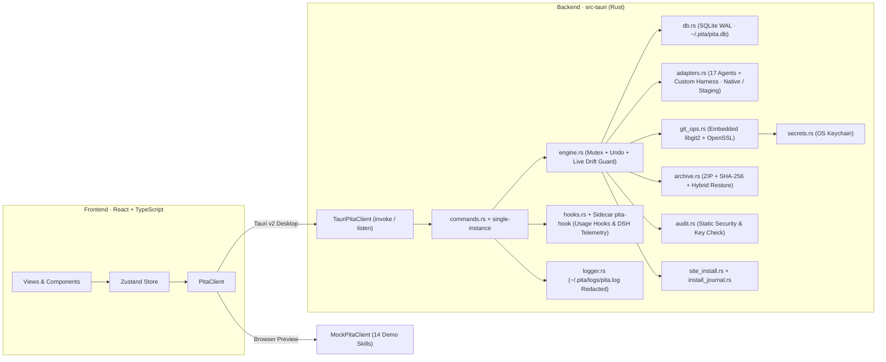

# Pita — Cross-Agent Skills Manager

<p align="center">
  
</p>

<p align="center">
  <strong>Discover, audit, budget tokens, update with diffs, and sync AI coding agent skills across 17+ tools — with zero terminal friction.</strong><br />
  A calm, local-first desktop app built with <strong>Tauri v2 + Rust + React + SQLite</strong> for Windows, macOS, and Linux.
</p>

<p align="center">
  <a href="https://github.com/Cheese-nya/pita/releases"></a>
  <a href="LICENSE"></a>
  
  
</p>

<p align="center">
  <strong>English</strong> ·
  <a href="README.zh-CN.md">简体中文</a> ·
  <a href="https://github.com/Cheese-nya/pita/releases">Releases (v0.3.0)</a> ·
  <a href="CHANGELOG.md">Changelog</a> ·
  <a href="https://github.com/Cheese-nya/pita/issues/new?template=bug_report.yml">Report Bug</a> ·
  <a href="https://github.com/Cheese-nya/pita/issues/new?template=agent_request.yml">Request Agent</a>
</p>

---

## Why Pita?

Managing `SKILL.md` folders across **Claude Code**, **Codex**, **Antigravity**, **DeepSeek Harness**, **Windsurf**, **OpenCode**, and **Gemini CLI** quickly turns into broken symlinks, bloated context windows, and unverified shell scripts.

Pita keeps a **single central library** while syncing real files to every agent safely:

| Capability | Manual Folders | Symlink-Only Tools | **Pita** |
| :--- | :--- | :--- | :--- |
| **Multi-agent sync** | Copy-paste by hand | Fragile symlinks / junctions | **Copy-Sync** real files (agents keep working if Pita is uninstalled) |
| **Context bloat control** | Blind guessing | None | **Real-time token budget** (`cl100k_base`) with per-agent threshold alerts |
| **Security before install** | Read every file manually | Blindly run remote files | **Pre-install static audit** (API keys, shebangs, risky shell/exfil patterns) |
| **Safe updates** | Overwrite & pray | Pull overwrites local edits | **Embedded `libgit2` diff preview**, drift guard, auto-snapshot & 1-click rollback |
| **Usage & cleanup** | No idea what is unused | No telemetry | **Opt-in `pita-hook` sidecar & DSH session log reader** to spot zombie skills |

---

## Screenshots (Light & Dark Themes)

|                  All Skills · Light Theme                  |                 All Skills · Dark Theme                  |
| :--------------------------------------------------------: | :------------------------------------------------------: |
|   |   |

| Pre-Install Security Audit (supports `npx skills add owner/repo`) |     Opt-in Usage Telemetry & Zombie Skill Cleanup      |
| :---------------------------------------------------------------: | :----------------------------------------------------: |
|        |  |

---

## Supported Agents (17 Built-in + Custom Harnesses)

Pita scans both global directories and registered project workspaces (up to 5 nested folder levels, automatically skipping `.trash`, `node_modules`, and `.git` while protecting symlinks to external repos):

| Agent | Default Global Skill Path(s) | Disable Strategy |
| :--- | :--- | :--- |
| **Claude Code** | `~/.claude/skills` | Native config (`settings.json` / `settings.local.json`) |
| **Codex** | `~/.codex/skills`, `~/.agents/skills` | Native config (`~/.codex/config.toml` via comment-preserving `toml_edit`) |
| **Antigravity** | `~/.gemini/config/skills`, `~/.gemini/antigravity/skills` | Safe staging (`~/.pita/staging/`) |
| **DeepSeek Harness (`dsh`)** | `$DSH_HOME/skills` or `~/.dsh/skills` | Flat `<name>.md` lifecycle + frontmatter & `.agents/skills` conflict check |
| **WorkBuddy** | `~/.workbuddy/skills`, `~/.codebuddy/skills` | Safe staging |
| **OpenCode** | `~/.config/opencode/skills` | Safe staging |
| **Trae (Global / CN)** | `~/.trae/skills`, `~/.trae-cn/skills` | Safe staging |
| **Windsurf** | `~/.codeium/windsurf/skills` | Safe staging |
| **Gemini CLI** | `~/.gemini/skills` | Safe staging |
| **Hermes Agent** | `~/.hermes/skills` | Safe staging |
| **Pi Coding Agent** | `~/.pi/agent/skills` | Safe staging |
| **OpenClaw** | `~/.openclaw/skills`, `~/.openclaw/workspace/skills` | Safe staging |
| **Qoder** | `~/.qoder/skills` | Safe staging |
| **T3 Code** | `~/.t3code/skills` | Safe staging |
| **Codex CLI** | `~/.codex-cli/skills` | Safe staging |
| **Claude CLI** | `~/.claude-cli/skills` | Safe staging |
| **Antigravity CLI** | `~/.gemini/antigravity-cli/skills` | Safe staging |
| **Custom Harnesses** | Any directory (with custom `PNG`/`SVG`/`JPG`/`WebP`/`ICO` icon) | Safe staging |

> Missing your favorite coding agent? [Open an Agent Support Request](https://github.com/Cheese-nya/pita/issues/new?template=agent_request.yml).

---

## Key Features

- **Unified Library, Matrix Brush & Keyboard Navigation**
  - Installed agents are prioritized in the top Token Dock (drag-and-drop reorderable), paired with a 6-slot / dual-ring deployment popover, a **Matrix Brush View** for bulk toggling across agents and projects, `Ctrl/⌘ K` command palette, and `J`/`K` drawer navigation.
- **Built-in `skills.sh` Marketplace & Multi-Source Installer**
  - Browse `skills.sh` live leaderboards (**All / Trending / Hot**) with source filters, offline cache, and viewport-driven `SKILL.md` excerpts.
  - Install from **Git URLs**, `owner/repo`, `owner/repo@skill`, pasted `npx skills add owner/repo` commands, GitHub folder URLs, `skills.sh` links, site-hosted skills (`.well-known/agent-skills` or `.well-known/skills`), local folders, or `.zip` / `.skill` archives. Downloads are commit-pinned, preserve conflicting files, and roll back partial writes automatically on failure.
- **Pre-Install Security & Credential Audit**
  - Automatically scans incoming skills for API key / OAuth requirements, executable scripts / shebangs, and high-risk shell or exfiltration commands (**Safe / Notice / High Risk** badges with file-level details) before deployment.
- **Token Budget Guardrails & Live Presets**
  - Calculates metadata + full `SKILL.md` token usage with `cl100k_base` (`js-tiktoken`) and warns when an agent exceeds its context budget (default `20,000` tokens).
  - **Live Presets** compute `Δ Token` deltas and reference counts in real time as you edit a preset, prompting bound agents and projects to align in one click.
- **Zero-Drift Translation & Field Search**
  - Filter **All Skills** by **Name / Description / Source / All Fields** with match highlighting.
  - Batch-translate skill descriptions into Simplified Chinese via built-in Google Translate (with mirror fallback) or a custom OpenAI-compatible endpoint—translations live in Pita's metadata only, keeping `SKILL.md` file hashes untouched (**zero Git drift**).
- **Diff-First Updates, Drift Guard & Rollback**
  - Powered by embedded `libgit2` (zero dependency on a system `git` binary): inspect full directory-tree file diffs before updating, verify on-disk hashes against un-scanned local edits, pin versions, and roll back via automatic pre-update snapshots.
- **Honest Usage Ledger & Opt-in Hooks**
  - Shows first-hand facts by default (install date, active duration, estimated context tokens)—**never fabricates invocation counts** when hooks are off.
  - Enable opt-in tracking via the bundled zero-shell Rust sidecar `pita-hook` (logs locally to `~/.pita/usage.jsonl` for Claude Code `PreToolUse` + `UserPromptSubmit` and Codex `UserPromptSubmit` `$skill` / `/skill`) or read-only incremental telemetry from `~/.dsh/sessions/` (`.jsonl` / `.jsonl.zstd`), then clean up unused zombie skills in one click.
- **Portable Bundles & Multi-Device GitHub Backup**
  - Export `skills-lock.json` v1 + `local-skills/` ZIP archives (SHA-256 verified with Zip-Slip protection), or connect a private GitHub backup repo via PAT (stored in OS Keychain) with per-item diff & conflict resolution (**Keep Local / Use Remote**).

---

## Download & First Launch

Grab the latest installer from **[GitHub Releases (v0.3.0)](https://github.com/Cheese-nya/pita/releases)**:

- **Windows (x64)**: `Pita_0.3.0_x64-setup.exe` or `Pita_0.3.0_x64_en-US.msi`
- **macOS (Apple Silicon / Intel)**: `Pita_0.3.0_aarch64.dmg` or `Pita_0.3.0_x64.dmg`
- **Linux (Debian / Ubuntu x64)**: `Pita_0.3.0_amd64.deb` (`sudo apt install ./Pita_0.3.0_amd64.deb`, installs both `/usr/bin/pita` and `/usr/bin/pita-hook`)

<details>
<summary>First-launch note for unsigned open-source builds (no terminal needed)</summary>

Current open-source desktop releases are not commercially code-signed yet. On first launch:

- **Windows (SmartScreen)**: Click **More info** → **Run anyway**.
- **macOS (Gatekeeper)**: Right-click `Pita.app` in **Applications** → **Open**, or go to **System Settings → Privacy & Security** and click **Open Anyway**.

</details>

---

## Architecture



---

## Local Development & Build

Requirements: **Node.js 22+**, **Rust 1.78+** (on Linux, install `libwebkit2gtk-4.1-dev`, `libappindicator3-dev`, `librsvg2-dev`, `patchelf`, `libssl-dev`, and `pkg-config`).

```bash
# Install frontend dependencies
npm ci

# 1. Browser preview mode (Mock workspace with 14 demo skills — safe to explore UI)
npm run dev

# 2. Tauri desktop dev mode (live local scan & ~/.pita/pita.db)
npm run build:sidecar
npm run tauri:dev

# 3. Full production checks (frontend + sidecar + Rust clippy & tests)
npm run build
npm run build:sidecar
cargo clippy --manifest-path src-tauri/pita-hook/Cargo.toml --all-targets -- -D warnings
cargo test --manifest-path src-tauri/pita-hook/Cargo.toml
cargo clippy --manifest-path src-tauri/Cargo.toml --all-targets -- -D warnings
cargo test --manifest-path src-tauri/Cargo.toml

# 4. Package desktop installer
npm run tauri:build
```

---

## Community

[Linux Do](linux.do)
## License

Released under the [MIT License](LICENSE). See [CHANGELOG.md](CHANGELOG.md) for release history.
