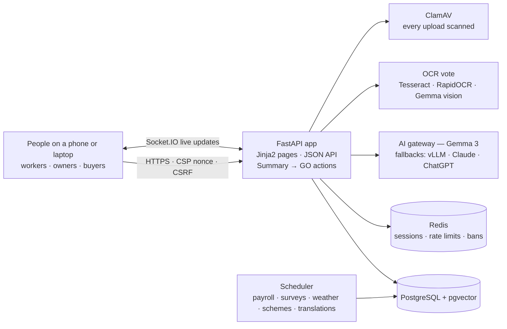
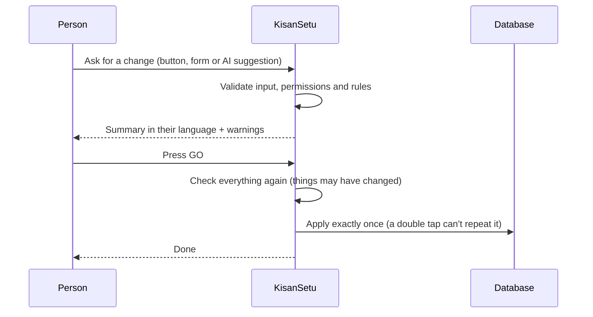

<div align="center">


# KisanSetu

**A fair-work bridge for Indian farms**<br>
<sub>किसानसेतु — खेत मज़दूरों, खेत मालिकों और ख़रीदारों के बीच एक हरा पुल</sub>

Farm jobs with protected salaries · honest payroll · farm shops · government schemes<br>
and an AI helper that speaks your language — on a basic phone or a laptop.

<p>


</p>

<a href="#a-quick-tour">Tour</a> ·
<a href="#features">Features</a> ·
<a href="#how-it-works">How it works</a> ·
<a href="#security-and-privacy">Security</a> ·
<a href="#tested-like-production">Testing</a> ·
<a href="#quick-start">Quick start</a>

<br><br>


</div>

<br>

> [!IMPORTANT]
> **Available only in India.** KisanSetu is made for work on Indian farms and works only inside India: every account,
> farm, job, delivery and saved location must be in India (GPS positions are checked against India's borders; typed
> addresses must be in an Indian state), phone numbers are Indian (+91), farms are verified by their Indian GSTIN,
> money is in rupees (₹), dates follow Indian time, and wages, tax (TDS), notice periods and government schemes follow
> Indian rules. It is not meant to be used anywhere else.

> [!WARNING]
> **Student-grade educational project.** No liability and no responsibility for any loss, damage, unpaid wage, crop
> loss, dispute or decision made using this software. Not a government service, employer, bank, insurer or legal adviser.
> Released under the [MIT License](LICENSE). Full text: [DISCLAIMER.md](DISCLAIMER.md).

## Why KisanSetu

Farm work often runs on trust alone: wages paid late or in part, no proof of payment, money taken "to join", documents
kept, and nobody to call when something goes wrong. KisanSetu builds the protections into the software itself —
salaries are counted every day, payments are proven by the screenshot itself (read by OCR, never typed), unfair terms
are refused by fixed rules, and every worker always knows who to call — while staying usable for people who read
little, in the language they speak.

It connects three groups: **farm workers** who find nearby jobs, **farm owners** who hire, run payroll and sell their
harvest, and **buyers** who buy straight from farms.

---

## A quick tour

<table>
<tr>
<td width="50%" valign="top">

<p align="center"><b>A worker's job at a glance</b><br><sub>Pay counted every day · next pay date · who to call · payment proofs</sub></p>
</td>
<td width="50%" valign="top">

<p align="center"><b>Kisan Didi, the talking guide</b><br><sub>Walks through each page aloud, one part at a time, in your language</sub></p>
</td>
</tr>
<tr>
<td width="50%" valign="top">

<p align="center"><b>Ask in Hindi, get your own numbers</b><br><sub>The AI helper answers from the person's real data — and never changes anything itself</sub></p>
</td>
<td width="50%" valign="top">

<p align="center"><b>Terms in plain words</b><br><sub>"Explain simply" on every farm's terms; risky clauses are flagged</sub></p>
</td>
</tr>
<tr>
<td width="50%" valign="top">

<p align="center"><b>Jobs within 30 km</b><br><sub>From the saved location — GPS or a typed address, no live GPS needed</sub></p>
</td>
<td width="50%" valign="top">

<p align="center"><b>Sign-up made for low literacy</b><br><sub>Picture tiles, a PIN keypad and read-aloud — in 30 languages</sub></p>
</td>
</tr>
<tr>
<td width="50%" valign="top">

<p align="center"><b>Run your farm</b><br><sub>Team, dues, insurance cover and an emergency stop for disasters</sub></p>
</td>
<td width="50%" valign="top">

<p align="center"><b>Honest payroll</b><br><sub>Payments are recorded from the screenshot — the amount can't be typed</sub></p>
</td>
</tr>
<tr>
<td width="50%" valign="top">

<p align="center"><b>Credit / debit statements</b><br><sub>Month by month with a running balance; CSV download</sub></p>
</td>
<td width="50%" valign="top">

<p align="center"><b>Farm shop</b><br><sub>Buy from verified farms — cash on delivery or pickup</sub></p>
</td>
</tr>
<tr>
<td width="50%" valign="top">

<p align="center"><b>Government schemes</b><br><sub>Check eligibility; links go only to verified official sites</sub></p>
</td>
<td width="50%" valign="top">

<p align="center"><b>Day and night</b><br><sub>A dark theme for evenings in the field</sub></p>
</td>
</tr>
</table>

<table>
<tr>
<td width="33%" valign="top"><p align="center"><sub><b>Phone first</b> — big buttons, bottom navigation</sub></p></td>
<td width="33%" valign="top"><p align="center"><sub><b>Your pay in your pocket</b></sub></p></td>
<td width="33%" valign="top"><p align="center"><sub><b>हिन्दी</b> and 29 more languages</sub></p></td>
</tr>
</table>

<sub>Screenshots are from a test installation with made-up people and farms; phone numbers, e-mail addresses and GSTINs are masked.</sub>

---

## Features

<table>
<tr>
<td width="50%" valign="top">

### For farm workers
- **Jobs within 30 km** of your saved location — shared by GPS or typed by hand
- **Salary counted every day** from the day you join, **+10 %** on holidays worked, never below **minimum wage**
- **Proof of every payment** — the screenshot itself, by SMS, WhatsApp, e-mail and in the app
- **Who to call** for your current and recent jobs, and safe problem reports (your identity is never shared)
- A short **"How did your day go?"** check-in; unsafe workplaces get halted
- **One working farm at a time**; during a notice period you may move to a new farm (days worked stay owed)

</td>
<td width="50%" valign="top">

### For farm owners
- **GSTIN verified from a photo** of the certificate (three OCR engines vote), then a farm with mandatory salary + health insurance
- **Hiring, roles and notices** with a strict hierarchy; big decisions are **co-owner votes**
- **Payroll** with TDS, OCR-checked payment proofs, a farm ledger and **monthly statements** with CSV
- **Farm shop** with a stock ledger; the AI answers buyers' questions
- **Weather & disaster scan** for every branch, and an **emergency stop**

</td>
</tr>
<tr>
<td width="50%" valign="top">

### For buyers
- Buy **straight from farms** — cash on delivery or self pickup; the buyer pays the courier, so the farmer doesn't lose
- **Ask the AI** about a product; reviews only from real purchases

</td>
<td width="50%" valign="top">

### For everyone
- **30 Indian languages**, read-aloud and voice input everywhere
- **Kisan Didi** talking guide and the **Kisan Mitra** AI helper — it proposes, you press **GO**
- **Government schemes** with eligibility checks and daily-verified official links
- Unfair terms (**"pay to join"**, deposits, kept documents) are refused by fixed rules

</td>
</tr>
</table>

<details>
<summary><b>Everything that is implemented — the full list</b></summary>
<br>

| Area | How it works |
|---|---|
| **India only** | Browser geolocation → bounding box + reverse geocoding (OSM Nominatim, cached & throttled) → offline city fallback. **No GPS needed:** people can type their address instead (state from the list, district, village / town, optional PIN) — found village → PIN → district, every answer must be in the chosen state (never a namesake elsewhere), Redis-cached for every worker, offline exact-name fallback; the PIN is used for the search and never stored, and typed locations are saved as not GPS-verified. Joining farms, accepting invitations, delivery and "near me" use the saved location (GPS or typed); a live position is used only when location is already allowed — never a permission prompt. |
| **Languages** | 30 languages (all 22 scheduled + English + 7 more), RTL for Urdu/Kashmiri/Sindhi, per-script Noto fonts. Every UI string is a catalog key (`app/i18n/locales/en.json`, 2,646 keys; `hi.json` hand-made, complete). Missing keys are back-filled by the AI and cached (`locales/generated/`); user-written text (products, terms, job titles) is translated on the fly and cached in Postgres. Listen (text-to-speech) and microphone input everywhere. |
| **Low-literacy UX** | Picture-tile sign-up wizard, numeric PIN keypad, read-aloud of every step, AI login/sign-up guide, big buttons, bottom navigation on phones. **Live camera in the page** (laptops too) next to every photo / document input — profile photo, ID proof, GST certificate, insurance papers, receipts, product and plant photos: capture → check → use (camera switched off while checking); the photo then goes through the normal upload checks. Face check: OpenCV + AI must agree on one face; a small background detection is ignored, and only when the AI is sure of one face does OpenCV get a second look with its other face model. The header menu never runs into the logo: words + icons, then words only, then icons only with tooltips when a long language, many menu items or zoom leave no room (checked across 9 widths, 3 roles and 3 languages). |
| **Kisan Didi — talking guide** | A female farmer avatar (inline SVG, CSP-safe) whose **lips move with the speech** (driven by the speech engine's word events, timed per word when a voice has none), who **blinks** and **raises her eyebrows** on questions. "Guide" walks through a page one part at a time with a spotlight, in the reader's language and voice; hard words (TDS, notice, advance, premium, e-KYC…) get a **tap-to-explain** popup; the assistant may **point at a part of the screen** (only parts the page reported, validated on the server). |
| **Terms in plain words** | "Explain simply" on every farm's terms: curated plain-language points for the platform terms; for custom terms the AI writes simple points that must **quote the terms word for word and invent no numbers** (else dropped), and fixed rules flag clauses that are **legal but risky** (deposits, pay held to harvest, loans worked off, documents kept, deductions, damage liability, any-time dismissal, no days off, …) with curated explanations and level badges (icon + label), marked in the text. |
| **Vernacular AI** | The assistant, plant doctor, product Ask-AI and terms explainer answer in the language the person **wrote in** — detected from the script (Devanagari, Tamil, Telugu, Bengali, Gurmukhi, …) or Hindi typed in English letters (Hinglish) — and read the answer aloud with that language's voice. A language switch drops older turns; a wrong-script answer is retried once. |
| **"Summary → GO"** | Every change is *prepared* first (validated, translated summary, warnings) and runs only after the user presses **GO** (`app/services/actions`). Double clicks cannot run it twice. |
| **Co-owner consensus** | Rename, settings, terms, closing, branch closing, adding co-owners → proposals that execute only after the owner **and every co-owner** approve. |
| **GSTIN** | Certificate photo → Tesseract + RapidOCR + Gemma vision, checksum validation & majority vote → GST API (auto in test mode) → only then farms can be created. The admin sees the name on the GST registration next to the owner (warning when they share no word); **rejecting a farm frees its GSTIN**, so nobody can lock a business out with a photo of its invoice. |
| **Farm creation** | Main branch on a map, ≤ 8 h working day, weekly offs, ≥ 1 crop, **mandatory salary + health insurance** (documents public), fair boilerplate T&C or custom T&C checked by AI + rules for unlawful clauses (blocks creation), admin approval (48–72 h; instant in test mode). |
| **Hiring & protection** | Jobs only within **30 km** of the worker's saved location (shared by GPS or typed by hand — the farm sees which; no live GPS needed to join), 18+ only, verified face photo, never below **minimum wage** (national floor or state rate), T&C acceptance recorded, **1-month notice only** (no sudden removal), workers can resign any time. **One working farm per person** (employee, supervisor, manager or accountant; owning or co-owning farms doesn't count, so an owner can still work on one other farm; a database index makes two simultaneous hires impossible). **During a notice period** a worker may join a new farm: the old job ends that day — its salary stops (the rest of the notice is no longer owed), pay for the days already worked stays owed, and both the old farm and the worker are told. Workers always see **who to call** (owner + managers: call / WhatsApp) for current jobs, jobs left in the last 60 days and jobs that still owe money — never shown to anyone else. **Custom terms that take money from workers** (pay to join, joining / registration / agent fees, security deposits, bonds), keep their ID documents or make them work off an advance are refused by fixed rules in English, Hindi and Hinglish — **whatever the AI says** (the AI only adds a second opinion; its cached verdict can never hide such a clause). Terms adopted before a rule existed stop all hiring until changed (the owner sees why on every farm tab), and workers reading such terms get a "pays to join" warning. |
| **Roles: promotion, demotion, notice** | Strict hierarchy owner > co-owner > manager > accountant > supervisor > employee: notices only from strictly above (never on oneself, a peer or a co-owner); only the giver, the owner or a co-owner withdraws a notice; closure notices cannot be withdrawn. **Promotion / demotion** needs the owner + all co-owners and is pinned to the role they saw (a stale proposal fails instead of guessing); demotion into farm work applies the hiring rules. A leader under an individual notice **loses every power at once** (pages, actions, alerts) but keeps working and being paid; closure notices pause nobody. Co-owners are removed by proposal (they don't vote on it); proposals that waited for a departed co-owner settle automatically. Member rows are locked for each GO — two leaders acting on one person: exactly one wins. |
| **Payroll** | Salary accrues **per day from joining** (bulk, per farm), **+10 %** on holidays/weekly offs worked, TDS per configurable slabs (new regime, rebate & marginal relief), due on the superadmin's **billing day**. AI warns owners before the due date; overdue → farm **halted**, owner + workers + superadmin informed. All business dates are Indian dates (IST) — never the UTC date, which is still "yesterday" before 05:30. |
| **Payment proof** | Owner uploads a screenshot; the **amount cannot be typed** — it is read by OCR engines + Gemma and accepted only when ≥ 2 sources agree; blur/contrast checks, duplicate image (perceptual hash) & UPI reference detection; partial payments warned. The worker gets the **screenshot itself** on every channel they have: attached to the e-mail, as the WhatsApp picture, and behind a private signed link in the SMS (30 days, that payment and that worker only, never cached or indexed) — plus the in-app proof page. |
| **Accounts** | Farm ledger (salaries, TDS, expenses, income, sales, purchases) visible to owner/co-owners/managers/accountants, CSV export; personal statements for workers & buyers. Financial records survive account deletion. **Credit / debit statements in the app** (`/account/statement`): month by month with opening balance, money in, money out, a running balance and the closing balance (tax lines shown for the record); the owner and every co-owner also open each farm's statement from their account, and the same statement is the farm's transaction history (managers / accountants read it there). Two queries per page however long the history (aggregate + window function); CSV per month. |
| **Wellbeing** | After working hours every worker gets "How did your day go?" + water/food/breaks/rest/overwork/respect/pay/safety. A bad day → superadmin gets full details; the owner gets an **anonymised** warning in a delayed daily digest. Several workers → **branch halted for safety**, safety case, legal warning & compensation (paid to *all* workers of the branch so nobody is singled out). False reports → warnings → ban; owners are told to pay salary till date (reason not disclosed). Unban only by superadmin after an appeal. |
| **Weather & disasters** | Daily AI scan of every branch: Open-Meteo forecast (batched), USGS earthquakes, GDACS & NASA EONET within **200 km**, crop-specific heat/cold/water-logging warnings, AI advisory. Danger without salary insurance → halt + "buy comprehensive cover"; with salary cover → suggest field/crop insurance. Emergencies (earthquake…) can be declared by the farm → halt + all branch orders cancelled. |
| **AI assistant** | Socket.IO + HTTP, parallel priority queue, per-user caps, prefilled prompt buttons, crop/pest Q&A with pgvector crop knowledge, **plant photo diagnosis**, crop & farming-type recommendations, understands "I planted X", worker grievances and emergencies → proposes actions. **The AI cannot run code or change anything** — see *Security*. |
| **Shop** | Cash on delivery / self pickup only, buyer pays courier (base + per km), atomic conditional stock updates + timestamped inventory ledger with idempotency keys, idempotent checkout, forward-only order states, verified-purchase reviews (banned authors tagged, deleted authors' reviews removed after 30 days), **Ask-AI** with RAG; low-confidence questions are sent to the owner. **Closing a shop is a vote** of the owner and co-owners: one click cancels every open order not yet with a courier (buyers told, stock restored); orders already with the courier — the buyer is paying for that trip — must still be delivered, so the shop is *closing* (no new orders, hidden from search) and closes by itself after the last delivery. Shop settings can only reopen a shop. |
| **Schemes (live, not hard-coded)** | Stored in the database (21 central schemes seeded). The superadmin adds state/central schemes, edits rules or links, **withdraws** closed schemes (optionally pointing to a replacement) and **restores** them — every change through GO, audited, and visible to everyone at once (per-process cache invalidated through Redis after commit). Links must be `https` on an allow-listed official domain (`gov.in`, `nic.in`, … editable) and are re-checked before every redirect. A **daily link-health job** follows redirects (public addresses only), flags broken / moved / unreachable portals and pages that say a scheme was discontinued, and reminds the superadmin to re-verify rules (default every 180 days). People who opened a scheme's portal are **notified when it changes or is withdrawn**; edited text is translated on the fly. Eligibility: age, land, income, tax, EPF, bank, rural, state. **Official-page cross-check:** the same daily job reads the official page's visible text — fingerprint vs the version an admin last reviewed, key sentences (amounts, dates, eligibility) added / removed, "discontinued / merged" signals, the scheme's name disappearing — and marks schemes *changed* or *may have ended* (people see "check the official site before applying"; admins see the sentences and an optional AI reading that must quote the page). Portals that omit their TLS intermediate are repaired like browsers do (AIA, still verified to a trusted root); expired certificates are named. JavaScript-only portals can be read by `scripts/render_scheme_pages.py` (optional, run outside the app: headless Chromium limited to the official domains). |
| **External jobs** | When no farm is hiring nearby, a daily hunt (Google Programmable Search restricted to an admin-managed allow-list of authentic sites) shows jobs sorted by distance — clearly labelled as governed by the source site's policies. |
| **Accounts & privacy** | OTP sign-up & password reset, optional ID proofs (AES-256-GCM, only the owner can reveal), data export ZIP by e-mail + signed link by SMS/WhatsApp on deletion, 30-day retention then anonymisation. Owners can delete only after all farms close (all salaries + orders settled). **Worker → farm owner too**: a farmer (or buyer) upgrades from the account page — current PIN / password, an e-mail no other account uses, a strong password, 18+ — and keeps the job they have (pay, payslips, who to call and grievances follow the job, not the account type); other devices are signed out. |
| **Superadmin** | Approve/reject/ban/delete farms & users (deletion blocked while salaries are due), reports with full details, safety cases, appeals, IP bans & abuse log, all platform settings (billing day, thresholds, minimum wages, tax slabs, holidays, trusted job sites), outbox, audit log, AI provider health, run jobs. |

</details>

---

## How it works



**Nothing changes without a human pressing GO.** Every change — by a button, a form or an AI suggestion — is prepared
first, shown as a plain summary in the person's language with any warnings, and runs only after **GO**, when everything
is checked again:



**Built with** FastAPI (async) · PostgreSQL + pgvector · SQLAlchemy 2 (async) · Redis · Socket.IO · Jinja2 · Tailwind v4 ·
CSP nonces · CSRF · async Redis rate limiter · APScheduler · Alembic. **AI:** OpenAI-compatible gateway (Gemma 3) → vLLM →
Gemma 3 fail-safe → Claude → ChatGPT. **OCR:** Tesseract + RapidOCR + Gemma 3 vision (majority vote).

---

## Security and privacy

- **The AI can never run scripts or change data** — it has no tools; its output is parsed as data only, actions are a
  whitelist with strict validation, and a person still presses GO. A unit test forbids `eval` / `exec` / `subprocess` /
  `innerHTML` anywhere in the code.
- **One login per account** — every request and socket event re-checks the login key, so a newer sign-in signs other
  devices out at once and they can change nothing.
- **No account sees another's data** — every id is checked against the person's own account or a farm role, and every
  secondary id against the same farm; tested under load with a private marker line per account and per farm.
- **Strict browser security** — CSP with per-request nonces, CSRF tokens, HSTS, no framing, `no-store` for private pages.
- **Secrets stay secret** — Argon2id passwords with a pepper, AES-256-GCM for ID documents, sealed one-time secrets in
  confirm steps, a redacted audit log; TOTP two-step login for the superadmin.
- **Abuse protection** — rate limits, strike points, an AI judge bounded by fixed ban ladders, and protection for shared
  mobile-network addresses.
- **Safe uploads** — antivirus scan before anything is opened, images rebuilt clean, risky PDFs refused.

<details>
<summary><b>Security details</b></summary>
<br>

* **CSP with per-request nonce** + `'strict-dynamic'`, no inline styles/handlers (`style-src-attr 'none'`), Trusted Types policy (report-only header, clean), HSTS, frame denial, COOP/CORP, Permissions-Policy, `no-store` for dynamic pages, CSP violation reporting.
* **CSRF**: HttpOnly SameSite=Strict cookie + masked per-render token (BREACH-safe) + Origin / `Sec-Fetch-Site` checks; Socket.IO same-origin only.
* **Sessions in Redis — one login per account**: opaque 256-bit id, SHA-256-hashed keys, sliding + absolute expiry, a fresh id on every login (no fixation). Each login mints a random key whose SHA-256 is stored on the user row; **every request** (page load, API call, form POST) and **every socket event** compares the session's key with the database before any handler runs. A newer login therefore signs every other device out at once: its POSTs — even a GO prepared earlier — are refused with 401 and **change nothing**, its page reload lands on the sign-in page that **says why** ("signed in on another device: Firefox on Android, 17-11-2026 11:20"; details come from a signed token, so the notice cannot be forged), its live Socket.IO connection is told and cut off (it never receives the new device's notifications), and the account gets a "new sign-in" notice. Password reset / change, bans, deletion and "sign out everywhere" end sessions with their own reason.
* **Passwords**: Argon2id + server-side pepper, rehash on login, lockout, timing-equalised login, OTP attempt limits; **TOTP 2FA mandatory for the superadmin**.
* **Encryption**: AES-256-GCM with key rotation, ciphertext bound to its owner (AAD), HMAC blind indexes for duplicate detection.
* **Secrets never sit readable in the database**: a password, PIN or code typed into a confirm-step action (change password, become a farm owner…) is stored **sealed** (AES-GCM, bound to the person and field) for the minutes until GO, used once, then wiped — on GO, cancel and expiry (the cleanup job also wipes older rows). The audit log redacts every secret field to `***` whoever writes it. The load test checks both invariants.
* **Rate limiting** (async sliding windows on Redis, per user/IP — never blocks the event loop); body-size limits; trusted hosts.
* **Spam & abuse — strikes, AI judge, fixed ladders**: spam / scam / injection text (1–3 points), rate-limit storms (3 or 8), password guessing across accounts (2), malware uploads (5) add strike points to the IP and the account (Redis, 7 days, shared by every worker). At 3 points in 24 h the AI sees the evidence (quoted as data, never instructions) and decides *ban* or *watch*; rule floors bound it (≥ 8 always ban, ≥ 5 when the AI is down). Penalties come from fixed ladders, never from the AI: **IP bans 1 h → 24 h → 7 d → 30 d**; signed-in spammers get an **account posting ban 1 h → 24 h → 7 d** (chat, questions, reviews — their job, pay and complaints are untouched). **Shared addresses** (5+ accounts in a week, e.g. mobile-carrier CGNAT) get at most 1 h and signed-in users pass. The superadmin sees every ban with its evidence and **lifts IP bans, posting bans and account bans**; a lift reaches every worker within 5 s and resets the strikes. Loopback and our own proxies can never be banned.
* **No cross-account data**: every id a request carries is checked against the person's own account or a farm where they hold the needed role, and every secondary id (branch, member, product, upload…) against that same farm — a unit test scans all actions and the load test checks 16 tables for rows tied to another farm's branch. Statements, notifications, the account page and `/api/auth/me` are checked under load with a private marker per account and per farm. A banned or deleted account holds no farm role anywhere. Dynamic translations use **one AI call per text** (text sent alongside can never steer how another farm's terms are translated and cached). Phone / email in the community directory are **opt-in**, shown to farmers and owners only. After sign-in, `?next=` must resolve to this site.
* **Uploads**: every upload is scanned by ClamAV (clamd INSTREAM) **before** anything is decoded or stored, and must come back OK — infected files are refused (422), logged as abuse events and reported to the superadmin; if the scanner is down or answers with an error, the upload is refused (`CLAMAV_REQUIRED=true`). Images are then rebuilt (re-encoded: metadata, trailing payloads and polyglots are dropped) and served with `Content-Security-Policy: sandbox` + `nosniff`; PDFs are refused when they contain scripts, launch actions, attachments or submitting forms — including hex-escaped names and actions hidden in compressed streams — and are always downloaded, never shown inline. Magic-byte validation, decompression-bomb guard, file names reduced to a safe base name, private storage with per-kind access control. All JSON / form / query-string text is cleaned by `SanitizeMiddleware` (bidi overrides, control characters, lone surrogates, invisible characters, HTML — Indian scripts with ZWJ and passwords untouched); CSV exports neutralise spreadsheet formulas.
* **The AI can never run scripts**: it has no tools; output is parsed with `json.loads` only; actions are limited to a whitelist with strict pydantic validation and still need a human GO; text is sanitised and rendered with `textContent`; navigation only to fixed internal routes. `tests/test_core.py::test_codebase_never_executes_dynamic_code` enforces "no eval/exec/subprocess/innerHTML" in the codebase.
* **No N+1 queries**: list pages and background jobs use joins, `IN (…)` batches and aggregate queries (payroll for any number of workers = constant queries).

</details>

---

## Tested like production

| What | Latest result |
|---|---|
| **Load test (bug hunt)** — 200 simulated people, attackers weighted ×3, 4 server processes, 10 minutes | **68,104 requests · 0 failures** · 95 % answered within 71 ms · **54 / 54** correctness checks |
| **Stress test** — step load 25 → 249 people | **61,083 requests · 0 failures** · 95 % within 69 ms · 49 / 49 checks |
| **Account isolation** — 300 simultaneous statement requests from 16 accounts | No line ever appeared in another account |
| **End-to-end suites** against a running server (real AI, real OCR, a real browser) | **11 suites, all passing** |
| **Unit tests** | **43, all passing** |

After every load test, `tests/load/check_invariants.py` checks the database, Redis and the server log: no negative stock,
stock equal to its movement ledger, every order took stock exactly once, no action ran twice, the AI never executed
anything, salary accrued once per day, nobody works on two farms, one live session per account, no server errors.
Every bug these tests found is logged with its fix in [`tests/load/findings.json`](tests/load/findings.json), and the
public **Stress test results** page shows each run:


<details>
<summary><b>Running the tests</b></summary>
<br>

```powershell
.venv\Scripts\python -m pytest                     # unit tests (tax, GSTIN, OCR voting, payroll, crypto, CSRF, i18n, AI guard, schemes…)
.venv\Scripts\python tests\e2e_flow.py              # end-to-end against a running server (uses the real AI gateway);
                                                    # also: location off → typed address / saved location, worker → owner
                                                    # (BASE=http://127.0.0.1:<PORT> if .env changes the port)
.venv\Scripts\python tests\e2e_lifecycle.py         # co-owner consensus, emergency halt, closure blocked until salaries paid, deletion
.venv\Scripts\python tests\e2e_schemes.py           # add / update / withdraw / restore schemes, notices, link checks, unofficial links refused
.venv\Scripts\python tests\load\seed_loadtest.py     # (once) data for the next three — every account / farm gets a private marker line
.venv\Scripts\python tests\e2e_sessions.py          # one login per account + account-leak tests (IDOR, sockets, caching, secrets, concurrency)
.venv\Scripts\python tests\e2e_security.py          # statements never mix accounts (300 concurrent requests), another farm's branch /
                                                    # shop / ledger refused, forged roles, hostile links, stored markup, CSV formulas,
                                                    # private downloads, login ?next= stays on this site (real browser)
.venv\Scripts\python tests\e2e_uploads.py           # ClamAV, image rebuilding, PDF active content, text sanitising
.venv\Scripts\python tests\e2e_roles.py             # hierarchy, paused leaders, promotion proposals, races, co-owner removal, contacts,
                                                    # one working farm per person, moving to a new farm during notice
.venv\Scripts\python tests\e2e_bans.py              # strikes → ladders, shared-IP protection, posting bans, superadmin lifts
.venv\Scripts\python tests\e2e_guide.py             # guide catalog, terms explainer, vernacular answers, screen pointing
.venv\Scripts\python tests\e2e_orders_race.py       # forced order-number collisions + the same checkout racing itself +
                                                    # checkouts vs cancellations on the same products (no deadlock) (direct DB)
.venv\Scripts\python tests\e2e_scheme_job.py        # daily scheme job while schemes are deleted / withdrawn mid-run (direct DB)
```

**Load testing (Locust)** → `/stress-test` (public) and `/admin/production-test`:

```powershell
.venv\Scripts\python scripts\run_loadtest.py --mode bughunt --seed -u 120 -t 4m   # bug hunt: 3× adversarial traffic
.venv\Scripts\python scripts\run_loadtest.py --mode stress --seed                 # 10-minute step load 25 → 250 users
.venv\Scripts\python scripts\run_loadtest.py --mode soak --seed --host http://127.0.0.1:8089 --docker kisansetu-app-1
                                                                               # 3-hour soak, spikes every 20 min, invariants every 15 min
```

`tests/load/locustfile.py` simulates visitors, workers, owners, buyers racing for the last units of stock, people signing
in on a second device, Socket.IO clients, slow AI users asking in several Indian languages, owners promoting /
demoting / giving notice while their managers act on the same people, spammers, guide users and **attackers** (missing
CSRF, malformed / 13 MB bodies, unknown and admin-only actions, foreign ids, IDOR, other people's statements, SQL-injection
/ unicode payloads, path traversal, password guessing). Every simulated person has their own IP and session. Results
(timeline, endpoints, server CPU / memory / event-loop lag / DB pool / AI queue, checks, the bugs found and fixed) are
stored and charted (Chart.js) on the superadmin's **Production test** page. The public, read-only **Stress test results**
page (`/stress-test`, linked from the home page and the footer) shows each stress / soak run's headline numbers, load
and response-time charts, run history and the database checks — without endpoint names, error texts, server internals
or bug details. The load test also joins farms with location turned off (saved-location distance), confirms typed
addresses (cached places only — it never floods the public map service), and checks that no password / PIN is ever
readable in prepared actions or the audit log.

</details>

---

## Quick start

**Windows, development** — needs Docker Desktop and [uv](https://docs.astral.sh/uv/) (Python 3.12; Python 3.15 lacks
wheels for some packages):

```powershell
docker compose up -d db redis                     # Postgres+pgvector on :5444, Redis on :6384
uv venv --python 3.12 .venv
uv pip install --python .venv\Scripts\python.exe -r requirements-dev.txt
.venv\Scripts\python scripts\generate_keys.py     # creates .env with strong secrets
# edit .env: SUPERADMIN_PHONE / SUPERADMIN_EMAIL / SUPERADMIN_PASSWORD (≥10 chars, letters+digits)
.venv\Scripts\python scripts\fetch_vendor.py      # self-host lucide / socket.io / leaflet + OpenCV face model
.venv\Scripts\python scripts\build_assets.py      # minified + hashed JS/CSS with SRI, Tailwind build (no Node needed)
.venv\Scripts\python run.py                       # http://localhost:8088 (or PORT from .env)
```

* `TEST_MODE=true` (default) auto-approves farms, GSTIN and insurance and **simulates** SMS / WhatsApp / email.
  OTP codes are shown on screen and in **Admin → Outbox**.
* The superadmin is created on first start from `.env`. Log in at `/login`; the first login forces **TOTP 2-step
  verification** (scan the QR code with any authenticator app) before `/admin` opens.
* Optional: install [Tesseract for Windows](https://github.com/UB-Mannheim/tesseract/wiki) and set `TESSERACT_CMD`.
  RapidOCR (installed via pip) and Gemma vision work without it.

**Full Docker stack:**

```bash
cp .env.example .env && python scripts/generate_keys.py   # then set production values
docker compose --profile full up -d --build               # app on :8088, runs `alembic upgrade head` on start
```

<details>
<summary><b>Production checklist</b></summary>
<br>

`ENV=production`, `TEST_MODE=false` (the default; the app refuses to start in production with test mode on — it would show
OTP codes), `AUTO_CREATE_TABLES=false` (use `alembic upgrade head`), real secrets (keep a
backup of `FIELD_ENCRYPTION_KEYS` — encrypted IDs are unrecoverable without it), HTTPS behind a reverse proxy with
`FORCE_HTTPS=true`, `ALLOWED_HOSTS`, `TRUSTED_PROXIES`, SMTP + Twilio (SMS/WhatsApp), `GSTIN_API_URL/KEY`,
`GOOGLE_CSE_API_KEY/CX` for the daily external job hunt, ClamAV (`CLAMAV_HOST`, the compose `clamav` service), database backups.
**Verify every year** in Admin → Settings: national floor wage, state minimum wages, income-tax / TDS slabs, holidays.
Keep comments in env files on their own lines — Docker Compose keeps `KEY=   # comment` as the value.
Behind a load balancer / reverse proxy keep `KEEP_ALIVE_SECONDS` (default 75) **above** its idle timeout, so the app
never closes a connection the proxy is about to reuse. Inside Docker the app always listens on 8088 (`PORT` in `.env`
is for the local development server); publish another port with `APP_PORT`.

</details>

<details>
<summary><b>Scaling out (several worker processes)</b></summary>
<br>

`WEB_CONCURRENCY=4` runs four uvicorn workers. Everything shared lives in Redis / Postgres: sessions and login keys,
rate limits, IP bans, the schemes and settings caches, Socket.IO rooms (Redis manager), job locks; start-up schema
creation and seeding are serialised by a Postgres advisory lock; the AI budget (`AI_CONCURRENCY`) is split across
workers; live events go to the current login's session room, so a signed-out device never receives them whichever
worker it is on. Browsers use WebSocket only when several workers run (no sticky sessions needed). Keep
`WEB_CONCURRENCY × 2 × DB_POOL_SIZE` below Postgres `max_connections`.
**Run several workers on Linux / Docker** (`docker-compose.loadtest.yml` shows the set-up). On Windows, uvicorn's
multi-process socket sharing let requests stall for minutes in testing, so `run.py` starts one worker there.

</details>

---

## Languages

All **22 scheduled languages of India** + English + 7 more — 30 in all — with right-to-left layout for Urdu, Kashmiri
and Sindhi, a Noto font for every script, read-aloud and voice input. English and Hindi are written by hand
(`app/i18n/locales/<code>.json`, always take priority); the other 28 languages are machine-translated into
`locales/generated/<code>.json` by the configured AI:

* **Quality gate** (`app/i18n.translation_ok`): a machine translation is used only if it is in the language's own
  alphabet (no Cyrillic / Hindi letters inside Bengali, no Tamil inside Malayalam…), keeps every `{placeholder}`, is not
  the English handed back, has no markup / line breaks and does not ramble. A rejected line simply stays in English.
  The gate runs when translations are made *and* when the files are loaded, so a bad file can never show wrong text.
* **Never stale**: `<code>.src.json` records which English text each translation was made from; when the English is
  reworded, the old translation is dropped and translated again.
* **Background job every 15 minutes** (`translations`, `TRANSLATION_MINUTES`): the whole catalog for every language
  people use, plus the first-visit screens (menus, home, sign-up, dashboard, jobs, helper, page scripts — ~760 lines) for
  *every* supported language, one small batch per language per round. It only starts a batch when no person has used the
  AI for 45 s (tracked in Redis across workers), and lines the AI keeps getting wrong are set aside for a week. Pages
  also back-fill the strings they show.
* A local 12B model translates ~15 lines in ~45 s (≈ 2 h per full language). To fill languages ahead of time:

```powershell
.venv\Scripts\python scripts\build_translations.py --status
.venv\Scripts\python scripts\build_translations.py --lang mr ta te   # chosen languages (resumable)
.venv\Scripts\python scripts\build_translations.py --all             # every supported language (takes hours on a local model)
```

---

## Project layout

```
app/
  main.py, config.py, database.py, realtime.py, sockets.py, templating.py, deps.py, middleware.py
  security/   talisman (CSP nonce), csrf, sessions (Redis), passwords, crypto, guard (IP bans), ratelimit, sanitize
  models/     59 tables (users, farms, payroll, shop, welfare, system)
  services/   actions/ (Summary → GO framework, 75 actions), ai/ (providers, queue, assistant, guard, moderation,
              embeddings), payroll, statements, tax, wages, weather, crops, ocr, gstin, shop, welfare, jobs, schemes,
              deletion, scheduler, …
  routers/    pages (Jinja2), api, auth, account, guide
  templates/  Jinja2 pages, partials, admin & farm tabs
  static/     css/theme.css, src/tailwind.css, js/ (core, ai, guide, pages), dist/ (built), vendor/ (fetched)
  i18n/       languages, locales/en.json, hi.json, generated/
migrations/   Alembic (async) — schema with pgvector + HNSW index
scripts/      generate_keys, fetch_vendor, build_assets, build_translations, create_superadmin, run_loadtest
tests/        43 unit tests, 11 end-to-end suites, load/ (Locust, invariants, findings)
docs/         screenshots used in this README
```

---

## License and disclaimer

Released under the [MIT License](LICENSE) © 2026 DHURJATI-JS. The software comes **without warranty**, and the author
and contributors accept **no liability and no responsibility** for any loss, damage, unpaid wage, crop loss, dispute or
decision connected with its use. Read the full [DISCLAIMER.md](DISCLAIMER.md) before using or deploying it.
Third-party models, APIs and libraries keep their own licences and terms.

<div align="center">
<br>
<sub>Made for the people who grow India's food. 🌾</sub>
</div>
