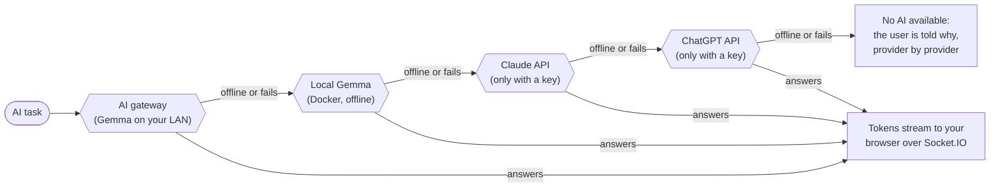
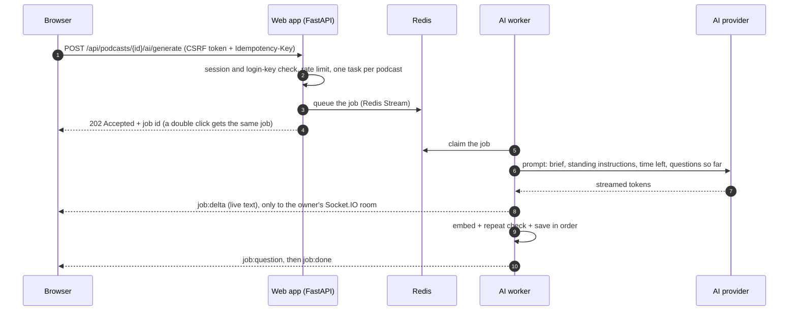
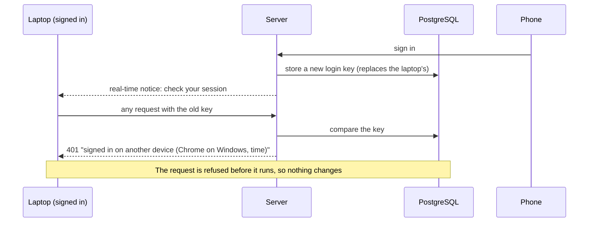
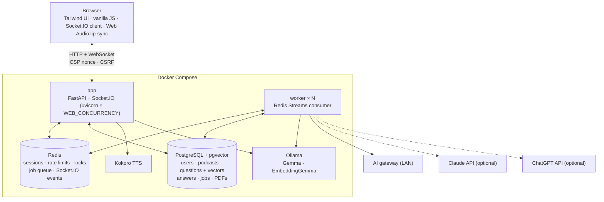

<p align="center">
  <picture>
    <source media="(prefers-color-scheme: dark)" srcset="docs/banner-dark.svg">
    
  </picture>
</p>

<p align="center">
  <b>An AI co-host that writes, checks and times your podcast questions, or interviews you and coaches every answer.</b><br>
  Local-first AI · a soft Kokoro voice with lip-sync · one-click install on macOS and Windows
</p>

<p align="center">
  
  
  
  
  
  
  
  
  
  <a href="LICENSE"></a>
</p>

<p align="center">
  <a href="#quick-start">Quick start</a> ·
  <a href="#two-ways-to-use-it">Two modes</a> ·
  <a href="#features">Features</a> ·
  <a href="#how-the-ai-works">How the AI works</a> ·
  <a href="#security-and-privacy">Security</a> ·
  <a href="#tested-correctness-leaks-and-load">Testing</a> ·
  <a href="#disclaimer-and-limitation-of-liability">Disclaimer</a> ·
  <a href="#licence">Licence</a>
</p>

> [!WARNING]
> This software is provided **"as is", without warranty of any kind**. AI output (questions, scores, feedback,
> rewritten answers and the synthetic voice) can be wrong, biased or inappropriate: **review everything before you
> use it**. Nothing in this app is legal, medical, financial or other professional advice. The author and contributors
> accept **no liability and no responsibility** for any loss or damage, or for how the software or its output is used.
> Read the [full disclaimer](DISCLAIMER.md).

<p align="center">
  <picture>
    <source media="(prefers-color-scheme: dark)" srcset="docs/screenshots/home-dark.png">
    
  </picture>
</p>

## Problems it solves

| | Problem | How it's handled |
|:-:|---|---|
|  | **Redundant questions**, within an episode or across your earlier episodes | Meaning (pgvector on EmbeddingGemma embeddings) **and** wording checks; pairs too close to call get an **AI double-check** (97% accurate on held-out test pairs with local Gemma); AI-suggested repeats are skipped, and a repeated follow-up is retried once with the reason |
|  | **Running over or under time** | Target length, intro and outro, a time slot per question, a live run-time bar; new AI questions are sized to the time left |
|  | **Weak question craft** | Yes/no, double-barrelled, leading, too-long and too-short questions are flagged with a concrete tip |
|  | **The blank page** | A complete, ordered question flow from just a theme, guest and audience, streamed live |
|  | **Unprepared guests** | A mock interview with a 0-10 score, what worked, specific fixes and a stronger rewrite that only uses facts you gave |
|  | **Rambling answers** | Speaking-time estimate from your pace, a rehearsal stopwatch and timing feedback against the slot |
|  | **Telling the same story twice** | Answers that overlap one you already gave are detected, and Mira asks for a fresh angle |
|  | **Repeating yourself to the AI** | "Mira remembers": say "avoid politics" once and every AI action on that podcast follows it |
|  | **AI outages** | LAN gateway → local Docker Gemma → Claude → ChatGPT; if none can answer, you're told exactly why |
|  | **Double clicks and spam** | Idempotency keys, per-podcast AI locks, per-user AI quotas and rate limits |
|  | **Shared or stolen sessions** | One login per account: signing in elsewhere signs this device out, and it's told why |
|  | **Unsafe content** | Text is cleaned on the way in, escaped on the way out, under a strict nonce-based CSP |

## Two ways to use it

<table>
  <tr>
    <th width="50%"> Create questions for a podcast <sub>(host)</sub></th>
    <th width="50%"> Prepare for a podcast <sub>(guest)</sub></th>
  </tr>
  <tr>
    <td valign="top">
      <ul>
        <li>Describe the theme, guest and audience; Mira streams an ordered question flow sized to the time left.</li>
        <li>Change questions your way ("shorter", "funnier", "more personal" or any instruction), with undo.</li>
        <li>Repeats, yes/no, double-barrelled and leading questions are flagged as you go.</li>
      </ul>
    </td>
    <td valign="top">
      <ul>
        <li>Mira predicts the questions you'll be asked and interviews you, out loud if you like.</li>
        <li>Every answer gets a score, what worked, specific fixes, a stronger rewrite and timing feedback.</li>
        <li>Rehearsal stopwatch, speaking-time estimate and the follow-up a real host would ask next.</li>
      </ul>
    </td>
  </tr>
  <tr>
    <td valign="top"></td>
    <td valign="top"></td>
  </tr>
</table>

<sub>Screenshots use a fictional demo account. Every question, flag, score and rewrite in them was produced by the app
itself with the real AI gateway (Gemma); see <a href="docs/capture_screenshots.py"><code>docs/capture_screenshots.py</code></a>.</sub>

Everything (podcasts, questions, answers, feedback and exported PDFs) is stored in PostgreSQL.

<details>
<summary><b>More screenshots</b>: the account chooser and the phone layout</summary>
<br>
<p>
  
  &nbsp;
  
</p>
</details>

## Features

<table>
  <tr>
    <td width="50%" valign="top">
       <b>AI co-host</b><br>
      Streamed question generation · rewrites on request with undo · follow-up and surprise questions · standing instructions applied to every suggestion
    </td>
    <td width="50%" valign="top">
       <b>Run-time planning</b><br>
      Target length per episode · a time slot per question · live run-time bar · speaking-time estimates from your own pace
    </td>
  </tr>
  <tr>
    <td valign="top">
       <b>Voice</b><br>
      Kokoro TTS with a soft, warm female voice · lip-synced avatar · the browser's voice as a fallback · read any question or rewrite aloud
    </td>
    <td valign="top">
       <b>Quality checks</b><br>
      Repeat detection with pgvector · an AI double-check for close calls · "asked before" across your podcasts · yes/no, leading and double-barrelled flags · answer-overlap detection
    </td>
  </tr>
  <tr>
    <td valign="top">
       <b>Real-time and parallel</b><br>
      Socket.IO streaming · Redis Streams worker pool · parallel embeddings · PDF rendering in a separate process pool
    </td>
    <td valign="top">
       <b>Accounts and security</b><br>
      Google-style sign-in and account chooser · one login per account · CSP nonces, CSRF, Argon2id · rate limits and leak tests
    </td>
  </tr>
  <tr>
    <td valign="top">
       <b>Export</b><br>
      A PDF run-sheet with timings and coaching notes · stored in PostgreSQL · download any time
    </td>
    <td valign="top">
       <b>Install and run</b><br>
      One click on macOS or Windows · everything in Docker · dark and light mode · works with local AI only
    </td>
  </tr>
</table>

## Quick start

**You need:** Docker Desktop (Windows 10/11 or macOS), about 12 GB of free disk for the local AI and voice models,
and 8 GB+ RAM recommended.

| | macOS | Windows |
|---|---|---|
| Install and run | double-click **`Start-Mac.command`** (first time: right-click → *Open*) | double-click **`Start-Windows.bat`** |
| Stop (data is kept) | double-click **`Stop-Mac.command`** | double-click **`Stop-Windows.bat`** |

The installer:

1. checks for Docker (offers to install it with Homebrew or winget, or opens the download page) and starts Docker Desktop if needed;
2. creates `.env` with fresh random secrets (first run only);
3. builds and starts the app, waits until it is healthy and opens **http://localhost:8080**;
4. starts local Gemma and Kokoro and downloads their models in the background (several GB, first run only); the app already works meanwhile;
5. checks that the app can reach your AI gateway, and tells you how to fix it if not.

> [!NOTE]
> **macOS + a gateway on your LAN:** macOS blocks Docker from local-network devices until you allow it in
> *System Settings → Privacy & Security → Local Network → Docker* (then restart Docker Desktop). Until then the app
> falls back to local Gemma, Claude or ChatGPT. Windows does not need this.

## Configuration

Settings live in `.env` (created by the installer). After editing it, run the installer again or `docker compose up -d`.

| Setting | Default | What it does |
|---|---|---|
| `AI_PROVIDER_ORDER` | `gateway,local,anthropic,openai` | Order in which AI providers are tried |
| `GATEWAY_BASE_URL` / `GATEWAY_API_KEY` / `GATEWAY_MODEL` | `http://192.168.0.226:8000/v1` / `change-me-gateway-key` / `gemma` | Your OpenAI-compatible AI gateway |
| `LOCAL_LLM_MODEL` / `LOCAL_EMBED_MODEL` | `gemma3:4b` / `embeddinggemma` | Local fallback model and embedding model (Ollama in Docker) |
| `ANTHROPIC_API_KEY` / `ANTHROPIC_MODEL` | empty / `claude-opus-5-5` | Claude fallback (off while the key is empty) |
| `OPENAI_API_KEY` / `OPENAI_MODEL` | empty / `gpt-5-mini` | ChatGPT fallback (off while the key is empty) |
| `EMBEDDING_ORDER` | `local,openai,hash` | Embeddings for repeat detection; `hash` always works offline |
| `TTS_ENABLED` | `true` | Kokoro voice (falls back to the browser's voice) |
| `SMTP_*` | empty | Email for password resets. Empty + `EMAIL_FALLBACK_TO_LOG=true` prints reset emails to the server log (single-user local installs only) |
| `APP_PORT`, `BASE_URL`, `ALLOWED_HOSTS` | `8080`, `http://localhost:8080`, `localhost` | Where the app listens and which host names it answers to (IP addresses always work) |
| `FORCE_HTTPS` | `false` | Set to `true` behind an HTTPS reverse proxy (HSTS, `Secure` + `__Host-` cookies) |

> [!IMPORTANT]
> The gateway key in `.env.example` is the gateway's default. If your gateway is reachable from the internet, change
> the key on the gateway and in `.env`.

## How the AI works



- **Provider chain.** A health monitor checks every provider in parallel and broadcasts status to all browsers. Each
  AI task tries providers in order; if one fails before answering, the next one is used silently; if one fails
  *mid-stream*, the partial text is discarded and the next provider takes over. Failing providers are skipped briefly
  (circuit breaker) and re-checked every few seconds. If none can answer, the message says exactly why, for example
  "AI Gateway: offline, Local Gemma: downloading model, Claude API: not configured, ChatGPT API: not configured".
- **Streaming and parallel processing.** AI tasks are queued on a Redis Stream and run by worker processes
  (`WORKER_CONCURRENCY` tasks each; scale with `docker compose up -d --scale worker=3`). Each parsed question is
  embedded *in parallel* with the ongoing stream and saved in order.
- **pgvector.** Questions and answers are embedded with EmbeddingGemma (local), then OpenAI, then a built-in hashing
  embedder. Each vector records its model and is only compared with vectors from the same model; HNSW indexes back
  the searches (repeats, "asked before", repeated stories, answer memory).
- **AI repeat check.** Embeddings can't settle every pair: with EmbeddingGemma, reworded repeats scored as low as
  0.71 while different questions on the same topic scored up to 0.78. So "Check quality & repeats" sends pairs in that
  band (0.68 to 0.80) to the AI, one pair per call at temperature 0, with one rule: two questions are the same only if
  a full answer to one would also fully answer the other. Confirmed repeats are marked *Similar*. Each verdict is
  stored for that exact pair of texts, so unchanged pairs are never asked about twice and editing either question
  retires it.
- **Memory.** Every AI feature uses one shared context: the podcast brief, guest bio, key messages, standing
  instructions and (for feedback) your most relevant earlier answers, so anything you said once is taken into account.
- **Run time.** Questions carry time slots; answers are timed from your words per minute (Account settings) or the
  rehearsal stopwatch; the AI is told the time left and the slot it is coaching for.
- **Voice.** Kokoro TTS (CPU, in Docker) with a soft, warm female blend (`af_heart` + `af_nicole`) by default; other
  female voices in Account settings. The avatar's lip-sync follows the audio (Web Audio analyser); with the browser
  voice it follows word boundaries.
- **Prompt-injection hardening.** User text is wrapped in tagged blocks the model is told to treat as data, tag
  characters are neutralised, and every AI output is cleaned before it is stored or shown.

<details>
<summary><b>What happens when you press "Generate"</b> (sequence diagram)</summary>



</details>

AI speed depends on your gateway. On the reference setup it has ranged from about 3 tokens per second (a 3-question
batch in ~50 s, answer feedback in ~2.5 min) to a 5-question batch in ~5 s. Progress streams live either way, and you
can keep working meanwhile.

## Security and privacy

<p>
  
  
</p>

- **One login per account.** Each sign-in mints a new key, stored on the account in PostgreSQL. Every page load, form
  post, API call and real-time connection compares the device's key with the database. On a mismatch the device is
  signed out *before* the request is processed, so nothing changes. The device is told why at once (real-time notice)
  and again on its next reload, for example "your account signed in on another device (Chrome on Windows, 17 Nov 2026
  at 06:14 UTC)". Password resets and expired sessions get their own explanations, and simultaneous sign-ins are
  serialised so exactly one device survives.
- **Sessions:** an opaque random token in an HttpOnly, SameSite cookie; Redis maps its SHA-256 to the user id. The name
  in the Google-style account chip, menu and chooser is *fetched by user id* (Redis profile cache, then PostgreSQL).
  Sessions rotate on sign-in and expire after 7 days idle or 30 days in total.
- **Sign-in:** a two-step flow with "Choose an account" for this device; Argon2id hashing with bounded parallelism;
  generic errors and timing equalisation (no account enumeration); lockout after repeated failures.
- **Forgot password:** single-use, hashed, 30-minute tokens; the response never reveals whether an account exists.
- **CSRF:** a signed double-submit cookie (HMAC) plus an Origin/Referer check on every unsafe request; also required to
  open a Socket.IO connection, which additionally checks Origin and the session.
- **Talisman-style headers:** a per-request CSP **nonce** (`script-src 'nonce-…' 'strict-dynamic'`, no `unsafe-inline`,
  no `unsafe-eval`), `frame-ancestors 'none'`, `nosniff`, Referrer-Policy, Permissions-Policy, COOP/CORP, HSTS over HTTPS.
- **No code execution from data:** all free text is cleaned (HTML and scripts stripped, control and invisible bidi
  characters removed) before it is stored; templates autoescape; the browser only uses `textContent`; PDF text is
  XML-escaped; JSON embedded in pages is escaped.
- **Isolation:** every query is scoped to the owner; other people's ids return 404 (never 403); job events go only to
  the owner's room; the voice cache is per account and lives on disk. Signing out, changing your password or revoking
  sessions closes that account's live connections on every server process. HTML is never gzip-compressed (BREACH);
  host-header allow-list (DNS-rebinding defence), body-size limit, open-redirect protection; access logs are off so
  one-time tokens never land in logs.

<details>
<summary><b>One login per account</b> (sequence diagram)</summary>



</details>

## Limits

Every list a user can grow is capped (enforced on the server, race-safe via row locks), and every expensive action is
rate-limited. All values can be tuned in `app/config.py` / `.env`.

| Limit | Value |
|---|---|
| Podcasts per account | 200 |
| Questions per podcast | 60 |
| Practice attempts kept per question | 20 (oldest removed) |
| Undo history per question | 20 (oldest removed) |
| Standing instructions per podcast | 20 (300 characters each) |
| PDF exports kept per podcast | 5 (oldest removed) |
| Signed-in devices per account | 1 (signing in elsewhere signs this device out, with the reason) |
| Accounts remembered per device | 5 |
| Open real-time connections per account | 10 |
| Questions per AI generate / rewrite request | 20 / 20 |
| Concurrent AI tasks per account | 3 (one per podcast question list, one per answered question) |
| Automatic retries when the AI repeats a question (follow-ups) | 1 |
| Question pairs per AI repeat check | 20 (closest first; the rest on the next check) |
| AI repeat verdicts kept per podcast | 300 (verdicts on edited questions are dropped) |
| Text sizes | title 120, theme 300, brief / bio / key messages 2,000, question 500, answer 5,000 characters |
| Voice text per request | 800 characters |
| Request body | 1 MB |
| AI task time limit | 15 minutes |
| Sign-in | 30 attempts / 15 min per IP; 5 failed attempts / 15 min per account |
| Password checks on account pages (change password, delete account) | 10 / 15 min per account |
| Sign-up | 5 / hour per IP (plus honeypot and minimum fill time) |
| Forgot password | 10 / hour per IP, 3 / hour per email |
| AI requests | 40 / hour and 300 / day per account |
| Voice requests | 120 / 10 min per account |
| PDF exports | 10 / 10 min per account |
| API writes | 300 / min per account |

## Architecture



```
app/            FastAPI app: main.py, config.py, models.py, worker.py, realtime.py, cli.py
  ai/           providers (httpx), router (fallback + health), embeddings, prompts, parsers
  jobs/         Redis Streams queue, job handlers, Socket.IO emitters, job guards
  security/     CSRF, Talisman-style headers, sessions, rate limits, sanitising, passwords
  services/     questions + repeats, podcasts, run time, PDF (ReportLab), exports, email, Kokoro
  routes/       pages, auth, JSON API, health
  templates/    Jinja2 (autoescaped)          static/js → esbuild → static/dist (minified)
frontend/       Tailwind v4 + esbuild build (runs inside Docker)
migrations/     Alembic (async)               tests/  pytest suite      loadtest/  smoke, stress, Locust, browser checks
docs/           README images, screenshot and chart scripts
```

## Tested: correctness, leaks and load

```bash
# Unit/integration tests: isolated stack with a throwaway in-memory "podcastqa_test" database
docker compose -f docker-compose.test.yml run --rm --build tests

# Stress test: throwaway stack with a fake LLM (OpenAI + Anthropic protocols, injected failures)
docker compose -f docker-compose.stress.yml up -d --build app worker fakellm kokoro
docker compose -f docker-compose.stress.yml run --rm -e STRESS_USERS=150 stress

# 10-minute Locust run (staged 50 → 150 → 250 → 300 → 100 users), then copy out the HTML report
FAKE_LLM_CHUNK_DELAY=0.02 docker compose -f docker-compose.stress.yml up -d --build app worker fakellm kokoro
FAKE_LLM_CHUNK_DELAY=0.02 docker compose -f docker-compose.stress.yml run --name pq-locust locust
docker cp pq-locust:/home/locust/. loadtest/results/locust-run/ && docker rm pq-locust

docker compose -f docker-compose.stress.yml down -v     # throw the stress data away
```

- **85 automated tests:** cross-account isolation (pages, API, jobs, exports, AI memory, sockets), AI fallback and
  "no AI" messages, streaming jobs, repeat skipping, the follow-up retry and the AI repeat check, memory, rewrites and undo, feedback
  parsing, double-submit and rate limits, CSRF/CSP/host/body-size checks, XSS cleaning, caps under concurrency, PDF
  storage, the voice proxy and one login per account.
- **Account-leak hunt** (`tests/test_leaks.py`): discovers every route that takes an id from the app itself and calls
  each one with a victim's ids as another signed-in account, as an anonymous visitor and from the victim's own
  signed-out device. Every call must be refused, none may reveal the victim's data, and the victim's data must be
  unchanged afterwards. New routes are covered automatically.
- **Headless browser** (Chromium): the full UI flow, including the two-window "signed out elsewhere" notice, with zero
  console errors or CSP violations.

<p align="center">
  <picture>
    <source media="(prefers-color-scheme: dark)" srcset="docs/load-test-dark.svg">
    
  </picture>
</p>

The Locust users mix hosts, guests, read-mostly visitors, sign-in churn, a second device signing in to the same
account, and hostile probes. Correctness is checked *during* the load: AI jobs must finish over Socket.IO, one job per
idempotency key, cross-account access must be 404, XSS must be stripped, question order must stay contiguous, and an
old device's write after a sign-in elsewhere must be refused with the reason and change nothing.

| Run 2, 17 Nov 2026 (latest) | Requests | p50 | p95 | p99 |
|---|---:|---:|---:|---:|
| All requests (incl. AI round trips) | 106,910 | 9 ms | 820 ms | 1.0 s |
| Read a podcast (`GET /api/podcasts/{id}`) | 13,023 | 10 ms | 71 ms | 250 ms |
| Add a question (`POST …/questions`) | 2,750 | 22 ms | 210 ms | 820 ms |
| Sign in (Argon2id) | 2,231 | 120 ms | 420 ms | 950 ms |
| AI generate round trip (fake LLM) | 1,157 | 870 ms | 1.1 s | 2.3 s |
| AI feedback round trip (fake LLM) | 3,693 | 930 ms | 1.2 s | 1.9 s |
| Voice (Kokoro TTS) | 351 | 2.6 s | 9.9 s | 11 s |

- **1 failure in 106,910 requests:** a follow-up the fake LLM repeated was correctly refused. Since then, a
  repeated follow-up is retried once automatically, telling the AI what to avoid.
- **Under load:** 3,699 old-device writes after a sign-in elsewhere were all refused with the reason and changed
  nothing, and 8,465 cross-account probes all returned 404.
- **Post-run audit:** no stuck jobs; the caps the load reached held exactly at their limits (60 questions per
  podcast, 5 PDFs, 20 attempts per question); no AI tasks overlapped on one podcast or question; no markup stored; no
  account with two live sessions; an empty queue, no leftover locks, no Redis evictions.
- **Compared with run 1** (85,110 requests, 142 req/s average, peak 232): run 2 carried 26% more traffic
  (178 req/s average, peak 285) with the database login-key check now on every request. Voice p95 fell from 60 s to
  9.9 s after adding a shared Kokoro concurrency limit, a per-account disk cache and a browser-voice fallback when
  Kokoro is busy (83 requests used it).
- **Machine:** Apple Silicon laptop, Docker Desktop, 4 web processes, 2 AI workers. *These figures describe one run on
  one machine and are not performance guarantees.*

### Known limitations

- **Repeat detection is a safety net, not a guarantee.** Close rewordings are flagged by meaning (e.g. 0.97 for
  "What first pulled you toward cold-chain technology?" vs "What originally drew you to cold-chain technology?"); looser
  ones go to the AI repeat check. Measured with local Gemma (gemma3:4b) on 32 held-out pairs written before testing,
  the check caught 16/16 repeats and wrongly flagged 1 of 16 different pairs (97%); on the pairs the app would
  actually send it, 19 of 20 were right (95%). The LAN gateway's larger model was unresponsive during that test and
  hasn't been measured. Without any AI, only the meaning and wording checks run. Read your list before recording.
- **AI output varies by model.** Scores and rewrites from a small local model are less consistent than from a large
  one, and the AI's own timing remarks (for example "about 175 words") can be off. The word counts and speaking-time
  estimates shown next to your answer are computed by the app from your text and pace, not by the AI.

## Operations

| Task | Command |
|---|---|
| Logs | `docker compose logs -f app worker` |
| Model download progress | `docker compose logs -f ollama-init` |
| Reset link without email | `docker compose exec app python -m app.cli reset-link you@example.com` |
| Back up the database | `docker compose exec db pg_dump -U podcastqa podcastqa > backup.sql` |
| Update after pulling new code | run the installer again (migrations run automatically) |
| Remove everything **including data** | `docker compose down -v` |
| Regenerate the README screenshots | run `docs/capture_screenshots.py` with Playwright against a **throwaway** stack |
| Redraw the load-test chart | `python docs/make_load_chart.py loadtest/results/<run>/stats_stats_history.csv docs` |

## Troubleshooting

- **"No AI is available right now":** the message lists each provider's state. Check that the gateway is running,
  wait for `ollama-init` to finish downloading Gemma, or add a Claude or ChatGPT key to `.env`.
- **Gateway offline only inside Docker on macOS:** grant Docker *Local Network* access (see [Quick start](#quick-start)).
- **"The AI worker isn't running":** run `docker compose up -d worker`.
- **Port 8080 busy:** the installer picks a free port on first run; otherwise change `APP_PORT` in `.env`.
- **Voice sounds robotic:** Kokoro is still starting, busy or offline; the browser's voice is used meanwhile.
- **"You've been signed out on this device":** the account signed in somewhere else (or its password was reset). If
  that wasn't you, sign in and change your password.

## Disclaimer and limitation of liability

- The software is provided **"as is" and "as available", without warranty of any kind**, express or implied,
  including merchantability, fitness for a particular purpose, accuracy and non-infringement.
- **AI output can be wrong.** Questions, rewrites, scores, feedback, "stronger answers", follow-ups and synthetic
  speech may be inaccurate, incomplete, biased, offensive or otherwise inappropriate. Repeat checks, quality flags,
  time estimates and scores are aids, not guarantees. Review and edit everything before relying on it.
- **Not professional advice.** Nothing in the app is legal, medical, psychological, financial or other professional
  advice, and it is not a substitute for professional media training.
- **Your responsibility.** You are responsible for your content and its use, including guest consent, privacy,
  copyright, defamation, platform rules and the law. Do not use the synthetic voice to impersonate real people.
- **Third parties.** If Claude or ChatGPT fallbacks are configured, text you submit may be sent to those providers and
  processed under their terms. The local models are downloaded from their publishers and are subject to their own
  licences and terms of use, for example the Gemma Terms of Use for Gemma and EmbeddingGemma.
- **Limitation of liability.** To the maximum extent permitted by law, the authors, contributors and operators accept
  **no liability** for any direct, indirect, incidental, special, consequential or exemplary damages, including loss
  of data, revenue, reputation or opportunity, arising from the use of, or inability to use, this software.
- **No responsibility.** The author and contributors accept **no responsibility** for how this software is used, for
  any content made with it, or for any episode, interview, publication or decision based on its output.
- **Deployers** are responsible for their own security, data protection and legal compliance, and should obtain legal
  review before offering the app to others.
- **Benchmarks and screenshots** in this document describe test runs on one machine with a fictional demo account. They
  are illustrations, not performance or accuracy guarantees.

The same disclaimer is shown on the home page and at `/legal` inside the app. The full text is in
[DISCLAIMER.md](DISCLAIMER.md); by using, copying or modifying this software you accept it.

## Licence

Released under the [MIT License](LICENSE) © 2026 DHURJATI-JS. You may use, copy, modify and distribute it freely; the
software comes **without warranty**, and the author accepts **no liability or responsibility** (see
[DISCLAIMER.md](DISCLAIMER.md)). Third-party models and services keep their own licences and terms.
