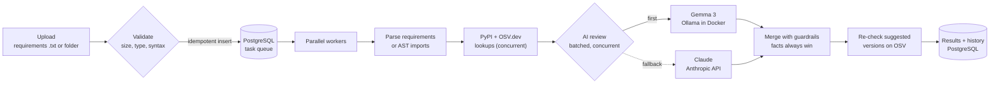

<div align="center">


# Vulnerability Detector

**Find vulnerable Python dependencies before they find you.**

Upload a `requirements.txt` or a whole project folder. Real advisories from OSV.dev are cross-checked by
**Gemma running locally in Docker**, with **Claude** as the fallback, and you get clear advice:
which packages to upgrade, to which version, and what to replace.

🔍 **Real CVEs from OSV.dev** · 🧠 **Local AI review** · ✅ **Every fix re-verified** · 🔒 **Your code never leaves your machine**

<p>
  
  
  
  
  
  
  
  
  
</p>

<p>
  <a href="#-quick-start">Quick start</a> ·
  <a href="#-features">Features</a> ·
  <a href="#-how-it-works">How it works</a> ·
  <a href="#%EF%B8%8F-configuration">Configuration</a> ·
  <a href="#-troubleshooting">Troubleshooting</a> ·
  <a href="#-license">License</a> ·
  <a href="#%EF%B8%8F-disclaimer">Disclaimer</a>
</p>

<picture>
  <source media="(prefers-color-scheme: dark)" srcset="docs/screenshots/dashboard-dark.png">
  
</picture>

</div>

> [!WARNING]
> **Student-grade project, provided as-is with no liability.** It's built for learning and personal use, not as a
> certified security product. Findings can be incomplete or wrong, so verify them at the source before you act.
> [Read the full disclaimer](#%EF%B8%8F-disclaimer).

---

## 🚀 Quick start

You only need **Docker**. The one-click scripts do the rest: they check Docker (and start it if it isn't running),
create `.env` with a random admin password, start PostgreSQL and Ollama, download Gemma, build the app and open
your browser.

| | macOS | Windows | Linux |
|---|---|---|---|
| **Start** | Double-click **`run.command`** | Double-click **`run.bat`** | `./run.sh` |
| **Needs** | [Docker Desktop](https://www.docker.com/products/docker-desktop/) | [Docker Desktop](https://www.docker.com/products/docker-desktop/) (WSL 2) | Docker Engine + Compose (the script offers to install it) |

Then open **http://localhost:8000** and sign in with the username and password shown in the terminal
(they're stored in `.env`).

> [!NOTE]
> The first start downloads about 1 GB (the Gemma 3 1B model plus Docker images). Later starts take seconds.
> On first setup the script also asks for an optional Anthropic API key for the Claude fallback. Press Enter to skip.

<details>
<summary>Prefer plain Docker commands?</summary>

```bash
cp .env.example .env            # then set ADMIN_PASSWORD (and optionally ANTHROPIC_API_KEY)
docker compose up -d --build    # the app downloads Gemma in the background on first start
```
</details>

### Everyday commands

| What | macOS / Linux | Windows |
|---|---|---|
| Start (sets up on first run) | `./run.sh` | `run.bat` |
| Stop (scans and model are kept) | `./run.sh stop` | `run.bat stop` |
| Restart | `./run.sh restart` | `run.bat restart` |
| Follow the logs | `./run.sh logs` | `run.bat logs` |
| Health of every service | `./run.sh status` | `run.bat status` |
| Self-diagnosis in the terminal | `./run.sh selfscan` | `run.bat selfscan` |
| Pull newer images and rebuild | `./run.sh update` | `run.bat update` |

Set `NO_BROWSER=1` to stop the script from opening a browser, which is handy on servers.

---

## ✨ Features

<table>
<tr>
<td width="50%" valign="top">

### 📄 Requirements files
Any file name works, as long as it ends in `.txt` and uses pip's format (`requests==2.32.3`), up to **10 MB**.
Comments, `--hash`, extras and environment markers are handled. Invalid lines are rejected with their line numbers,
and unpinned or ranged entries are flagged.

### 📁 Whole project folders
Pick a folder or drop it on the page. Up to **30 `.py` files, 1 MB each**. Every `import` is read with Python's
AST, and the standard library and your own modules are filtered out. Import names are mapped to PyPI
projects (`yaml` → PyYAML, `cv2` → opencv-python). Virtualenvs and caches are skipped automatically, and a
`requirements*.txt` inside the folder supplies the versions.

### 🧠 Local AI with a fallback
**Gemma 3** runs locally in Docker through Ollama, with schema-constrained JSON output. If it's offline,
still downloading, too slow or gives a bad answer, **Claude** takes over. With neither available, results
still come from advisory data and built-in rules.

</td>
<td width="50%" valign="top">

### 🛡️ Facts beat the model
Advisories come from **OSV.dev** and metadata from **PyPI**. The AI can't hide a known vulnerability, invent
a version or downgrade you. Every suggested version is **re-checked against OSV** before you see it.
Suspected issues that OSV doesn't know about are labelled "verify first".

### ⚡ Task queue and parallel work
Scans are queued in PostgreSQL (`FOR UPDATE SKIP LOCKED`) and processed by parallel workers. Inside each
scan, file parsing, PyPI/OSV lookups and AI batches all run concurrently. Queued scans survive restarts.

### 🕘 Complete history
Every scan and every finding is stored in PostgreSQL. **Scan again** creates a new entry instead of
overwriting the old one, and the **History** page has search, filters and pagination. Each result shows
how it compares with the previous scan of the same project.

### 🩺 Self-diagnosis
The app scans its **own** dependencies and code with the same pipeline. Use the button in the UI, the
daily automatic run, or `./run.sh selfscan`, which exits with status 1 if anything is vulnerable.

</td>
</tr>
</table>

**Also included:** an Apple-style interface with light and dark themes (following your system by default),
**double upload/submit protection**, live progress, JSON export, a single admin login from `.env`, and
everything bound to `127.0.0.1`.

### Screenshots

<table>
<tr>
<td width="50%">
<picture>
  <source media="(prefers-color-scheme: dark)" srcset="docs/screenshots/scan-dark.png">
  
</picture>
<p align="center"><sub><b>Results</b>: severity overview, verified upgrade targets, advisories</sub></p>
</td>
<td width="50%">
<picture>
  <source media="(prefers-color-scheme: dark)" srcset="docs/screenshots/history-dark.png">
  
</picture>
<p align="center"><sub><b>History</b>: every scan and re-run, searchable</sub></p>
</td>
</tr>
<tr>
<td width="50%">
<picture>
  <source media="(prefers-color-scheme: dark)" srcset="docs/screenshots/project-dark.png">
  
</picture>
<p align="center"><sub><b>Project scan</b>: imports, pins and risky stdlib modules</sub></p>
</td>
<td width="50%">
<picture>
  <source media="(prefers-color-scheme: dark)" srcset="docs/screenshots/login-dark.png">
  
</picture>
<p align="center"><sub><b>Sign in</b>: admin account from <code>.env</code></sub></p>
</td>
</tr>
</table>

### Try it with the samples

The [`samples/`](samples) folder holds deliberately outdated inputs. **Don't install them.**

- `samples/requirements-vulnerable.txt`: ten pinned packages, including known-vulnerable Django, Pillow,
  PyYAML and Jinja2, the abandoned `pycrypto` and `nose`, and an unpinned `numpy`.
- `samples/student-grades/`: a tiny student-grades Flask project. Choose **Project folder** and pick this
  folder to see import scanning, `pickle` detection and an unpinned `pandas` import.

---

## 🧭 How it works



1. **Validate.** Limits and file types are checked before anything is queued. A per-form submission id
   (with a unique constraint in the database) makes double clicks, re-sent forms and retried uploads harmless.
2. **Parse.** Requirements are parsed with `packaging`. Python files are read with `ast`, which handles
   `from a.b import c`, `importlib.import_module("x")` and line-by-line fallbacks for Python 2 code.
3. **Ground truth.** Each package is looked up on PyPI (latest release, yanked or inactive status, whether it
   exists at all) and on OSV.dev. Duplicate GHSA, PYSEC and CVE records are merged, and severity comes from
   GitHub's rating or the CVSS v3 vector.
4. **AI review.** Gemma gets compact facts and a rule-based baseline for each package, and returns
   schema-constrained JSON. If it fails, the same request goes to Claude using structured outputs, with the
   API's server-side refusal fallback switched on.
5. **Guardrails.** Known vulnerabilities can't be hidden. Versions must exist, be newer than the installed
   one and include every fix. One-word or mixed-up answers are replaced by the rule-based advice, and
   well-known abandoned projects (pycrypto, nose, PyPDF2…) always get their successor.
6. **Verify and store.** Suggested versions are re-checked on OSV, and everything is saved to PostgreSQL.

> [!TIP]
> **Privacy:** your source code never leaves your machine, because it's parsed locally. Only package names and
> versions go to PyPI and OSV.dev, and only package facts (never code) go to Claude, and only when Gemma can't answer.

---

## ⚙️ Configuration

Everything lives in `.env`. The scripts create it from [`.env.example`](.env.example).

| Variable | Default | What it does |
|---|---|---|
| `ADMIN_USERNAME`, `ADMIN_PASSWORD` | `admin`, random | The single login. Stored in plain text on purpose (local, single-user app). |
| `OLLAMA_MODEL` | `gemma3:1b` | Local model. `gemma3:4b` gives better advice but needs ≥ 8 GB of Docker memory. |
| `ANTHROPIC_API_KEY` | *(empty)* | Turns on the Claude fallback. |
| `ANTHROPIC_MODEL` | `claude-opus-5-5` | Claude model used for the fallback. |
| `ANTHROPIC_EFFORT` | `high` | Claude effort: `low` · `medium` · `high` · `xhigh` · `max`. |
| `ONLINE_LOOKUPS` | `true` | Real advisories from OSV.dev and metadata from PyPI. `false` = fully offline, AI only. |
| `SELF_SCAN_ON_START` | `true` | Scan the app's own dependencies on start-up (at most once a day). |
| `WORKER_CONCURRENCY` | `2` | Scans processed in parallel. |
| `LLM_CONCURRENCY` | `2` | AI requests in flight (also Ollama's parallel slots). |
| `LLM_BATCH_SIZE` | `6` | Packages per AI request. |
| `OLLAMA_TIMEOUT` | `300` | Seconds to wait for Gemma before falling back. |
| `APP_OLLAMA_URL` | *(container)* | Point the app at a native Ollama with GPU acceleration (see below). |
| `APP_PORT`, `POSTGRES_HOST_PORT`, `OLLAMA_HOST_PORT` | `8000`, `5433`, `11435` | Ports on your machine, bound to `127.0.0.1` only. |

The upload limits are fixed: up to **30 Python files of 1 MB each**, and a requirements file of up to **10 MB**.

---

## 🗂️ Project layout

```text
├── app/
│   ├── main.py          # FastAPI routes, login, uploads, JSON API
│   ├── uploads.py       # upload validation (limits, types, requirements syntax)
│   ├── parsing.py       # requirements parser + AST import extraction
│   ├── mapping.py       # import → PyPI names, stdlib risks, known replacements
│   ├── advisories.py    # PyPI + OSV.dev clients, CVSS scoring, advisory merging
│   ├── llm.py           # Gemma (Ollama) first, Claude fallback, JSON schema
│   ├── analyzer.py      # the scan pipeline and the guardrails
│   ├── worker.py        # PostgreSQL-backed task queue with parallel workers
│   ├── selfscan.py      # self-diagnosis (UI, daily, and `python -m app.selfscan`)
│   ├── db.py            # schema, queue claims, history queries
│   ├── templates/       # Jinja2 pages (Tailwind classes)
│   └── static/          # app.js, built app.css, favicon
├── tailwind/app.css     # Tailwind v4 source - built inside Docker, no Node needed locally
├── samples/             # deliberately vulnerable inputs to try
├── tests/               # pytest: parsing, advisories, guardrails, AI fallback, full HTTP flow
├── run.sh · run.command # one-click runner for Linux / macOS
├── run.bat · run.ps1    # one-click runner for Windows
└── docker-compose.yml   # app + PostgreSQL 17 + Ollama
```

### Development

```bash
python3 -m venv .venv && .venv/bin/pip install -r requirements-dev.txt
make dev     # app with auto-reload on :8001, PostgreSQL + Ollama in Docker
make test    # unit tests + the full HTTP flow against PostgreSQL
make css     # rebuild Tailwind after changing templates (runs in Docker)
```

---

## 🧯 Troubleshooting

<details>
<summary><b>Gemma is slow</b></summary>

Docker Desktop on macOS and Windows runs Ollama on the **CPU only**. A scan of about ten packages takes a few
minutes with `gemma3:1b`. For GPU speed, install the native [Ollama](https://ollama.com) app, run
`ollama pull gemma3:1b`, set `APP_OLLAMA_URL=http://host.docker.internal:11434` in `.env`, and run
`./run.sh restart`. Adding an `ANTHROPIC_API_KEY` also helps, because slow Gemma batches then fall back to Claude.
</details>

<details>
<summary><b>I want the bigger model (gemma3:4b)</b></summary>

Give Docker Desktop at least 8 GB of memory (Settings → Resources), set `OLLAMA_MODEL=gemma3:4b` in `.env`,
then run `./run.sh` again. It downloads the model and restarts the app.
</details>

<details>
<summary><b>"Port … is used by another program"</b></summary>

Pick free ports in `.env` (`APP_PORT`, `POSTGRES_HOST_PORT`, `OLLAMA_HOST_PORT`) and start again.
</details>

<details>
<summary><b>macOS says run.command can't be opened</b></summary>

Right-click it and choose **Open** once. If it isn't executable (for example after unzipping), run
`chmod +x run.sh run.command`.
</details>

<details>
<summary><b>Windows says running scripts is disabled</b></summary>

Use `run.bat`. It starts PowerShell with `-ExecutionPolicy Bypass` for this script only, without changing
your system policy.
</details>

<details>
<summary><b>Start completely fresh</b></summary>

`docker compose down -v` removes the containers **and all data**: the scan history and the downloaded model.
Delete `.env` too if you want a new password.
</details>

---

## 🔐 Security notes

This app is designed to run **locally for one person**, and some choices follow from that:

- The admin password is stored in plain text in `.env` (no hashing). Keep the file private. The scripts
  create it with owner-only permissions on macOS and Linux.
- There's no CSRF or CORS protection. Every port is bound to `127.0.0.1`, and the session cookie is
  `HttpOnly` and `SameSite=Lax`.
- Uploaded files are stored in PostgreSQL, never written to disk or executed. All AI output is
  HTML-escaped before display.

Don't expose the app to a network without adding proper authentication, HTTPS and CSRF protection first.

---

## 📜 License

Released under the [MIT License](LICENSE) © 2026 DHURJATI-JS. Free to use, copy and modify — **with no
liability and no responsibility** on the author or anyone else involved. See [DISCLAIMER.md](DISCLAIMER.md).

---

## ⚠️ Disclaimer

**This is a student-grade project.** It was built for learning and personal use, and it is **not** a
professional or certified security product.

**No warranty.** The software is provided **"as is"**, without warranty of any kind, express or implied,
including but not limited to the warranties of merchantability, fitness for a particular purpose and
non-infringement.

**No liability.** In no event shall the author(s) or contributors be liable for any claim, damages, data loss,
security incident or other liability, whether in an action of contract, tort or otherwise, arising from, out
of or in connection with this software or the use of, or other dealings in, it.

**No responsibility.** The author, developers and contributors accept no responsibility for how this software
is used, or for any decision, upgrade or action taken based on its results. You use it entirely at your own risk.
See [DISCLAIMER.md](DISCLAIMER.md).

**Check before you act.** Advisory data comes from third parties (OSV.dev, PyPI) and AI models make mistakes,
so results can be incomplete, outdated or wrong. Confirm findings at the source, test upgrades before
deploying them, and don't rely on this tool as your only security control. It is not a substitute for a
professional security review.

Gemma is provided under Google's Gemma Terms of Use, and the Claude API is subject to Anthropic's terms.
Using them is your responsibility.

<div align="center"><sub>Made with FastAPI, PostgreSQL, Tailwind CSS, Gemma and Claude · runs entirely on your machine</sub></div>
