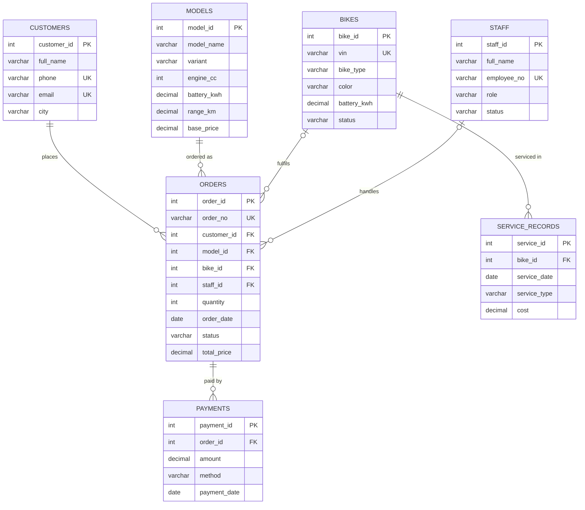

# REVON – Hybrid Motorcycle Management System

**A web-based database application: ERD → MySQL relational database → Flask web interface**
for a hybrid (EV + ICE) motorcycle business — bookings, bike inventory, models & pricing, staff, payments and service history.


### 🌐 **Live Demo:** [Nexgen Solution Hub](https://nexgen-solution-hub.vercel.app/)

## Table of Contents

1. [Project Overview](#1-project-overview)
2. [Features](#2-features)
3. [Technology Stack](#3-technology-stack)
4. [Folder Structure](#4-folder-structure)
5. [Entity Relationship Diagram (ERD)](#5-entity-relationship-diagram-erd)
6. [Database Design – Data Dictionary](#6-database-design--data-dictionary)
7. [SQL Concepts Covered](#7-sql-concepts-covered)
8. [Using the Application](#8-using-the-application)
9. [How ERD, SQL and Web Interface Work Together](#9-how-erd-sql-and-web-interface-work-together)
10. [Testing Constraints](#10-testing-constraints)
11. [Troubleshooting](#11-troubleshooting)
12. [Future Enhancements](#12-future-enhancements)
13. [License](#13-license)

---

## 1. Project Overview

A hybrid-motorcycle company needs to manage **customers** (riders, dealers, fleets) who place **orders**, the **models** and prices on offer, the physical **bikes** (inventory by VIN), the **staff** (sales advisors, technicians, delivery riders) assigned to each order, the **payments** received (installments allowed), and the **service records** of every bike.

This project designs that business as an **Entity Relationship Diagram**, converts it into a **normalised relational database (MySQL)** with primary keys, foreign keys and constraints, and provides a **responsive web interface (Flask)** to insert, view, search, update and delete records. Every page shows which SQL is executed, so the link between the web interface and the database is always visible.

## 2. Features

| Area | What it does |
|------|--------------|
| **Dashboard** | KPIs (orders, revenue, payments received, outstanding balance), orders by status, top models by revenue, inventory & staff status, recent orders – all SQL `COUNT`, `SUM`, `GROUP BY`, `JOIN`. |
| **CRUD for 7 tables** | Add / View / Search / Edit / Delete for Customers, Staff, Bikes, Models, Orders, Payments, Service Records. |
| **Search & filter** | Keyword search (`LIKE`) on every list page, status filter on orders. |
| **Foreign-key dropdowns** | Order form lets you choose Customer, Model (required) and Bike, Staff (optional) – the selected ID is stored as a foreign key. |
| **Order detail page** | 5-table JOIN: customer, model specs, bike unit, staff, progress tracker, payments and balance due. |
| **Order tracking** | Look up any order by number (e.g. `RVN-2026-0009`) from the top bar. |
| **Business rules** | Order number auto-generated; total = `quantity × model base price` when left 0; delivery date auto-filled when status = Delivered; warnings for already-sold bikes, multi-unit orders with one VIN, and staff on leave. |
| **Constraint feedback** | PK / FK / UNIQUE / CHECK / NOT NULL errors are caught and explained in plain language. |
| **SQL Reports** | 9 ready queries with the SQL text and live result. |
| **SQL Console** | Run any read-only `SELECT` against the live database (writes are blocked). |
| **ERD & Project page** | Architecture, ERD image and table row counts. |
| **Responsive + dark mode** | Works on desktop, tablet and mobile; follows the system theme. |

## 3. Technology Stack

| Layer | Technology |
|-------|-----------|
| Database | **MySQL 8.x** (MySQL Workbench) · SQLite 3 as fallback / serverless demo |
| Backend | **Python 3.10+**, **Flask 3**, **PyMySQL** |
| Frontend | HTML5 (Jinja2 templates), custom responsive CSS, no JS framework |
| Hosting | **Vercel** (Python serverless function) + any hosted MySQL |

## 4. Folder Structure

```
revon-tms/
├── app.py                  # Flask app: routes, generic CRUD, business rules, reports, console
├── db.py                   # Database layer (MySQL)
├── config.py               # Settings
├── requirements.txt        # Flask, PyMySQL, cryptography, certifi, gunicorn
├── vercel.json             # Vercel build + routing
├── api/index.py            # Vercel serverless entry point (exports the Flask app)
├── START_HERE.bat          # ▶ Windows one-click start
├── start.sh                # ▶ macOS / Linux one-command start
├── README.md  LICENSE  .gitignore
│
├── database/
│   ├── 01_schema_mysql.sql   # DDL: 7 tables, PK, FK, UNIQUE, CHECK, INDEX, 2 views
│   ├── 02_seed_data.sql      # DML: sample data
│   ├── 03_queries_demo.sql   # CRUD, JOINs, GROUP BY, sub-queries, procedure, function,
│   │                         # triggers, transactions, constraint tests, GRANT/REVOKE
│   └── schema_sqlite.sql     # Same schema for SQLite mode
│
├── templates/              # Jinja2 pages: base, dashboard, list, form, order, track,
│                           # reports, console, about, error
├── static/
│   ├── css/style.css       # Responsive design 
│   └── erd.png             # ERD shown inside the app
└── docs/
    ├── ERD.png / ERD.svg   # Entity Relationship Diagram
    ├── erd.dot             # ERD source 
    └── generate_erd.py     # Script that draws the ERD
```

## 5. Entity Relationship Diagram (ERD)


| # | Entity | Description |
|---|--------|-------------|
| 1 | **CUSTOMERS** | Riders, dealerships and fleet companies that place orders |
| 2 | **MODELS** | REVON model/variant catalogue: engine cc, battery kWh, range, top speed, base price |
| 3 | **BIKES** | Physical inventory units identified by VIN |
| 4 | **STAFF** | Sales advisors, technicians and delivery riders |
| 5 | **ORDERS** | Central transaction entity – a customer's order for a model |
| 6 | **PAYMENTS** | Money received against an order (installments allowed) |
| 7 | **SERVICE_RECORDS** | Service history of each bike (battery checks, tyres, firmware…) |

| Relationship | Type | Participation | FK in child | ON DELETE |
|--------------|------|---------------|-------------|-----------|
| CUSTOMER **places** ORDER | 1 : N | Mandatory | `orders.customer_id` | RESTRICT |
| MODEL **is ordered as** ORDER | 1 : N | Mandatory | `orders.model_id` | RESTRICT |
| BIKE **fulfils** ORDER | 1 : N | Optional (assigned later) | `orders.bike_id` | SET NULL |
| STAFF **handles** ORDER | 1 : N | Optional | `orders.staff_id` | SET NULL |
| ORDER **is paid by** PAYMENT | 1 : N | Mandatory | `payments.order_id` | CASCADE |
| BIKE **is serviced in** SERVICE_RECORD | 1 : N | Mandatory | `service_records.bike_id` | CASCADE |

> **Many-to-many (resolved):** Customers ↔ Models, Bikes ↔ Staff are M:N in the real world. They are resolved through the associative entity **ORDERS**, which is why `orders` holds four foreign keys.



**Generating the ERD in MySQL Workbench:** *Database → Reverse Engineer…* → select your connection → tick `revon_db` → Execute. Or redraw with Graphviz: `python docs/generate_erd.py`.

## 6. Database Design – Data Dictionary

**Normalisation:** all tables are in **Third Normal Form (3NF)** – e.g. model specs and price live once in `models`, customer phone once in `customers`.

**customers** – `customer_id` PK · `full_name` NOT NULL · `company` · `phone` NOT NULL **UNIQUE** · `email` **UNIQUE**, CHECK format · `city` NOT NULL · `address` · `created_at` DEFAULT now

**staff** – `staff_id` PK · `full_name` · `employee_no` **UNIQUE** · `phone` · `role` CHECK IN (Sales Advisor, Technician, Delivery Rider) · `hire_date` · `experience_yrs` CHECK 0–50 · `status` CHECK IN (Available, On Delivery, On Leave)

**bikes** – `bike_id` PK · `vin` **UNIQUE** · `bike_type` CHECK IN (City, Sport, Eco, Cargo, Touring, Demo) · `model_name` · `color` · `make_year` CHECK 2020–2040 · `battery_kwh` CHECK > 0 · `status` CHECK IN (In Stock, Reserved, Sold, In Service, Demo)

**models** – `model_id` PK · `model_name`, `variant` **UNIQUE (composite)** · `engine_cc` CHECK > 0 · `battery_kwh` CHECK > 0 · `range_km` CHECK > 0 · `top_speed_kmh` CHECK > 0 · `base_price` CHECK ≥ 0

**orders** – `order_id` PK · `order_no` **UNIQUE** · `customer_id` **FK→customers** (RESTRICT) · `model_id` **FK→models** (RESTRICT) · `bike_id` **FK→bikes** (SET NULL) · `staff_id` **FK→staff** (SET NULL) · `items_desc` · `quantity` CHECK > 0 · `order_date` · `delivery_date` CHECK ≥ order_date · `status` CHECK IN (Booked, In Assembly, Delivered, Cancelled) · `total_price` CHECK ≥ 0

**payments** – `payment_id` PK · `order_id` **FK→orders** (CASCADE) · `amount` CHECK > 0 · `method` CHECK IN (Cash, Bank Transfer, Card, Cheque, Online, Installment) · `payment_date` · `reference_no`

**service_records** – `service_id` PK · `bike_id` **FK→bikes** (CASCADE) · `service_date` · `service_type` CHECK IN (Battery Check, Oil Change, Tyre, Engine, Brakes, General Service, Software Update) · `description` · `cost` CHECK ≥ 0

**Views:** `v_order_details` (orders + customer + model + bike + staff + total paid) and `v_bike_service_summary`. **Indexes:** `idx_order_status`, `idx_order_date` (plus automatic indexes on PK/FK/UNIQUE). **Sample data:** 11 customers, 9 staff, 9 bikes, 8 models, 15 orders, 13 payments, 8 service records.

## 7. SQL Concepts Covered

| Concept | Where |
|---------|-------|
| **DDL** – CREATE/ALTER/DROP DATABASE, TABLE, VIEW, INDEX | `01_schema_mysql.sql`, `03_queries_demo.sql` Part F |
| **Primary / Foreign keys** | 7 PKs, 6 FKs with `RESTRICT / CASCADE / SET NULL` and `ON UPDATE CASCADE` |
| **Constraints** | `NOT NULL`, `UNIQUE` (single + composite), `CHECK`, `DEFAULT` |
| **CRUD** | Web forms · `02_seed_data.sql` · Part A |
| **INNER / LEFT / RIGHT / SELF JOIN** | Order detail page, lists, Reports 1–3, Part B |
| **Aggregates, GROUP BY, HAVING** | Dashboard, Reports 2, 4, 5, 9, Part C |
| **Sub-queries** (scalar, correlated, `IN`, `NOT IN`) | Reports 6–8, Part D |
| **Views** | `v_order_details`, `v_bike_service_summary` |
| **Stored procedure / function** | `sp_customer_history`, `fn_order_balance` – Part G |
| **Triggers** | `trg_order_delivered` (BEFORE UPDATE), `trg_order_status_log` (AFTER UPDATE audit) – Part H |
| **Transactions** | `START TRANSACTION / COMMIT / ROLLBACK` – Part I; the web app commits or rolls back every write |
| **DCL** | `CREATE USER`, `GRANT`, `REVOKE` – Part K |
| **Security** | Parameterised queries (`%s`) prevent SQL injection; console is read-only |


## 8. Using the application

| Page | How to use |
|------|-----------|
| **Dashboard** | Business overview. Click an order number to open it. |
| **Track Order** | Type an order number (e.g. `RVN-2026-0009`) in the top bar or on the Track page. |
| **Orders** | Search by order no / customer / city / model / VIN / staff; filter by status. **Add Order** → pick Customer + Model (required), Bike + Staff (optional). Leave *Total Price* = 0 to auto-calculate; leave *Order No* blank to auto-generate. 👁 opens the detail page. |
| **Order detail** | Progress bar, customer / model / bike / staff cards, payments and balance due. **Add payment** pre-selects this order. |
| **Payments** | Record cash / bank / card / cheque / online / installment payments. |
| **Customers, Bikes, Models, Staff, Service** | Same pattern: list → search → Add / ✏️ Edit / 🗑 Delete. |
| **SQL Reports** | Pick a report on the left; the SQL and live result are shown. |
| **SQL Console** | Write your own `SELECT` (or `SHOW TABLES`, `DESCRIBE orders` on MySQL). Writes are blocked on purpose. |
| **ERD & Project** | Architecture, ERD and table row counts. |

After every insert / update / delete a green message appears together with the SQL statement that was executed.

## 9. How ERD, SQL and Web Interface Work Together

```
 ┌──────────────┐   HTTP form (GET/POST)   ┌──────────────────────┐   SQL (PyMySQL)   ┌──────────────────┐
 │   Browser    │ ───────────────────────▶ │  Flask app (app.py)  │ ────────────────▶ │  MySQL Server    │
 │ HTML + CSS   │                          │  validation, rules,  │                   │  revon_db        │
 │ forms/tables │ ◀─────────────────────── │  SQL building (db.py)│ ◀──────────────── │  7 tables, views │
 └──────────────┘   rendered HTML page     └──────────────────────┘   rows / errors   └──────────────────┘
```

1. **ERD → Tables:** each entity became a table, each identifier a **PRIMARY KEY**, each 1:N relationship a **FOREIGN KEY** on the "many" side.
2. **Tables → Forms:** foreign-key columns are dropdowns filled by `SELECT id, name FROM parent_table`.
3. **Form submit → SQL:** Flask builds a parameterised `INSERT` / `UPDATE` / `DELETE` and runs it in a transaction (`COMMIT` on success, `ROLLBACK` on error).
4. **Constraints protect data:** the database itself rejects bad data (duplicate order number, negative quantity, delivery before order, deleting a customer who has orders). The app catches the error and explains it.
5. **SQL → Pages:** lists, dashboard and reports are `SELECT` queries with `JOIN`, `GROUP BY` and sub-queries rendered as HTML tables.

## 10. Testing Constraints

| # | Try this in the web app | Constraint | Expected result |
|---|-------------------------|-----------|-----------------|
| 1 | Add an order with number `RVN-2026-0001` | **UNIQUE** | Error: duplicate value |
| 2 | Add an order with quantity `-5` | **CHECK** (`quantity > 0`) | Error: CHECK rule |
| 3 | Edit an order: delivery date earlier than order date | **CHECK** (dates) | Error: CHECK rule |
| 4 | Add a model that already exists (same name + variant) | **Composite UNIQUE** | Error: duplicate |
| 5 | Submit an empty customer form | **NOT NULL** | "Full Name is required" … |
| 6 | Delete customer *Ahmed Raza* (#1) | **FK – ON DELETE RESTRICT** | Error: still referenced by orders |
| 7 | Delete an order that has payments | **FK – ON DELETE CASCADE** | Order and its payments are deleted |
| 8 | Delete a bike used in orders | **FK – ON DELETE SET NULL** | Orders remain, bike shows "—" |
| 9 | Open *SQL Reports → LEFT JOIN* | **LEFT JOIN** | *Omar Farooq* (no orders) is listed with 0 |
| 10 | Create an order with a *Sold* bike or staff *On Leave* | Business rule | Warning is shown |

The same tests as SQL are in `database/03_queries_demo.sql` (Part J). Re-run `01_schema_mysql.sql` + `02_seed_data.sql` (or `python app.py --reset-sqlite`) to restore the sample data.

## 11. Troubleshooting

| Problem | Solution |
|---------|----------|
| `'python' is not recognized` | Reinstall Python and tick **Add Python to PATH**, or use `py app.py`. |
| Sidebar says **SQLite** but you want MySQL | MySQL connection failed – read the terminal message; check the MySQL service, the password and that `revon_db` exists (`python app.py --init-mysql`). |
| `Access denied for user 'root'@'localhost'` | Wrong `MYSQL_PASSWORD`. |
| `cryptography package is required` | `pip install cryptography` (already in `requirements.txt`). |
| Port 5000 already in use | `PORT=5001 python app.py`. |
| CHECK constraints not enforced | Use MySQL **8.0.16+** (older versions ignore CHECK). |
| Vercel data disappears | Expected with SQLite in `/tmp` – use a hosted MySQL. |
| Vercel shows a MySQL SSL / connection error | Set `MYSQL_SSL=true` and allow connections from anywhere (Vercel IPs change) in your DB provider's firewall. |

## 12. Future Enhancements

Potential future improvements include:

- Admin and employee authentication.
- Role-based access control.
- PDF invoices and delivery receipts.
- Customer notification system.
- WhatsApp integration.
- Motorcycle warranty management.
- Battery health monitoring.
- Maintenance reminders.
- Advanced inventory analytics.
- Sales performance reporting.
- Ride-mode usage analytics.
- Customer order notifications.

## 13. License

This project is licensed under the MIT License.

See the [LICENSE](LICENSE) file for details.

---

**REVON – Hybrid Motorcycle Management System**

Developed for **NEXGEN Solutions**

*Smarter Mobility. Smarter Management.*
