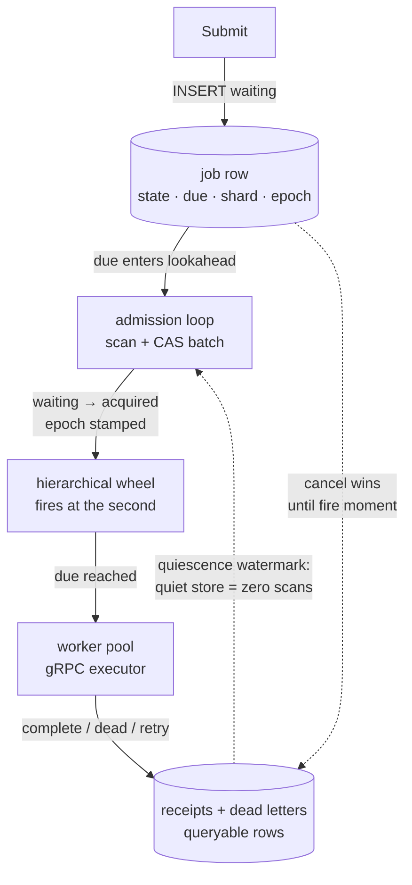
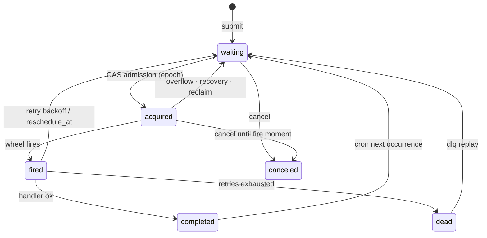
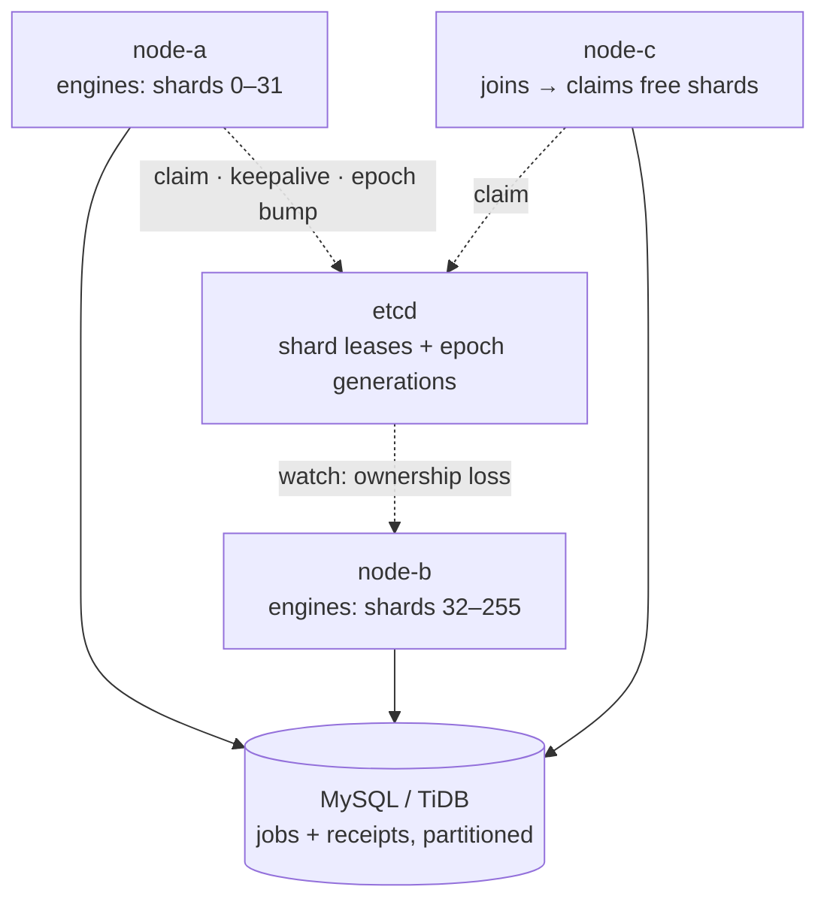

# hourglass

Delayed jobs and cron for Go: SQLite embedded, sharded MySQL/TiDB +
etcd cluster — same engine, same API.

```go
h, _ := hourglass.Open("sqlite://./hourglass.db")
defer h.Close()

h.Register("email:welcome", handler)
h.Submit(ctx, "email:welcome", payload, hourglass.Delay(24*time.Hour))
h.Every(ctx, "report:daily", "0 9 * * *")   // cron, registered handler
h.Cancel(ctx, id, "user asked")             // wins until the fire moment

go h.Run(ctx)                               // 1s ticks: admit -> wheel -> fire
```

CLI reads the same store: `hourglass stats`, `hourglass dlq ls`,
`hourglass dlq replay`.

## Design

Precision is not a polling interval. The database holds the long
horizon — a job due in two days is a quiet row. The wheel holds the
precision — a lookahead window admitted in CAS batches, fired from
memory at the second, zero DB reads between admission windows.

Fire path:



Job states (terminal rows persist as receipts until retention):



Cluster — ownership, not a leader:



Shards are logical and over-allocated, mapped onto partitions by a
directory — adding a node claims free shards, no data moves. Handoff
is graceful (drain the wheel, release) or lease-expiry (new owner
bumps the epoch, reclaims acquired rows, rescans the misfire horizon).

## Contracts

- Fire at the appointed second, never early, never skipped. Memory is
  a cache; the database is the owner.
- No orphans: a crashed node's in-flight jobs are reclaimed by lease
  expiry and re-fired within the misfire horizon.
- Cancel wins until the fire moment; epoch fencing stops a zombie
  node's late shots.
- Every fire is a receipt — "did this side effect happen?" is a SELECT.

## Hard parts

| Mechanism | Code | Proven by |
| --- | --- | --- |
| Epoch fencing: a zombie node cannot fire after handoff | `wheel.go` `SetEpoch`, `engine.go` epoch check on CAS + fire path | `TestWheelEpochFencingBlocksZombie`, `TestEpochFencingEndToEnd`, `TestTwoNodeShardFailoverEndToEnd` |
| Cancel is mark-don't-remove: no removal race with the tick | `wheel.go` `Cancel` + tick skip | `TestWheelCancelIsMarkNotRemove`, `TestCancelDuringPumpReReadWindow` |
| Misfire horizon: the wheel is lossy by design; rescan covers it | `engine.go` `misfireHalo` window floor | `TestOpenRecoversInFlightRows` |
| Wheel overflow releases surplus to `waiting` (backpressure, not OOM) | `engine.go` admit capacity + release | `TestWheelRejectsWhenFull`, `TestWheelOverflowReleaseEndToEnd` |
| Batched fire-path writes: one statement per tick per target state | `engine.go` pump (~32K id cap for MySQL packets) | `TestBenchmarkHotMinute` |
| Never early, never skipped | `wheel.go` tick semantics | `TestWheelNeverFiresEarly`, `TestWheelFiresAtAppointedSecond` |
| Ownership loss is a watch event, not a discovery poll | `registry.go` claim/lease/watch | `TestRegistryLeaseExpiryFreesShard`, `TestRegistryWatchDeliversOwnershipLoss` |
| Graceful handoff drains one per-shard wheel | `join.go` | `TestJoinClaimsShardsAndFiresJobs`, `TestGracefulHandoffMovesShardWithoutLoss` |

## Decisions

Only the choices whose alternative a competent engineer would defend:

| Decision | Rejected |
| --- | --- |
| DB keeps the long horizon; the wheel keeps the precision | shorter polling — precision bought with permanent DB load over all pending jobs |
| The wheel is the core; a broker is a post-1.0 delivery sink | broker-first — uncancellable after publish, delayed index on the broker's heap, three systems before the first job fires |
| Fencing authority is etcd epochs | DB-row fencing (Temporal's shape) — couples ownership to every store dialect; etcd leases deliver loss as a watch event |
| Cancel of an admitted-but-unfired job is mark-don't-remove | remove-under-lock — races the tick, and a slow cancel stalls the fire path |
| `fired_record` rows are the durable queue; memory is a cache | in-memory push with retry — a slow executor stalls the wheel; a crash between fire and delivery orphans the job |
| Admission is capacity-bounded; overflow releases back to `waiting` | unbounded wheel — the lookahead is a memory budget; without release it is an OOM, not backpressure |

## Measured

Gated tests (`-run TestBenchmark`, fake clock) — regressions fail CI:

| benchmark | hourglass | poll-based baseline |
| --------- | --------- | ------------------- |
| fire precision p50 / p99 / max (5,000 jobs / 10 min) | **0 / 0 / 1000 ms** (1s tick) | 2,000 / 4,000 / 5,000 ms (5s poll) |
| quiescent reads, 10 min idle, 100K pending | **2** (watermark) | 121 (one scan per interval, forever) |
| hot minute: 100K jobs due the same second | **11.1s drain, 0.02 write stmts/job, zero loss** | unbatched path: 4+ writes/job |

Cluster load, real MySQL 8.4 + etcd 3.5.17, one laptop
(`cmd/hourglass-bench`):

| jobs | shards | submit/s | fires/s | loss |
| ---- | ------ | -------- | ------- | ---- |
| 20,000 | 16 | 3,051 | 3,805 | 0 |
| 50,000 | 8 | 3,242 | 5,877 | 0 |
| 50,000 | 32 | 3,699 | 5,553 | 0 |
| 100,000 | 32 | 4,061 | **6,346** | 0 |

Failover (hard kill, 2,000 in-flight jobs, 3 runs): takeover 2.57–3.58s
(LeaseTTL-bound), 2,000/2,000 re-fired by the new owner, zero loss,
zero duplication.

Latency and drain curve from a measured run (HDR, per-job
source-anchored — no coordinated omission from the measuring side):


Defects caught by the bench suite, none visible to unit tests:

1. Hot minute stalled silently: batched id-list statements exceeded
   SQLite's ~8K placeholder cap → chunk at 500 per round-trip.
2. Reclaim was age-only: takeover right after a crash reclaimed
   nothing → `epoch < newEpoch` OR aged lease.
3. Engines spawned after `Register` started handlerless: reclaimed
   jobs dead-lettered 2,000/2,000 → engines inherit the registry.
4. `KillForTest` killed only the lease, simulating a zombie that
   happened to be correct → hard kill without drain, which exposed
   (2) and (3) in minutes.

The ~6.3K fires/s is a single-process ceiling at default knobs; the
200K/s ancestor ran broker delivery, not per-fire SQL receipts — not
comparable.

```sh
# engine benchmarks, anywhere (SQLite):
go test -run '^$' -bench 'Benchmark(Submit|FirePath)' -count 10 > old.txt
benchstat old.txt new.txt

# cluster scenarios (real MySQL + etcd):
hourglass-bench -s cluster-throughput -n 20000 -shards 16
benchplot -mode percentile -o latency.svg bench-results/*.json
```

## Limits

- The "standalone durable time layer" category is unproven; this is a
  reference implementation, not a category founder. Scope frozen at
  v1.0.
- Takeover is LeaseTTL-bound: 2.57–3.58s at TTL=3s, 15–20s at 15s. No
  loss — but every ownership change is a latency window.
- All numbers single-host, laptop-grade.
- 256 logical shards, fixed; rebalance is manual.

## Compared

|              | asynq          | river            | xxl-job        | Temporal         | hourglass          |
| ------------ | -------------- | ---------------- | -------------- | ---------------- | ------------------ |
| truth        | Redis zset     | PG rows          | SQL + logs     | sharded history  | SQL rows + receipts|
| precision    | 5s forwarder   | ~1s (leader scheduler + fetch) | dispatch loop | timer gate at the timestamp (wake = workflow callback through 3 hops) | time wheel (0ms p50 @ 1s tick) |
| scheduling plane | every server (redundant forwarders) | elected leader | central dispatcher (SPOF) | shard owners | shard owners |
| scale-out    | execution only | execution only   | dispatcher-bound | shards (fixed at boot) | shards (movable, no data moves) |
| cron durability | scheduler memory | leader memory — may skip on election (durable = Pro) | DB rows | event history | job row (completed → waiting) |
| cancel       | until claimed  | while running (cooperative) | manual | workflow-level | until fire moment (epoch-fenced) |
| dependency   | Redis          | PostgreSQL       | DB + central   | 4 services + DB  | the SQL you run    |

river is the interesting neighbor: same truth model, the difference is
entirely the scheduling plane — elected leader vs admission loop per
shard owner. Temporal runs the same shard-owner + fencing-generation
model (RangeID ≈ epoch, verified in source) with a workflow engine on
top; a durable timer shouldn't need one. Compose when you need replay.

## Not goals

Workflow/DAG orchestration · exactly-once delivery · step replay or a
durable-execution journal · natural-language time parsing · calling
models, ever · a required broker · multi-tenancy before the core is
proven.

## Status

v1.0 complete, frozen: embedded engine, cluster (MySQL/TiDB + etcd),
gRPC executor. CI: lint, race, real-infra integration, benchmark
gates. Clean-room rebuild from a production system that peaked above
200K execution commands per second —
[write-up](https://edwardshen125.github.io/posts/engineering-case-study/building-a-production-go-scheduler-for-200k-delayed-jobs-per-second/).

## License

MIT
