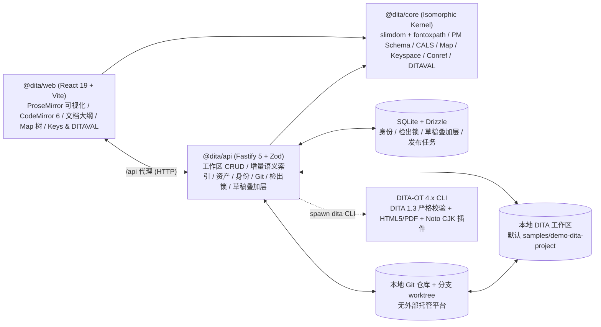

# DITAEditor

[](LICENSE)
[](CHANGELOG.md)
[](package.json)
[](https://github.com/Ericfeng84/DITAEditor/releases/latest/download/DITAEditor-1.5.0-mac-arm64.dmg)
[](https://github.com/Ericfeng84/DITAEditor/releases/latest/download/DITAEditor-1.5.0-win-x64.exe)

**简体中文** · [English](README.en.md)

面向技术文档团队的 **Web DITA 1.3 结构化写作工作台**：ProseMirror 可视化编辑与 CodeMirror 6 XML 源码双模，可折叠**文档大纲视图**与受 DITA 1.3 内容模型约束的拖拽重排，可视化 Map / Bookmap 编排，单一信息源语义引擎（Keyspace 键管理 / Conref / DITAVAL），**干净基线 + 个人草稿叠加层**的本地 Git 版本管理、检出锁与可视化 Diff，DITA-OT 4.x 权威校验与带主题的 HTML5 / 中文 PDF 发布，AI 片段级辅助，以及手册级 Topic 委派 —— 全部以标准 DITA XML 为唯一事实源，100% 无损往返、最小化 Git Diff。

> **v1.5.0**（Phase 0–13）· [更新日志](CHANGELOG.md) · [MIT 许可](LICENSE) · [架构基线与路线图](docs/architecture-and-plan.md) · [工程约定](AGENTS.md)

| 在线体验 | 地址 | 说明 |
| :--- | :--- | :--- |
| 官网与双语文档站 | https://ericfeng84.github.io/DITAEditor/ | Astro 静态站，含 DITA 沙箱与全文搜索（英文入口 `/en/`） |
| 完整版工作台 | https://www.cemplatformcvs.cloud/dita | GCP Cloud Run（子路径反代）：DITA-OT 4.2.1 严格校验、HTML5 主题与 Noto CJK PDF、Git 锁与 AI（[部署指南](docs/deploy-gcp-cloudrun.md)） |
| 纯浏览器离线版 | https://ericfeng84.github.io/DITAEditor/workbench/ | 内存中运行 `demo-dita-project`，无服务端 Git / 发布 / AI |

## 目录

- [界面预览](#界面预览)
- [核心能力](#核心能力)
- [系统架构与技术栈](#系统架构与技术栈)
- [仓库目录结构](#仓库目录结构)
- [快速开始](#快速开始)
- [官网、文档站与离线工作台](#官网文档站与离线工作台)
- [开发、构建与测试](#开发构建与测试)
- [REST API 速览](#rest-api-速览)
- [实施路线图](#实施路线图)
- [许可证](#许可证)

---

## 界面预览

> 截图均来自真实运行的中文界面（1600×1000）。英文界面截图见 [README.en.md](README.en.md#screenshots)。

**手册工作台：先分发，再写作（Phase 10）** — 入口即手册列表：卡片展示 Topic / Map 数量、当前分支、挂载目录与「待我处理」任务数；「我的编辑任务」按「我收到的 / 我委派的」分组，集中呈现状态、截止日期与逾期标记。


**三栏工作台与双模编辑** — 左栏在「项目文件 / Map 结构树 / Keys 键空间 / 版本 / 任务」间切换，中栏为多 Tab 可视化编辑区并实时提示检出权限，右栏为保持原始属性顺序的属性检查器；「可视化 / 双栏对比 / XML 源码」三视图随时切换。


**单一信息源语义引擎（Keyref / Conref / DITAVAL）** — 不改动底层 XML 的前提下，可视化区实时展开块级与行内 `conref`/`conkeyref` 只读预览（含嵌套 `keyref` 解析与一键溯源），并联动 Map 树应用 `.ditaval` 规则的「全部 / 淡化 / 隐藏」三态投影与 Flag 高亮。


**DITA-OT 4.x 严格校验与异步 HTML5 / 中文 PDF 发布** — 发布对话框集中选择 Root Map、HTML5 / PDF、DITAVAL 与标题，实时展示运行时、构建命令、`build.log`、发布历史与产物；严格校验展示真实退出码、耗时与 `DOTJ` / `DOTX` 诊断并可跳回源码行列。PDF 使用纯 XML 的 Noto CJK font-mappings 插件，零自定义 Java 代码。


<details>
<summary>展开更多截图（任务面板、双语界面、双栏对比、Git/Diff、严格校验、PDF 输出、AI 助手与 AI Diff）</summary>

**任务面板：状态、截止日期、逾期标记与完成操作** — 状态在待开始 / 进行中 / 已完成之间流转，逾期红色高亮，「打开 Topic」直接定位文件，标记完成后即刻从待办消失；任务只写 SQLite，不修改任何 XML。


**中英双语全栈界面（Phase 8）** — 工作台、对话框、诊断与文档站共用一套强类型双语文案，`zh-CN` 与 `en` 切换即时生效并持久化，英文界面同样覆盖手册、任务、检入与发布全流程。


**可视化与 XML 源码双栏对比** — 源码区提供 DITA 1.3 标签与属性补全、良构检查与格式化，双栏模式实时对照同一文档的两种表示。


**本地 Git 版本、Check-out 独占锁与可视化 Diff** — 阅读默认只读，检出后获得 `(项目, 分支, 文件)` 维度的独占写锁；保存后可预览工作区 Diff、填写提交说明并签入，提交后自动释放锁；不同分支使用独立 `git worktree`，互不阻塞。


**DITA-OT 严格校验结果与诊断**


**中文 PDF 输出（目录与正文，Noto CJK 嵌入）**


**AI 辅助写作与安全 Diff** — AI 只提交候选片段：面板流式输出提案并透明展示模型、键空间 / 路径索引 / DITAVAL 上下文徽标；每个补丁必须经 MergeView 差异确认（XML 良构、可视化兼容、DOCTYPE 保留、可重新严格校验）才能写入，应用后单步 `Cmd/Ctrl+Z` 即可撤销。


</details>

---

## 核心能力

### 1. 100% 无损 XML 往返内核（`@dita/core`）

前后端同构的 DITA XML 内核：XML 声明、`<!DOCTYPE>`、注释、PI、CDATA、命名空间与元素原始属性顺序（`rawAttrs`）在 `XML → slimdom → ProseMirror Doc → slimdom → XML` 往返中零丢失；序列化幂等，改一个字只变一行 XML（10 份复杂黄金样本验证）。

<details>
<summary>实现细节</summary>

- **解析与位置追踪**：基于 `slimdom` + `slimdom-sax-parser` + `fontoxpath`，解析时同步记录每个节点源码起止行列号，供源码跳转与诊断定位。
- **元数据零丢失**：XML 声明（`<?xml ...?>`）、`<!DOCTYPE ...>`（含完整 PUBLIC/SYSTEM 与内部子集）、注释（`<!-- ... -->`）、处理指令（`<?...?>`）、CDATA 与命名空间（`xml:*`、`xmlns:*`、`ditaarch:*`）完整保留；属性一律按 `rawAttrs` 原始顺序回写，不落为无序对象。
- **确定性序列化**：严格幂等（`roundTrip(roundTrip(x)) === roundTrip(x)`）与最小化变更范围，仅改文本时不扰动其它节点格式，由 `packages/dita-core/test/fixtures/` 的 10 份黄金往返样本守护。

</details>

### 2. 双模式 Topic 编辑器（可视化 / 双栏对比 / XML 源码）

原生 ProseMirror Schema 精细建模 DITA 1.3 结构，行内元素一律用 inline node 而非 Mark 以保证空元素与嵌套顺序保真，未知/特化标签原样透传；CodeMirror 6 提供语义补全、良构 Lint 与切换保护。

<details>
<summary>实现细节</summary>

- **精细建模与兜底透传**：Schema 建模 `concept` / `task` / `reference` / `topic` 核心结构（`title`、`shortdesc`、`prolog`、`section`、`steps/step/cmd`、`note`、`codeblock`、`dl`、`fig/image` 等）；行内元素（`<b>`、`<i>`、`<u>`、`<codeph>`、`<keyword>`、`<ph>`、`<xref>` 等）为 inline node，空元素、嵌套顺序与属性完整保真；同时支持 `<simpletable>` 与 OASIS CALS `<table>`（保留 `<colspec>`，支持 `namest`/`nameend`/`morerows` 跨行列转换与多 `tgroup` 保护）；未知/特化标签经 `unknown_block` / `unknown_pre_block` / `unknown_inline` / `unknown_inline_block` 透传并保留 `xml:space="preserve"` 空白语义。
- **高效写作交互**：支持「无标签 / 标签 / 含属性」三种渲染模式；上下文感知 `/` 斜杠菜单（仅列当前光标处合法的 DITA 元素）、选中文本悬浮气泡工具栏、Notion 风格块级手柄与块间 `+` 插块；右侧属性检查器覆盖核心属性、条件过滤（DITAVAL）、复用（Conref）与自定义属性并保持原始 XML 属性顺序，底部面包屑可快速选中祖先节点。
- **CodeMirror 6 源码与切换保护**：基于 `@dita/core` 规则表与活动 Root Map 语义提供标签、属性、`keyref` / `conkeyref` / 条件过滤值的补全，实时良构 Lint 与格式化；切回可视化前强制 `checkXmlWellFormed()`，语法错误时拦截切换并在源码精确定位 `{ line, column }`。

</details>

### 3. 文档大纲视图与结构重排（v1.5.0）

编辑器左侧独立大纲栏（`apps/web/src/editor/outline/`）把当前文档渲染成可折叠结构树：默认「结构骨架」只保留结构容器，「全部块级」展开所有块；支持按文本 / `<tag>` / `#id` 即时过滤、`+N` 隐藏子块徽标与结构告警圆点，`Cmd/Ctrl+Shift+O` 一键开合；展开、收起或切换视图不会重挂载编辑器，Undo 历史、选区与滚动位置完整保留。

<details>
<summary>实现细节</summary>

- **双向定位**：大纲与 Visual / Split / Source 三模式双向联动 —— 点击大纲节点平滑滚动并高亮脉冲，光标移动同步高亮对应大纲行。
- **受 DITA 1.3 约束的拖拽**：基于 `@dita/core` 的 `DITA_SEQUENCE_MODEL` 与 `isChildAllowed()` 计算合法落点，支持同容器排序与合法跨容器搬移（段落 / 提示拖入另一 `<section>`、`<li>` 拖入另一列表），非法落点实时提示原因；每次落点都是单个 ProseMirror 事务，一步 `Cmd/Ctrl+Z` 撤销且 100% 无损往返。
- **键盘与只读保护**：`Alt+↑/↓` 同级键盘重排；只读身份或他人检出状态下自动禁用拖拽与键盘重排。

</details>

### 4. 可视化 Map / Bookmap 树与多文件工作台

三栏可拖拽工作台 + 无损 Map / Bookmap DOM 引擎：拖拽调整 `topicref` / `mapref` / `topichead` / `chapter` / `keydef` 层级与顺序，同时原位保留 `<reltable>`、`<topicmeta>`、注释与 PI；配合多 Tab 编辑与项目级问题诊断面板。

<details>
<summary>实现细节</summary>

- **三栏可拖拽工作台**（`react-resizable-panels`）：左侧在「项目文件」「Map 结构树（`react-arborist`）」与「Keys 键空间」间切换；顶部提供 Root Map 选择器、DITAVAL 条件配置选择器与三态投影开关，以及快捷新建 / 导入 / 导出入口。
- **无损 Map / Bookmap DOM 引擎**：拖拽调整层级与顺序，右键按模板新建并挂载 Topic、挂载已有文件、编辑节点属性、一键查看 Map 源码。
- **多 Tab 编辑与问题诊断**：多文档标签页、未保存状态追踪、单文件 / 全部保存、还原基线；底部项目级诊断面板汇总 XML 良构错误、断链 `href`、循环 `<mapref>`、缺失图片、未定义 `keyref`、非法 / 循环 `conref` 与 `.ditaval` 语法错误。

</details>

### 5. 单一信息源语义引擎（Keyspace / Conref / DITAVAL）

Root Map 生效键空间按 BFS 与 **First Definition Wins** 裁决并支持 `keyscope` 隔离；Keyspace 面板内置键管理闭环（新建 `<keydef>` / 重命名 / 原位改值 / 绑定 `keyref`）；`conref` / `conkeyref` / `conrefend` 跨文档复用由 DFS 环路检测守护；`.ditaval` 条件过滤提供实时三态投影 —— 全部零 XML修改。

<details>
<summary>实现细节</summary>

- **BFS 键空间（`keydef` / `keyref` / `keyscope`）**：按 DITA 1.3 规范做广度优先遍历与冲突裁决，`keyscope` 作用域隔离且同一子 Map 在多作用域下不误报；左侧 Keys 面板展示当前 Root Map 生效键与被覆盖计数，可一键插入 `<keyword keyref="..."/>` 或跳转到定义行，可视化区实时解析行内 `keyref` 文本与图片引用并支持一键溯源。
- **键管理闭环（v1.5.0）**：`KeyspacePanel` + `NewKeyDialog` + `KeyrefAttrField` + `InsertKeyrefDialog` 覆盖「新建 Key → 在 Map 树与属性检查器中原位改值 → 一键绑定 `keyref`」全流程；Map 树过滤 `<keydef>` 噪音行并精简节点快捷操作，新建 / 改名写入标准 DITA `<keydef>` 而非私有索引。
- **跨文档复用与 DFS 环路检测**：支持直接 `conref`、间接 `conkeyref`、同文档 `#./id`、`conrefend` 范围切片、嵌套 `keyref` 展开及 DITA 1.3 特化兼容校验；DFS `visitStack` 精准拦截自循环、双向 / 多跳循环与嵌套子节点循环（放行合法菱形 DAG）并展示完整环路链；被复用片段以只读内联卡片渲染（纯 DOM 构造，不改写底层 `Doc` 与 XML），检视区「复用」tab 可按 Key 或相对路径浏览目标元素、实时预览展开结果并新建复用元素或绑定当前元素。
- **DITAVAL 三态投影**：完整解析 `.ditaval`（`<prop>`、`<revprop>`、`<startflag>` / `<endflag>`、`<style-conflict>`），遵循同属性多值全排斥、跨属性逻辑与 `props="group(val)"` 求值规则；一键切换 `.ditaval` 与「全部显示 / 置灰排除 / 隐藏排除」并实时同步 Map 树（隐藏模式锁定拖拽以防索引错位）与可视化区（Flag 配色与起止徽章），条件属性编辑器（`ProfilingAttrEditor`）内置项目全量词表与生效状态预览。

</details>

### 6. 本地工作区、增量语义索引与资产后端（`@dita/api`）

Fastify 5 + Zod 提供工作区扫描、文件 CRUD、批量导入与按分支缓存的增量语义索引器（`WorkspaceSemanticIndexer`）；保存 / 重命名 / 删除后自动刷新 Keyspace、Topic ID 索引与项目诊断，并内置路径安全防护与图片资产管线。

<details>
<summary>实现细节</summary>

- **内置示例项目**：默认加载 `samples/demo-dita-project/`（`product-manual.ditamap`、`admin-book.bookmap`、公共复用库 `shared/common-reuse.dita`、`filters/cloud-edition.ditaval` & `onprem-admin.ditaval`、嵌套子 Map、Concept/Task/Reference 文档与 SVG 架构图），离线内存模式体验一致。
- **路径安全**：`resolveSafeWorkspacePath` 拦截路径穿越（`..`）、绝对路径、空字节与符号链接逃逸。
- **资产管线**：Multipart 图片上传（`.png` / `.jpg` / `.jpeg` / `.gif` / `.svg` / `.webp` / `.avif`，单文件上限 10 MB），自动计算相对文档的 POSIX `href` 并提供预览路由。

</details>

### 7. 干净基线 + 个人草稿叠加层与本地 Git（Phase 4 / Phase 13）

基于 `simple-git` 在项目目录直接初始化本地仓库，零外部托管平台；共享分支 `workDir` 永远等于 Git `HEAD`，未检入的编辑 / 新建 / 删除 / 重命名与草稿图片隔离在每人自己的 SQLite 草稿叠加层；检出后按 `(project, branch, file_path)` 独占写入，签入前执行 XML 良构与 DITA 结构预检，并提供 MergeView 可视化 Diff、无污染合并、Tag / 安全回滚与版本审计。

<details>
<summary>实现细节</summary>

- **零外部依赖**：无需 GitHub / GitLab / Gitee，切换分支时重定向工作区根目录而不复制项目。
- **轻量身份与角色**：SQLite + Drizzle ORM 持久化免密码作者身份（管理员 / 编辑者 / 只读），工具栏一键切换；写接口在服务端强制校验角色与锁归属，只读身份及他人检出的文件在可视化与源码编辑器均自动只读。
- **独占锁与恢复**：不同文件、不同分支互不阻塞，仅能提交本人已检出且有改动的文件；支持撤销检出（回滚 `HEAD`）、释放锁保留草稿、管理员强制解锁并把内容与补丁写入 `lock_backups`。
- **可视化 Diff 与历史**：左侧「版本」面板展示分支、检出锁、工作区改动与提交历史，CodeMirror 6 `MergeView` 对比工作区改动或任意两个版本，签入前先预览 Diff 并填写提交说明。
- **干净基线 + 个人草稿叠加层（Phase 13）**：`apps/api/src/modules/locks/draft-service.ts`（SQLite `working_drafts` + 仓库外草稿资产）与 `apps/api/src/modules/files/overlay-workspace.ts` 提供与磁盘等价的叠加读取视图；跨文件诊断、严格校验与 AI 上下文读 `User Overlay`（`Baseline` + 本人草稿，`DitaSemanticIndex.cloneWithOverlay()`），正式发布默认走干净 `Baseline`（`HEAD` / `Tag` / `Commit`，经 `git archive` 快照），可选 `my_drafts` 预览只含请求者自己的草稿。
- **无污染合并与版本审计**：`apps/api/src/modules/git/merge-service.ts` 用 `git merge-tree` 预检冲突并隔离合成 merge commit，`MergeDialog` 逐文件并排求解 XML 冲突；Tag、文件还原、提交回滚与 append-only `version_audit_logs`（`apps/api/src/modules/git/audit-service.ts`）覆盖检出 / 转派 / 检入 / 合并 / 回滚 / 发布全链路。
- **检入校验门禁与 AI 修复闭环（v1.5.0）**：检入前对草稿执行 XML 良构与 DITA 结构预检，可从检入面板直接跳转问题行或呼起 AI 修复，修复完成后自动检出保存，校验不过不放行检入。

</details>

### 8. DITA-OT 4.x 权威校验与异步发布（Phase 5 / Phase 12）

双层校验：前端约束与 TS 语义索引负责零延迟把关，按需再调 DITA-OT `--validate=yes --processing-mode=strict` 做官方 DTD/RNG 校验；发布走 SQLite 任务表 + 进程内限流队列，产出带主题的 HTML5 ZIP 与嵌入 Noto CJK 的中文 PDF。

<details>
<summary>实现细节</summary>

- **双层严格校验**：解析 `DOTJ` / `DOTX` 错误码并跳转到源码行列；提供 Root Map 时按整图校验以保证 `keyref` / `conkeyref` / `conref` 解析，独立主题校验把缺少键上下文的 `DOTJ046E` 降级为警告；发布入口固定在 Map 树面板，对象始终是当前 Root Map。
- **零中间件发布流水线**：进程内 `PublishQueue` 并发限流（默认 1），每次发布复制分支工作区快照隔离构建，支持超时强杀、排队 / 运行中取消、`build.log` 落盘与 SSE 实时日志、重启后回收中断任务与按保留天数清理产物。
- **HTML5 与中文 PDF 交付**：HTML5 产物打包 ZIP 并提供 `/preview/*` 在线预览（相对资源路径可直接访问）；PDF 通过纯 XML 插件 `dita-ot-plugins/com.ditaeditor.pdf-cjk/`（`plugin.xml` + XML Catalog + DITA-OT 4 `font-mappings.xml` + `fop.xconf`）映射 Noto Sans / Serif / Mono CJK，发布时追加 `--customization.dir` 与 `--args.fo.userconfig` 并强制 `--validate=yes`。
- **HTML5 样式主题**：非 `vanilla` 任务追加 `--nav-toc=full`，构建后由确定性 Node 后处理器注入内置主题（`dita-ot-plugins/html5-themes/`：现代技术文档 / 出版极简纸白 / 企业标准手册 / 开发者暗夜风 + 原生兜底），提供可折叠目录树、页内大纲、`Cmd/Ctrl+K` 离线搜索、代码复制、明暗切换与移动端抽屉；品牌参数按手册存入 SQLite `manual_publish_profiles`，发布弹窗内可多视口实时预览，ZIP 解压后 `file://` 打开离线搜索同样可用，配置零 XML / Git 污染。
- **单容器交付**：`Dockerfile` 内置 Node 22、JRE 21、DITA-OT 4.2.1、Noto CJK 与字体插件；生产模式由 `@dita/api` 直接托管 `@dita/web` 构建产物，零 Redis / PostgreSQL 依赖。

</details>

### 9. AI 辅助写作与错误修复（Phase 6）

AI 只输出被替换区间的 XML，由 `@dita/core` 按源码偏移无损拼回并强制校验（良构 / ProseMirror 可转换 / DOCTYPE 与 XML 声明保留），失败自动带原因重试，写入前必须经 Diff 确认与 Check-out 锁守卫。

<details>
<summary>实现细节</summary>

- **片段级无损修改**：内核含 `extractTargetFragment` / `spliceAndVerifyAiXml` / `normalizeCandidateXml` / `buildDitaConstraintSummary`，支持**元素 / 行窗口 / 整篇**三种定位，重试默认 2 次。
- **四类任务**：`ask`（只答不改）、`authoring`（重写 / 扩写 / 精简 / 补写 shortdesc 与步骤）、`optimize_tags`（`uicontrol` / `menucascade` / `wintitle` / `filepath` / `codeph` / `parmname` 等语义标签与块结构）、`fix_error`（XML 结构、Map 链接、资源路径、Keyref、Conref 环路、DITAVAL 与 DITA-OT 严格校验错误）。
- **入口遍布工作台**：检视区「AI」页签（排在首位）与文档区右下角 AI 浮动按钮（默认「整篇 Topic」靶向，可切「片段」，带目标 / 上下文徽标、流式输出与 Diff 确认）、行内气泡栏「AI 改写 / 询问」、源码 XML 错误横幅「AI 修复」、问题面板与严格校验逐条修复；请求始终携带当前未保存缓冲区。
- **模型与审计**：`@dita/api` 用 LangChain.js（`@langchain/core` + `@langchain/openai`）封装 OpenAI 兼容 `ChatOpenAI`，默认 DeepSeek，可配置私有化 / 内网代理 `baseURL`、模型、Key、超时与重试；SQLite `ai_settings` 保存管理员配置（Key 仅返回掩码），`ai_usage_logs` 记录调用人、任务、文件、状态、重试、token 与耗时；管理员与文件所有者直接应用，未检出的编辑者先签出，只读或他人锁定仅可预览。

</details>

### 10. 全栈中英双语界面（Phase 8）

`@dita/core` 提供强类型 `UiLocale` 与 `formatMessage`，`@dita/web` 以「单一文案源 + `Record<MessageKey, string>`」让缺失键在 typecheck 阶段失败；切换语言不刷新页面、不重建编辑器实例，未保存缓冲区与撤销栈完整保留；`@dita/api` 按请求语言返回锁冲突、校验、发布与 AI 提示。

<details>
<summary>实现细节</summary>

- **零依赖强类型 i18n**：`src/i18n/messages/zh-CN.ts` 是唯一文案源（`MessageKey` 由它派生），`en.ts` 用 `Record<MessageKey, string>` 强制键集合一致，`pnpm --filter @dita/web typecheck` 即可校验缺失或拼错的键。
- **无损热切换**：顶栏 `中文 / EN` 只更新 Zustand locale store 与 `html[lang]`，ProseMirror 装饰通过 `DITA_DECORATIONS_KEY` 的 locale 元数据单事务刷新，`index.css` 的 `:root[lang="en"]` 同步替换 5 个 DITA 区块伪标签。
- **双语元素词典**：`dita-rules.ts` 为 110+ 元素与属性补充英文标签 / 说明 / 占位符（`getElementLabel(spec, locale)` 等），`createTopicTemplate` / `createMapTemplate` 支持 `lang: 'en'` 生成 `xml:lang="en"` 的 OASIS 1.3 模板。
- **服务端双语与门禁**：`resolveRequestLocale(req)` 依次读取 `x-dita-locale` → `Accept-Language` → `zh-CN`，`HttpError` 携带 `{ key, params }` 按请求语言渲染，XML 正文仍遵循文档自身 `xml:lang`；`apps/web/test/i18n-parity.test.ts`（键集合 / 占位符 / 空值）、`apps/web/test/no-hardcoded-cjk.test.ts`（注释剥离后零硬编码中文）、`apps/api/test/phase8-i18n.test.ts`（角色、锁冲突、校验提示与 AI 未配置守卫在 `x-dita-locale: en` 下均为英文）三道门禁防回归。

</details>

### 11. 手册工作台与 Topic 委派（Phase 10）

工作台入口即手册列表，支持接入已有目录、新建、归档与恢复；每个任务绑定 `(手册, 分支, Topic, 负责人, 截止日期, 备注)`，逾期高亮、一键打开 Topic 或标记完成 —— 元数据只写 SQLite，从不污染 XML 与 Git 历史。

<details>
<summary>实现细节</summary>

- **手册即入口**：卡片展示 Topic / Map 数量、当前分支、挂载目录、「待我处理」数量与最近打开时间，内置示例手册开箱可用。
- **任务委派**：「我收到的 / 我委派的」双视图与待开始 / 进行中 / 已完成状态机。
- **不污染文档**：手册元数据与任务只存 SQLite（`manuals` / `assignments`），不产生额外 Git 提交，文档仍走标准检出与提交链路。
- **与编辑区联动**：编辑器「任务」页签与顶部任务条展示当前 Topic 委派状态，支持委派、转派、检出并开始；管理员可在任意手册委派，作者只能查看与完成自己的任务。

</details>

### 12. 文档智能导入与工具化 DITA-OT 修复 Agent（Phase 14）

一键将 PDF、Word（`.docx`）、PowerPoint、Excel、HTML、EPUB、CSV、Outlook（`.msg`）与 Markdown 转换为标准 OASIS DITA 1.3 手册或 Topic：先经 **Docling + Microsoft MarkItDown** 双解析层转为 Markdown 并提取独立图片，再由多角色 AI Agent（Planner → Writer → **工具化 DITA-OT Repair Agent**）撰写、校验并自动修复；支持新建干净基线手册或在现有手册中写入 Phase 13 个人草稿叠加层。

<details>
<summary>实现细节</summary>

- **双解析器与智能路由**：PDF / 扫描件 / AsciiDoc 优先 **Docling**（`docling-serve` sidecar HTTP 异步 API 优先、本机 `docling` CLI 回退），Office / EPUB / CSV / HTML 优先亚秒级零 GPU 的 **MarkItDown**（`--keep-data-uris` 保留 Base64 插图并剥离为 `images/*` + `asset://` 占位符），`.md` / `.txt` 零依赖直通；上传向导第 1 步支持按次覆盖解析引擎。
- **两段式 5 步向导**：默认在解析与大纲规划后暂停于审阅页（支持编辑 Markdown、检查图片、调整 Map / Topic 拆分与重新规划），也提供「一键全自动」直通撰写；工作台首页、Map 树右键、文件树、新建 Topic 弹窗与 `Ctrl/Cmd+Shift+I` 均可直达。
- **工具化 DITA-OT 修复 Agent 与确定性终检**：Writer 后处理幂等注入标准 `DOCTYPE`、`id`/`xml:lang`、精确相对图片路径与外链 `scope="external" format="html"|"pdf"`；Layer 1 拦截良构、内容模型、Topic 根非法直系子节点、ProseMirror 往返与缺失资产；Layer 2 先 `lax` 预扫暴露全部出错文件，再在沙箱 `stagingDir` 中向模型提供 `dita_ot_validate`（`lax`/`strict`）、`list_staged_files`、`read_staged_file`、`write_staged_file` 四个工具批量修复 Topic 与 Map，配动态步数/调用预算、无进展熔断、非 Tool-Calling 模型按 Topic 独立计数降级，以及外层**确定性 `strict` 终检门禁**（无 DITA-OT 时显式 `skipped`）。
- **容器按需组合**：主 `Dockerfile` 默认 `ARG INSTALL_MARKITDOWN=false` 保持零 Python 依赖精简；根级 `docker-compose.yml` 一键编排 `ditaeditor`（含 MarkItDown）+ `docling-serve` sidecar。

</details>

---

## 系统架构与技术栈

**pnpm Workspace + Turborepo** 组织的纯 TypeScript 全栈 Monorepo。XML 解析、无损序列化、DITA 1.3 元素规则、CALS 表格模型与 Map DOM 操作沉淀在共享包 `@dita/core`，由 `@dita/web` 与 `@dita/api` 共同复用；DITA 1.3 DTD/RNG 严格校验与 HTML5/PDF 发布由 `@dita/api` 直接调度 DITA-OT 4.x CLI，零 Java 业务代码。



| 层级 / 模块 | 技术选型 | 说明 |
| :--- | :--- | :--- |
| **Monorepo 工程** | pnpm 11 + Turborepo | 统一管理 `@dita/core`、`@dita/web`、`@dita/api` 构建、类型检查与测试 |
| **前端工作台** | React 19 + TypeScript 5.8 + Vite 6 + Tailwind CSS 4 | 响应式三栏工作台与高精度编辑界面 |
| **可视化编辑** | 原生 ProseMirror | 贴合 DITA DTD 结构约束，自定义 NodeView 与块/行内操作体验 |
| **文档大纲** | 原生 React 结构树 + `DITA_SEQUENCE_MODEL` | 可折叠大纲、双向定位与受内容模型约束的拖拽 / 键盘重排 |
| **XML 源码编辑** | CodeMirror 6 | XML 语法高亮、DITA 1.3 智能补全与实时良构 Lint |
| **Map 树与状态** | `react-arborist` + `react-resizable-panels` + Zustand | 虚拟化结构树、拖拽调层级、分栏布局与多 Tab 状态管理 |
| **XML 无损内核** | `slimdom` + `slimdom-sax-parser` + `fontoxpath` | 无损 DOM 表示、节点位置追踪与 XPath 3.1 查询 |
| **后端 API** | Fastify 5 + `@fastify/multipart` + Zod | 本地磁盘工作区管理、资产上传预览与项目诊断接口 |
| **持久化与协作** | SQLite + Drizzle ORM + `better-sqlite3` | 轻量身份/角色、检出锁与管理员解锁补丁备份，零外部数据库依赖 |
| **版本管理** | `simple-git` + `git worktree` + SQLite 草稿叠加层 | 干净基线 + 个人草稿层、分支隔离工作区、无污染合并、Tag / 回滚与版本审计 |
| **校验与发布** | DITA-OT 4.2.x CLI + JRE 21 | 官方 DITA 1.3 DTD/RNG 严格校验、HTML5 / PDF2 发布、纯 XML Noto CJK 字体插件 |
| **桌面客户端** | Electron 35 + `electron-builder` + `esbuild` | 轻量桌面版（macOS Apple Silicon `arm64` & Windows `x64`），主进程内嵌 `@dita/api`，数据隔离至 `userData` |
| **测试框架** | Vitest 3 | 覆盖核心 round-trip 黄金样本、编辑器交互命令、工作区 API、Git/锁全链路与桌面路径/Windows 启动单测 |

### 仓库目录结构

```text
DITAEditor/
├── packages/
│   └── dita-core/              # @dita/core — 前后端共享的 DITA 1.3 与 XML 无损内核
│       ├── src/
│       │   ├── xml/            # slimdom 解析、位置追踪、确定性序列化、XPath、DOM 对比
│       │   ├── model/          # DITA 1.3 元素元数据、内容约束与属性规则表
│       │   ├── cals/           # OASIS CALS 表格 <-> colspan/rowspan 双向转换
│       │   ├── map/            # Map/Bookmap DOM 树引擎与 POSIX 路径工具
│       │   ├── ditaval/        # .ditaval 解析、多值/分组条件求值与 Flag 合并
│       │   ├── semantics/      # BFS Keyspace、Conref/Conkeyref 解析、DFS 环路检测与增量索引
│       │   ├── templates/      # Topic (concept/task/reference/topic) 与 Map/Bookmap 模板
│       │   ├── ai/             # AI 目标片段定位、候选 XML 规整、无损拼接校验与 DITA 约束摘要
│       │   └── prosemirror/    # ProseMirror Schema 与 slimdom <-> PM Doc 无损双向转换
│       └── test/fixtures/      # 10 份复杂 DITA 1.3 黄金往返测试样本
├── apps/
│   ├── web/                    # @dita/web — React 19 + Vite 双模结构化写作工作台
│   │   └── src/
│   │       ├── components/     # 顶栏、Tab 栏、文件浏览、Keys 面板、属性/复用检视区、条件编辑器、问题面板
│   │       ├── editor/         # visual/ (ProseMirror + 语义装饰/Conref 渲染)、outline/ (大纲模型、拖拽与定位)、source/ (CodeMirror 6)
│   │       ├── map-tree/       # react-arborist Map 树、DITAVAL 投影、节点检查器、右键菜单、概览面板
│   │       ├── components/publish/ # 发布对话框、构建日志流与严格校验结果
│   │       ├── ai/             # AI 面板/设置/用量/Diff 对话框、SSE 客户端、目标构建与会话状态
│   │       ├── services/       # API 客户端、离线示例回退与持久化桥接
│   │       └── store/          # Zustand 工作台、多 Tab 与语义上下文状态管理
│   ├── api/                    # @dita/api — Fastify 5 本地工作区、增量语义索引与资产服务
│       └── src/modules/
│           ├── files/          # 安全路径校验、工作区扫描、文件 CRUD、Multipart 上传、诊断与叠加读取视图
│           ├── indexer/        # WorkspaceSemanticIndexer 与 /api/semantics/* 语义路由
│           ├── locks/          # 检出锁、草稿叠加层（working_drafts）与检入校验门禁
│           ├── git/            # 本地仓库、worktree、无污染合并、Tag / 回滚与版本审计
│           ├── identity/       # 免密码作者身份与三档角色
│           ├── validate/       # /api/validate/strict DITA-OT 严格校验
│           ├── publish/        # SQLite 发布任务、快照构建、SSE 日志与产物下载
│           ├── ai/             # AI 配置/用量、Prompt 构建、LangChain 模型工厂、SSE 编排与重试
│           └── dita-ot/        # dita CLI 运行时探测、子进程调度与 DOTJ/DOTX 日志解析
│   ├── site/                   # @dita/site — Astro 5 双语官网与文档站（GitHub Pages 同步打包 /workbench/ 离线工作台）
│   │   └── src/
│   │       ├── pages/          # 双语首页、/docs/*、404 与 robots/sitemap
│   │       ├── content/docs/   # 中英对称的 6 篇文档（Content Collections）
│   │       ├── components/     # 首屏/首页区块、mini-demo 岛屿与 Pagefind 搜索弹窗
│   │       ├── lib/            # 行级 Diff、站点配置与页面路径辅助
│   │       └── styles/         # Tailwind 4 CSS-first 设计令牌与组件样式
│   └── desktop/                # @dita/desktop — Electron 轻量桌面端（macOS arm64 & Windows x64）
│       ├── src/                # main.ts（内嵌 Fastify）、preload.ts、paths.ts（userData 隔离与首次样本拷贝）
│       ├── scripts/            # build.mjs（esbuild）与 stage.mjs（扁平依赖打包）
│       ├── build/              # macOS .icns / Windows .ico 图标与 entitlements.mac.plist
│       └── electron-builder.yml# macOS Apple Silicon (.dmg/.zip) 与 Windows x64 (NSIS .exe/.zip) 打包配置
├── .github/workflows/          # deploy-site.yml / deploy-hf-space.yml / deploy-cloudrun.yml / release-desktop.yml
├── deploy/                     # 云端托管配置（huggingface/ 与 gcp/：cloudbuild.yaml、deploy-cloudrun.sh）
├── samples/
│   └── demo-dita-project/      # 开箱即用的多变体 DITA 1.3 演示项目（Map/Bookmap/复用库/DITAVAL/SVG）
├── docs/
│   ├── architecture-and-plan.md # 完整架构设计基线与分阶段实施路线
│   ├── deploy-gcp-cloudrun.md  # GCP Cloud Run 低成本试用部署、子路径反代与 WIF 自动发布指南
│   ├── deploy-huggingface-spaces.md # Hugging Face Spaces 单容器部署指南
│   ├── deploy-github-pages.md  # GitHub Pages 官网与离线工作台部署指南
│   ├── phase12-html-themes-plan.md # Phase 12 HTML5 发布样式主题与模板蓝图
│   ├── phase13-versioning-overlay-plan.md # Phase 13 干净基线与个人草稿叠加层方案
│   ├── key-management-integration-plan.md # Keyspace 键管理与新建 Key 工作流方案
│   ├── checkin-validation-ai-fix-plan.md  # 检入校验门禁与 AI 修复闭环方案
│   ├── adr/                    # 架构决策记录（手册工作区、请求隔离、软委派、草稿叠加层）
│   ├── phase7-site-plan.md     # Phase 7 官网/沙箱/文档站蓝图
│   ├── phase6-ai-contract.md   # Phase 6 AI 接口/SSE/DB/前端集成契约
│   └── pic/                    # 工作台界面截图
├── dita-ot-plugins/            # DITA-OT 4.x 插件与静态发布主题（纯 XML/CSS/JS，零 Java 代码）
│   ├── com.ditaeditor.pdf-cjk/ # 中文 PDF 字体映射插件（Noto CJK）
│   └── html5-themes/           # 4 套 HTML5 发布样式主题 + 共享排版底座与离线运行时
├── Dockerfile                  # 单容器构建（Node + JRE 21 + DITA-OT + Noto CJK）
└── graphify-out/               # 项目代码库知识图谱
```

---

## 快速开始

### 环境要求

| 依赖 | 版本 | 用途 |
| :--- | :--- | :--- |
| Node.js | **22+** | 运行 `@dita/web`、`@dita/api` 与构建脚本 |
| pnpm | **11.5+** | Monorepo 依赖管理与 workspace 脚本 |
| Java | **21** | DITA-OT 4.x 运行时（仅严格校验 / 发布需要） |
| DITA-OT | **4.2.x** | 官方 DITA 1.3 DTD/RNG 校验与 HTML5 / PDF 构建 |
| Noto CJK | Sans / Serif / Mono | 中文 PDF 字体嵌入（Docker 镜像已内置） |
| Docker | 24+（可选） | 单容器一键部署，内置全部运行时 |

### 方式一：Docker 单容器（推荐，开箱即用）

镜像已内置 Node 22、JRE 21、DITA-OT 4.2.1、Noto CJK 与字体插件，无需在宿主机安装 Java / DITA-OT；生产模式由 API 直接托管前端构建产物：

```bash
docker build -t dita-editor .
docker run --rm -p 3001:3001 -v dita-editor-data:/data dita-editor
# 浏览器打开 http://localhost:3001
```

`/data` 卷包含默认示例工作区（首次启动自动播种）、SQLite 数据库、分支 worktree 与发布历史；备份该卷即可迁移全部项目数据。也可通过 `-v /path/to/project:/data/workspace` 挂载宿主 DITA 项目。

### 方式二：本地源码 + 本机 DITA-OT

```bash
# 1. 安装依赖
pnpm install

# 2. 首次编译共享内核 @dita/core（供 @dita/api 与 @dita/web 引用）
pnpm --filter @dita/core build

# 3. 准备 DITA-OT 4.2.1（macOS / Linux，安装到自动探测目录）
curl -L -o /tmp/dita-ot.zip \
  https://github.com/dita-ot/dita-ot/releases/download/4.2.1/dita-ot-4.2.1.zip
unzip -q /tmp/dita-ot.zip -d "$HOME/.local/share"
mv "$HOME/.local/share/dita-ot-4.2.1" "$HOME/.local/share/dita-ot"
"$HOME/.local/share/dita-ot/bin/dita" --version

# 4. 可选：准备 Noto CJK 字体（也可设置 DITAEDITOR_NOTO_CJK_DIR）
#    放到 ~/.local/share/fonts/noto 或 ~/Library/Fonts/Noto 即可被自动探测

# 5. 并行启动后端 API 与前端开发服务器
pnpm dev
```

启动完成后访问：**前端工作台** `http://localhost:5173`（Vite 已把 `/api` 代理至 `http://localhost:3001`）、**后端 API** `http://localhost:3001`（健康检查 `GET /health`）。也可在两个终端分别执行 `pnpm --filter @dita/api dev` 与 `pnpm --filter @dita/web dev`。

#### 本机 DITA-OT 配置

不使用 Docker 时，安装 DITA-OT 4.x 并确保 `dita` 在 `PATH` 中（或设置 `DITA_OT_HOME`；也会自动探测 `~/dita-ot`、`~/.local/share/dita-ot`、`/opt/dita-ot`、`/usr/local/dita-ot`）；中文 PDF 需额外准备 Noto CJK 字体，可设置 `DITAEDITOR_NOTO_CJK_DIR`，或放入 `~/.local/share/fonts/noto`、`~/Library/Fonts/Noto` 由运行时自动探测。`pnpm --filter @dita/api dev` 启动后，发布对话框会显示运行时检测结果。无需把插件安装进 DITA-OT：`@dita/api` 始终通过 `--customization.dir` 加载仓库内插件，避免 DITA-OT 4 的 Catalog 顺序覆盖；如需让其他 DITA-OT 命令复用，可 `cd dita-ot-plugins && zip -qr /tmp/plugin.zip com.ditaeditor.pdf-cjk && dita install /tmp/plugin.zip`。

### 方式三：桌面客户端（macOS Apple Silicon & Windows x64，轻量版）

无需安装 Docker 或 Node.js，直接从 GitHub **Releases** 下载对应平台安装包运行：

- **macOS (Apple Silicon `arm64`)**：`DITAEditor-<version>-mac-arm64.dmg` / `.zip`
- **Windows (`x64`)**：`DITAEditor-<version>-win-x64.exe`（NSIS 安装程序）/ `.zip`（便携版）

桌面端在主进程内嵌 `@dita/api`（仅监听 `127.0.0.1` 随机端口），内置中文 PDF 字体插件与示例项目；所有工作区、SQLite 数据库（`dita-editor.sqlite`）、分支 `git worktree` 与发布产物均保存在系统用户数据目录（`app.getPath('userData')`，可通过环境变量 `DITA_DESKTOP_DATA_DIR` 覆盖）。轻量版会自动探测本机已安装的 Git 与 DITA-OT 4.x（若未安装，编辑、Map 编排、Keys/Conref/DITAVAL 与 AI 辅助仍可正常使用）。

> 未配置商业代码签名证书的开源构建首次启动时：macOS 如遇 Gatekeeper 提示可执行 `xattr -cr /Applications/DITAEditor.app`；Windows SmartScreen 点击「更多信息 → 仍要运行」。

本地开发与手动打包桌面端：

```bash
# 1. 先构建工作台三包
pnpm --filter @dita/core --filter @dita/web --filter @dita/api build

# 2. 本地启动 Electron 桌面端开发预览
pnpm --filter @dita/desktop dev

# 3. 本机打包（按当前操作系统执行对应命令，产物输出在 apps/desktop/release/）
CSC_IDENTITY_AUTO_DISCOVERY=false pnpm --filter @dita/desktop run dist:mac   # macOS Apple Silicon
CSC_IDENTITY_AUTO_DISCOVERY=false pnpm --filter @dita/desktop run dist:win   # Windows x64
```

**自动发布**：发布正式 Release 时，[`.github/workflows/release-desktop.yml`](.github/workflows/release-desktop.yml) 会在 `macos-latest`（`arm64`）与 `windows-latest`（`x64`）并行打包，将 Tag 同步为应用版本号并把双端安装包挂载到该 Release（也支持在 Actions 中通过 `workflow_dispatch` 手动试跑）。

### 方式四：云端低成本试用部署（GCP Cloud Run + 子路径反代 + Push 自动部署）

面向线上试用或团队外部演示，可将单容器镜像以 **`min-instances=0` / `max-instances=1`（2 vCPU / 2 GiB）** 部署到 GCP Cloud Run（`asia-northeast1`），并通过主域名子路径反向代理（如 Vercel `vercel.json` Rewrites 或 Cloudflare Worker）实现中国大陆直连，再结合 GitHub Actions **Workload Identity Federation（无密钥 OIDC）** 与 Artifact Registry 清理策略在每次 `push` 到 `main` 时自动构建发布：

```bash
# 首次手动初始化构建与部署（默认适配 /dita 子路径反代）
GCP_PROJECT_ID="<你的GCP项目ID>" ./deploy/gcp/deploy-cloudrun.sh
```

完整架构说明、子路径反代配置、WIF 无密钥 CI 配置、Artifact Registry 清理策略与一键清零费用命令详见 **[docs/deploy-gcp-cloudrun.md](docs/deploy-gcp-cloudrun.md)**（另提供 [Hugging Face Spaces](docs/deploy-huggingface-spaces.md) 与 [GitHub Pages](docs/deploy-github-pages.md) 部署指南）。

### 方式五：仅编辑 / 语义写作（不安装 DITA-OT）

只运行编辑、Map 编排、Keys / Conref / DITAVAL、Git 与检出锁时，可跳过 Java 与 DITA-OT；发布与「DITA-OT 严格校验」会显示运行时未就绪，不影响其它功能。

### 后端环境变量（`@dita/api`）

<details>
<summary>展开环境变量表（端口、DITA-OT、发布、AI）</summary>

| 变量名 | 默认值 | 说明 |
| :--- | :--- | :--- |
| `PORT` | `3001` | Fastify 服务监听端口 |
| `DITA_BASE_PATH` | 空 | 反向代理子路径前缀（如 `/dita`）；Fastify 通过 `rewriteUrl` 自动剥离，配合构建期 `VITE_BASE=/dita/` |
| `DITA_WORKSPACE_DIR` | `samples/demo-dita-project` | 启动时默认打开的本地 DITA 项目目录 |
| `DITA_IMPORTS_DIR` | `.dita-workspaces` | 导入项目、SQLite 数据库（`dita-editor.sqlite`）与分支 `git worktree` 的存放根目录 |
| `DITA_LOCK_TTL_HOURS` | `72` | 检出锁过期提示阈值（小时，仅界面提醒，不自动删锁） |
| `DITA_OT_HOME` / `DITA_HOME` | 空 | DITA-OT 4.x 安装目录；未设置时自动探测常见目录，最后回退 `PATH` 中的 `dita` |
| `DITA_CMD` | 空 | 显式指定 `dita` 可执行文件路径（优先级高于 `DITA_OT_HOME`） |
| `DITA_PUBLISH_DIR` | `.dita-workspaces/publish` | 发布任务快照、`build.log` 与产物存储根目录 |
| `DITA_PUBLISH_CONCURRENCY` | `1` | 进程内并发构建数；大队列建议保持 1–2 |
| `DITAEDITOR_PDF_PLUGIN_DIR` | 仓库 `dita-ot-plugins/com.ditaeditor.pdf-cjk` | 中文 PDF 字体插件目录，同时作为 `--customization.dir` |
| `DITAEDITOR_HTML_THEMES_DIR` | 仓库 `dita-ot-plugins/html5-themes` | HTML5 发布主题资源目录；打包版桌面端由主进程显式传入 |
| `DITAEDITOR_FOP_XCONF` | 插件内 `fop.xconf` | FOP 字体配置模板 |
| `DITAEDITOR_NOTO_CJK_DIR` | `/usr/share/fonts/opentype/noto` | Noto CJK 字体目录，用于生成本次构建的 `fop.xconf` |
| `DITA_WEB_DIST` | `apps/web/dist` | 生产模式静态前端目录；存在 `index.html` 时由 API 托管 |
| `DEEPSEEK_BASE_URL` | `https://api.deepseek.com/v1` | OpenAI 兼容 AI 端点；内网代理填其 `/v1` 地址（后台「AI 设置」可覆盖） |
| `DEEPSEEK_MODEL` | `deepseek-flash` | 默认模型名，可换成代理暴露的任意模型 |
| `DEEPSEEK_API_KEY` | 空 | AI Key 的环境变量兜底；数据库中管理员保存的 Key 优先 |
| `AI_TIMEOUT_MS` | `45000` | 单次模型调用超时（毫秒） |
| `AI_MAX_CONTEXT_CHARS` | `24000` | 项目上下文（键空间/路径索引/DITAVAL 词表）字符预算 |
| `DITA_INGEST_DIR` | `<importsRoot>/ingest` | Phase 14 导入暂存目录（容器内默认 `/data/ingest`） |
| `INGEST_DEFAULT_ENGINE` | `auto` | 文档导入默认解析引擎：`auto` / `docling` / `markitdown` |
| `DOCLING_MODE` | `auto` | Docling 通道：`auto` / `serve` / `cli` / `off` |
| `DOCLING_SERVE_URL` | `http://localhost:5001` | `docling-serve` HTTP 地址（`docker-compose.yml` 默认指向 `http://docling-serve:5001`） |
| `MARKITDOWN_ENABLED` | `true` | 是否启用本机 / 容器内 `markitdown` CLI |

</details>

---

## 官网、文档站与离线工作台

独立静态站 `apps/site`（`@dita/site`，Astro 5 + React 19 Islands + Tailwind CSS 4），与单容器工作台镜像完全解耦、可托管在任意 CDN：

| 入口 | 内容 |
| :--- | :--- |
| `/` · `/en/` | 中英双语官网首页：Hero、真实工作台多 Tab 展台（手册工作台 / 三栏编辑 / 双模 / 单一信息源 / 发布 / AI）、CCMS / Markdown 对照表、「改一字仅变一行 XML」微演示、九大能力深度展台（含文档大纲视图）、单容器架构全景、Docker / pnpm / AI 三条快速启动路径 |
| `/workbench/` | **纯浏览器三栏离线工作台**：由 `@dita/web` 以 `VITE_STATIC_DEMO=true` 构建并合包发布，运行多文件示例项目、Map 树、可视化/源码双模编辑与 Keys/Conref/DITAVAL（不含服务端 Git、DITA-OT 发布与 AI 代理） |
| `/docs/*` · `/en/docs/*` | 六篇对称文档（简介、Docker 快速开始、本地开发与字体配置、功能导览、AI 配置、架构参考），带页内 TOC、代码一键复制与中英静态全文检索（`Cmd/Ctrl+K`，Pagefind） |

首页「改一个字，只变一行 XML」微演示以 `client:visible` 懒加载，首屏不加载 ProseMirror / CodeMirror chunk。

```bash
pnpm --filter @dita/site dev      # http://localhost:4321
pnpm --filter @dita/site build    # 静态产物 + Pagefind 索引
pnpm --filter @dita/site test     # 双语字典/文档 slug 对称性与预设往返无损
```

部署：`.github/workflows/deploy-site.yml` 在 `main` 推送时构建 `@dita/site` 与离线版 `@dita/web`（输出至 `/workbench/`）并发布到 GitHub Pages（详见 [docs/deploy-github-pages.md](docs/deploy-github-pages.md)）；`SITE_URL` / `SITE_BASE` 通过仓库变量覆盖根路径或子路径（如 `/DITAEditor/`）。

---

## 开发、构建与测试

```bash
pnpm -r build && pnpm -r typecheck && pnpm -r test   # 全量
pnpm build && pnpm typecheck && pnpm test            # 或 Turborepo 快捷脚本
```

当前测试覆盖 **807/807 Vitest 全部通过**：

<details>
<summary>展开各包测试明细</summary>

- `@dita/core`（232 项）：10 份复杂 DITA 1.3 黄金往返、未知/特化元素透传、OASIS CALS 表格网格计算、XML 解析/XPath 3.1、规则与模板、Phase 9 顺序/基数内容模型校验、Map/Bookmap 无损操作（含 `<keydef>` 增删改与降噪）、DITAVAL 条件求值（多值/分组/Flag/冲突配色）、BFS Keyspace + `keyscope`、Conref/Conkeyref/`conrefend` 展开与 DFS 环路检测、AI 片段定位与无损拼接，以及 Phase 14 Markdown 大纲切片、Base64 图片剥离与无损 Map 挂载。
- `@dita/web`（356 项）：ProseMirror ↔ XML 桥接、表格命令、行内气泡栏、块级手柄与变换、顺序引导与结构装饰、CodeMirror DITA 补全（含 `keyref` / `conkeyref` / 条件属性语义补全）、Map 树工具与 DITAVAL 投影、可视化语义装饰无损往返断言、复用属性值组装、Phase 4 身份/锁只读投影、Phase 8 双语目录对称与源码硬编码中文扫描、Phase 10 手册工作台路由与防丢逻辑、文档大纲模型/拖拽重排、Keyspace 键管理与检入校验门禁，以及 Phase 14 导入进度步骤状态测试。
- `@dita/api`（185 项）：内置示例项目零错误校验、55 个 Topic + 4 个嵌套子 Map 规模化扫描与安全/上传/断链测试、`/api/semantics/*` Root Map 切换与增量环路诊断、Phase 4 身份/Git/锁/跨分支隔离/强解备份、Phase 5 运行时探测（含 Windows `dita.bat` 调度封装 `resolveDitaSpawn`）、DOTJ/DOTX 日志归一化、严格校验与 HTML5/PDF 发布流水线、Phase 6 AI 配置/掩码/用量/SSE 回归、Phase 8 `x-dita-locale` 双语响应、Phase 10 多手册隔离与任务委派全链路、Phase 13 草稿叠加层/无污染合并/Tag/回滚/审计与检入结构预检，以及 Phase 14 双解析器路由、多角色 Agent、工具化 DITA-OT 修复 Agent（含跨文件修 Map / 熔断 / 终检门禁 / 非工具降级）与端到端导入路由测试。
- `@dita/site`（30 项）：中英双语字典键对称、文档 slug 对称、子路径（`SITE_BASE`）与离线工作台路由辅助，以及 `@dita/core` 预设无损往返。
- `@dita/desktop`（4 项）：打包态/开发态资源与 `userData` 路径隔离、首次样本拷贝幂等性（跳过 `.git`、不覆盖用户修改）与 Release Tag 版本号规范化。

</details>

---

## REST API 速览

<details>
<summary>展开 Workspace / Semantics / Assets / Git / Validate / Publish 端点表</summary>

| 方法与路径 | 说明 |
| :--- | :--- |
| `GET /health` | 服务状态、`@dita/core` 版本与当前工作区路径 |
| `GET /api/workspace` | 扫描工作区：文件树、Map 与 `.ditaval` 列表、Topic 标题索引与统计 |
| `POST /api/workspace/open` | 切换本地工作区目录（或 `{ useDefault: true }` 重置回内置示例项目） |
| `POST /api/workspace/import` | 批量导入项目文件（UTF-8 文本与 Base64 二进制图片） |
| `GET` / `POST /api/workspaces/create` | 手册（工作区）列表 / 新建并挂载目录 |
| `POST /api/workspaces/forget` | 从手册列表移除（不删磁盘目录） |
| `GET` / `POST /api/manuals` · `PATCH` / `DELETE /api/manuals/:id` | 手册元数据（分支、最近打开时间）读写 |
| `GET` / `POST /api/assignments` · `PATCH` / `DELETE /api/assignments/:id` | Topic 编辑任务列表与建 / 改 / 删（只写 SQLite） |
| `GET /api/assignments/summary` | 「我收到的 / 我委派的」任务汇总与逾期计数 |
| `GET /api/files/tree` | 工作区文件树、Map 摘要与 Topic 标题映射 |
| `GET /api/files/content?path=...` | 读取文件内容并附带 XML 良构性检查结果 |
| `PUT /api/files/content` | 保存内容至磁盘并触发增量语义索引更新 |
| `POST /api/files/create` | 基于标准模板新建 Topic / Map / Bookmap / DITAVAL 文件 |
| `POST /api/files/mkdir` / `rename` | 创建工作区子目录 / 重命名或移动文件与目录 |
| `DELETE /api/files?path=...` | 删除工作区内指定文件或目录 |
| `POST /api/assets/upload` | 上传图片资产并返回相对于当前文档的 DITA `href` |
| `GET /api/assets/raw?path=...` | 按工作区路径读取二进制图片资产 |
| `GET /api/assets/resolve?from=...&href=...` | 按源文档相对路径解析并返回图片资产 |
| `GET /api/ai/config` | 读取 AI 公共配置（Key 掩码、来源 `db`/`env`、模型、超时） |
| `PUT /api/ai/config` | 管理员保存 AI 配置（端点、模型、Key、温度、重试、超时） |
| `POST /api/ai/config/test` | 用当前或覆盖配置发起真实小请求，返回连通性与延迟 |
| `POST /api/ai/stream` | SSE 流式 AI 任务：`meta` / `delta` / `retry` / `proposal` / `error` / `done` |
| `GET /api/ai/usage?days=...&limit=...` | 管理员查询用量账本（总量、按天/任务/用户/模型、最近调用） |
| `GET /api/semantics/context?rootMap=...&ditaval=...` | 当前 Root Map 的 Keyspace、Topic ID 索引、条件值词表与已解析 `.ditaval` |
| `GET /api/semantics/keyspace?rootMap=...` | 按 BFS 规则构建并返回指定 Root Map 的生效键空间 |
| `GET /api/semantics/ids?filePath=...` | 工作区或指定 Topic 中所有可复用的 `@id` 元素索引 |
| `GET /api/semantics/ditaval?path=...` | 解析指定 `.ditaval` 文件的条件过滤与 Flag 规则 |
| `POST /api/semantics/resolve-document` | 单篇文档（含未保存草稿）的实时 `keyref` / `conref` 覆盖层与诊断 |
| `POST /api/semantics/resolve-conref` | 按需展开单条 `conref` / `conkeyref` 预览（含 DFS 循环检测） |
| `GET /api/diagnostics?rootMap=...` | XML 良构、断链 `href`、循环 `<mapref>`、缺失图片、未定义 `keyref`、`conref` 环路与 `.ditaval` 错误 |
| `GET /api/identity` | 可切换作者、当前身份与三档角色说明 |
| `GET /api/locks` | 当前分支检出锁、作者目录与 Git 工作区信息 |
| `POST /api/locks/checkout` | 检出并独占锁定单个文件（他人已检出返回 409） |
| `POST /api/locks/release` / `cancel` | 释放锁保留草稿 / 撤销检出并回滚到 `HEAD` |
| `POST /api/locks/checkin` | 提交本人已检出且有改动的文件，创建本地 Commit 后释放锁 |
| `POST /api/locks/force-unlock` | 管理员强制解锁，内容与补丁写入 `lock_backups` |
| `POST /api/locks/handoff` | 将本人检出的文件与锁转派给其他作者 |
| `GET /api/git/status` | 仓库初始化状态、当前分支、`git status` 改动与锁列表 |
| `POST /api/git/init` | 初始化本地仓库、`.gitignore` 与首个提交（管理员/编辑者） |
| `GET` / `POST /api/git/branches` | 分支列表（含 worktree 路径）/ 新建分支 |
| `POST /api/git/switch-branch` | 切换到主工作区或分支隔离 worktree 并返回新快照 |
| `GET /api/git/log` / `diff` / `file` | 提交历史、任意两版本差异与指定版本文件内容 |
| `POST /api/git/commit` / `discard` | 本地提交（校验锁归属）/ 丢弃单文件改动 |
| `POST /api/git/external-commit` / `external-discard` | 处理基线外（他人或脚本）改动：收录为新提交 / 丢弃回 `HEAD` |
| `GET` / `POST /api/git/tags` · `DELETE /api/git/tags/:name` | 标签列表 / 打标签 / 删除标签（发布可基于 Tag 快照） |
| `GET /api/git/merge-preview` / `merge-conflict` · `POST /api/git/merge` | `git merge-tree` 预检、冲突文件内容与隔离合成合并 |
| `POST /api/git/restore-file` / `revert-commit` | 单文件还原（`draft` / `commit`）与提交安全回滚 |
| `GET /api/git/audit` | append-only 版本审计台账（检出 / 转派 / 检入 / 合并 / 回滚 / 发布） |
| `GET /api/validate/runtime` | DITA-OT 版本、中文 PDF 插件与 Noto CJK 字体就绪状态 |
| `POST /api/validate/strict` | 按文件或 Root Map 执行 `--validate=yes --processing-mode=strict`，返回归一化 DOTJ/DOTX 诊断 |
| `GET /api/publish/runtime` | 发布运行时状态与发布根目录 |
| `GET /api/publish/themes` / `themes/:id/preview` | 内置 HTML5 发布主题列表与预览页 |
| `GET` / `PUT /api/publish/profile` | 按手册读取 / 保存主题与品牌参数（`manual_publish_profiles`） |
| `GET` / `POST /api/publish/jobs` | 当前分支发布历史 / 创建 HTML5 或 PDF 任务（只读角色 403） |
| `GET /api/publish/jobs/:id` | 任务状态、诊断、产物与日志/预览/下载 URL |
| `POST /api/publish/jobs/:id/cancel` | 取消排队或运行中的任务（作者或管理员） |
| `GET /api/publish/jobs/:id/log?offset=` | 按偏移增量读取 `build.log` |
| `GET /api/publish/jobs/:id/events` | SSE 实时推送构建状态与日志 |
| `GET /api/publish/jobs/:id/preview/*` | HTML5 产物在线预览（目录默认 `index.html`） |
| `GET /api/publish/jobs/:id/artifact?inline=1` | 下载 PDF 或 HTML5 ZIP，`inline=1` 内嵌预览 |
| `GET` / `PUT /api/ingest/config` · `POST /api/ingest/config/test` | 文档解析引擎（Docling / MarkItDown）配置读取、Admin 保存与连通性探测 |
| `POST /api/ingest/jobs` · `GET /api/ingest/jobs` / `:id` | 上传文档创建导入任务（新项目或现有手册 Topic）/ 查询任务列表与详情 |
| `GET` / `PUT /api/ingest/jobs/:id/markdown` · `GET .../assets/:assetId` | 审阅/编辑解析出的 Markdown 与预览提取的图片资产 |
| `POST /api/ingest/jobs/:id/{replan,approve,cancel}` · `GET .../stream` | 重新规划大纲 / 批准进入 AI 撰写校验 / 取消任务 / SSE 实时进度与日志流 |

</details>

---

## 实施路线图

<details>
<summary>展开 Phase 0–14 与 v1.5.0 已完成条目</summary>

- [x] **Phase 0**：Monorepo 底座、`@dita/core`（`slimdom` + `slimdom-sax-parser` + `fontoxpath` + ProseMirror Schema + CALS 适配器）与 10 份黄金往返测试。
- [x] **Phase 1**：双模式 Topic 编辑器 MVP（ProseMirror 可视化编辑 + NodeView + CALS/simpletable 编辑 + `/` 上下文插入 + 属性面板 + 面包屑 + CodeMirror 6 源码补全/Lint 与切换保护）。
- [x] **Phase 2**：可视化 Map / Bookmap 树（`react-arborist`）、无损 Map DOM 引擎、三栏多 Tab 工作台、Fastify 本地工作区/资产 API 与示例项目 `samples/demo-dita-project/`。
- [x] **Phase 3**：Root Map 跨文件语义引擎（`keydef/keyref` BFS + `keyscope`、`conref/conkeyref`/`conrefend` 与 DFS 循环检测、DITAVAL 三态过滤与 Flag、增量 `/api/semantics/*` 索引、Keys 面板、语义插入弹窗、条件属性编辑器与 CodeMirror 6 语义补全）。
- [x] **Phase 4**：SQLite + Drizzle 身份与三档角色、本地 `simple-git` 仓库与分支隔离 `git worktree`、检出锁/签入/撤销/强解备份、CodeMirror 6 MergeView Diff 与左侧「版本」面板。
- [x] **Phase 5**：`@dita/api` 直接调度 DITA-OT 4.x CLI（零 Java 业务代码，内置 DTD/RNG 严格校验 + 纯 XML Noto CJK 中文 PDF 插件）、零 Redis 的 SQLite + 进程内限流异步发布与 SSE 日志，以及单容器 `Dockerfile` 部署。
- [x] **Phase 6**：LangChain.js AI 辅助（DeepSeek / OpenAI 兼容端点）、`@dita/core` 片段级无损替换与自动校验重试、SSE 流式写作/标签优化/错误修复、强制 Diff 确认与锁守卫、SQLite 配置与 token 用量审计；含真实端点脚本 `apps/api/scripts/e2e-ai-live.mts`。
- [x] **Phase 7**：独立静态官网 `@dita/site`（Astro 5 + React 19 + Tailwind CSS 4，双语 + 6 篇对称文档 + Pagefind 搜索 + 首页微演示），并通过 GitHub Pages 托管纯前端离线版三栏工作台（`/workbench/`）。
- [x] **Phase 8**：全栈中英双语（`@dita/core` 双语元素词典与语义/AI 诊断、`@dita/web` 强类型 i18n 与无损热切换、`@dita/api` 请求语言解析与双语提示、三套 i18n 防回归测试；规划见 [docs/phase8-i18n-plan.md](docs/phase8-i18n-plan.md)）。
- [x] **Phase 9**：DITA 1.3 顺序/基数内容模型校验（`@dita/core` 纯规则内核、`getInsertionSlot()` 引导式插入，以及可视化装饰 / 源码 Lint / 问题面板三处同源结构诊断）。
- [x] **Phase 10**：手册编辑工作台（Workbench Hub）与轻量 Topic 编辑任务（`Assignment`）委派闭环，多手册/多分支并发隔离与 Check-out/Check-in/Rename 联动（规划见 [docs/phase10-workbench-assignments-plan.md](docs/phase10-workbench-assignments-plan.md)）。
- [x] **Phase 11**：轻量桌面端 `@dita/desktop`（Electron 35 + `electron-builder`，内嵌 `@dita/api` 与 `userData` 隔离、Windows `dita.bat` 兼容修复）与 GitHub Release 自动构建（macOS `arm64` `.dmg`/`.zip` + Windows `x64` NSIS `.exe`/`.zip`）。
- [x] **Phase 12**：HTML5 发布样式主题（`dita-ot-plugins/html5-themes/` 四套静态主题 + 共享排版底座与离线运行时、确定性 Node 后处理器、`/api/publish/themes` 与多视口预览、按手册保存品牌参数于 `manual_publish_profiles`；`vanilla` 主题保持原样）与 GCP Cloud Run 子路径部署（规划见 [docs/phase12-html-themes-plan.md](docs/phase12-html-themes-plan.md)）。
- [x] **Phase 13**：干净基线 + 个人草稿叠加层（`working_drafts` 与仓库外草稿资产、`User Overlay` 读取视图、无污染合并、Tag / 安全回滚、`version_audit_logs` 版本审计，以及多 Tab 身份隔离与 `my_drafts` 发布快照；见 [ADR 0004](docs/adr/0004-baseline-and-draft-overlay.md) 与 [Phase 13 方案](docs/phase13-versioning-overlay-plan.md)）。
- [x] **v1.5.0 增强**：编辑器文档大纲视图（`apps/web/src/editor/outline/`，结构骨架 / 全部块级、双向定位与受 DITA 1.3 约束的拖拽 / `Alt+↑/↓` 重排）、Keyspace 键管理与新建 Key 工作流（`NewKeyDialog` / `KeyrefAttrField` / `InsertKeyrefDialog`）、检入校验门禁与 AI 修复闭环（见 [docs/key-management-integration-plan.md](docs/key-management-integration-plan.md)、[docs/checkin-validation-ai-fix-plan.md](docs/checkin-validation-ai-fix-plan.md)）。
- [x] **Phase 14**：文档智能导入与 AI Agent 撰写校验闭环（Docling + Microsoft MarkItDown 双解析器与直通、Base64 图片资产提取、Planner → Writer → 有界工具化 DITA-OT Repair Agent + 确定性 `strict` 终检门禁、新建干净基线手册或写 Phase 13 草稿叠加层、5 步向导与 SSE 实时进度，以及根级 `docker-compose.yml`；见 [docs/phase14-docling-agent-plan.md](docs/phase14-docling-agent-plan.md)）。

</details>

---

## 许可证

本项目采用 [MIT License](LICENSE) 发布，可自由用于商业与非商业场景，保留版权与许可声明即可。

Copyright © 2026 DITAEditor contributors
