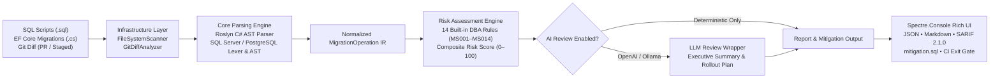

<div align="center">

```text
 __  __ _                 _   _             ____             _   _            _ 
|  \/  (_) __ _ _ __ __ _| |_(_) ___  _ __ / ___|  ___ _ __ | |_(_)_ __   ___| |
| |\/| | |/ _` | '__/ _` | __| |/ _ \| '_ \\___ \ / _ \ '_ \| __| | '_ \ / _ \ |
| |  | | | (_| | | | (_| | |_| | (_) | | | |___) |  __/ | | | |_| | | | |  __/ |
|_|  |_|_|\__, |_|  \__,_|\__|_|\___/|_| |_|____/ \___|_| |_|\__|_|_| |_|\___|_|
          |___/                                                                  
```

### 🛡️ Zero-Downtime Database Migration Guard for .NET, EF Core, SQL Server & PostgreSQL

**Catch destructive schema changes, table-locking DDL, and zero-downtime deployment hazards *before* they hit production — powered by Roslyn C# AST analysis, a dialect-aware SQL parser, and optional OpenAI / Ollama AI review.**

[](https://github.com/Fatollahsalimi13/MigrationSentinel/actions/workflows/ci-cd.yml)
[](https://www.nuget.org/packages/MigrationSentinel)
[](https://www.nuget.org/packages/MigrationSentinel)
[](LICENSE)
[](https://github.com/Fatollahsalimi13/MigrationSentinel/stargazers)
[](https://dotnet.microsoft.com/)

</div>

---

## Why MigrationSentinel?

A single unreviewed `ALTER COLUMN`, missing `CONCURRENTLY` keyword, or `DROP COLUMN` in an Entity Framework Core migration can lock a multi-terabyte production table, trigger cascading 500 errors across rolling Kubernetes pods, or permanently destroy customer data.

Traditional linters rely on brittle regular expressions that choke on comments, miss multi-clause `ALTER TABLE` statements, and cannot understand C# `MigrationBuilder` code. **MigrationSentinel** solves this critical DevOps and DBA pain point by combining:

1. **True AST Analysis (Zero Regex Guesswork):** Parses EF Core C# migrations via the **Roslyn Compiler API** (`Microsoft.CodeAnalysis.CSharp`) and SQL Server / PostgreSQL scripts via a **dialect-aware SQL Lexer & AST Parser** — including *recursive parsing* of raw SQL embedded inside `migrationBuilder.Sql(...)`.
2. **Actionable Expand-and-Contract Mitigations:** Doesn't just scream "error" — automatically generates dialect-specific safe rollout SQL (e.g., `CREATE INDEX CONCURRENTLY`, SQL Server `WITH (ONLINE = ON)`, PostgreSQL `NOT VALID` + `VALIDATE CONSTRAINT`, and dual-write shadow column plans).
3. **Hybrid Deterministic + AI Review Layer:** Pairs 14 zero-latency, deterministic DBA rules with optional contextual code review via **OpenAI / Codex API** or **local Ollama** for air-gapped environments.
4. **First-Class CI/CD & GitHub Security Integration:** Supports Git diff PR gating (`migration-sentinel diff --base origin/main`), configurable severity exit codes, Markdown PR summaries, JSON automation output, and **SARIF v2.1.0** uploads directly to the GitHub Security tab.

---

## Architecture & Workflow Overview

MigrationSentinel is built with strict **Clean Architecture** separation so you can run it as a global `.NET` CLI tool or embed `MigrationSentinel.Core` directly into your own internal developer portals and CI tooling.



### Project Structure

| Layer | Project | Responsibilities |
| :--- | :--- | :--- |
| **Core Domain** | [`MigrationSentinel.Core`](src/MigrationSentinel.Core) | Domain models, Roslyn EF Core AST parser, SQL Server & PostgreSQL lexer/parser, 14 DBA risk rules (`MS001`–`MS014`), composite risk scoring, and mitigation SQL generator. |
| **Infrastructure** | [`MigrationSentinel.Infrastructure`](src/MigrationSentinel.Infrastructure) | Recursive file scanner, Git diff analyzer, OpenAI & Ollama HTTP review wrappers, `.migrationsentinel.json` loader, and JSON / Markdown / SARIF 2.1.0 report formatters. |
| **Presentation** | [`MigrationSentinel.Cli`](src/MigrationSentinel.Cli) | Packable `.NET` global tool (`PackAsTool=true`) built with `Spectre.Console` & `Spectre.Console.Cli` featuring colored tables, severity breakdown charts, progress bars, and mitigation panels. |
| **Verification** | [`MigrationSentinel.Tests`](tests/MigrationSentinel.Tests) | Comprehensive xUnit + FluentAssertions unit and end-to-end integration test suite covering SQL dialects, Roslyn AST edge cases, Git diffs, AI providers, and CLI exit codes. |

---

## Installation

### Install as a .NET Global Tool (Recommended)

Requires [.NET 8.0 SDK](https://dotnet.microsoft.com/download) or later (rolls forward automatically on .NET 9 & .NET 10):

```bash
dotnet tool install -g MigrationSentinel
```

Update to the latest version at any time:

```bash
dotnet tool update -g MigrationSentinel
```

### Embed as a .NET Library

Use the AST parsers and risk engine programmatically inside your own CI bots, tests, or platform services:

```bash
dotnet add package MigrationSentinel.Core
```

### Build & Run from Source

```bash
git clone https://github.com/Fatollahsalimi13/MigrationSentinel.git
cd MigrationSentinel
dotnet build -c Release
dotnet run --project src/MigrationSentinel.Cli -- scan samples
```

---

## Quick Start Guide

### 1. Scan a Migrations Directory

```bash
migration-sentinel scan ./src/MyApp.Data/Migrations
```

### 2. Gate a Pull Request (Scan Only Changed Migrations in Git)

Avoid noise from legacy historical migrations by scanning only files added or modified in the current branch or staged index:

```bash
# Compare current PR branch against main
migration-sentinel diff --base origin/main --fail-on high

# Pre-commit hook mode (staged files only)
migration-sentinel diff --staged --fail-on critical
```

### 3. Export Safe Rollout Mitigation SQL & SARIF Report

```bash
migration-sentinel scan ./Migrations \
  --dialect postgresql \
  --format sarif \
  --output sentinel-results.sarif \
  --mitigation-out safe-rollout.sql
```

### 4. Augment AST Analysis with AI Review (OpenAI or Local Ollama)

```bash
# Cloud review via OpenAI / Codex-compatible API
export OPENAI_API_KEY="sk-..."
migration-sentinel scan ./Migrations --ai openai --ai-model gpt-4o-mini

# 100% private, air-gapped review via local Ollama
migration-sentinel scan ./Migrations --ai ollama --ai-model qwen2.5-coder:7b
```

### 5. Inspect Rules & Initialize Project Configuration

```bash
# View all built-in AST & heuristic rules
migration-sentinel rules

# Generate a .migrationsentinel.json config file in your repo root
migration-sentinel init
```

Example `.migrationsentinel.json`:

```json
{
  "dialect": "Auto",
  "failOn": "High",
  "disabledRules": [],
  "severityOverrides": {
    "MS013": "Info"
  },
  "aiProvider": "none",
  "aiModel": "gpt-4o-mini"
}
```

---

## Built-in Risk Rule Catalog

| Rule ID | Severity | Category | Detection Summary |
| :--- | :--- | :--- | :--- |
| **`MS001`** | 🔴 Critical | `DataLoss` | `DROP TABLE` / `migrationBuilder.DropTable` causing irreversible data loss & rolling-deploy outages. |
| **`MS002`** | 🔴 Critical | `DataLoss` | `DROP COLUMN` / `migrationBuilder.DropColumn` breaking active EF Core queries and discarding data. |
| **`MS003`** | 🔴 Critical | `DataLoss` | `TRUNCATE TABLE` wiping all rows under an exclusive table lock. |
| **`MS004`** | 🟠 High / 🔴 Crit | `TableLock` | `ALTER COLUMN` type change or narrowing length causing full table rewrite locks & potential truncation. |
| **`MS005`** | 🟠 High | `TableLock` | Adding a `NOT NULL` column without a `DEFAULT` constraint (fails on populated tables). |
| **`MS006`** | 🟠 High | `BreakingContract` | `RENAME TABLE`, `RENAME COLUMN`, or `sp_rename` breaking zero-downtime blue/green deployments. |
| **`MS007`** | 🟠 High | `TableLock` | `CREATE INDEX` without `CONCURRENTLY` (PostgreSQL) or `WITH (ONLINE = ON)` (SQL Server). |
| **`MS008`** | 🟠 High / 🔴 Crit | `DataLoss` | Unfiltered `DELETE` or `UPDATE` missing a `WHERE` clause inside a migration script. |
| **`MS009`** | 🟡 Medium | `TableLock` | `DROP INDEX` lacking online/concurrent safeguards and risking query plan regressions. |
| **`MS010`** | 🟡 Medium / 🟠 High | `BreakingContract` | Dropping Primary Key or Foreign Key constraints (`DropPrimaryKey`, `DropForeignKey`, `DROP CONSTRAINT`). |
| **`MS011`** | 🟡 Medium | `TableLock` | Tightening a nullable column to `NOT NULL` directly without `NOT VALID` check validation. |
| **`MS012`** | 🟡 Medium | `Security` | `ON DELETE CASCADE` / `DROP ... CASCADE` risking unintended multi-table deletions. |
| **`MS013`** | 🔵 Low | `BestPractice` | Raw SQL inside `migrationBuilder.Sql()` (automatically parsed recursively for inner destructive DDL). |
| **`MS014`** | 🔵 Low | `BestPractice` | Missing or empty `Down(MigrationBuilder)` rollback method in an EF Core migration. |

---

## GitHub Actions CI/CD Integration

Drop this step into any `.NET` repository to automatically fail risky Pull Requests and publish inline annotations to the **GitHub Security → Code Scanning** tab:

```yaml
name: Database Migration Safety Gate

on: [pull_request]

permissions:
  contents: read
  security-events: write

jobs:
  migration-guard:
    runs-on: ubuntu-latest
    steps:
      - uses: actions/checkout@v4
        with:
          fetch-depth: 0

      - uses: actions/setup-dotnet@v4
        with:
          dotnet-version: '8.0.x'

      - name: Install MigrationSentinel
        run: dotnet tool install -g MigrationSentinel

      - name: Analyze PR Migration Diff
        run: |
          migration-sentinel diff \
            --base origin/${{ github.base_ref }} \
            --fail-on high \
            --format sarif \
            --output migration-sentinel.sarif

      - name: Upload SARIF to GitHub Code Scanning
        if: always()
        uses: github/codeql-action/upload-sarif@v3
        with:
          sarif_file: migration-sentinel.sarif
```

---

## Why This Project Qualifies for Open-Source Grants & the OpenAI Codex Program

**MigrationSentinel** is designed from day one as high-leverage, open-source developer infrastructure aligned with the mission of **open-source software reliability grants** and the **OpenAI Codex Open-Source Program**:

- **High-Impact Production Safety Gap in the .NET Ecosystem:** Millions of production APIs rely on Entity Framework Core, SQL Server, and PostgreSQL, yet .NET has historically lacked a dedicated, open-source, Roslyn-native equivalent to Ruby's `strong_migrations` or PostgreSQL's `squawk` that understands *both* C# `MigrationBuilder` ASTs and raw multi-dialect SQL.
- **Thoughtful Hybrid AI Architecture (Deterministic AST + LLM Reasoning):** Rather than blindly sending raw files to an LLM, MigrationSentinel extracts exact AST operations and line numbers deterministically first, then passes structured context to **OpenAI / Codex models** (or local **Ollama** models) for cross-statement semantic review, zero-downtime rollout checklists, and bespoke SQL rewrite synthesis.
- **Enterprise-Ready Open Standards:** Ships under a permissive **MIT License** with zero vendor lock-in, full **SARIF v2.1.0** compliance for native DevSecOps integration, deterministic builds, and a clean library API (`MigrationSentinel.Core`) that other open-source tools and AI coding agents can embed directly.
- **AI-Agent & Automated PR Synergy:** MigrationSentinel's structured JSON/SARIF reports and auto-generated mitigation scripts serve as an ideal feedback loop for autonomous coding agents (such as Codex), enabling agents to detect unsafe migrations they authored and automatically refactor them into expand-and-contract patterns before human review.

---

## Contributing

Contributions, new database rules, dialect enhancements (e.g., MySQL/MariaDB, Oracle), and bug reports are warmly welcomed!

1. Fork the repository and create a feature branch (`git checkout -b feat/rule-ms015`).
2. Add unit tests in `tests/MigrationSentinel.Tests` covering both positive detections and false-positive edge cases.
3. Run `dotnet test MigrationSentinel.sln -c Release` and verify all checks pass.
4. Open a Pull Request using [Conventional Commits](https://www.conventionalcommits.org/).

---

## License

Distributed under the **MIT License**. See [`LICENSE`](LICENSE) for full details.
