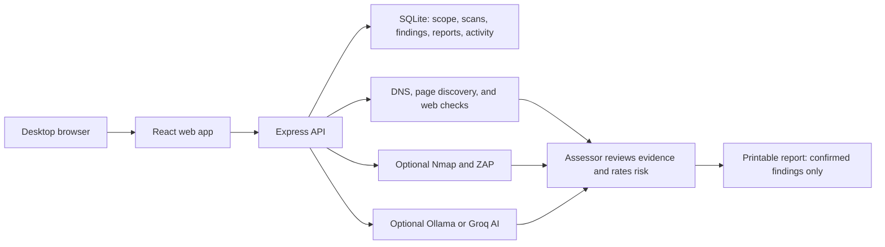

<p align="center">
  
</p>

<h1 align="center">AIVERA Lite</h1>

<p align="center">The simple edition of AIVERA: a desktop web app for assessing websites you have permission to test. Define the scope, run careful checks, review the evidence, and turn confirmed findings into a printable report.</p>

<p align="center"><code>LITE edition</code> &nbsp; <code>Version 1.0.0</code> &nbsp; <code>React 19 + Vite 7</code> &nbsp; <code>Express 5 + SQLite</code> &nbsp; <code>Optional local AI</code></p>

<p align="center">
  <a href="#run-locally"></a>
  <br>
  <sub>Runs on your own computer with no sign-in. Hosted websites receive passive requests only.</sub>
</p>

<p align="center">
  <a href="#at-a-glance"><strong>At a glance</strong></a> &nbsp;·&nbsp;
  <a href="#app-tour"><strong>App tour</strong></a> &nbsp;·&nbsp;
  <a href="#workspace"><strong>Workspace</strong></a> &nbsp;·&nbsp;
  <a href="#how-it-works"><strong>How it works</strong></a> &nbsp;·&nbsp;
  <a href="#run-locally"><strong>Run locally</strong></a> &nbsp;·&nbsp;
  <a href="#safety-and-scope"><strong>Safety and scope</strong></a>
</p>

<p align="center"><sub><strong>LITE</strong> · one assessor, one scan, one report &nbsp;|&nbsp; Need team roles, remediation, and approvals? See <a href="https://github.com/Feliciety02/AIVERA-pro"><strong>AIVERA Pro</strong></a></sub></p>

AIVERA Lite runs on your own computer and has no sign-in screen. Enter a URL, confirm written permission, and start a scan. The app shows the scan's steps and findings; an assessor then confirms or rejects each finding. Only confirmed findings appear in the report. AI can explain results and draft text, but it does not verify findings.

## At a glance

<table>
  <tr>
    <td align="center" width="25%"><strong>01 · Define scope</strong><br><sub>Approved hosts, permission, and paths to skip</sub></td>
    <td align="center" width="25%"><strong>02 · Scan</strong><br><sub>Recon, web checks, and optional security tools</sub></td>
    <td align="center" width="25%"><strong>03 · Verify</strong><br><sub>Evidence, assessor decisions, and risk ratings</sub></td>
    <td align="center" width="25%"><strong>04 · Report</strong><br><sub>Confirmed findings and a printable PDF view</sub></td>
  </tr>
</table>

The dashboard summarizes websites, scans, findings needing review, confirmed findings, and activity. The Findings page filters by status, severity, and website. The Activity page records testing actions and the redacted text sent to AI.

## App tour

These **four unedited 1440 × 900 screenshots** show the running app in Microsoft Edge on **November 16, 2026**. Dashboard, Findings, and Report use **synthetic local demo records**; they are not results from a real assessment. Select any image to open it at full size. The [capture archive](docs/screenshots/desktop-2026-11-16/README.md) records the capture method and file hashes.

### Start and monitor a scan

The scan home collects the approved URL, permission confirmation, and options. The dashboard then shows the review queue and confirmed results across saved websites.

<table>
  <tr>
    <td align="center" width="50%"><a href="docs/screenshots/desktop-2026-11-16/01-scan-home.png"></a><br><strong>1 · Scan home</strong><br><sub>Set scope and start an authorized scan</sub></td>
    <td align="center" width="50%"><a href="docs/screenshots/desktop-2026-11-16/02-dashboard.png"></a><br><strong>2 · Dashboard</strong><br><sub>Websites, review queue, and confirmed results</sub></td>
  </tr>
</table>

### Verify and report

Findings stay in a review queue until an assessor records a decision and risk rating. The report includes confirmed findings, evidence, and recommended fixes.

<table>
  <tr>
    <td align="center" width="50%"><a href="docs/screenshots/desktop-2026-11-16/03-findings.png"></a><br><strong>3 · Findings</strong><br><sub>Filter and verify each reported issue</sub></td>
    <td align="center" width="50%"><a href="docs/screenshots/desktop-2026-11-16/04-report.png"></a><br><strong>4 · Report</strong><br><sub>Prepare a report from confirmed findings</sub></td>
  </tr>
</table>

## Workspace

| Screen | What you can do |
| --- | --- |
| **Scan home** | Enter an approved website, confirm permission, and choose whether to run an optional ZAP passive scan |
| **Scan progress** | Follow each check, inspect its output, and review the findings it produced |
| **Dashboard and website** | See totals across assessments or open one website's scope, scans, findings, and reports |
| **Findings and finding detail** | Filter the review queue, inspect evidence, and confirm or reject a result with a verification note |
| **Reports and report detail** | Create a report, edit its summary, and print or save a PDF with confirmed findings |
| **Activity** | Review assessment actions and the redacted text sent to AI |

## How it works



The scan checks five areas: security configuration and HTTPS, authentication and login security, session cookies, information disclosure, and exposed files or directories. DNS lookup and page discovery provide context. Nmap and exposed-file checks run only for a local copy on `localhost` or `127.0.0.1`; OWASP ZAP passive scanning is optional. Hosted websites receive passive requests only.

Likelihood and impact are each rated low (1), medium (2), or high (3). Their product sets severity: **9 critical, 6 high, 3–4 medium, 2 low, 1 info**. An assessor records the decision and verification note. A rejected finding is kept as a false alarm in the assessment history.

## Run locally

You need **Node.js 22 or newer**. Nmap and OWASP ZAP are optional; their scan steps are skipped when unavailable. For AI features, use a local Ollama model or configure a Groq key.

```powershell
npm install
Copy-Item server/.env.example server/.env
```

Edit `server/.env`: put **only approved hostnames** in `ALLOWED_HOSTS`, then configure your AI provider and optional tool paths. Keep the file private. An empty `ALLOWED_HOSTS` removes the host restriction, so set it before testing any website.

```powershell
npm run db:setup
npm run dev
```

Open **http://localhost:5190** on your computer. Paste an approved URL, tick the permission checkbox, and press **Scan**. For the default local AI provider, pull its model first with `ollama pull llama3.2:3b`.

For a production build on the same computer, run `npm run build` and then `npm start`; the API serves the built website at **http://localhost:4100** by default. This repository does not include a hosted service or user accounts.

## Safety and scope

- The scan form requires the tester to confirm permission. With a nonempty `ALLOWED_HOSTS`, the API rejects websites outside that list.
- Paths entered under **Options → Paths to skip** are excluded from requests.
- Hosted sites receive normal page requests, a TLS handshake, and optional ZAP passive checks. Local copies can also receive Nmap and exposed-file checks.
- Secrets, cookies, tokens, and email addresses are redacted before data is sent to AI. The Activity page shows the text sent and the answer received.
- AI output is advice. It cannot confirm a finding; the assessor must review evidence and record a decision.

## Explore the repository

| Area | Start here | What you will find |
| --- | --- | --- |
| Web app | [src/pages/](src/pages/) · [src/components/](src/components/) | Scan home, dashboard, findings, reports, activity, and shared UI |
| API and database | [server/src/routes.ts](server/src/routes.ts) · [server/prisma/schema.prisma](server/prisma/schema.prisma) | API routes, scope records, scans, findings, reports, and logs |
| Scan tools | [server/src/tools/](server/src/tools/) · [server/src/scanner.ts](server/src/scanner.ts) | DNS, discovery, web checks, Nmap, ZAP, and scan orchestration |
| AI handling | [server/src/ai/](server/src/ai/) | Redaction, interpretations, explanations, and summary drafting |
| Desktop captures | [screenshot archive](docs/screenshots/desktop-2026-11-16/README.md) | Unedited PNGs and a synthetic data fixture |
| Project documents | [docs/](docs/) | Proposal, system documentation, report draft, and demo guide |

## Updating and checking

| Command | Purpose |
| --- | --- |
| `npm run dev` | Run the API on port 4100 and web app on port 5190 |
| `npm run db:setup` | Create or sync the local SQLite database |
| `npm run typecheck` | Check the web app and API types |
| `npm run build` | Typecheck and build the production web app |
| `npm start` | Serve the API and built web app on port 4100 |

After changing scan logic, check it on a local test website you control before using an approved hosted target. Local typechecks cannot verify live target behavior, external tool installations, AI responses, or permissions.
