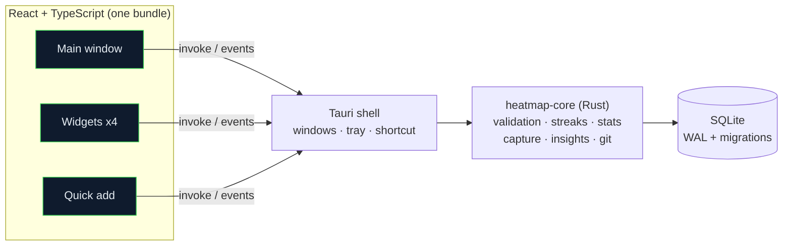

<div align="center">


<br>

[](https://github.com/GwenAsa/heatmap-desktop/actions/workflows/ci.yml)
[](https://github.com/GwenAsa/heatmap-desktop/releases/latest)
[](LICENSE)


**[Download](https://github.com/GwenAsa/heatmap-desktop/releases/latest)** · **[Install guide](docs/INSTALL.md)** · **[Architecture](docs/ARCHITECTURE.md)** · **[Changelog](CHANGELOG.md)**

</div>


## What is it?

Heatmap is a **desktop app for tracking anything you do** — habits, study time, commits, workouts, mood — and seeing it as a calendar heatmap where **every single square shows its day number**. Everything stays on your computer in one SQLite file. No account, no cloud, no telemetry.

<div align="center">

</div>


## Features

<table>
<tr>
<td width="72" align="center"></td>
<td><b>Heatmaps you can actually read</b><br>Monthly and yearly views, weekday-aligned, leap-year correct. Day numbers stay legible on every intensity (contrast ≥ 4.5:1 is tested). Missing data, a recorded zero, rest days, today and future dates all look different — never by colour alone.</td>
</tr>
<tr>
<td align="center"></td>
<td><b>Four desktop widgets</b><br>Glass ring, neon terminal month, paper strip, sticky-note sheet. Log without opening the app. Drag them anywhere; pin on top, normal, or behind your windows.</td>
</tr>
<tr>
<td align="center"></td>
<td><b>Quick capture</b><br>Type a sentence, get an entry: <code>coding 90m yesterday</code>. Live preview before you save. Global shortcut or <code>heatmap-app --quick</code>.</td>
</tr>
<tr>
<td align="center"></td>
<td><b>Forgiving goals + Git tracker</b><br>Daily or "3 days a week" goals, freeze days that protect a streak, and automatic daily commit counts from your own local repositories.</td>
</tr>
<tr>
<td align="center"></td>
<td><b>Honest insights</b><br>Best weekday, 30-day trend, unusual days, and two-tracker correlation with a time shift — always labelled as correlation, never causation.</td>
</tr>
<tr>
<td align="center"></td>
<td><b>Yours, completely</b><br>Local SQLite, atomic imports with an automatic safety copy, JSON/CSV import and export, one-click database backup. Nothing leaves your machine.</td>
</tr>
</table>


## Desktop widgets

<div align="center">

</div>

| Widget | Style | Best for |
|---|---|---|
| **Ring** `--widget ring` | Glass, gradient progress ring | Today's goal + one-tap logging |
| **Month** `--widget month` | Neon terminal | Browsing a month, logging any day |
| **Strip** `--widget strip` | Minimal paper | The last 14 weeks at a glance |
| **Sheet** `--widget sheet` | Sticky note | Every tracker for today + type-to-log |

Open them from **Widgets & tools**, the tray menu, or the command line. Position, tracker and pin mode are remembered; *Start with my computer* reopens them at login with the main window hidden.

> Screenshots come from a virtual display without a compositing window manager; on GNOME the rounded corners are transparent.

## Quick capture

<div align="center"></div>

| You type | It logs |
|---|---|
| `coding 90m yesterday` | Coding · 90 min · yesterday |
| `coding 1.5h mon` | Coding · 90 min · last Monday |
| `gym` / `gym skip` | Gym done / explicitly not done |
| `reading 20 2 days ago // chapter 4` | Reading · 20 · two days ago · note |
| `coding 45 2026-03-01` | Coding · 45 min · that date |

Tracker names match exactly or by a *unique* prefix (`cod` → Coding). It never guesses from the middle of a name, so a typo can't land in the wrong tracker.


## Install

Grab the latest `.deb` or `.AppImage` from the **[Releases](https://github.com/GwenAsa/heatmap-desktop/releases/latest)** page.

```bash
# Ubuntu 24.04 / Zorin OS 18 (recommended)
sudo apt install ./Heatmap_*_amd64.deb

# or the portable AppImage
sudo apt install libfuse2t64
chmod +x Heatmap_*_amd64.AppImage && ./Heatmap_*_amd64.AppImage
```

**Android (experimental):** build the APK from the repository's *Actions → Android APK* workflow. See [docs/ANDROID.md](docs/ANDROID.md) for what works and what does not.

Upgrading from an older version? See the [install guide](docs/INSTALL.md). Your data lives in `~/.local/share/app.heatmap.desktop/heatmap.db` and is never touched by installing or removing the app.

## Build from source

```bash
sudo apt install build-essential curl file libssl-dev libwebkit2gtk-4.1-dev libgtk-3-dev \
     libayatana-appindicator3-dev librsvg2-dev patchelf nodejs npm git
# Rust 1.88 or newer (https://rustup.rs)

npm ci
npm run tauri dev                          # develop
npm run tauri build -- --bundles deb,appimage
```

## Tests

```bash
cargo test -p heatmap-core   # 57 tests: dates, streaks, schedules, migrations, import/export, git, capture, insights
npm test                     # 21 tests: grids, day numbers, contrast, keyboard, SVG export
npx tsc --noEmit             # types
```

## Architecture



All logic lives in `core/` with no GUI dependency, so it is tested without a display. See [docs/ARCHITECTURE.md](docs/ARCHITECTURE.md).

## Project status

| Area | State |
|---|---|
| Linux (Ubuntu 24.04, Zorin OS 18) | `.deb` / AppImage; automated tests and GUI smoke tests run on Ubuntu 24.04 |
| Widget pin modes (on top / behind windows) | Depends on the window manager; Wayland may ignore them |
| Global shortcut `Ctrl+Alt+H` | X11 only. On Wayland bind `heatmap-app --quick` in your system keyboard settings |
| Android | Experimental: CI-built APK, not yet run on a physical phone. No widgets, Git tracker or file import/export yet ([details](docs/ANDROID.md)) |
| Windows / macOS | Not built or tested |

## Roadmap

- [x] Annual + monthly heatmaps, trackers, goals, streaks, schedules
- [x] SQLite storage with migrations, JSON/CSV import/export, backups
- [x] Desktop widgets, quick capture, Git tracker, insights, Studio (palettes + SVG/PNG export)
- [ ] Multi-device sync (file-based, conflict-safe) and encrypted backups
- [ ] Reminders and timers
- [ ] Custom dashboards, rolling 30/90-day and compare views
- [ ] PDF reports, tracker archive UI, translations

## Contributing

Issues and pull requests are welcome — see [CONTRIBUTING.md](CONTRIBUTING.md). For security reports, see [SECURITY.md](SECURITY.md).

## License

[MIT](LICENSE)

<div align="center">

<sub>Built with Tauri, Rust, React and SQLite.</sub>
</div>
