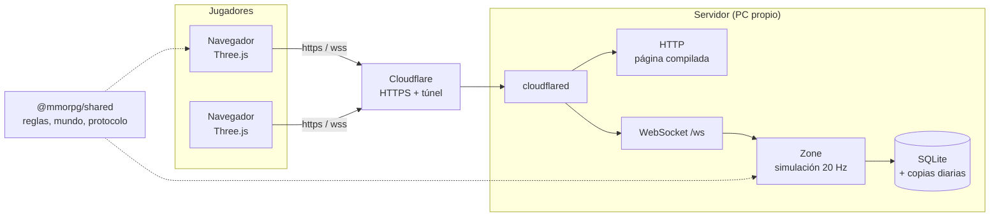
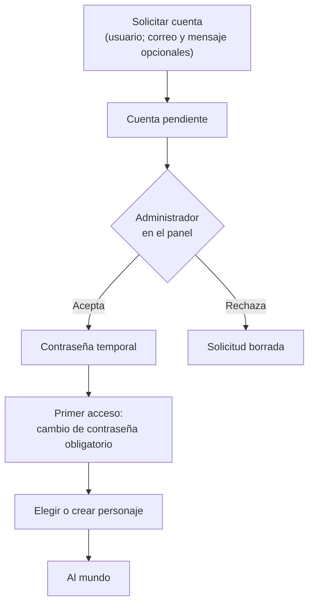
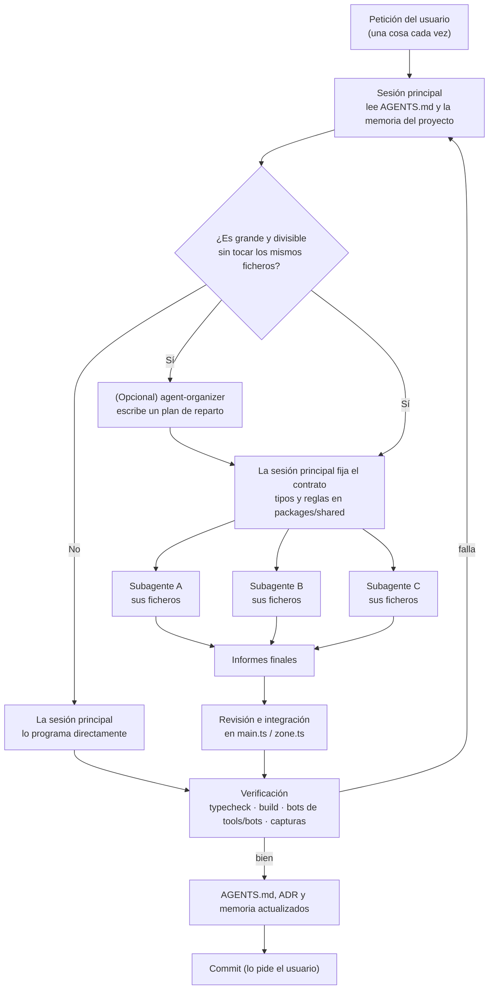

<div align="center">


# Valdoria

### Un MMORPG medieval que se juega en el navegador

Una ciudad amurallada con castillo, catedral y barrios llenos de vida; criaturas fuera de la muralla, un dragón en su guarida, minas bajo tierra, un continente tropical al otro lado del mar, oficios, mercado entre jugadores y una diosa que bendice a quien reza ante ella.
Sin instalar nada: entras desde la web y juegas con tus amigos en el mismo mundo.

<br />

<!-- DIRECCION -->
[](https://multi-jade-volleyball-mechanisms.trycloudflare.com)
<!-- /DIRECCION -->

[](LICENSE)


<br />

**[Jugar](#jugar)** · **[Capturas](#capturas)** · **[Características](#características)** · **[Arquitectura](#arquitectura)** · **[Instalación](#puesta-en-marcha-local)** · **[Cómo se hizo](#cómo-se-hizo)** · **[Créditos](#créditos)**

<br />


<sub><b>Plaza Mayor</b> · fuente, puestos del mercado, vecinos paseando, minimapa con el barrio actual y la misión en curso</sub>

</div>

## Índice

- [Qué es Valdoria](#qué-es-valdoria)
- [Jugar](#jugar)
- [Capturas](#capturas)
- [Características](#características)
- [Arquitectura](#arquitectura)
- [Seguridad](#seguridad)
- [Estructura del monorepo](#estructura-del-monorepo)
- [Puesta en marcha local](#puesta-en-marcha-local)
- [Variables de entorno](#variables-de-entorno)
- [Scripts y pruebas](#scripts-y-pruebas)
- [Despliegue](#despliegue)
- [Cómo se hizo](#cómo-se-hizo)
- [Documentación](#documentación)
- [Créditos](#créditos)
- [Licencia](#licencia)

---

## Qué es Valdoria

Valdoria es un MMORPG de mundo persistente que corre entero en el navegador. Hay cuatro clases (Caballero, Bárbaro, Mago y Pícaro), misiones encadenadas, oficios de recolección (pescador, peletero, recolector y minero), una casa de subastas con moneda propia y combate en tiempo real con esquiva y ataques anunciados.

El mundo se divide en tres regiones: **Valdoria y las Cumbres de Hierro** en la superficie, **Forjahonda**, una capital minera bajo tierra, y **Aldamar**, un continente con islas, puerto y barcos de línea. Se viaja entre ellas por portales y escaleras.

Casi todo lo que se ve y se oye (ciudad, castillo, efectos, interfaz, sonido ambiente) se genera por código: geometrías básicas, texturas de canvas y audio sintetizado con WebAudio. Los modelos de personajes y criaturas son de terceros con licencias libres (ver [Créditos](#créditos)).

El servidor es **autoritativo**: el cliente solo envía intenciones y el servidor valida y difunde el estado.

---

## Jugar

<!-- ENLACE -->
<div align="center">

### [multi-jade-volleyball-mechanisms.trycloudflare.com](https://multi-jade-volleyball-mechanisms.trycloudflare.com)

<sub>Mientras la beta no tenga dominio propio, la dirección cambia cuando se reinicia el servidor.</sub>

</div>
<!-- /ENLACE -->

1. Pulsa **Solicitar cuenta**, elige un usuario y, si quieres, deja un mensaje.
2. Cuando un administrador la apruebe te dará una **contraseña temporal**; al entrar por primera vez eliges la tuya.
3. Crea tu personaje (hasta 3 por cuenta) y aparecerás en la Plaza Mayor.

Funciona en navegadores de escritorio con WebGL (Chrome, Firefox, Edge y Safari). Si el enlace no responde, la beta está apagada: puedes [ejecutarla en local](#puesta-en-marcha-local).

<details>
<summary><b>Controles</b></summary>

<br />

| Tecla | Acción |
|-------|--------|
| <kbd>W</kbd> <kbd>A</kbd> <kbd>S</kbd> <kbd>D</kbd> | Moverte |
| <kbd>Espacio</kbd> | Saltar (subir, con la escoba; <kbd>Shift</kbd> baja) |
| <kbd>Shift</kbd> o <kbd>Q</kbd> | Esquivar rodando (a pie) |
| Ratón | Arrastrar para girar la cámara; rueda para el zoom |
| Clic | Atacar, seleccionar o, en el suelo, caminar hasta allí |
| <kbd>Tab</kbd> | Cambiar de objetivo |
| <kbd>1</kbd>–<kbd>4</kbd> | Habilidades (la 4 es la definitiva) |
| <kbd>R</kbd> | Montar o desmontar (también barcas, en el agua) |
| <kbd>E</kbd> | Hablar, sentarse o trabajar en tu oficio |
| <kbd>F</kbd> | Rezar ante la estatua de la diosa |
| <kbd>I</kbd> · <kbd>K</kbd> · <kbd>J</kbd> · <kbd>M</kbd> | Inventario, habilidades, diario de misiones y mapa |
| <kbd>V</kbd> | Bloquear el ratón (modo apuntado) |
| <kbd>Enter</kbd> | Chat y gestos: `/saludar`, `/aplaudir`, `/vitorear`, `/sentarse`, `/tumbarse` |

</details>

---

## Capturas

<table>
  <tr>
    <td width="50%" align="center">
      
      <br /><sub><b>Inicio de sesión</b> · cuentas aprobadas por un administrador</sub>
    </td>
    <td width="50%" align="center">
      
      <br /><sub><b>Habilidades</b> · rangos de clase, tres opciones por casilla y definitiva</sub>
    </td>
  </tr>
  <tr>
    <td width="50%" align="center">
      
      <br /><sub><b>Casa de subastas</b> · los jugadores ponen precio a sus materiales</sub>
    </td>
    <td width="50%" align="center">
      
      <br /><sub><b>Inventario</b> · ficha, equipo, oficio y mochila con rarezas</sub>
    </td>
  </tr>
  <tr>
    <td width="50%" align="center">
      
      <br /><sub><b>Recolección</b> · los puntos ricos brillan del color de su rareza</sub>
    </td>
    <td width="50%" align="center">
      
      <br /><sub><b>Monturas</b> · caballo, corcel sagrado, cabra, pantera y escoba voladora</sub>
    </td>
  </tr>
  <tr>
    <td width="50%" align="center">
      
      <br /><sub><b>Barrio Viejo</b> · cada barrio tiene su estandarte, colores y vida</sub>
    </td>
    <td width="50%" align="center">
      
      <br /><sub><b>Panel de administración</b> · solicitudes, cuentas, expulsiones, avisos y eventos</sub>
    </td>
  </tr>
</table>

> Las capturas son anteriores a Forjahonda, Aldamar y los barcos. Pendiente: añadir capturas de esas regiones.

---

## Características

### La ciudad y el mundo

| Función | Descripción |
|---------|-------------|
| **Seis barrios** | Plaza Mayor, Recinto del Castillo, Barrio de la Catedral, del Gremio, Viejo y del Yunque, con estandarte y rótulo al entrar |
| **Castillo habitable** | Gran salón del trono con la Reina Isolda, Sala de los Portales y Biblioteca Real |
| **Catedral transitable** | Nave hueca con la estatua de la diosa al fondo |
| **Interiores** | El Gremio y las casas-taller se pueden entrar y tienen muebles y colisiones |
| **Parques y descanso** | Sentado recuperas vida más deprisa; los vecinos pasean, charlan y se sientan |
| **Lago y nado** | Se nada (más lento y sin atacar); hay peces, juncos y nenúfares |
| **Día y noche** | Ciclo de 24 minutos compartido por todos: sol, luna, estrellas, nubes, farolas, luciérnagas y ventanas encendidas |
| **Sonido ambiente** | Agua, pájaros, grillos, viento, oleaje y gaviotas sintetizados en el navegador |
| **Cumbres de Hierro y Forjahonda** | Camino hasta la Bocamina y escalera que baja a una capital minera subterránea con forja, lava y mina |
| **Aldamar y Puerto Escama** | Continente con islas, capital tropical con palacio y mercado de especias, faro y pecio |
| **Barcos de línea** | Dos líneas con horario fijo que unen el puerto con las islas; se viaja a bordo |

### Clases y combate

| Función | Descripción |
|---------|-------------|
| **Cuatro clases** | Caballero, Bárbaro, Mago y Pícaro, con habilidades, pasiva y montura propias |
| **Bendición de la diosa** | Rezar 21 s transforma al Caballero en **Paladín** y al Mago en **Mago de la Luz** |
| **Árbol de habilidades** | Tres casillas con tres opciones cada una, definitiva y rangos |
| **Rangos de clase** | Títulos por nivel con bonificación de vida y daño |
| **Elementos** | Fuego, escarcha, rayo, arcano, luz, sombra y físico, con quemadura, ralentización y cadena de rayo |
| **Esquiva y combo** | Rodada con invulnerabilidad breve; el tercer golpe seguido pega más y empuja |
| **Enemigos por niveles** | Lobo, jabalí, araña, bandido, esqueleto y trol, cada uno con su ataque anunciado y su IA |
| **Jefe dragón** | Vermithrax despierta con un evento del panel; quien más ayuda a derrotarlo gana la montura voladora |
| **Monturas** | Caballo, corcel sagrado, cabra montesa, pantera sombría, escoba voladora, dragón y barcas |

### Oficios y economía

| Función | Descripción |
|---------|-------------|
| **Cuatro oficios** | Pescador, Peletero, Recolector y Minero, con herramienta, animación y nivel propios |
| **Pesca con picada** | El servidor programa la picada; hay que pulsar a tiempo. Cañas, barcas y pesca de altura |
| **Rarezas** | Común, poco común, rara, épica y legendaria; los puntos ricos brillan |
| **Casa de subastas** | Órdenes de compra y venta entre jugadores, tablón de precios y moneda propia (besantes) |
| **Tiendas** | Cañas, barcas y compra de pescado en la Lonja |
| **Misiones** | Cadena principal y secundarias, NPCs con diálogo, marcador `!`, flecha guía y diario |

### Administración de la beta

| Función | Descripción |
|---------|-------------|
| **Solicitudes** | Aceptar o rechazar cuentas; al aceptar se genera una contraseña temporal |
| **Cuentas y conectados** | Contraseña temporal nueva, bloquear, ver quién juega y expulsar |
| **Eventos del mundo** | Doble experiencia, doble recolección, luna de lobos y ataque del dragón |
| **Avisos** | Cartel grande en pantalla para todos los conectados |

---

## Arquitectura

El servidor simula el mundo a 20 ciclos por segundo, valida todo lo que envían los clientes y difunde el estado a cada jugador (solo lo que tiene cerca). Cliente y servidor comparten reglas, datos del mundo y protocolo en `@mmorpg/shared`; el cliente usa las mismas reglas para predecir su movimiento.



Decisiones de diseño relevantes:

- **Autoritativo**: el cliente envía intenciones (mover, atacar, recolectar); nunca estado.
- **Zone independiente del transporte**: la simulación (`zone.ts`) no sabe nada de WebSockets.
- **Red**: snapshots por jugador con interés por área (110 m), campos fijos solo de vez en cuando, interpolación de los demás jugadores 100 ms en el pasado y reconciliación del propio movimiento.
- **Sin framework de UI**: interfaz en DOM y CSS propios, para no meter capas en el bucle de render.
- **Gráficos procedurales**: geometrías básicas, texturas de canvas y sombreadores propios; sin luces reales para efectos nocturnos (cada una cuesta fotogramas).

Detalle completo en [`AGENTS.md`](AGENTS.md) y en los [ADR](docs/adr/).

### Flujo de acceso



---

## Seguridad

| Medida | Detalle | Dónde |
|--------|---------|-------|
| **Servidor autoritativo** | El cliente no decide daño, botín, posición ni dinero; el servidor valida distancias, enfriamientos, oficio, herramienta y saldo | `apps/server/src/zone.ts` |
| **Contraseñas** | scrypt con sal aleatoria por cuenta, calculado de forma asíncrona | `apps/server/src/auth.ts` |
| **Sesiones** | Token aleatorio, guardado solo como hash SHA-256 y válido 30 días | `auth.ts`, `store.ts` |
| **Fuerza bruta** | Bloqueo de 1 minuto tras 5 fallos | `auth.ts` |
| **Beta por invitación** | Las cuentas nuevas no entran hasta que un administrador las aprueba; la contraseña temporal obliga a cambiarla | `auth.ts`, `ui/admin.ts` |
| **Límites de red** | Mensajes de 1 KB como máximo, 200 conexiones y 6 por IP real (`CF-Connecting-IP`); conexiones muertas fuera a los 30 s | `apps/server/src/main.ts` |
| **Cabeceras HTTP** | `X-Content-Type-Options`, `X-Frame-Options: DENY`, `Referrer-Policy` y `Permissions-Policy` | `apps/server/src/http.ts` |
| **HTTPS sin puertos abiertos** | El servidor solo escucha en `127.0.0.1`; desde Internet se entra únicamente por Cloudflare Tunnel | `deploy/` |
| **Aislamiento del proceso** | systemd: código de solo lectura, solo escribe en `apps/server/data` y sin privilegios | `deploy/valdoria.service` |

---

## Estructura del monorepo

Monorepo con npm workspaces.

```
.
├── packages/
│   └── shared/          # Reglas y datos comunes: clases, progresión, objetos, oficios, mercado, mundo, protocolo
├── apps/
│   ├── server/          # Simulación (zone.ts), cuentas (auth.ts), subastas (market.ts), SQLite (store.ts), HTTP (http.ts)
│   └── client/          # Three.js: mundo (world/), personajes y monturas (models/), interfaz (ui/)
├── deploy/              # Servicios systemd y guiones de instalación, actualización y dirección del túnel
├── tools/bots/          # Bots de carga y comprobaciones automáticas por sistema
├── docs/                # Capturas, ADR, plan de equipo y medidas de rendimiento
├── memoria/             # Bitácora del desarrollo (notas Markdown)
└── .claude/             # Agentes y skills de Claude Code usados en el proyecto
```

---

## Puesta en marcha local

**Requisitos**: Node.js 22.5 o posterior (se usa `node:sqlite`, que llegó en la 22.5; probado con la 22.22) y npm.

```bash
# 1. Clona el repositorio
git clone https://github.com/Haise232/aetherfall-mmo.git
cd aetherfall-mmo

# 2. Instala las dependencias de todos los paquetes
npm install

# 3. Arranca servidor y cliente con recarga en caliente
npm run dev
```

Abre `http://localhost:5173`. La primera vez se crea la cuenta **`admin` / `admin`** y obliga a cambiar la contraseña al entrar.

Para probar con bots sin cuentas: `ALLOW_GUEST=1 npm run dev:server`.

Producción local (sirve la página compilada y el juego en el mismo puerto):

```bash
npm run build
npm start        # http://localhost:8787
```

---

## Variables de entorno

<details>
<summary><b>Servidor</b> (todas opcionales)</summary>

<br />

| Variable | Por defecto | Descripción |
|----------|-------------|-------------|
| `PORT` | `8787` | Puerto HTTP y WebSocket |
| `HOST` | `0.0.0.0` | Interfaz; detrás del túnel se usa `127.0.0.1` |
| `DB_PATH` | `data/game.db` | Base de datos SQLite |
| `ADMIN_PASSWORD` | `admin` | Contraseña de `admin` al crearla por primera vez |
| `ADMIN_RESET` | - | `1` devuelve `admin` a la contraseña inicial y obliga a cambiarla |
| `ALLOW_GUEST` | - | `1` permite entrar sin cuenta (solo pruebas locales) |
| `MAX_CONN` / `MAX_PER_IP` | `200` / `6` | Conexiones simultáneas en total y por IP |
| `BACKUP_DIR` / `BACKUP_KEEP` | `data/backups` / `14` | Carpeta de copias y cuántas se guardan |
| `STATIC_DIR` | `apps/client/dist` | Página compilada que sirve el servidor |
| `WS_DEFLATE` | activado | `0` apaga la compresión del WebSocket |
| `DEBUG_TICK` | - | `1` imprime cada 5 s el tiempo por ciclo, la CPU y el ancho de banda |

En el servicio systemd se ponen en `/etc/valdoria.env`.

</details>

---

## Scripts y pruebas

| Comando | Descripción |
|---------|-------------|
| `npm run dev` | Servidor (8787) y cliente Vite (5173) con recarga en caliente |
| `npm run typecheck` | Comprueba los tipos de todo el monorepo (`tsc -b`) |
| `npm run build` | Comprueba tipos y compila el cliente en `apps/client/dist` |
| `npm start` | Servidor de producción |

<details>
<summary><b>Comprobaciones automáticas y medidas</b></summary>

<br />

No hay un ejecutor de pruebas (Jest, Vitest...): son guiones con `tsx` que levantan una `Zone` en proceso y comprueban reglas.

| Comando | Qué comprueba |
|---------|---------------|
| `npx tsx tools/bots/quest-check.ts` | Misiones |
| `npx tsx tools/bots/gather-check.ts` | Oficios y recolección |
| `npx tsx tools/bots/market-check.ts` | Casa de subastas |
| `npx tsx tools/bots/combat-check.ts` | Combate, esquiva y ataques anunciados |
| `npx tsx tools/bots/deep-check.ts` | Cumbres y Forjahonda |
| `npx tsx tools/bots/isles-check.ts` | Salas del castillo, portales, mar, barcas y tiendas |
| `npx tsx tools/bots/ships-check.ts` | Barcos de línea |
| `npx tsx tools/bots/bench-step.ts` | Tiempo por ciclo y ancho de banda con 25, 50 y 100 jugadores |
| `npx tsx tools/bots/load.ts` | Bots conectados a un servidor real (con `ALLOW_GUEST=1`) |

Las medidas de rendimiento y sus cuellos de botella están en [`docs/rendimiento.md`](docs/rendimiento.md). Son de 2026-11-16, anteriores a varias optimizaciones de red (interés por área), así que conviene volver a medir.

</details>

---

## Despliegue

La beta corre en un PC propio con **Cloudflare Tunnel** delante: HTTPS gratuito, sin abrir puertos del router y sin mostrar la IP de casa. Coste: cero.

```bash
sudo deploy/instalar.sh      # compila, instala el juego y el túnel como servicios y publica la dirección
deploy/direccion.sh          # muestra la dirección pública actual
deploy/publicar-direccion.sh # la escribe en este README y la sube a GitHub
deploy/actualizar.sh         # publica cambios: compila y reinicia (los jugadores se guardan y vuelven a entrar solos)
sudo deploy/desinstalar.sh   # quita los servicios (la base de datos se queda)
```

- **Arranque automático**: los servicios arrancan con el equipo y se reinician si se caen.
- **Copias de seguridad**: una al arrancar y otra cada día en `apps/server/data/backups` (las 14 últimas).
- **Apagado limpio**: al reiniciar se guarda a todos los conectados y el cliente se reconecta solo.
- No ejecutes `npm run dev` a la vez que el servicio: comparten puerto y base de datos.

---

## Cómo se hizo

Valdoria se ha construido con **Claude Code** (el asistente de programación de Anthropic) como colaborador, con la dirección, las decisiones y las pruebas jugando a cargo de Haise232. Esta sección cuenta qué se usó y deja claro qué está documentado y qué no.

### Lenguajes y tecnologías

Versiones tomadas de los `package.json` (rango declarado) y de lo instalado en `node_modules`.

| Capa | Tecnología | Declarado | Instalado |
|------|-----------|-----------|-----------|
| Lenguaje | TypeScript estricto (`strict`, `noUncheckedIndexedAccess`, objetivo ES2022, referencias de proyecto con `tsc -b`) | `^5.6.0` | 5.9.3 |
| Cliente | Three.js | `^0.170.0` | 0.170.0 |
| | `@types/three` | `^0.170.0` | 0.170.0 |
| | Vite | `^6.0.0` | 6.4.6 |
| | Tipografías `@fontsource-variable/grenze-gotisch` y `@fontsource/alegreya-sans` | `^5.3.0` | 5.3.0 |
| | Interfaz | DOM y CSS propios, sin framework | - |
| | Audio | WebAudio sintetizado (sin ficheros de sonido, salvo la música de rezo) | - |
| Servidor | Node.js | 22 | - |
| | `ws` (WebSocket) | `^8.18.0` | 8.23.0 |
| | `tsx` (ejecuta TypeScript) | `^4.19.0` | 4.23.15 |
| | `node:sqlite` y `node:crypto` (módulos de Node) | - | - |
| Base de datos | SQLite, con migración automática de columnas en `store.ts` | - | - |
| Monorepo | npm workspaces (`packages/*`, `apps/*`) | - | - |
| Utilidades | `concurrently` (arranque conjunto en desarrollo) | `^9.2.5` | 9.2.5 |
| | `@types/node` | `^22.0.0` | 22.20.5 |
| Despliegue | systemd + Cloudflare Tunnel (`cloudflared`), guiones en Bash y un trozo de Python 3 en `publicar-direccion.sh` | - | - |
| Documentación | Markdown, Mermaid, notas en una bóveda de Obsidian (`memoria/`) | - | - |

Técnicas que merece la pena destacar: modelos glTF animados por código (el dragón no trae animaciones: se mueven los huesos desde TypeScript), sombreadores propios (cielo, mar, lago, césped, portales), instancias y puntos en GPU (césped de 28 000 matas, ~770 luciérnagas), reconciliación de movimiento con predicción en el cliente, y simulación del servidor con rejillas espaciales para mantener el coste lineal.

### Herramientas

- **Claude Code**: asistente de programación en terminal. Escribe y edita el código, ejecuta `npm run typecheck`, `npm run build` y los guiones de `tools/bots/`, y mantiene `AGENTS.md` como documentación técnica para futuras sesiones. Las decisiones de `docs/adr/001-decisiones-iniciales.md` están registradas como "tomadas por Claude por delegación del usuario".
- **Memoria del proyecto**: Claude Code guarda notas persistentes entre sesiones (estado, preferencias). `memoria/` contiene una bitácora en Markdown (Obsidian) de las primeras sesiones.
- **Skills `threejs-*`** (13) en `.claude/skills/`: guías de Three.js (geometría, materiales, sombreadores, iluminación, animación, cargadores, rendimiento, texturas, postproceso, interacción, canalización de assets, fundamentos y React Three Fiber) que se cargan bajo demanda.
- **Chrome sin interfaz** para capturas de verificación visual (según `memoria/Registro de sesión.md`), además de pruebas con bots y simulación en proceso.
- **Git y GitHub** para el control de versiones.
- **Presupuesto cero**: ninguna herramienta de pago ni servicio con coste en el producto. Hosting en un PC propio y túnel gratuito de Cloudflare.

### Flujo de trabajo

Todo el código se escribió con Claude Code. Una **sesión principal** habla con el usuario, decide y escribe la mayor parte del código. Cuando un trabajo es grande y se puede dividir sin pisarse, lo **delega en subagentes**: instancias con su propio contexto y un perfil especializado que trabajan en segundo plano y devuelven un informe.



**Reglas que se daban a cada subagente** (copiadas de los encargos reales):

- **Contrato primero, e intocable.** La sesión principal escribía antes los tipos, constantes y posiciones en `packages/shared` (por ejemplo `market.ts` y los mensajes `mk*` de `protocol.ts`). Así el servidor, la interfaz y la escena 3D se podían hacer a la vez sin esperarse.
- **Cada agente es dueño de sus ficheros.** El encargo dice qué ficheros puede tocar y cuáles son de otro agente que trabaja en paralelo. Si necesita algo de fuera, lo pide en el informe en vez de editarlo.
- **No romper el trabajo de nadie.** Nada de `git stash`, `checkout` ni `restore`. Hay que respetar los cambios sin guardar del usuario y volver a leer `zone.ts` y `main.ts` justo antes de cada edición.
- **No tocar el servidor real.** El puerto 8787 es el del juego publicado. Las pruebas se hacen en otro puerto con la base de datos en memoria: `PORT=8899 DB_PATH=:memory: ALLOW_GUEST=1 npx tsx apps/server/src/main.ts`.
- **Sin commits.** Los commits los hace la sesión principal, después de verificar.
- **Todo en español** (comentarios y textos del juego), con el estilo compacto del código que ya existe.

### Rondas de trabajo con subagentes

Sacadas del historial de sesiones de Claude Code. Las filas de una misma ronda corrían **en paralelo**.

| Fecha | Ronda | Agentes y reparto |
|-------|-------|-------------------|
| 17 nov | Casa de subastas | `agent-organizer` hizo el plan. Luego, a la vez: `backend-developer` (libro de órdenes, casado precio-tiempo y transacciones SQLite en `apps/server/src/market.ts`), `frontend-developer` (ventana de la subasta en `ui/market.ts`) y `game-developer` (plaza del mercado en 3D: mostrador, tablón de precios y puestos) |
| 17 nov | Parques | `game-developer`: aspecto 3D de los cuatro parques de barrio y de sus vecinos, sobre las huellas de colisión de `parks.ts` |
| 17 nov | Monturas | `game-developer`: rediseño de caballo, corcel, cabra, pantera y escoba, con sus andares |
| 17 nov | Sonido ambiente | `game-developer`: agua, pájaros, grillos, viento y hojas sintetizados con WebAudio (`world/ambience.ts`) |
| 17 nov | Dragón (2 en paralelo) | `game-developer` n.º 1: modelo, animación por huesos y aliento de fuego (`models/dragon.ts`, `dragonFx.ts`). `game-developer` n.º 2: silla de montar, sonido e integración en `main.ts` |
| 18 nov | Enemigos y lago (3 en paralelo) | `game-developer`: animales (lobo, jabalí, araña) · humanoides (bandido, esqueleto, trol) · lago con shader propio y animación de nado |
| 18 nov | Red (2 en paralelo) | `general-purpose`: servidor con snapshots por radio de visión y campos fijos enviados una sola vez (de unos 160 KB/s a una fracción) · cliente con interpolación y control con el ratón |
| 18 nov | Arreglo | `general-purpose`: el personaje retrocedía dos pasos al parar (reconciliación de la predicción) |
| 18 nov | Noche y combate (3 en paralelo) | `general-purpose`: iluminación nocturna y luciérnagas · sensación de golpe (efectos, sonido, dirección del impacto) · mecánicas de combate, IA de enemigos, esquiva y ataques anunciados |
| 18 nov | Habilidades y oficios (2 en paralelo) | `general-purpose`: efectos de habilidades y elementos (fuego, escarcha, rayo...) · herramientas en la mano, animaciones de faena y pesca con picada |
| 23 nov | Puerto Escama (2 agentes + sesión principal) | `game-developer`: capital tropical (palacio, plazas, mercado de especias, playa) · `game-developer`: fauna y vida (aves, delfines, vecinos, sonido). Mientras, la sesión principal hacía los barcos de línea |
| 26 nov | Publicación | `agent-organizer`: plan de limpieza del repositorio y borrador de este README |

En total: 23 encargos a 5 tipos de agente. El resto del juego lo escribió directamente la sesión principal: servidor autoritativo, protocolo, cuentas y administración, misiones, catedral y castillo, progresión, regiones, portales, barcos y despliegue.

### En qué está especializado cada agente

Los agentes con fichero son perfiles de la colección comunitaria [VoltAgent/awesome-claude-code-subagents](https://github.com/VoltAgent/awesome-claude-code-subagents), copiados sin modificar a [`.claude/agents/`](.claude/agents/). Su cabecera fija las herramientas y el modelo (todos usan **Sonnet**).

**Usados en el proyecto:**

| Agente | Especialidad | Herramientas | Por qué se eligió |
|--------|--------------|--------------|-------------------|
| [`game-developer`](.claude/agents/game-developer.md) | Sistemas de juego, render gráfico, red multijugador y jugabilidad | Leer, escribir, editar, terminal, buscar | Todo lo visual y sonoro del mundo: modelos, animación, shaders, escenas y audio |
| [`backend-developer`](.claude/agents/backend-developer.md) | APIs y servicios de servidor robustos y escalables | Leer, escribir, editar, terminal, buscar | Lógica transaccional de la subasta, donde un error duplica o pierde monedas |
| [`frontend-developer`](.claude/agents/frontend-developer.md) | Aplicaciones de interfaz completas (pensado para React, Vue y Angular) | Leer, escribir, editar, terminal, buscar | Ventana de la subasta; aquí se usó con DOM sin framework |
| [`agent-organizer`](.claude/agents/agent-organizer.md) | Partir una tarea compleja en subtareas, asignar cada una al agente adecuado y escribir el plan en Markdown | Solo leer, escribir y buscar (sin terminal) | Planificar repartos antes de lanzar varios agentes a la vez |
| `general-purpose` | Agente genérico que trae Claude Code (no necesita fichero) | Todas | Trabajos que cruzan servidor y cliente (red, combate) y en los que importa más el contexto que el perfil. Usa el mismo modelo que la sesión principal |

**Instalados pero sin usar** (están en el [plan de equipo](docs/PLAN-EQUIPO.md) y se pueden copiar igual):

| Agente | Especialidad |
|--------|--------------|
| [`websocket-engineer`](.claude/agents/websocket-engineer.md) | Comunicación en tiempo real con WebSockets a escala |
| [`typescript-pro`](.claude/agents/typescript-pro.md) | Tipos avanzados y seguridad de tipos de extremo a extremo |
| [`fullstack-developer`](.claude/agents/fullstack-developer.md) | Funcionalidades que cruzan base de datos, API y cliente |
| [`ui-designer`](.claude/agents/ui-designer.md) | Diseño visual, sistemas de diseño y componentes |
| [`performance-engineer`](.claude/agents/performance-engineer.md) | Cuellos de botella en aplicaciones, bases de datos e infraestructura |
| [`qa-expert`](.claude/agents/qa-expert.md) | Estrategia de calidad y planes de prueba |
| [`security-engineer`](.claude/agents/security-engineer.md) | Seguridad de infraestructura y controles en CI/CD |
| [`security-auditor`](.claude/agents/security-auditor.md) | Auditorías de vulnerabilidades, solo lectura (útil contra trampas) |
| [`devops-engineer`](.claude/agents/devops-engineer.md) | CI/CD, contenedores y despliegues |
| [`fintech-engineer`](.claude/agents/fintech-engineer.md) | Transacciones con precisión contable (economía del juego) |
| [`database-optimizer`](.claude/agents/database-optimizer.md) | Consultas lentas e índices |
| [`postgres-pro`](.claude/agents/postgres-pro.md) | PostgreSQL: rendimiento, réplicas y copias (el juego acabó usando SQLite) |
| [`knowledge-synthesizer`](.claude/agents/knowledge-synthesizer.md) | Extraer patrones del historial de otros agentes |

### Cómo copiar los agentes a tu proyecto

Un agente es un único fichero Markdown con una cabecera (`name`, `description`, `tools`, `model`) y sus instrucciones. Claude Code los busca en dos sitios:

- `.claude/agents/` dentro de un proyecto: solo para ese proyecto, y se puede versionar con git para todo el equipo.
- `~/.claude/agents/`: para todos tus proyectos.

**Uno suelto**, descargándolo de este repositorio:

```bash
mkdir -p .claude/agents
curl -fsSL -o .claude/agents/game-developer.md \
  https://raw.githubusercontent.com/Haise232/aetherfall-mmo/main/.claude/agents/game-developer.md
```

**Todos los de este proyecto** (y las skills de Three.js):

```bash
git clone --depth 1 https://github.com/Haise232/aetherfall-mmo.git /tmp/valdoria
mkdir -p .claude/agents .claude/skills
cp /tmp/valdoria/.claude/agents/*.md .claude/agents/      # o ~/.claude/agents/ para todos tus proyectos
cp -r /tmp/valdoria/.claude/skills/threejs-* .claude/skills/
rm -rf /tmp/valdoria
```

**Desde la colección original**, con más de cien agentes: [VoltAgent/awesome-claude-code-subagents](https://github.com/VoltAgent/awesome-claude-code-subagents).

**Para usarlos**, reinicia Claude Code (o abre `/agents` para ver los cargados) y pídelo por su nombre: *"usa el agente game-developer para hacer el modelo del lobo"*. Claude Code también los elige solo cuando la tarea encaja con su `description`. Para cambiar el modelo o las herramientas de un agente, edita su cabecera.

Consejo, a partir de lo que funcionó aquí: los agentes rinden mejor con un encargo cerrado. Dales qué ficheros son suyos, qué contrato no pueden tocar, cómo probar sin romper nada y qué deben devolver en el informe. Y revisa siempre ese informe antes de darlo por bueno.

### Cómo se trabajó

1. **Plan y decisiones iniciales**: presupuesto cero, TypeScript estricto, Three.js plano sin React, servidor autoritativo a 20 Hz y npm workspaces ([ADR 001](docs/adr/001-decisiones-iniciales.md)).
2. **Por partes**: el usuario pide una cosa cada vez y la prueba jugando antes de pasar a la siguiente. Cada sistema lleva sus reglas puras en `packages/shared` y su comprobación en `tools/bots/`.
3. **Verificación**: `npm run typecheck` y `npm run build` tras cada cambio importante, guiones de comprobación por sistema, auditoría de colisiones y capturas desde un navegador sin interfaz. Se separa siempre lo verificado de lo que solo dice el informe de un agente.
4. **Documentación viva**: [`AGENTS.md`](AGENTS.md) se actualiza con cada sistema nuevo. Es lo primero que lee cualquier agente, así que la siguiente sesión no pierde contexto. Las decisiones con alternativas van en [`docs/adr/`](docs/adr/).
5. **Rendimiento medido, no supuesto**: ver [`docs/rendimiento.md`](docs/rendimiento.md) y el [ADR 002](docs/adr/002-combate.md).

---

## Documentación

- [`AGENTS.md`](AGENTS.md): guía técnica completa de cada sistema (protocolo, mundo, combate, oficios, red...).
- [`docs/adr/`](docs/adr/): decisiones de arquitectura (001 iniciales, 002 combate, 003 viajes y Aldamar, 004 barcos de línea).
- [`docs/rendimiento.md`](docs/rendimiento.md): medidas y cuellos de botella.
- [`docs/PLAN-EQUIPO.md`](docs/PLAN-EQUIPO.md): plan de agentes y fases.
- [`memoria/`](memoria/): bitácora de las primeras sesiones.

---

## Créditos

- Modelos de personaje: [KayKit: Adventurers Character Pack](https://github.com/KayKit-Game-Assets/KayKit-Character-Pack-Adventures-1.0) de Kay Lousberg (CC0).
- Esqueletos: [KayKit: Skeletons Character Pack](https://github.com/KayKit-Game-Assets/KayKit-Character-Pack-Skeletons-1.0) de Kay Lousberg (CC0).
- Lobo y araña: modelos de **Quaternius** (CC0), vía Poly Pizza.
- Dragón: [Dragon Rigged](https://poly.pizza/m/WIOTISRjeX) de **na3ee1** ([CC-BY 3.0](https://creativecommons.org/licenses/by/3.0/)), vía Poly Pizza. Animado por código.
- Tipografías: Grenze Gotisch y Alegreya Sans (SIL Open Font License), vía Fontsource.
- Agentes de `.claude/agents/`: [VoltAgent/awesome-claude-code-subagents](https://github.com/VoltAgent/awesome-claude-code-subagents), con la licencia de ese repositorio.
- La ciudad, el castillo, el jabalí, el trol, los efectos, la interfaz y el sonido ambiente se generan por código.
- Música del rezo (`pray.mp3`): tema principal del OST de *Seiken Tsukai no World Break*. Pertenece a sus autores y no forma parte de la licencia del proyecto.

Los detalles de cada licencia de modelos están en `apps/client/public/models/` (`CREDITOS.md`, `mobs/CREDITOS-*.md` y los ficheros de licencia de KayKit).

---

## Licencia

El código está bajo licencia [MIT](LICENSE). Los recursos de terceros (modelos, tipografías, música) conservan su licencia original, indicada en [Créditos](#créditos), y no quedan cubiertos por la MIT.

---

<div align="center">

Hecho por **[Haise232](https://github.com/Haise232)** con la ayuda de Claude Code.

Si te gusta Valdoria, pide tu cuenta y nos vemos en la Plaza Mayor.

</div>
