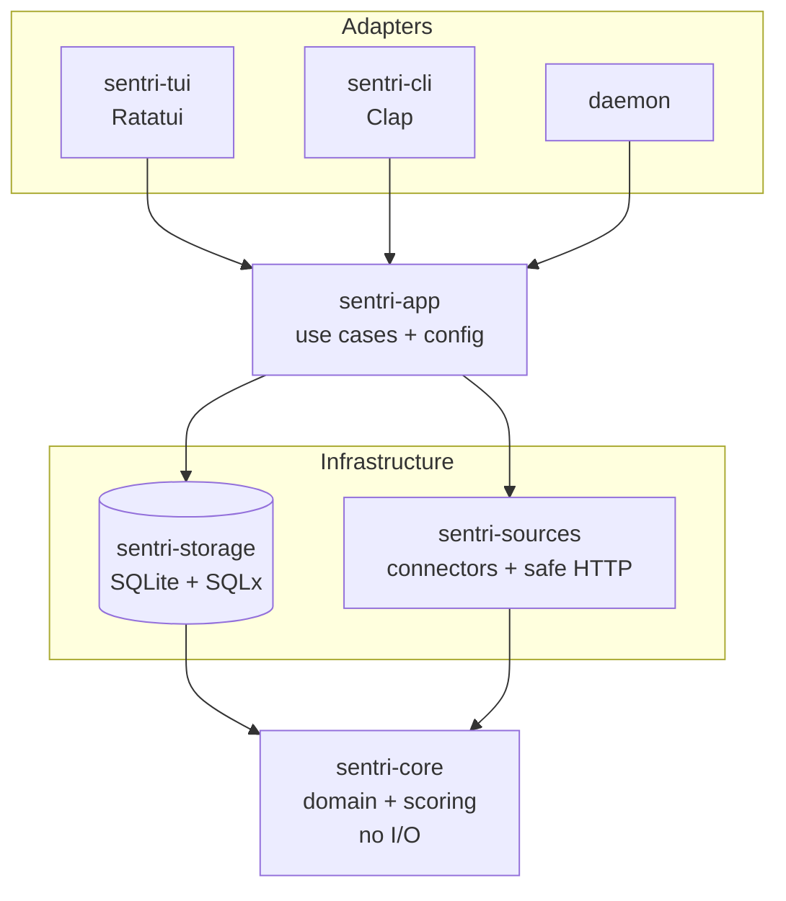

<div align="center">

# SENTRI

### Your personal opportunity radar, in the terminal

**English** · [Español](README.es.md)

**SENTRI** brings scholarships, hackathons, courses, jobs, volunteering,
fellowships, open calls, events, communities and open source projects into a
single feed, scores them against your interests, and lets you decide what to
do with each one.

[](https://github.com/HustavoJhon/sentri/actions/workflows/ci.yml)
[](https://www.rust-lang.org/)
[](https://doc.rust-lang.org/edition-guide/rust-2024/index.html)
[](https://www.sqlite.org/)
[](https://ratatui.rs/)
[](docs/roadmap.md)

[What it is](#what-is-sentri) · [Features](#features) ·
[Installation](#installation) · [Usage](#usage) ·
[Terminal images](#terminal-images) · [Architecture](#architecture) ·
[AI usage](#ai-usage) · [Contributing](#feedback-and-contributing)

</div>


<p align="center">
  <sub>Real captures of the TUI · Gruvbox Dark theme · usable over SSH without Nerd Fonts</sub>
</p>

---

## What is SENTRI?

Good opportunities are scattered across dozens of places: scholarship
portals, blogs, GitHub, Hacker News, community calendars, job boards and
event directories. They usually arrive late or get lost.

SENTRI is a **personal radar** for that problem. It collects, normalizes and
deduplicates what matters to you, gives each item an **explainable score**, and
shows everything in a fast, private, distraction-free terminal interface.

**Who it is for:** students, developers and tech community members who want
to keep track of opportunities without checking twenty websites. It is built
with the Peruvian and Latin American tech ecosystem in mind (Peruanos.dev,
GDG chapters, Get on Board, hack0.dev), and works just as well anywhere you
can point it at feeds and public sources.

**What it finds:** scholarships, fellowships, exchanges, hackathons and
competitions, courses and trainings, jobs and internships, volunteering, open
calls, conferences, meetups and workshops, calls for speakers, communities,
open source projects and tech news.

It is not another RSS reader or job search engine. It is a personal inbox for
deciding **which opportunity deserves your time**.

### What makes it different

- **Explainable relevance.** Every recommendation shows *why* it ranks where
  it does: matching interests, city, country, modality, travel, deadline and
  the affinity SENTRI learns from your likes and saves.
- **Independent sources.** A failing connector never stops the others; its
  error is recorded and collection goes on.
- **Terminal first.** A Rust + Ratatui interface that works over SSH, even
  from a phone, without Nerd Fonts. Images use Kitty or Sixel graphics when
  the terminal supports them, and colored half blocks everywhere else.
- **Local first.** Your data lives in an embedded SQLite database on your
  machine: no account and no cloud service. Files are created with
  owner-only permissions.
- **External content is untrusted.** The HTTP client blocks SSRF, enforces
  size and time limits, sanitizes text before it reaches the terminal, and
  reads secrets only from environment variables.

## See it in action

| First run | Dashboard |
|---|---|
|  |  |
| **Peruvian ecosystem** | **Calendar** |
|  |  |

## Features

| | |
|---|---|
| **Unified feed** | Opportunities and news in one place, with filters, search, and sorting by relevance, date or deadline. |
| **Rule-based scoring** | Interests, categories, city, country, modality, eligibility, free courses, certificates, prizes, travel and deadlines. No black boxes. |
| **Learned affinity** | Likes, saves, dismissals and applications adjust recommendations by category, tag and kind of opportunity. |
| **Clear interactions** | Like, save, dismiss, interesting, applied, enrolled and completed, with an append-only history. |
| **Add any link** | `sentri add URL` detects the platform, reads public metadata (Open Graph / JSON-LD), and keeps the URL even when the page blocks reading. |
| **Connectors** | RSS/Atom (including Google News, Mastodon, Bluesky and YouTube feeds), iCalendar (Luma, Meetup), GitHub (repositories and *good first issues*), Hacker News, GDG, Devpost, Kaggle, Peruanos.dev, hack0.dev, dev.events and Get on Board. |
| **Cards per kind** | Jobs show salary, modality and skills; events show date, organizer and place; communities show city and links; news shows topic, author and classification. What cards show is configurable. |
| **Rich details** | Description with its paragraphs and lists, key facts, image (with a full-screen viewer), author, notes, edit history and custom fields. |
| **Configurable dashboard** | Choose which widgets and metrics appear, their order, and a detailed or compact layout. |
| **Calendar** | Month, week, day and agenda views; schedule an opportunity's dates without signing up for anything. |
| **Declarative configuration** | Profile, interests, scoring weights and sources in a commented `config.toml`, also editable from the TUI. Adding an interest needs no code. |
| **Background daemon** | Periodic collection with a single-instance lock, crash recovery and a systemd unit. |
| **Secure by default** | Private, loopback and cloud metadata IPs are blocked; redirects, content types and sizes are limited; text is sanitized for the terminal. |
| **One binary** | SQLite is built in: no server, external service or database to install. |

## Installation

### Requirements

- **Rust stable 1.89+** (edition 2024).
- **Linux** (developed and tested on a Linux desktop; also works over SSH).
- Nothing else: SQLite is compiled into the binary (`sqlx` with `sqlite-bundled`).

### From source

```sh
git clone https://github.com/HustavoJhon/sentri.git
cd sentri
cargo install --path crates/sentri-cli
```

You can also run it without installing:

```sh
cargo run -p sentri-cli --          # opens the TUI
cargo run -p sentri-cli -- --help   # lists the commands
```

### First run

```sh
sentri config init   # writes the commented configuration (never overwrites)
sentri               # opens the TUI and collects from the enabled sources
```

On an empty database the TUI starts collecting right away and fills each
section as sources answer. `sentri collect` does the same from the command
line.

## Usage

### Command line

```sh
sentri                                  # opens the TUI
sentri add https://example.com/event    # adds a link with its metadata
sentri feed --view jobs --free --upcoming
sentri search rust --category open_source
sentri show 42                          # details and score explanation
sentri like 42                          # toggles like
sentri save 42
sentri mark 42 applied
sentri schedule 42                      # adds its dates to the calendar
sentri calendar --days 60
sentri collect --source hn-front-page
sentri sources
sentri status
sentri terminal                         # explains how this terminal draws images
sentri daemon --interval 120            # continuous collection
sentri backup ~/backups/sentri.db
```

<details>
<summary><b>Main commands</b></summary>

| Command | What it does |
|---|---|
| `sentri` | Opens the TUI. |
| `sentri add URL` | Adds a link and reads its public metadata. |
| `sentri edit ID` | Corrects or completes fields; `--set field=value` and `--reset field`. |
| `sentri feed --view …` | Feed filtered by section: `discover`, `news`, `jobs`, `courses`, `events`, `hackathons`, `scholarships`, `volunteering`, `open-source`, `travel`… |
| `sentri search …` | Searches by keywords with the same filters as the feed. |
| `sentri show ID` | Details and relevance explanation. |
| `sentri like/save/dismiss ID` | Toggles an interaction. |
| `sentri mark/unmark ID FLAG` | Status: `applied`, `enrolled`, `completed`, `interesting`… |
| `sentri history` | Recent actions. |
| `sentri calendar` | Calendar entries and dated opportunities. |
| `sentri schedule ID` | Adds an opportunity's dates to the calendar. |
| `sentri collect` | Collects now from the enabled sources. |
| `sentri daemon` | Collects in the background (made for systemd). |
| `sentri terminal` | Shows the detected terminal, graphics protocol, image renderer and why. |
| `sentri config init/path/check` | Manages and validates the configuration. |
| `sentri backup FILE` | Consistent copy of the database. |

</details>

### TUI shortcuts

| Key | Action |
|---|---|
| `j` `k` `↓` `↑` | Move |
| `Enter` | Open details (recorded in the history) |
| `Tab` `⇧Tab` `[` `]` | Switch section |
| `1`…`9` `0` | Jump to a section |
| `l` `s` `d` `i` | Like · save · dismiss · interesting |
| `p` `e` `c` | Applied · enrolled · completed |
| `a` | Add to the calendar |
| `o` | Open the original link |
| `z` | View the image full screen (`Esc` closes) |
| `n` | Add a link |
| `/` | Search |
| `:` `Ctrl-p` | Command palette |
| `S` | Change order: relevance → newest → deadline |
| `E` | Edit every field and your notes |
| `v` | Card density |
| `R` | Collect now |
| `?` | Help |
| `q` `Ctrl-c` | Quit |

Shortcuts can be remapped in **Settings › Shortcuts** or `[keys]`. The TUI
adapts to the width: three panes from 110 columns, two from 80, a narrow
section rail from 60, and just the feed on smaller screens. Mouse: wheel to
scroll, click to select, second click to open details. See
[docs/tui.md](docs/tui.md).

## Configuration

| What | Default path (Linux) |
|---|---|
| Configuration | `~/.config/sentri/config.toml` (or `$SENTRI_CONFIG`) |
| Database | `~/.local/share/sentri/sentri.db` |
| Image cache | `~/.cache/sentri/images` |
| Secrets | Environment variables; the configuration only stores their **name** (`token_env`) |

An interest is declared without touching code:

```toml
[[profile.interests]]
name = "Artificial intelligence"
keywords = ["ai", "ia", "machine learning", "llm", "deep learning"]
categories = ["hackathon", "fellowship"]
priority = "high"          # low ×1 · medium ×2 · high ×3
```

Set your own city, country and GitHub user (all optional):

```toml
[profile]
home_city = "Your city"
country = "Your country"

[github]
username = "your-github-user"   # public profile and avatar only, no token
```

Scoring weights (`home_city`, `travel`, `deadline_soon`, `not_eligible`,
`avoid_keyword`…) are configurable, and every recommendation can be explained
from the TUI or with `sentri show`. Dashboard widgets and card contents are
set in `[dashboard]` and `[cards]`. Everything can also be changed from
**Settings** in the TUI, which keeps your comments and makes a backup before
writing. See [docs/configuration.md](docs/configuration.md).

## Terminal images

SENTRI shows images (event posters, logos, your GitHub avatar) with real
pixels when the terminal supports a graphics protocol, and with colored half
blocks (`▀`, two pixels per cell) everywhere else. Keep `images = "auto"` (the
default): it asks the terminal what it supports when the TUI starts. Rendering
uses [`ratatui-image`](https://github.com/ratatui/ratatui-image) 11.1.

Run `sentri terminal` to see what SENTRI detected in your terminal, what it
is drawing with, and why.

| Terminal | Protocol | What was tested in a real terminal |
|---|---|---|
| foot 1.28 | Sixel | ✅ Detection, details image and avatar drawn in Sixel, startup without a key press |
| Alacritty 0.17 | none (Alacritty supports neither Kitty graphics nor Sixel) | ✅ Detection and half-block fallback |
| tmux 3.8 inside foot, `allow-passthrough on` | Sixel is detected but **not used**: tmux cannot place Sixel images reliably, so `auto` uses half blocks | ✅ Large images and the full-screen viewer drew correctly, but small ones landed in the wrong place; fallback, navigation and clean exit checked |
| tmux without `allow-passthrough` | none: graphics cannot reach the terminal | ✅ Half blocks, no keys lost at startup |
| kitty 0.49 | Kitty graphics protocol (kitty has no Sixel) | ✅ Detection, details image, avatar, full-screen viewer, navigation, redraw after resizing, `sentri terminal` |
| tmux 3.8 inside kitty, `allow-passthrough on` | Kitty graphics protocol, through Unicode placeholders | ✅ Detection, images in the right place, navigation, full-screen viewer, clean exit with no images left behind |
| WezTerm, Ghostty, iTerm2, Konsole, Windows Terminal | depends on the terminal | ⏳ Not tested; `ratatui-image` supports Kitty, Sixel and iTerm2 images |

Notes:

- Resizing was checked in kitty with images on screen (129×66 → 68×39 →
  150×76 columns: images are redrawn at the new size) and in tmux with half
  blocks. Resizing while Sixel images are shown has not been checked.
- Kitty images inside tmux use Unicode placeholders, which tmux keeps in
  place; they need `set -g allow-passthrough on` in `~/.tmux.conf`. SENTRI
  never changes your tmux settings.
- **Seeing blocky images in kitty or foot?** Check `images` in your
  `config.toml`: older configuration files set `images = "halfblock"`, which
  never asks the terminal. SENTRI says so at startup, in Settings and in
  `sentri terminal`; set `images = "auto"` and restart.
- `images = "kitty"`, `"sixel"` or `"iterm2"` forces a protocol (for example
  Sixel inside tmux, at your own risk). `"halfblock"`, `"ascii"` and `"off"`
  never use one.
- Details: [docs/configuration.md](docs/configuration.md#imágenes).

## Architecture

SENTRI is a **modular monolith** in a Cargo workspace. There are no
microservices: the TUI, the CLI and the daemon are adapters that call the same
use cases.



| Crate | Responsibility |
|---|---|
| `sentri-core` | Domain models, URL normalization and deduplication, interests, rule-based scoring. **No I/O.** |
| `sentri-storage` | SQLite, versioned migrations and repositories. |
| `sentri-sources` | `Connector` trait, connectors, safe HTTP client (anti-SSRF) and metadata extraction. |
| `sentri-app` | TOML configuration and use cases: collect, add links, interact, query the feed and the calendar. |
| `sentri-tui` | Ratatui interface. Talks only to `sentri-app`. |
| `sentri-cli` | The `sentri` binary (Clap): dispatches subcommands and opens the TUI. |

Key rules: `sentri-core` does no I/O; adapters never run SQL or HTTP
directly; external content is validated, truncated and never executed. See
[docs/architecture.md](docs/architecture.md) and the
[architecture decisions](docs/adr/).

## Security and privacy

- **Anti-SSRF** on every request: only `http`/`https`, only public IPs, DNS
  rebinding filtered, redirects revalidated, system proxies ignored.
- **Limits** on time, size, redirects and `Content-Type`, enforced while
  streaming.
- **Sanitization** of control and bidirectional characters to prevent ANSI
  injection into the terminal. Descriptions keep their paragraphs and lists,
  but HTML is never rendered.
- **Secrets** never live in the repository or in `config.toml`: only in
  environment variables (`token_env`).
- **Personal data** is stored with `0600` permissions (database, WAL and
  backups) in a `0700` directory.
- **No scraping** of restricted platforms and no personal account cookies.
- **Profile display:** IP addresses found in your public GitHub profile
  fields are never shown.

See [docs/security.md](docs/security.md).

## AI usage

SENTRI was built with **heavy use of AI coding assistants** (Claude Code and
OpenCode). The maintainer wrote the specifications, reviewed the changes and
is responsible for the result. **SENTRI itself uses no AI at runtime** and
sends none of your data to AI services: recommendations come from explicit,
explainable rules. Full disclosure: [AI_USAGE.md](AI_USAGE.md).

## Roadmap

| Phase | Content | Status |
|---|---|---|
| 0–4 | Workspace, models, SQLite, search, interactions, TUI | Done |
| 5 | Connectors (RSS/Atom, GitHub, Hacker News, iCalendar, Peruvian ecosystem, Get on Board…) | In progress |
| 6 | Interests, scoring, explanations and personalization | In progress |
| 7 | Events and Google Calendar (OAuth2) | Local calendar done; Google not connected |
| 8–10 | Courses, jobs, professional profile and help with sign-ups | Pending |
| 11 | Daemon, systemd, retries and supervision | Base done |
| 12–13 | Remote access, VPS, Axum API and PWA | Pending |

Details and next steps: [docs/roadmap.md](docs/roadmap.md).

## Development

```sh
./scripts/check.sh   # fmt + clippy (-D warnings) + tests
```

The same script runs in GitHub Actions for `main` and `dev`. Technical
documentation lives in [`docs/`](docs/) and is currently written in Spanish:

| Document | Content |
|---|---|
| [Architecture](docs/architecture.md) | Layers, crates and data flow |
| [Configuration](docs/configuration.md) | Profile, interests, scoring, sources, dashboard, cards and images |
| [Sources](docs/sources.md) | Feasibility, policies and implementation order |
| [Security](docs/security.md) | Anti-SSRF, secrets and personal data |
| [TUI](docs/tui.md) | Layout, shortcuts and sections |
| [Daemon](docs/daemon.md) | systemd, guarantees and VPS deployment |
| [Database](docs/database.md) | Model, migrations, backups and permissions |
| [Editing](docs/editing.md) | Detected data vs. manual corrections |
| [Calendar](docs/calendar.md) | Views, entries and Google Calendar |
| [Roadmap](docs/roadmap.md) | Phases and next steps |
| [ADR](docs/adr/) | Architecture decisions |

## Feedback and contributing

SENTRI is in active development and feedback shapes what comes next.

- **Report a bug:** [open an issue](https://github.com/HustavoJhon/sentri/issues/new)
  with what you did, what you expected and what happened. Include your SENTRI
  version or commit, your OS and terminal, and the output of
  `sentri terminal` if the problem involves the display. Remove personal data
  (paths, tokens, IP addresses) from logs and screenshots.
- **Request a feature:** open an issue that describes the use case: what you
  want to do and why. That helps more than a proposed solution.
- **Source integration problems:** if a source stops working or returns wrong
  data, open an issue with the source name from `sentri sources`, the error
  shown there or in `sentri.log` (next to the database), and an example link.
- **Propose a new connector:** open an issue with the platform, how it
  publishes data (official API, RSS/Atom, iCalendar, JSON-LD on public pages),
  whether it needs a token, and its terms of use. SENTRI only uses public,
  permitted access and never scrapes restricted platforms (see
  [docs/sources.md](docs/sources.md) and
  [ADR 0004](docs/adr/0004-no-scraping-of-restricted-platforms.md)).
- **Contribute code:**
  1. Open an issue first to agree on the change.
  2. Keep changes small and include tests.
  3. Run `./scripts/check.sh` before opening the pull request.

This repository does not have a published license yet.

---

<div align="center">
  <sub>Made with Rust in Cusco, Peru</sub>
</div>
