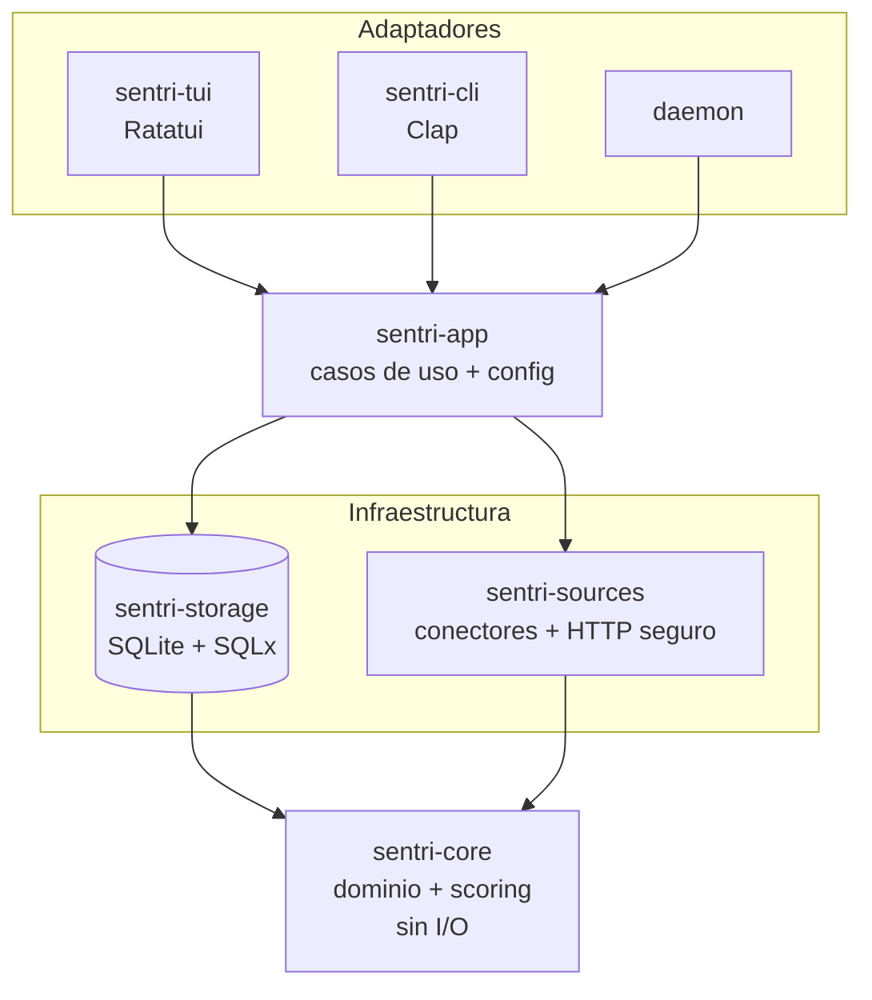

<div align="center">

# SENTRI

### Tu radar personal de oportunidades — en la terminal

**SENTRI** reúne becas, hackathons, cursos, empleos, voluntariados, fellowships,
convocatorias, eventos y proyectos open source en un solo feed, los puntúa
según tus intereses y te deja decidir qué hacer con cada uno.

[](https://github.com/HustavoJhon/sentri/actions/workflows/ci.yml)
[](https://www.rust-lang.org/)
[](https://doc.rust-lang.org/edition-guide/rust-2024/index.html)
[](https://www.sqlite.org/)
[](https://ratatui.rs/)
[](docs/roadmap.md)

[Qué es](#qué-es-sentri) · [Características](#características) ·
[Instalación](#instalación) · [Uso](#uso) · [Arquitectura](#arquitectura) ·
[Documentación](#documentación)

</div>


<p align="center">
  <sub>Capturas reales de la TUI · tema Gruvbox Dark · usable por SSH sin Nerd Fonts</sub>
</p>

---

## Qué es SENTRI?

Las oportunidades interesantes están repartidas entre decenas de fuentes:
portales de becas, blogs, GitHub, Hacker News, calendarios de comunidades,
newsletters, redes sociales… y casi siempre llegan tarde o se pierden.

SENTRI nace para resolver eso: es un **radar personal** que recopila, normaliza
y deduplica todo lo que te interesa, le asigna una **puntuación explicable** y
lo presenta en una interfaz de terminal rápida, privada y sin distracciones.

No es un lector RSS más ni un buscador de empleo. Es una bandeja de entrada
personal para decidir **qué oportunidad merece tu tiempo**.

### Lo que lo hace diferente

- **Relevancia explicable.** Cada recomendación muestra *por qué* sube o baja:
  coincidencia de intereses, ciudad, país, modalidad, viaje, deadline y
  afinidad aprendida de tus interacciones.
- **Fuentes independientes.** Un conector que falla no detiene a los demás; el
  error queda registrado y el resto sigue recopilando.
- **Terminal first.** TUI en Rust + Ratatui, pensada para funcionar por SSH
  incluso desde el móvil, sin Nerd Fonts ni protocolos gráficos.
- **Datos tuyos.** SQLite embebido, sin cuentas, sin nube obligatoria y con
  permisos restrictivos desde el primer arranque.
- **Contenido externo no confiable.** Cliente HTTP con protección anti-SSRF,
  límites de tamaño, saneamiento de texto y secretos solo por variables de
  entorno.

## En acción

| Primer arranque | Dashboard |
|---|---|
|  |  |
| **Ecosistema peruano** | **Calendario** |
|  |  |

## Características

| | |
|---|---|
| **Feed unificado** | Oportunidades y noticias en un solo lugar, con filtros, búsqueda y orden por relevancia, fecha o deadline. |
| **Scoring por reglas** | Intereses, categorías, ciudad, país, modalidad, elegibilidad, gratuidad, certificado, premios, viaje y deadlines. Sin cajas negras. |
| **Afinidad aprendida** | Likes, guardados, descartes y postulaciones ajustan la recomendación por categoría, etiqueta y tipo de oportunidad. |
| **Interacciones claras** | Like, guardado, descarte, interesante, postulado, inscrito y completado, con historial append-only. |
| **Añadir cualquier enlace** | `sentri add URL` detecta la plataforma, extrae metadatos públicos (Open Graph / JSON-LD) y guarda la URL aunque la página bloquee la lectura. |
| **Conectores** | RSS/Atom, GitHub (repos y *good first issues*), Hacker News, Google News, Mastodon, Bluesky y YouTube. |
| **Detalles ricos** | Imagen, autor, editor, notas personales, historial de cambios y campos personalizados. |
| **Calendario** | Vista mensual, semanal, diaria y agenda; programa fechas de una oportunidad sin inscribirte en nada. |
| **Configuración declarativa** | Perfil, intereses, pesos del scoring y fuentes en un `config.toml` comentado. Añadir un interés no requiere código. |
| **Daemon desacoplado** | Recopilación periódica en segundo plano, con bloqueo de instancia única, recuperación tras caídas y unidad de systemd. |
| **Seguridad por defecto** | Bloqueo de IPs privadas/loopback/metadatos cloud, límites de redirecciones, tipos y tamaños, y saneamiento de texto para la terminal. |
| **Un solo binario** | SQLite va embebido; no hay servidor, servicio externo ni base de datos que instalar. |

## Instalación

### Requisitos

- **Rust stable 1.89+** (edición 2024).
- **Linux** (probado en escritorio; también funciona por SSH).
- Nada más: SQLite se compila dentro del binario (`sqlx` con `sqlite-bundled`).

### Desde el código

```sh
git clone https://github.com/HustavoJhon/sentri.git
cd sentri
cargo install --path crates/sentri-cli
```

También puedes ejecutarlo sin instalar:

```sh
cargo run -p sentri-cli --          # abre la TUI
cargo run -p sentri-cli -- --help   # lista los comandos
```

### Primer arranque

```sh
sentri config init   # escribe la configuración comentada (no sobrescribe)
sentri collect       # recopila de las fuentes habilitadas
sentri               # abre la TUI
```

## Uso

### Línea de comandos

```sh
sentri                                  # abre la TUI
sentri add https://example.com/evento   # añade un enlace con metadatos
sentri feed --view jobs --free --upcoming
sentri search rust --category open_source
sentri show 42                          # detalles y explicación del score
sentri like 42                          # alterna like
sentri save 42
sentri mark 42 applied
sentri schedule 42                      # añade sus fechas al calendario
sentri calendar --days 60
sentri collect --source hn-front-page
sentri sources
sentri status
sentri daemon --interval 120            # recopilación continua
sentri backup ~/backups/sentri.db
```

<details>
<summary><b>Ver los comandos principales</b></summary>

| Comando | Qué hace |
|---|---|
| `sentri` | Abre la TUI. |
| `sentri add URL` | Añade un enlace y extrae metadatos públicos. |
| `sentri edit ID` | Corrige o completa campos; `--set campo=valor` y `--reset campo`. |
| `sentri feed --view …` | Feed filtrado por sección: `discover`, `news`, `jobs`, `courses`, `events`, `hackathons`, `scholarships`, `volunteering`, `open-source`, `travel`… |
| `sentri search …` | Busca por palabras con los mismos filtros del feed. |
| `sentri show ID` | Detalles y explicación de la relevancia. |
| `sentri like/save/dismiss ID` | Alterna una interacción. |
| `sentri mark/unmark ID FLAG` | Estado: `applied`, `enrolled`, `completed`, `interesting`… |
| `sentri history` | Acciones recientes. |
| `sentri calendar` | Entradas y oportunidades con fecha. |
| `sentri schedule ID` | Añade las fechas de una oportunidad al calendario. |
| `sentri collect` | Recopila ahora de las fuentes habilitadas. |
| `sentri daemon` | Recopila en segundo plano (ideal para systemd). |
| `sentri config init/path/check` | Gestiona y valida la configuración. |
| `sentri backup FILE` | Copia consistente de la base de datos. |

</details>

### Atajos de la TUI

| Tecla | Acción |
|---|---|
| `j` `k` `↓` `↑` | Mover |
| `Enter` | Abrir detalles (registra en el historial) |
| `Tab` `⇧Tab` `[` `]` | Cambiar de sección |
| `1`…`9` `0` | Saltar a una sección |
| `l` `s` `d` `i` | Like · guardar · descartar · interesante |
| `p` `e` `c` | Postulado · inscrito · completado |
| `a` | Añadir al calendario |
| `o` | Abrir enlace original |
| `n` | Añadir un enlace |
| `/` | Buscar |
| `:` `Ctrl-p` | Paleta de comandos |
| `S` | Cambiar orden: relevancia → recientes → deadline |
| `E` | Editar todos los campos y notas |
| `v` | Densidad de las cards |
| `R` | Recopilar ahora |
| `?` | Ayuda |
| `q` `Ctrl-c` | Salir |

La TUI se adapta al ancho: tres paneles con ≥110 columnas, dos con ≥80 y solo
el feed en pantallas estrechas. Ratón: rueda para desplazar, clic para
seleccionar y segundo clic para abrir detalles. Ver [docs/tui.md](docs/tui.md).

## Configuración

| Qué | Ruta por defecto (Linux) |
|---|---|
| Configuración | `~/.config/sentri/config.toml` (o `$SENTRI_CONFIG`) |
| Base de datos | `~/.local/share/sentri/sentri.db` |
| Secretos | Variables de entorno; la config solo guarda su **nombre** (`token_env`) |

Un interés se declara sin tocar código:

```toml
[[profile.interests]]
name = "Artificial intelligence"
keywords = ["ai", "ia", "machine learning", "llm", "deep learning"]
categories = ["hackathon", "fellowship"]
priority = "high"          # low ×1 · medium ×2 · high ×3
```

Los pesos del scoring (`home_city`, `travel`, `deadline_soon`,
`not_eligible`, `avoid_keyword`…) son configurables y cada recomendación se
puede explicar desde la TUI o con `sentri show`. Ver
[docs/configuration.md](docs/configuration.md).

## Arquitectura

SENTRI es un **monolito modular** en un workspace Cargo. No hay microservicios:
la TUI, la CLI, el daemon y la futura API son adaptadores que llaman a los
mismos casos de uso.



| Crate | Responsabilidad |
|---|---|
| `sentri-core` | Modelos de dominio, normalización y deduplicación de URLs, intereses, scoring basado en reglas. **Sin I/O.** |
| `sentri-storage` | SQLite, migraciones versionadas y repositorios. |
| `sentri-sources` | Trait `Connector`, conectores, cliente HTTP seguro (anti-SSRF) y extracción de metadatos. |
| `sentri-app` | Configuración TOML y casos de uso: recopilar, añadir enlaces, interactuar, consultar feed y calendario. |
| `sentri-tui` | Interfaz Ratatui. Solo habla con `sentri-app`. |
| `sentri-cli` | Binario `sentri` (Clap): despacha subcomandos y abre la TUI. |

Reglas clave: `sentri-core` no hace I/O; los adaptadores no ejecutan SQL ni HTTP
directamente; todo contenido externo se valida, se trunca y nunca se ejecuta.
Ver [docs/architecture.md](docs/architecture.md) y las
[decisiones de arquitectura](docs/adr/).

## Seguridad y privacidad

- **Anti-SSRF** en cada petición: solo `http`/`https`, solo IPs públicas, DNS
  rebinding filtrado, redirecciones revalidadas y proxies del sistema ignorados.
- **Límites** de tiempo, tamaño, redirecciones y `Content-Type` en streaming.
- **Saneamiento** de caracteres de control y bidi para evitar inyección de ANSI
  en la terminal.
- **Secretos** nunca en el repositorio ni en `config.toml`: solo variables de
  entorno (`token_env`).
- **Datos personales** con permisos `0600` (base, WAL y backups) y directorio
  `0700`.
- **Sin scraping** de plataformas restringidas ni cookies de cuentas
  personales. Ver [docs/security.md](docs/security.md).

## Roadmap

| Fase | Contenido | Estado |
|---|---|---|
| 0–4 | Workspace, modelos, SQLite, búsqueda, interacciones, TUI y edición | Completado |
| 5 | Conectores: RSS/Atom, GitHub, Hacker News, Google News, Mastodon, Bluesky, YouTube | En curso |
| 6 | Intereses, scoring, explicaciones y personalización | En curso |
| 7 | Eventos y Google Calendar (OAuth2) | Pendiente |
| 8–10 | Cursos, empleos, perfil profesional y asistencia a inscripciones | Pendiente |
| 11 | Daemon, systemd, reintentos y supervisión | Base |
| 12–13 | Acceso remoto, VPS, API Axum y PWA | Pendiente |

Consulta el detalle y los próximos pasos en [docs/roadmap.md](docs/roadmap.md).

## Desarrollo

```sh
./scripts/check.sh   # fmt + clippy (-D warnings) + tests
```

El mismo script corre en GitHub Actions para `main` y `dev`. La documentación
técnica vive en [`docs/`](docs/):

| Documento | Contenido |
|---|---|
| [Arquitectura](docs/architecture.md) | Capas, crates y flujo de datos |
| [Configuración](docs/configuration.md) | Perfil, intereses, scoring y fuentes |
| [Fuentes](docs/sources.md) | Viabilidad, políticas y orden de implementación |
| [Seguridad](docs/security.md) | Anti-SSRF, secretos y datos personales |
| [TUI](docs/tui.md) | Distribución, atajos y secciones |
| [Daemon](docs/daemon.md) | systemd, garantías y despliegue en VPS |
| [Base de datos](docs/database.md) | Modelo, migraciones, backups y permisos |
| [Edición](docs/editing.md) | Datos detectados vs. correcciones manuales |
| [Calendario](docs/calendar.md) | Vistas, entradas y Google Calendar |
| [Roadmap](docs/roadmap.md) | Fases y próximos pasos |
| [ADR](docs/adr/) | Decisiones de arquitectura |

## Contribuir

SENTRI está en desarrollo activo y el alcance cambia rápido. Si quieres
proponer una fuente, un atajo o una mejora:

1. Abre un issue describiendo el caso de uso.
2. Mantén los cambios pequeños y con tests.
3. Ejecuta `./scripts/check.sh` antes de abrir el PR.

Este repositorio todavía no tiene una licencia publicada.

---

<div align="center">
  <sub>Hecho con Rust desde Cusco, Perú</sub>
</div>
