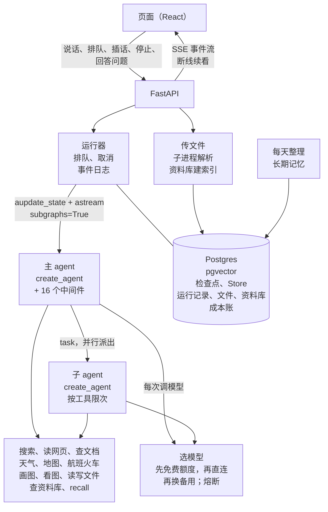

# 灵稿 · LingDraft

从一个想法，到一份拿得出手的作品。

一个能搜、能读、回答会标来源的 AI 对话 agent。能看用户发的图和文件，能查用户自己的资料库；用户要成品时，把文档、网页、代码写成文件，右栏边写边看，改一次出一版。做到一半碰到只有用户能定的地方，会停下来问，等回答了接着做。主 agent 和子 agent 都是 LangChain 的 `create_agent`，上面挂着自己写的 16 个中间件。运行层也是自己写的，管排队、停止、插话、停下来问用户和断线续看。默认用 DeepSeek，另外直连了 7 家模型，“自动”按第一句话挑模型。检查点、长期记忆、运行记录、资料库的向量和成本账都存在 Postgres。


<p>
  
  
</p>

## 架构



## LangGraph 和 LangChain 在这里怎么用

| 机制 | 用在哪 |
|---|---|
| `create_agent` + `AgentMiddleware` | 主 agent、子 agent 都由它搭；16 个自写中间件用到 `before_agent`、`abefore_model`、`awrap_model_call`、`awrap_tool_call`、`after_model`（`can_jump_to`）、`after_agent` |
| `ModelRequest.override(model=…, tools=…)` | 每次调模型现挑模型：这一轮定下的、免费额度、直连、备用，出问题一路换下去；这段对话没有资料库时，把查资料库的工具从请求里拿掉 |
| `ExtendedModelResponse` + `Command(update=…)` | 中间件在一次模型调用里顺手改 state：写上起好的标题、换掉没通过审核的工具结果、记下换上的备用模型、超长重发时记下压到了哪一轮 |
| `context_schema` / `ToolRuntime` | 取插话、上次起好的标题这些运行时的东西从 context 传给中间件，不进 state；子任务、recall、读写文件、查资料库、看图的工具从 `ToolRuntime` 拿 state 和 context |
| `aupdate_state(as_node=START)` + `astream(None)` | 用户的话先写进检查点再开跑，排队时服务重启也不丢 |
| `stream_mode=["messages", "updates", "custom"]`，`subgraphs=True` | 逐字的思考和正文、存下的步骤、工具进度一路推给页面；子 agent 的流按命名空间认出是哪个子任务的；模型写文件时，从 `tool_call_chunks` 边收边解出标题和正文，右栏跟着出字 |
| `get_stream_writer` / `TAG_NOSTREAM` | 中间件推自定义事件（在等什么、工具进度、换了哪个模型）；写短版、单条送审这些内部调用不推给页面 |
| `content_blocks` | 8 家模型的思考统一按标准 content blocks 读；豆包的类标成自家的提供方，才读得到它的思考 |
| `with_structured_output(method="function_calling")` | 判断难易、起标题这些结构化输出走强制工具调用：DeepSeek 只支持这一种，百炼、TokenHub 上有的接入点也不认 `json_schema` |
| `ContextOverflowError` | 各家报的“上下文超长”都认成它，连 MiMo 不报错、一个字没生成就结束的也算；压缩中间件压了再发一次 |
| `langchain.mcp`（`MCPAdapter`） | 搜索、读网页、天气、地图、航班火车、画图、查文档（Context7）都是 agent-tools 的 MCP 工具，怎么搜、怎么读、挑城市、定地名、查班次、出图存图、结果的样子和失败时给模型的话都在服务里，几个产品共用：灵稿起服务时取来，工具说明后面接上自己的一段，中间件给搜索结果、读到的页、查到的每段文档带上来源 id，管每轮画几张查几次、比路线时核对车站的城市；天气、地图、航班火车、画图结果的 `structuredContent` 画卡片，模型只看文字（图只给编号，页面经灵稿后端按编号取）；排行程是灵稿自己的工具，模型按查到的班次编号排，核对过才画行程卡 |
| `ToolMessage.artifact` | 子 agent 的整段消息放在 artifact 里交回：来源、用量、子任务卡从这里读，主 agent 的模型只看报告；写文件、查资料库的结果也把给页面的部分放在这里 |
| `ToolCallLimitMiddleware` | 子 agent 搜、读各 8 次的硬上限 |
| `RecursiveCharacterTextSplitter` | 资料库切块：先按标题、页分段，再按 800 字切、重叠 100 |
| `AsyncPostgresSaver`，`durability="exit"` | 检查点只在一轮的开头和结尾存 |
| `interrupt(…, response_schema=…)` / `Command(resume={id: …})` | 模型问用户：`ask_user` 工具里调 `interrupt`，这次执行结束、线程停在工具里等；回答按中断的 id 交回去，同一轮接着跑，同一条消息里别的工具不重跑；回答的格式由 `response_schema` 校验，不合格的存不进检查点 |
| `AsyncPostgresStore` | 长期记忆；和检查点、运行记录共用一个连接池 |
| LangSmith | 评测每次传成一个实验；线上开着 tracing，中间件那几层不记输入输出：每层记的都是同一份请求，一轮问天气就有 1.5MB |
| `StateGraph` + `interrupt` | 早先的海报场景：手写图，生成前后停下来让人确认 |
| `InMemorySaver` / `InMemoryStore` | 测试 |

## 几个工程决定

**运行层自己写，对照 Agent Server。** 一个对话同时只跑一轮。停止就是取消这一轮的任务，在等的模型、搜索一起断开。事件先写进事件日志，断线后带着最后一个事件 id 续看。回答时用户又说的话可以排队，等这一轮答完再发；也可以插进正在跑的这一轮，下一次调模型之前放进对话。插进这一轮是 Agent Server 没有的。

**模型问用户：停在工具里，等的时候不动检查点。** 新建时选“对话”还是“工作”（左栏两个入口，新页面上一个大开关），定下以后整段不变。工作任务里的计划、调研、写报告这类活，模型先调 `ask_user` 把只有用户能定的事问清楚再动手，页面出一张问题卡：选一个选项、自己写，或者跳过。对话里不给这个工具，也没有那段提示词。一开始不分模式，靠提示词写“什么情况该问”，上线后发现情形列举不完，改成由用户选；先做成输入框里每句话都能换的开关，用起来别扭，又改成新建时定。工作任务里问不问、问什么仍由模型判断，代码只管三件事。

- 停下来不算失败。这次执行记成“问了”，线程的状态是“等回答”，一直等，不会过一阵自己接着做；重启、重新部署以后照样能答。
- 等的时候往检查点里写一次（哪怕只是改标题），等着的问题就丢了。所以这时接着说、改名都先拒掉，停止和重新回答是先把这一轮收尾再做；回答本身什么都不写，只带着中断的 id 接着跑。
- 一轮最多问 2 次，再问的不停下来，直接让模型按自己的判断做并说明；用户跳过也一样。等回答的那段时间不算进这一轮的用时。

问题卡上还有一个“别再问了”：这个问题当跳过，这个工作任务之后也不再出卡，能恢复。这是用户明确选的，所以由代码保证，直接不给模型这个工具；提示词换成一段“不先问，自己定并说明”。缺一个只有用户知道的条件（比如没说哪个城市）时，模型出卡问还是在正文里反问都算对，区别只是卡能接着当前这一轮往下做。

**用户的位置不经过模型，也不进检查点。** 模型查天气、找附近、比路线时可以选“当前位置”，位置从浏览器来。停下来要位置用的是问用户的同一套 `interrupt`，只是由包着工具的中间件发起，页面出的是位置卡；浏览器里已经允许过定位的不出卡，直接取。交回 `interrupt` 的值会进检查点，所以里面只有“给了 / 没给”；坐标留在进程内存里，调工具时放进 MCP 请求的 `_meta`（LangChain 的适配器不带 `_meta`，这一次改用 FastMCP 的客户端直接调）。模型的参数、检查点、日志和 tracing 里都没有坐标。要过一次就不再要：给过的位置按人留 10 分钟，这段时间里哪段对话、哪一轮再用到都直接用，不停下来；留得不长是因为人会走动，过了再用到的由页面悄悄重取，不再出卡。没给位置的不调工具，回一段话让模型改用用户说的或记忆里的地方，或者问用户；这一轮里不再要第二次。

**检查点只存开头和结尾。** 默认每一步都存一份整段对话，存储随对话长度按平方增长。改成 `durability="exit"` 后，12 轮的对话从 156 个检查点、4.5MB 降到 36 个、1.1MB。代价是被掐断的那一轮要整轮重跑。

**上下文压缩围着前缀缓存设计。** DeepSeek 命中缓存的输入只要 1/30 的价钱。LangChain 现成的两种压缩每次都改开头，算下来摘要贵 11%、清工具结果贵 27%，摘要还会把页面上的历史一起删掉。所以自己写：

- 压到哪一轮存在 state 里、只往后挪，两次挪动之间发出去的前缀逐字不变；
- 先把旧的工具结果换成带来源 id 的一行说明，还超才把整轮换成短版，原文用 `recall` 取回；
- 只改发给模型的那一份，页面照常显示原文；
- 估算没到线、模型服务却说上下文超长（估少了，或者这个模型的窗口更小）时，不管触发线，把之前几轮压到估算的一半，再发一次；MiMo 超长不报错、一个字没生成就结束，也照这样处理。

算账时还查出每轮都丢了上一轮的缓存，28%～30% 没命中的输入是白算的，也一起修了。

**子 agent 的用量靠代码管，不靠提示词。** 主 agent 用 `task` 工具一次派几个子 agent 并行去查：每轮最多 5 个，同时最多跑 3 个。评测发现，提示词里“够了就停”那几句 Flash 根本不照做，加不加平均都搜 8 次左右。改成每一步告诉它还剩几次，再加按工具的硬上限。一个三城对比的问题，花费降了 30%，用时降了 32%。

**选模型：降成本放在“自动”里，一段对话只定一次。** 用户多半不改默认。新对话的第一句话进来时，用 Flash 判断一次难易，简单的用免费额度，复杂的用 V4 Pro，之后整段对话沿用：换模型前缀缓存就全废，几家的思考格式也不能混在一段对话里。手写 40 句第一句话测，39 句和人工标的一致。每次调模型先走同一个模型在百炼、TokenHub 上的免费额度，没成就换直连，再不行换备用 Flash，试过的不再换回去。熔断按“厂商:模型”记，免费额度那边坏了不连累直连。工作任务不判断，直接按复杂的走：它本身就是复杂的活，真实模型评测里给简单问题用的免费模型拿着问用户的工具也不用。

**资料库：向量放进同一个 Postgres，参数靠评测定。** 用户把文件传进资料库，以后任何对话都能查，回答标到文件的哪一段，点开就翻到原文。

- 向量存在 pgvector 里。块和文件表用外键连着，删文件、删块在一个事务里，删了马上搜不到，不用另起向量库，也不用清理任务。2 万块不建向量索引，精确查 130–360 ms。
- 查的时候向量、关键词各取 20 块，用 RRF 合并，再用重排模型取前 8 块。
- 块切多大、要不要关键词、要不要重排、用哪个向量模型，都靠自己出的题跑数字定。36 道题里第 1 条就命中的：只用向量是 15 道，现在是 30 道；提升最大的一步是加重排（17 → 26）。另一套 47 道的真实公开资料（含中文问英文文档）是 41 道。
- 资料库对模型来说是个工具，查不查由它定：工具说明里列出库名和文件名，结果开头写明“最接近的不一定相关，没有就直说”。

**模型写的文件：文件表里一版一行。** 用户要报告、方案、网页这类成品时，模型调 `create_file`，右栏边写边看。改的时候用片段替换：每段原文要在全文里恰好出现一次，有一段对不上就整次不改，告诉模型是第几段；不做模糊匹配。每改一次存一版全文，一轮里同一份文件只留最后一版。文件全文不在每轮开头注入，前缀缓存不断。各家默认的最长输出有的只有几千 token，整篇文档放在工具参数里会被截断，所以每次调用都带上 65536；还是被截断的那次不存。

**跑命令：每条命令一个新容器，文件表还是唯一的真相。** 工作任务里模型多一个 `run_command`，用来算数、分析用户发的表格、出图表。沙箱是单独的服务：一段对话一个工作目录，每条命令起一个 gVisor 容器，跑完就删，不联网、装不了包，所以进程里的变量留不到下一条命令，留得下来的只有文件；这一点写在工具说明里，模型会把脚本写成文件再跑。跑之前把用户发的文件放进 `uploads/`（只读），跑完把 `outputs/` 里新增、改过的文件登记进文件表，图跟在回答里，别的是文件卡片；一轮里同一个路径只留最后一版。工具说明里要写出装了哪一种中文字体：只写“已经配好”时，模型照习惯把字体设成没装的 SimHei，图上的中文全是方框。模型写的文件也放进去（`uploads/documents/`，只读，总是最新一版，来源 id 已换成编号、文末附来源列表），镜像里有一个固定的转换程序 `convert-doc`：用户说一句“导出成 PDF”，模型跑一条命令就出文件，版式不由模型现写；右栏文档的下载菜单里也有 PDF、Word，那条路不经过模型，后端拿同一份内容在一个临时工作区里跑同一个程序，转过的一版留着下次直接给。PPT 也走这条路：python-pptx 只管把形状写进文件、不会排，真实模型做的两份 PPT 里 15 页有 1 页图伸出页面、压住了字，只看抽出来的文字发现不了；所以镜像里装了 LibreOffice，`convert-doc` 能把 PPT 排成 PDF（8 页约 5 秒），右栏打开 PPT 先看排出来的每一页。转换前要把钱数里的 `$` 转义：pandoc 读 GFM 时两个 `$` 之间的字都算公式，真实报告里的“$100–$200/月”被排成了一行公式，所以照页面渲染的规矩（后一个 `$` 后面跟数字的不算公式）先处理一遍。

**长期记忆每天整理一次。** Store 不跟检查点一起提交，边聊边存的话，重新回答、删对话都撤不回已经存进去的记忆。记忆放进系统提示词，一变前缀缓存就断。所以对话里不存，每天凌晨 3 点（闲时价）把有新内容的对话整理一遍：模型对照全部现有记忆增、改、删，记忆一天只变一次。

**用户发的文件不卡对话、不拖垮容器。** 选好就传，在单独的子进程里解析，对话照常进行：容器只有 512MB，子进程最先被 OOM 杀掉，60 秒超时，出了事只是这个文件读不了。本机测一份 16MB、26 万行的 Excel，解析 4 秒，子进程峰值约 150MB。2 万字以内的文件整篇给模型（一句话合计不超过 5 万字），长的只给目录和开头，模型用 `read_file` 按页读、在文件里找。文件内容不存进消息，每次调模型时按存下的文字现拼，拼出来逐字不变，前缀缓存照常命中。看不见图的模型调看图工具，由能看图的模型看完用文字回答。

**模型出错分几类处理。** 服务不可用走熔断：同一个模型连续 2 次不可用就断开 180 秒，429 不计入，不然请求一密就把所有对话一起断开。发出去 30 秒还没出第一个字也算不可用，换备用。生成到一半断了，去掉页面上的半截，再调一次。内容审核拦下时，把新加进来的工具结果逐条送审，只去掉没通过的再试；拦下的是用户的话就停下这一轮。

## 评测

用真实模型回放多轮对话（`backend/evals/`），每一轮查三样：

- 轨迹：该不该搜、该不该读原文、引用的来源在不在；
- 回答：裁判模型按用例写的标准判；
- 引用：另一个裁判模型拿 agent 当时看到的材料，逐条核对带角标的说法有没有依据。

资料库另有两套检索题（自己的技术笔记 36 道，真实公开资料 47 道），看第 1 条、前 8 条命中和 MRR。每次评测传成 LangSmith 的一个实验，只回答一个具体问题，答到就停。

## 项目结构

```
.
├── backend/
│   ├── app/
│   │   ├── api/               FastAPI 接口；运行器（排队、停止、插话、问用户、事件日志）；运行记录
│   │   ├── graph/research/    对话 agent：create_agent 和中间件、子 agent、上下文压缩、长期记忆、提示词
│   │   ├── graph/poster/      海报场景：手写的 StateGraph
│   │   ├── files/             用户发的、模型写的文件：认类型、子进程里解析、各版本、原件和文字怎么存
│   │   ├── knowledge/         资料库：切块、向量和重排、两路检索、建索引
│   │   ├── tools/             搜索、读网页、查文档、天气、地图、航班火车和排行程、画图、看图、读写文件、查资料库、问用户
│   │   ├── evals/             回放评测：多轮驱动、裁判、引用核对、传到 LangSmith
│   │   ├── models.toml        能选的模型、自动的规则、免费额度、单价
│   │   ├── model_catalog.py   按 models.toml 定每一轮、每个用途用哪个模型
│   │   ├── research_llm.py    建各家的模型；测试用的假模型
│   │   ├── model_guard.py     模型服务出错的分类和熔断
│   │   ├── costs.py           每次调模型、调工具记一行账
│   │   ├── quota.py           额度：按账算，日、周两个窗口
│   │   └── aio.py             对话 agent 跑在一个固定的后台事件循环里
│   ├── evals/research/        评测用例
│   └── tests/                 600 多个测试，只用假模型；CI 在内存和 Postgres 上各跑一遍
├── frontend/src/              对话页：对话列表、过程时间线、来源角标、各种卡片、右栏的文件和版本、资料库页、设置和记忆
├── Dockerfile                 先构建前端再装后端，一个容器同时出接口和页面
└── docker-compose.yml
```

## 技术栈

- 后端：Python 3.12、FastAPI、LangGraph 1.2、LangChain 1.4、Postgres（pgvector、psycopg 连接池）、jieba、uv
- 模型：默认 DeepSeek V4 Pro（主 agent、整理记忆）、Flash（子 agent、判断难易、起标题、写短版）；输入框旁边还能选豆包、Kimi、千问、MiMo、GLM、混元、MiniMax；资料库用千问 qwen3.7 的向量和重排
- 前端：React 18、Vite、Tailwind CSS + CSS modules、react-markdown、ESLint
- 观测：LangSmith
- 部署：Docker Compose；GitHub Actions 跑测试，合并后自动部署，等正在跑的回答跑完再换容器

## 本地运行

```bash
cd backend
cp .env.example .env    # 填数据库地址和密钥；LINGDRAFT_FAKE=1 用假模型
uv sync
uv run uvicorn app.api.main:app --port 8000

# 另开一个终端
cd frontend
npm install
npm run dev             # http://localhost:5173
```

测试：`cd backend && uv run pytest -q`

接口、事件、环境变量、存储等开发说明见 [backend/README.md](backend/README.md)。
