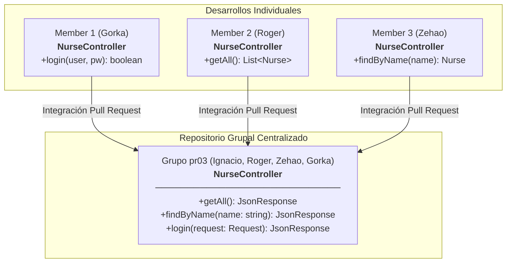
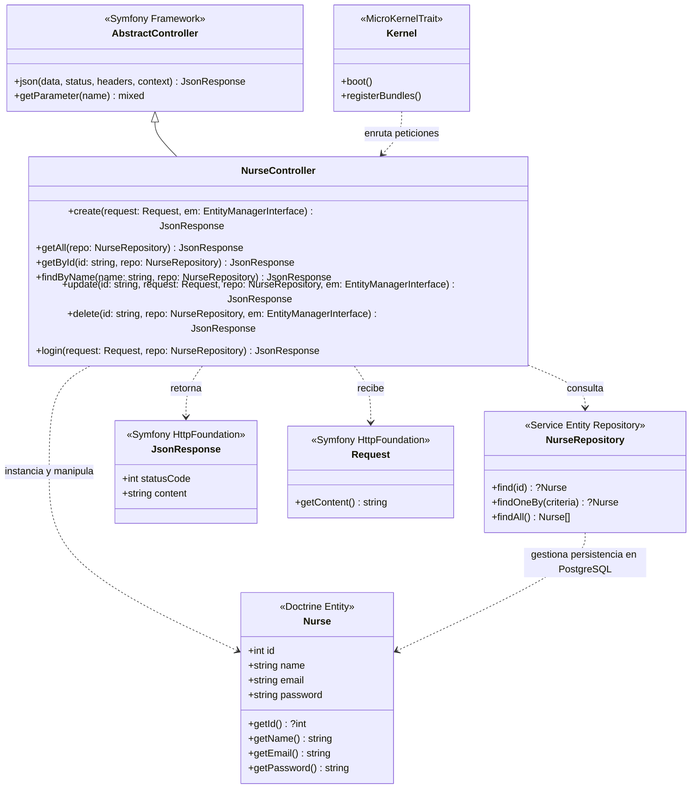
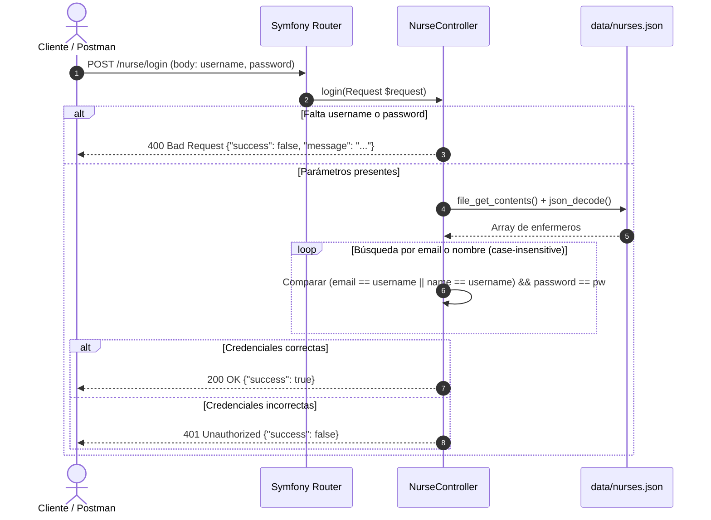
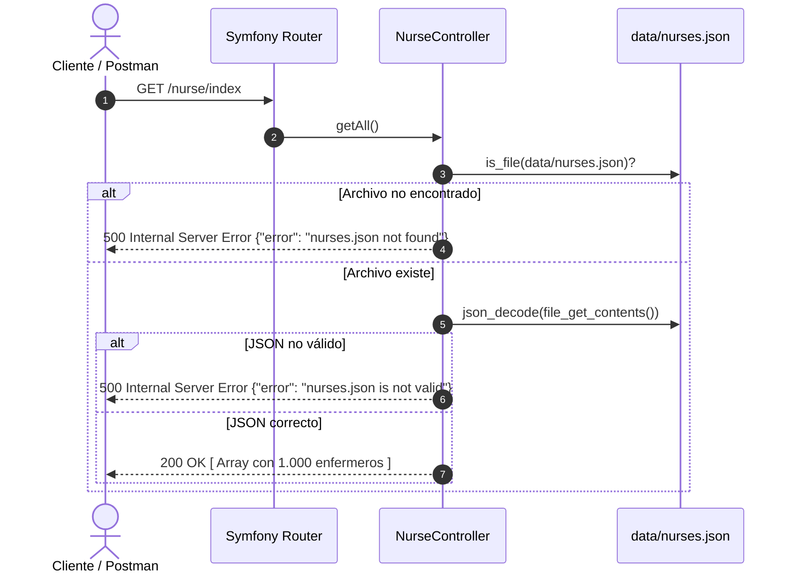
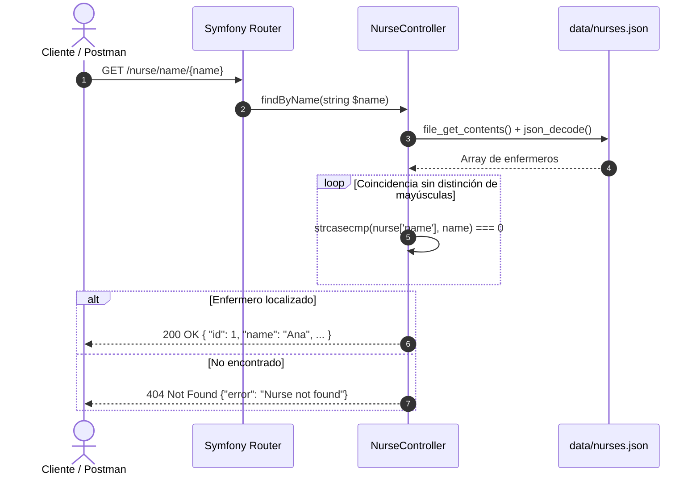
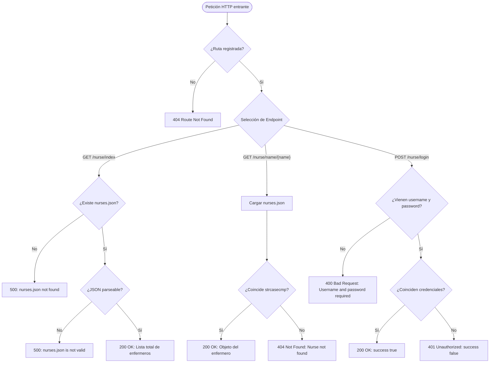
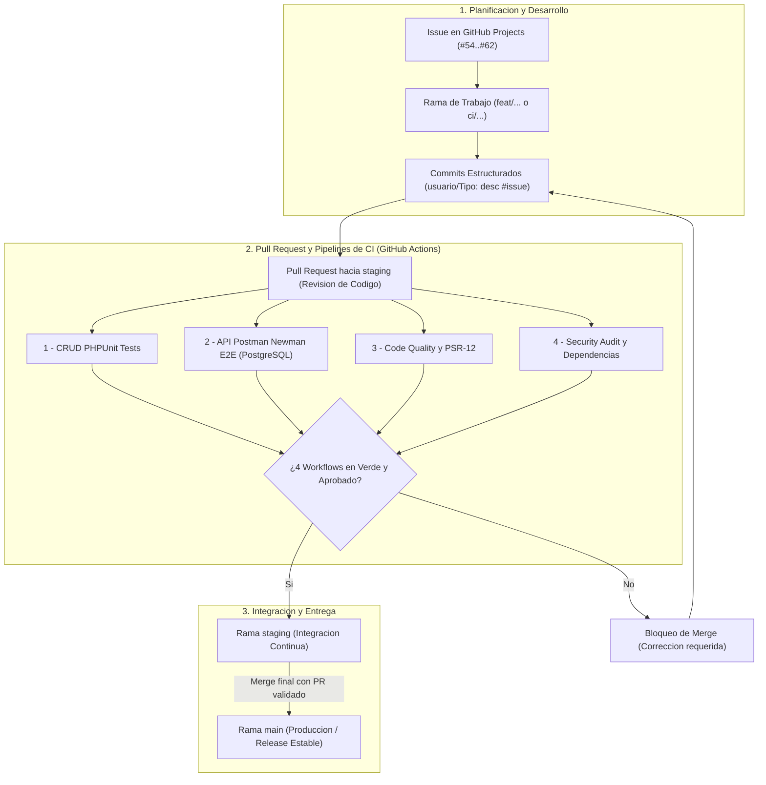

<div align="center">

# Nurse Simulator

[](https://symfony.com/)
[](https://www.php.net/)
[](https://www.postgresql.org/)
[](https://supabase.com/)
[](.github/workflows/)
[](tests/)
[](docs/postman/)
[](composer.json)
[-E2001A?style=for-the-badge)](https://www.stucom.com/)
[](#)
[](LICENSE)

<p align="center">
  <strong>API REST de Simulación y Gestión Hospitalaria de Personal de Enfermería</strong><br>
  M0616 — Proyecto Intermodular | 2º Desarrollo de Aplicaciones Web (DAW)
</p>

[Documentación Completa (ES)](docs/general/DOCUMENTACION_ES.md) • [Full Documentation (EN)](docs/general/DOCUMENTATION_EN.md) • [Colección Postman](docs/postman/nurse-api.postman_collection.json)

---

</div>

## 1. Sobre el Proyecto

**Nurse Simulator** es una API REST desarrollada con **Symfony 7.4** y **PHP 8.2+** orientada a simular la administración, consulta e identificación de los enfermeros de un complejo hospitalario.

Este proyecto forma parte de la fase inicial (**pr03 — Introducción Backend**) del **Proyecto Intermodular (M0616)** cursado en **2º DAW** en el centro **STUCOM Pelai (Barcelona)** durante el curso académico **2026/2027**.

### Equipo de Desarrollo y Roles (Grupo pr03)

| Miembro | Rol y Responsabilidades | GitHub |
|---|---|---|
| **Ignacio Breñas** | **Project Manager & Tech Lead**<br>• Dirección y organización integral del equipo de desarrollo.<br>• Creación y estructuración de las ramas de trabajo individuales de cada miembro.<br>• Definición, reparto y seguimiento de Issues en el tablero de GitHub Projects.<br>• Supervisión de calidad, revisión e integración de Pull Requests asegurando el correcto funcionamiento global.<br>• Inicialización del framework Symfony 7.4 y centralización de la suite de pruebas en Postman. | [@Ignaciobrenas](https://github.com/Ignaciobrenas) |
| **Christopher Roger Tito** | **Desarrollador Backend**<br>• Implementación del endpoint de lectura general de enfermeros (`getAll`).<br>• Pruebas y evidencias en Postman para el listado global. | [@RogerTito455](https://github.com/RogerTito455) |
| **Zehao Yin** | **Desarrollador Backend**<br>• Implementación del endpoint de búsqueda por nombre (`findByName`).<br>• Ampliación del dataset de pruebas a 1.000 enfermeros en JSON. | [@zyin-08](https://github.com/zyin-08) |
| **Gorka Ramirez** | **Desarrollador Backend**<br>• Implementación del endpoint de validación y login de enfermeros (`login`).<br>• Pruebas unitarias de credenciales y evidencias en Postman. | [@gorkaramirez936](https://github.com/gorkaramirez936) |

---

## 2. Objetivos de la Práctica (STUCOM pr03)

Siguiendo las especificaciones del documento oficial docente (`pr03_Introduccio_back_end`):
1. **Aprendizaje y bases del trabajo grupal con Symfony:** Creación de proyecto modular e integración progresiva de ramas de trabajo en equipo.
2. **Desarrollo de API REST estática:** Exposición de endpoints HTTP que devuelven respuestas en formato JSON a partir de datos estructurados en archivos (simulando persistencia previa a la introducción de bases de datos relacionales).
3. **Flujo de trabajo individual a grupal:**
   - Desarrollo individual de endpoints especializados por cada miembro.
   - Fusión e integración coordinada en un repositorio común (`group repo`).
4. **Verificación exhaustiva:** Chequeo funcional de cada endpoint mediante **Postman** y registro de evidencias.

---

## 3. Arquitectura y Esquemas UML

### 3.1. Esquema de Integración Modular (Trabajo Individual -> Repositorio Común)

Tal y como especifica la práctica, cada integrante del equipo desarrolló su funcionalidad antes de confluir en el controlador grupal integrado:



---

### 3.2. Diagrama de Clases UML



---

### 3.3. Diagramas de Secuencia

#### A. Inicio de Sesión (`POST /nurse/login`)


#### B. Consulta General (`GET /nurse/index`)


#### C. Búsqueda por Nombre (`GET /nurse/name/{name}`)


---

### 3.4. Diagrama de Flujo Lógico de la Aplicación



---

## 4. Especificación de la API REST

### Endpoints Disponibles

| Método | Ruta | Parámetros | Códigos HTTP | Descripción |
|---|---|---|---|---|
| `POST` | `/nurse` | Body JSON: `name`, `email`, `password` | `201`, `400`, `409`, `422`, `500` | Registra un nuevo enfermero/a en la base de datos con contraseña hasheada (Bcrypt). |
| `GET` | `/nurse/index` | *Ninguno* | `200`, `500` | Devuelve el catálogo completo de enfermeros. |
| `GET` | `/nurse/{id}` | Path: `{id}` (entero > 0) | `200`, `400`, `404`, `500` | Obtiene los detalles de un enfermero por su ID (excluyendo password). |
| `GET` | `/nurse/name/{name}` | Path: `{name}` | `200`, `404` | Localiza un enfermero por su nombre (*case-insensitive*). |
| `PUT` | `/nurse/{id}` | Path: `{id}`<br>Body JSON: `name`, `email`, `password` (opc.) | `200`, `204`, `400`, `404`, `409`, `422`, `500` | Actualiza los datos de un enfermero existente. Retorna `204` si no hay cambios. |
| `DELETE` | `/nurse/{id}` | Path: `{id}` (entero > 0) | `200`, `400`, `404`, `409`, `500` | Elimina un enfermero por su ID verificando restricciones de integridad referencial. |
| `POST` | `/nurse/login` | Body JSON: `username`, `password` | `200`, `400`, `401` | Inicia sesión verificando credenciales contra email o nombre. |

### Pipelines de Integración Continua (GitHub Actions CI/CD)

El repositorio incorpora 4 pipelines automatizados en `.github/workflows/` que se ejecutan en cada `push` y `pull_request` hacia `staging` y `main`:

1. **`1-crud-phpunit.yml` (CRUD PHPUnit Tests)** [](.github/workflows/1-crud-phpunit.yml)  
   Ejecución automatizada de la suite de 59 pruebas unitarias y 139 aserciones con PHPUnit 11 en entorno PHP 8.2 con caché de dependencias. Evidencias en [`docs/ci/phpUnit/`](docs/ci/phpUnit).
2. **`2-api-postman.yml` (API Postman Newman Tests)** [](.github/workflows/2-api-postman.yml)  
   Pruebas integrales End-to-End (E2E) mediante Newman en modo headless levantando un contenedor de servicio PostgreSQL 15, aplicando migraciones y probando el ciclo de vida CRUD completo. Evidencias en [`docs/ci/apiPostman/`](docs/ci/apiPostman).
3. **`3-code-quality.yml` (Code Quality & PSR-12)** [](.github/workflows/3-code-quality.yml)  
   Chequeos estáticos de sintaxis (`php -l`), validación de configuración YAML (`lint:yaml`), análisis de contenedor (`lint:container`) y cumplimiento estricto del estándar PSR-12 con PHP-CS-Fixer. Evidencias en [`docs/ci/codeQuality/`](docs/ci/codeQuality).
4. **`4-security-audit.yml` (Security Audit & Dependencies)** [](.github/workflows/4-security-audit.yml)  
   Validación estricta de coherencia entre `composer.json` y `composer.lock`, auditoría de vulnerabilidades conocidas (`composer audit --locked`) y prevención de filtrado de credenciales en archivos `.env`. Evidencias en [`docs/ci/securityAudit/`](docs/ci/securityAudit).

### Colección de Pruebas Postman

El repositorio incluye una suite integral de Postman lista para importar con sus entornos y colecciones:
* Colección central: [`docs/postman/nurse-api.postman_collection.json`](docs/postman/nurse-api.postman_collection.json)
* Evidencias de ejecución organizadas por endpoint:
  * [`docs/postman/createNurse`](docs/postman/createNurse): Evidencias de creación (`POST /nurse`).
  * [`docs/postman/readAll`](docs/postman/readAll): Evidencias de listado general (`GET /nurse/index`).
  * [`docs/postman/readById`](docs/postman/readById): Evidencias de consulta por ID (`GET /nurse/{id}`).
  * [`docs/postman/readByName`](docs/postman/readByName): Evidencias de búsqueda por nombre (`GET /nurse/name/{name}`).
  * [`docs/postman/update`](docs/postman/update): Evidencias de actualización (`PUT /nurse/{id}`).
  * [`docs/postman/delete`](docs/postman/delete): Evidencias de eliminación (`DELETE /nurse/{id}`).
  * [`docs/postman/login`](docs/postman/login): Evidencias de autenticación (`POST /nurse/login`).

---

## 5. Modelo de Datos y Persistencia

La aplicación implementa persistencia relacional completa a través de **Doctrine ORM** conectado a una base de datos **PostgreSQL** alojada en la nube ([Supabase](https://supabase.com/)), además de mantener un dataset local de respaldo en [`data/nurses.json`](data/nurses.json):

* **Entidad `Nurse`:** Mapeada mediante atributos nativos de PHP 8.2+ ([`src/Entity/Nurse.php`](src/Entity/Nurse.php)) con los campos `id` (autoincremental), `name`, `email` (único) y `password` (hasheado criptográficamente).
* **Repositorio `NurseRepository`:** Capa de abstracción de datos ([`src/Repository/NurseRepository.php`](src/Repository/NurseRepository.php)) para consultas desacopladas.
* **Seguridad de contraseñas:** Las contraseñas de nuevos registros y actualizaciones son transformadas automáticamente mediante algoritmo seguro **Bcrypt** (`password_hash`), impidiendo el almacenamiento de texto plano en base de datos.

---

## 6. Flujo de Trabajo en GitHub

El equipo sigue una metodología estricta basada en ramas, issues, pipelines de CI/CD y revisiones de código mediante Pull Requests:



* **Gestión y Liderazgo:** Ignacio Breñas ejerció el rol de **Project Manager**, encargándose de planificar las entregas, estructurar y crear las ramas de trabajo de cada desarrollador, repartir los issues en GitHub Projects y supervisar la integración continua asegurando la estabilidad y el correcto funcionamiento de todo el proyecto.
* **Convención de commits:** `usuario/Tipo: descripción #issue` (ej. `ibrenas/Feat: implement delete nurse endpoint DELETE /nurse/{id} #57`).
* **Tablero Kanban:** Gestión ágil mediante GitHub Projects (`Todo`, `In progress`, `Done`).
* **Integración controlada:** Ramas individuales de feature -> `staging` mediante Pull Request con validación obligatoria de los 4 pipelines de CI -> `main` para versiones estables.

---

## 7. Instalación y Ejecución Rápida

### Requisitos Previos
* **PHP >= 8.2** con extensiones (`pdo`, `pdo_pgsql`, `mbstring`, `json`, `ctype`, `intl`).
* **Composer** (v2 o superior).
* **Base de datos PostgreSQL** (local o en [Supabase](https://supabase.com/)).
* *(Opcional)* **Symfony CLI**.

### Puesta en Marcha

```bash
# 1. Clonar el repositorio
git clone https://github.com/Ignaciobrenas/Nurse-Simulator.git
cd Nurse-Simulator

# 2. Instalar dependencias del proyecto
composer install

# 3. Configurar entorno local (definir DATABASE_URL en .env o .env.local)
cp .env.example .env

# 4. Ejecutar migraciones de base de datos
php bin/console doctrine:migrations:migrate --no-interaction

# 5. Iniciar el servidor de desarrollo
symfony server:start
# O alternativamente con el servidor embebido de PHP:
php -S localhost:8000 -t public
```

### Probar Endpoints con cURL

```bash
# 1. Registrar un nuevo enfermero (POST /nurse)
curl -i -X POST http://localhost:8000/nurse \
  -H "Content-Type: application/json" \
  -d '{"name": "Marta Garcia", "email": "marta.garcia@hospital.com", "password": "Password123"}'

# 2. Listado completo de enfermeros (GET /nurse/index)
curl -i http://localhost:8000/nurse/index

# 3. Obtener enfermero por ID (GET /nurse/{id})
curl -i http://localhost:8000/nurse/1001

# 4. Buscar enfermero por nombre (GET /nurse/name/{name})
curl -i http://localhost:8000/nurse/name/Marta

# 5. Actualizar enfermero (PUT /nurse/{id})
curl -i -X PUT http://localhost:8000/nurse/1001 \
  -H "Content-Type: application/json" \
  -d '{"name": "Marta G. Actualizada", "email": "marta.actualizada@hospital.com"}'

# 6. Eliminar enfermero (DELETE /nurse/{id})
curl -i -X DELETE http://localhost:8000/nurse/1001

# 7. Iniciar sesión (POST /nurse/login)
curl -i -X POST http://localhost:8000/nurse/login \
  -H "Content-Type: application/json" \
  -d '{"username": "marta.actualizada@hospital.com", "password": "Password123"}'
```

---

## 8. Estructura del Proyecto

```
Nurse-Simulator/
├── .github/
│   └── workflows/                  # Pipelines de CI/CD en GitHub Actions
│       ├── 1-crud-phpunit.yml      # Pruebas unitarias automatizadas con PHPUnit
│       ├── 2-api-postman.yml       # Pruebas E2E Newman con PostgreSQL runner
│       ├── 3-code-quality.yml      # Linting sintáctico y chequeo PSR-12
│       └── 4-security-audit.yml    # Auditoría Composer y seguridad de secretos
├── bin/
│   └── console                     # CLI de Symfony
├── config/                         # Configuración de framework, paquetes y rutas
│   ├── packages/
│   ├── routes.yaml
│   └── services.yaml
├── data/
│   └── nurses.json                 # Dataset JSON de prueba (1.000 enfermeros)
├── docs/
│   ├── ci/                         # Evidencias gráficas de pipelines CI
│   │   ├── apiPostman/             # Capturas de Newman E2E
│   │   ├── codeQuality/            # Capturas de linting y PSR-12
│   │   ├── phpUnit/                # Capturas de pruebas unitarias PHPUnit
│   │   └── securityAudit/          # Capturas de auditoría de seguridad
│   ├── general/
│   │   ├── DOCUMENTACION_ES.md     # Memoria técnica completa en español
│   │   ├── DOCUMENTATION_EN.md     # Complete technical documentation in English
│   │   ├── Nurse-Simulator.docx    # Documento Word editable
│   │   └── Nurse-Simulator_...pdf  # Documento PDF oficial de entrega
│   └── postman/                    # Colección y evidencias de prueba API
│       ├── createNurse/            # Capturas POST /nurse
│       ├── delete/                 # Capturas DELETE /nurse/{id}
│       ├── login/                  # Capturas POST /nurse/login
│       ├── readAll/                # Capturas GET /nurse/index
│       ├── readById/               # Capturas GET /nurse/{id}
│       ├── readByName/             # Capturas GET /nurse/name/{name}
│       ├── update/                 # Capturas PUT /nurse/{id}
│       └── nurse-api.postman_collection.json
├── public/
│   └── index.php                   # Front Controller
├── src/
│   ├── Controller/
│   │   └── NurseController.php     # Controlador con todos los endpoints CRUD
│   ├── Entity/
│   │   └── Nurse.php               # Entidad Doctrine Nurse
│   ├── Repository/
│   │   └── NurseRepository.php     # Repositorio de persistencia en PostgreSQL
│   └── Kernel.php                  # Kernel de la aplicación
├── tests/
│   └── Controller/
│       └── NurseControllerTest.php # Suite unificada de pruebas unitarias PHPUnit
├── .env.example                    # Plantilla de variables de entorno
├── composer.json                   # Dependencias y autoloading
├── LICENSE                         # Licencia MIT
└── README.md                       # Presentación visual del proyecto
```

---

<div align="center">
  <sub>Desarrollado con dedicación por el Grupo pr03 • STUCOM Pelai • DAW 2 (2026/27)</sub>
</div>
