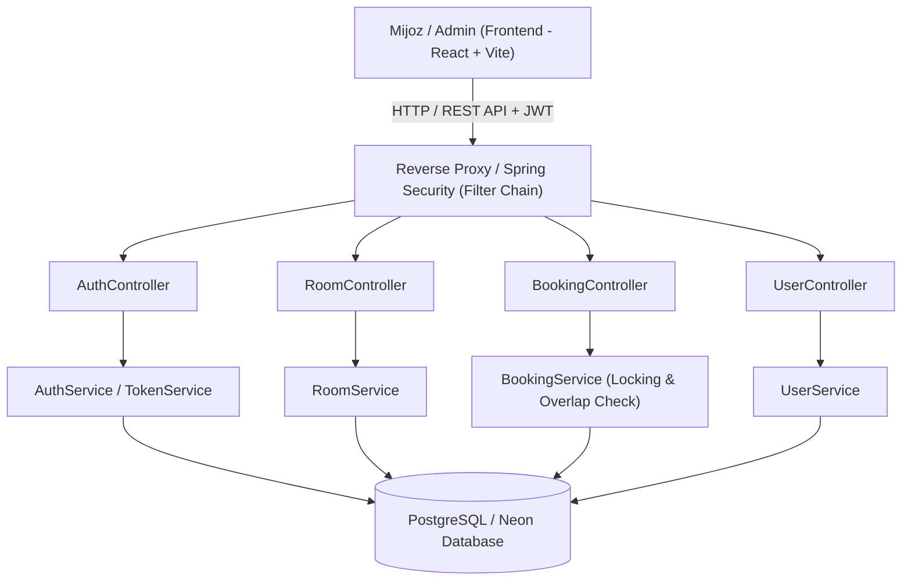

# 🏨 Mehmonxona Boshqaruv Tizimi (Hotel Management System)

Zamonaviy, toza arxitektura va ilg'or biznes mantiqqa asoslangan **Full-Stack Mehmonxona Boshqaruv Tizimi**.

Loyiha backend qismi **Java Spring Boot**, ma'lumotlar bazasi **PostgreSQL (Neon Cloud)**, frontend qismi esa **React + Vite + Tailwind CSS** texnologiyalarida ishlab chiqilgan.

---

## 📌 Mundarija
- [Loyiha haqida](#-loyiha-haqida)
- [Texnologiyalar steki (Tech Stack)](#-texnologiyalar-steki-tech-stack)
- [Asosiy imkoniyatlar va Biznes talablar](#-asosiy-imkoniyatlar-va-biznes-talablar)
- [Tizim arxitekturasi](#-tizim-arxitekturasi)
- [API Hujjatlari (Endpoints)](#-api-hujjatlari-endpoints)
- [Mahalliy muhitda ishga tushirish (Local Setup)](#-mahalliy-muhitda-ishga-tushirish-local-setup)
- [Testlash (Unit & Integration Tests)](#-testlash-unit--integration-tests)
- [Production Deployment (Render & Neon)](#-production-deployment-render--neon)
- [Loyiha tuzilishi](#-loyiha-tuzilishi)

---

## 📖 Loyiha haqida

Ushbu tizim mehmonxona faoliyatini to'liq avtomatlashtirish uchun mo'ljallangan:
- **Mijozlar** bo'sh xonalarni real vaqt rejimida qidirishi, narx va qulayliklarni ko'rishi, xonalarni bron qilishi va o'z buyurtmalari tarixini boshqarishi mumkin.
- **Administratorlar** xonalar (narx, sig'im, holat), mijozlar profillari va barcha band qilishlarni boshqaradi, shuningdek mijozlarning mehmonxonaga kelishi (**Check-In**) va ketishini (**Check-Out**) rasmiylashtiradi.

---

## 🛠 Texnologiyalar steki (Tech Stack)

### Backend:
- **Til & Platforma**: Java 21 / Spring Boot 3+
- **Xavfsizlik**: Spring Security, JWT (Access & Refresh tokenlar), HttpOnly Cookie
- **Ma'lumotlar bazasi & ORM**: PostgreSQL, Spring Data JPA, Hibernate (Pessimistic Locking bilan)
- **API Hujjatlari**: OpenAPI 3 / Swagger UI (springdoc)
- **Build vositasi**: Gradle 9+
- **Testlash**: JUnit 5, Mockito, Spring Security Test, MockMvc, H2 In-Memory DB

### Frontend:
- **Kutubxona & Build**: React 19, Vite
- **Styling & UI**: Tailwind CSS, Lucide React Icons
- **State & Context**: React Context API, Custom Hooks

### DevOps & Cloud:
- **Database**: [Neon PostgreSQL](https://neon.tech) (Cloud Serverless)
- **Hosting / Deploy**: [Render.com](https://render.com) (Blueprint IaC - `render.yaml`)
- **Konteynerizatsiya**: Docker, Docker Compose

---

## 🚀 Asosiy imkoniyatlar va Biznes talablar

### 1. Autentifikatsiya va Avtorizatsiya (RBAC)
- Foydalanuvchilarni ro'yxatdan o'tkazish (`REGISTER`) va tizimga kirish (`LOGIN`).
- JWT orqali autentifikatsiya (Access token `Bearer` sarlavhasida, Refresh token esa xavfsiz HttpOnly Cookie'da saqlanadi).
- Ikki darajali rollar tizimi:
  - `CUSTOMER` — mijoz roli;
  - `ADMIN` — administrator roli.

### 2. Xonalarni boshqarish (Room Management)
- Xonalarni yaratish, tahrirlash, o'chirish (Soft delete) va ko'rish (faqat `ADMIN`).
- Xona turlari (`SINGLE`, `DOUBLE`, `DELUXE`, `FAMILY`, `SUITE`), narxlari va sig'imi.
- Xonalarni turi, narxi, sig'imi va tanlangan sanalardagi bo'shligi bo'yicha murakkab qidiruv (`Filter & Search`).

### 3. Band qilish jarayoni (Booking Management)
- **Sanalar to'qnashuvining oldini olish (Double-Booking Prevention)**: Bir vaqtning o'zida bir nechta foydalanuvchi bir xonani band qilishga uringanda, JPA darajasidagi `PESSIMISTIC_WRITE` qulfi va sanalar kesishishini tekshiruvchi algoritm orqali takroriy bron qilish mutlaqo oldi olingan.
- **Avtomatik narx hisoblash**: Kunlar soni va xona narxiga asosan umumiy summa (`BigDecimal`) aniq hisoblanadi.
- **Holatlar zanjiri (Strict Status Workflow)**:
  $$\text{PENDING} \xrightarrow{\text{Admin tasdiqlashi}} \text{CONFIRMED} \xrightarrow{\text{Mehmon kelganda}} \text{CHECKED\_IN} \xrightarrow{\text{Mehmon ketganda}} \text{CHECKED\_OUT}$$
  *(Ixtiyoriy bosqichda check-in dan oldin bekor qilish: `CANCELLED`)*.
- Mijoz faqat o'ziga tegishli buyurtmalarni ko'rishi va bekor qilishi mumkin.

### 4. Administratsiya (Admin Panel)
- Barcha xonalar va mijozlar ro'yxatini ko'rish.
- Barcha bronlarni filtrlash va boshqarish.
- Mehmonlarni qabul qilish (`Check-In`) va kuzatish (`Check-Out`).

---

## 🏗 Tizim arxitekturasi



---

## 📡 API Hujjatlari (Endpoints)

Loyihani ishga tushirgach, interaktiv Swagger UI orqali barcha API'larni sinab ko'rish mumkin:
👉 **`http://localhost:8080/api/v1/swagger-ui.html`**

| Metod | Endpoint | Ruxsat | Tavsif |
| :--- | :--- | :--- | :--- |
| **POST** | `/api/v1/auth/register` | Public | Yangi foydalanuvchini ro'yxatdan o'tkazish |
| **POST** | `/api/v1/auth/login` | Public | Tizimga kirish va JWT olish |
| **POST** | `/api/v1/auth/refresh` | Public | Access tokenni yangilash (Cookie orqali) |
| **POST** | `/api/v1/auth/logout` | Public | Tizimdan chiqish |
| **GET** | `/api/v1/rooms` | Public | Xonalarni ko'rish va qidirish |
| **GET** | `/api/v1/rooms/{id}` | Public | Xona haqida batafsil ma'lumot |
| **POST** | `/api/v1/rooms` | ADMIN | Yangi xona qo'shish |
| **PUT** | `/api/v1/rooms/{id}` | ADMIN | Xona ma'lumotlarini yangilash |
| **DELETE**| `/api/v1/rooms/{id}` | ADMIN | Xonani o'chirish (Soft delete) |
| **POST** | `/api/v1/bookings` | Authenticated | Xonani bron qilish |
| **GET** | `/api/v1/bookings/my` | Authenticated | Mijozning o'z bronlari tarixi |
| **GET** | `/api/v1/bookings/{id}` | Authenticated | Bron tafsilotlarini ko'rish |
| **PATCH**| `/api/v1/bookings/{id}/cancel` | Authenticated | Bronni bekor qilish |
| **GET** | `/api/v1/bookings` | ADMIN | Barcha bronlarni ko'rish |
| **PATCH**| `/api/v1/bookings/{id}/confirm`| ADMIN | Bronni tasdiqlash (`CONFIRMED`) |
| **PATCH**| `/api/v1/bookings/{id}/check-in`| ADMIN | Mehmonni qabul qilish (`CHECKED_IN`) |
| **PATCH**| `/api/v1/bookings/{id}/check-out`| ADMIN | Mehmonni kuzatish (`CHECKED_OUT`) |
| **GET** | `/api/v1/users/me` | Authenticated | Joriy profil ma'lumotlari |
| **GET** | `/api/v1/users` | ADMIN | Barcha foydalanuvchilar ro'yxati |

---

## 💻 Mahalliy muhitda ishga tushirish (Local Setup)

### Talablar:
- **Java 21** yoki undan yuqori
- **Node.js 18+** va npm
- **Docker** va Docker Compose (ixtiyoriy)

### 1-usul: Docker Compose yordamida (Tavsiya etiladi)

Loyiha ildiz katalogida bitta buyruq bilan barcha servislarni (PostgreSQL + Backend) ishga tushiring:
```bash
docker compose up --build
```
Frontendni ishga tushirish:
```bash
cd frontend
npm install
npm run dev
```
Brauzerda: `http://localhost:5173`

---

### 2-usul: Qo'lda (Manual) ishga tushirish

#### 1. Backend sozlamalari:
`backend` papkasidagi `.env` faylini tekshiring yoki o'zingizning ma'lumotlar bazangizni kiriting:
```properties
PORT=8080
DB_URL=jdbc:postgresql://localhost:5432/hotel
DB_USER=postgres
DB_PASS=postgres
JWT_SECRET=404E635266556A586E3272357538782F413F4428472B4B6250645367566B5970337336763979244226452948404D635166546A576E5A7234753778214125442A
JWT_ACCESS_TIME=900000
JWT_REFRESH_TIME=604800000
SECURE=false
```

Backendni ishga tushirish:
```bash
cd backend
./gradlew bootRun
```
*Dastur birinchi marta ishga tushganda, tizimda avtomatik ravishda boshlang'ich xonalar va quyidagi administrator foydalanuvchisi yaratiladi:*
- **Admin Email**: `izzatbek.engineer@gmail.com`
- **Admin Parol**: `admin123`

#### 2. Frontendni ishga tushirish:
```bash
cd frontend
npm install
npm run dev
```

---

## 🧪 Testlash (Unit & Integration Tests)

Loyiha sifatini kafolatlash uchun **30 ta to'liq Unit va Integration testlar** yozilgan. Testlar in-memory **H2 Database** da izolyatsiya qilingan muhitda ishlaydi (tashqi baza talab qilinmaydi).

Testlarni yurgizish:
```bash
cd backend
./gradlew test
```

### Test qamrovi:
- **`BookingServiceTest` (10 ta Unit test)**:
  - Narx to'g'ri ko'paytirib hisoblanishi;
  - Mehmonlar soni xona sig'imidan oshganda rad etilishi;
  - Sanalar to'qnashganda (Double booking) `CustomBadRequestException` otilishi;
  - Ruxsatsiz foydalanuvchi birovning bronini bekor qila olmasligi;
  - Statuslarning to'g'ri o'zgarishi (`CONFIRMED`, `CHECKED_IN`, `CHECKED_OUT`, `CANCELLED`).
- **`RoomServiceTest` (6 ta Unit test)**:
  - Xona yaratish, dublikat raqamlar nazorati, soft delete, sanalar va narx filtrlari.
- **`AuthServiceTest` (4 ta Unit test)**:
  - Ro'yxatdan o'tish, mavjud email validatsiyasi, xato parol tekshiruvi.
- **`AuthControllerIntegrationTest` (3 ta Integration test)**:
  - Haqiqiy HTTP so'rovlar, validatsiya xatolari, JWT cookie tekshiruvlari.
- **`RoomControllerIntegrationTest` (4 ta Integration test)**:
  - RBAC ruxsatlari: Ommaviy GET, oddiy mijoz uchun 403 Forbidden, admin uchun 200 OK.
- **`BookingFlowIntegrationTest` (To'liq End-to-End integratsion lifecycle)**:
  - Mijoz 1 xonani band qilishi -> Mijoz 2 ayni shu xonani shu sanaga band qilmoqchi bo'lganda rad etilishi -> Admin tasdiqlashi -> Check-In -> Bekor qilish taqiqlanishi -> Check-Out.

---

## ☁️ Production Deployment (Render & Neon)

Loyiha **Render Blueprint (Infrastructure as Code)** orqali avtomatlashtirilgan.

Ildiz katalogidagi [`render.yaml`](./render.yaml) quyidagi resurslarni avtomatik ko'taradi:
1. **`hotel-backend`**: Docker runtime asosidagi Web Service (Port: 8080, Frankfurt mintaqasi);
2. **`hotel-frontend`**: Pre-built static site (Vite build, SPA rewrite qoidalari bilan).

### Render'ga joylash qadamlari:
1. Loyihani GitHub'ga push qiling:
   ```bash
   git add .
   git commit -m "feat: complete hotel management project"
   git push origin main
   ```
2. [Render Dashboard](https://dashboard.render.com/) ga kiring va **Blueprints** bo'limiga o'ting;
3. Repository'ni tanlang;
4. Render so'ragan Neon parametrlarni kiriting:
   - `DB_URL`: `jdbc:postgresql://<neon-host>/neondb?sslmode=require`
   - `DB_USER`: `neondb_owner`
   - `DB_PASS`: `<neon-password>`
5. **Apply** tugmasini bosing — Render backend va frontendni avtomatik ravishda build qilib, ishlab chiqarishga chiqaradi.

---

## 📁 Loyiha tuzilishi

```text
hotel-management/
├── backend/
│   ├── src/
│   │   ├── main/
│   │   │   ├── java/com/hotel/backend/
│   │   │   │   ├── config/          # Security, JWT, CORS, Swagger, DataInitializer
│   │   │   │   ├── controller/      # REST API kontrollerlar (Auth, Room, Booking, User)
│   │   │   │   ├── dto/             # Request va Response DTO lari (Records)
│   │   │   │   ├── entity/          # JPA Entity lari va Enum lar
│   │   │   │   ├── exception/       # GlobalExceptionHandler va Custom istisnolar
│   │   │   │   ├── repository/      # Spring Data JPA repozitoriylari (Pessimistic lock bilan)
│   │   │   │   ├── service/         # Asosiy biznes mantiq qatlami
│   │   │   │   └── util/            # JwtUtil, CookieUtil
│   │   │   └── resources/
│   │   │       └── application.yaml # Asosiy dastur konfiguratsiyasi
│   │   └── test/                    # Unit va Integration testlar (H2 DB)
│   ├── build.gradle                 # Gradle sozlamalari
│   └── Dockerfile                   # Multi-stage production Docker fayli
├── frontend/
│   ├── src/
│   │   ├── api/                     # Axios/Fetch API mijozlari (client.js)
│   │   ├── components/              # Qayta ishlatiluvchi UI komponentlar
│   │   ├── context/                 # AuthContext (JWT boshqaruvi)
│   │   └── pages/                   # Home, MyBookings, AdminDashboard
│   ├── package.json
│   └── vite.config.js
├── docker-compose.yaml              # Mahalliy Docker Compose fayli
├── render.yaml                      # Render Blueprint (IaC) konfiguratsiyasi
└── README.md                        # Loyiha hujjatlari
```

---

## 👨‍💻 Muallif

- **Muallif**: Izzatbek
- **Bog'lanish**: abdusharipovizzat03@gmail.com
- **Loyiha turi**: Mehmonxona Boshqaruv Tizimi Backend & Frontend
