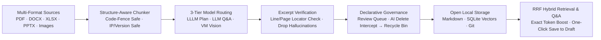

<div align="center">


<h1>ZHIXU · 知序</h1>

<p><strong>Lightweight Enterprise-Grade Open-Source AI Knowledge Base Architecture: Auditable, Verifiable, and Reversible Local-First Knowledge Compiler &amp; Desktop Studio</strong></p>

<p>
  <strong>English</strong> | <a href="./README_ZH.md">简体中文</a>
</p>

<p>
  <a href="#overview">Overview</a> ·
  <a href="#interface-preview">Preview</a> ·
  <a href="#comparison-with-enterprise-open-source-kb-architectures">Comparison</a> ·
  <a href="#architecture--core-engineering">Architecture</a> ·
  <a href="#model-routing">Model Routing</a> ·
  <a href="#quick-start">Quick Start</a> ·
  <a href="#deployment--api">Deployment &amp; API</a> ·
  <a href="#license--code-signing-certificate">License &amp; Cert</a>
</p>

<p>
  <a href="./LICENSE"></a>
  <a href="https://github.com/JoeJiang-927117/ZHIXUAgentic-Knowledge-Base/releases"></a>
  
  
  
  
  
  
  
  
</p>

<br />


</div>

---

## Overview

**ZHIXU (知序)** is benchmarked directly against **enterprise open-source knowledge base architectures** (such as RAGFlow, Dify, AnythingLLM, and XWiki), built for teams that need **enterprise governance, auditability, and strict security boundaries without the operational overhead of Elasticsearch + MinIO + Redis + MySQL multi-container stacks**.

In engineering, operations, compliance, and project delivery, critical knowledge lives scattered across PDF specs, Word SOPs, Excel inventories, PowerPoint decks, and field photos. Existing options leave three common gaps:
- **Traditional Enterprise Wikis (Confluence / XWiki / Outline)**: Mature review workflows, but entirely manual—legacy documents cannot be compiled into structured knowledge automatically.
- **Heavyweight RAG Platforms (RAGFlow / Dify)**: Feature-rich pipelines, but heavy deployment footprint and chunk-only retrieval that lacks formal Wiki governance (`Draft → Review → Published Baseline → AI Delete Guard → Git Rollback`).
- **Lightweight Local Chat Tools (AnythingLLM, etc.)**: Fast to run locally, but oriented around personal chat rather than structured Wiki compilation, excerpt line/page verification, split manual editing, and multi-stage approval.

**ZHIXU takes a "Lightweight Monolith, Enterprise Kernel" approach:**

1. **Immutable Evidence Base**: Imported PDF, DOCX, XLSX, PPTX, Markdown, and image files are stored locally as immutable source records tracked by SHA-256 hashes. AI never mutates original files.
2. **Two-Stage Knowledge Compilation & Excerpt Verification**: Structure-aware chunking, zero-bloat OOXML parsing, and two-stage compilation turn heterogeneous sources into a structured Markdown Wiki across six knowledge domains with TF-IDF mutual entity indexing. Cited excerpts are verified back against original line/page locators; unverifiable hallucinations are dropped.
3. **Enterprise Change Governance**: AI creations and updates enter a declarative review workflow (`Draft → Moderating → Validating → Published → Archived`). AI delete proposals are intercepted into `Pending Delete → Recycle Bin`. A built-in split Markdown editor allows human editing with baseline line-level diffs, SQLite version snapshots, and `isomorphic-git` rollback.
4. **Open Data Sovereignty & Bilingual Experience**: Knowledge lives as plain Markdown, indexes and persistent vectors live in local SQLite, and revision history lives in standard `.git`. Supports one-click **English / Chinese (`EN / 中文`)** UI switching and deploys as a desktop app, single Node process, or single Docker container.

### Typical Enterprise Scenarios

- **Engineering & Ops Knowledge Base**: Compile server inventories (`.xlsx`), SOP runbooks (`.docx`/`.pdf`), scripts, and incident postmortems with exact IP/port/version boosting.
- **Policies, Standards & Compliance**: Mandatory human review before publishing, preserved official baselines, explicit applicability & conflict reporting—preventing silent AI edits to formal rules.
- **Project Delivery & Postmortems**: Unify proposals, slide decks (including speaker notes), and site photos into a cross-linked Wiki; turn multi-turn Q&A conclusions into reviewable drafts in one click.
- **Private / Intranet Deployment**: Cloud API first by default, or switch seamlessly to LAN GPU (`vLLM` / `SGLang` / `Ollama`) or local Ollama with mandatory Bearer auth and `127.0.0.1` default binding.

---

## Comparison with Enterprise Open-Source KB Architectures

| Dimension | Heavyweight Open-Source RAG<br/>(RAGFlow / Dify) | Lightweight Local AI<br/>(AnythingLLM) | Traditional Enterprise Wiki<br/>(XWiki / Outline) | ZHIXU · 知序 |
| :--- | :--- | :--- | :--- | :--- |
| **Core Focus** | Multi-tenant RAG orchestration | Personal / small-team local chat | Manual collaborative docs | **Lightweight Enterprise AI Knowledge Compiler & Governance Studio** |
| **Deployment** | Heavy (ES / DB / MinIO / Redis) | Light (Desktop / single container) | Medium (DB + web services) | **Ultra-light (Desktop app, single Node process, or 1 Docker container)** |
| **Knowledge Artifact** | Vector chunks (hard to curate manually) | Vector chunks & chat logs | Manually authored pages | **Auto-compiled + human-editable standard Markdown Wiki** |
| **Anti-Hallucination** | Rerank + prompt guardrails | Basic similarity retrieval | Manual writing | **Mandatory source excerpt locator verification + honest refusal** |
| **AI Change Governance** | No page-level review / delete guard | No approval workflow / baselines | Workflow without AI compilation | **Declarative review + AI delete recycle bin + line Diff + Git rollback** |
| **Model Compute Split** | Unified model config | Single chat/embedding model | None | **Independent LLLM / LLM / VM 3-tier routing by cognitive load** |
| **Data Openness** | Coupled to internal DB & object store | Coupled to internal vector DB | Coupled to platform DB | **100% open local files (Markdown + SQLite + Git)** |

---

## Interface Preview

<table>
  <tr>
    <td width="50%" align="center">
      
      <br />
      <strong>Login Page</strong>
    </td>
    <td width="50%" align="center">
      
      <br />
      <strong>3-Pane Knowledge Studio</strong> · Split Editor / Line Diff / Source Inspector
    </td>
  </tr>
  <tr>
    <td width="50%" align="center">
      
      <br />
      <strong>Admin Control Center</strong> · 3-Tier API Routing / Recycle Bin / Accounts
    </td>
    <td width="50%" align="center">
      
      <br />
      <strong>Multi-Turn Q&amp;A Workspace</strong> · Context Follow-ups / Highlighting / Save as Draft
    </td>
  </tr>
</table>

---

## Architecture & Core Engineering



### 1. Zero-Bloat Document Parsing & Structure-Aware Chunking
- **Custom OOXML Parser** (`src/main/ooxml.ts`): Built on Node native `zlib` and a pure TypeScript ZIP central directory reader—no multi-megabyte spreadsheet libraries. `.xlsx` sheets emit Markdown tables with header continuation across chunks; `.pptx` extracts slides alongside speaker notes.
- **Structure-Aware Semantic Chunker** (`src/main/chunker.ts`):
  - **Code-Fence State Machine**: Tracks ```` ``` ```` and `~~~` blocks so `# comments` inside scripts are never misread as headings; oversized code blocks split cleanly on line boundaries with balanced fences.
  - **Engineering-Literal-Safe Splitting**: Preserves IP addresses (`192.168.1.100`), versions (`v2.0.1`), and decimals (`3.14`).
  - **Micro-Chunk Coalescing & Deduplication**: Merges tiny fragments within the same section path while retaining breadcrumbs and line/page locators.

### 2. RRF Hybrid Retrieval & Honest Citation Q&A
- **4-Signal Fusion** (`src/main/search.ts`, `src/main/schema.ts`):
  1. **Chinese + English BM25**: `Intl.Segmenter('zh-CN')` + bigram indexing cached per `(root, revision, scope)`.
  2. **Persistent SQLite Vectors**: Incremental content-hash embeddings persisted in SQLite with no artificial row cap.
  3. **Word-Boundary TF-IDF Mutual Index**: Enforces ASCII word boundaries (eliminating false matches like `port` inside `import`/`report`), merges parenthetical aliases (`Standard Operating Procedure (SOP)` → `SOP`), and weights entity links by TF-IDF × heading position.
  4. **Exact Technical Token Boost + Adaptive Sigmoid Rerank**: Boosts exact IP/port/version/unit tokens; calibrates Cross-Encoder logits with temperature-scaled Logistic Sigmoid (`1 / (1 + exp(-x / T))`).
- **Multi-Turn Follow-ups & Evidence Highlighting**: Carries the last 3 verified turns for coreference resolution, highlights matched terms in evidence snippets, and outputs `Conclusion / Applicability / Conflicts & Gaps / Citations`—refusing cleanly when evidence is insufficient.

### 3. Crash-Safe Storage, Governance & Security Defaults
- **Crash-Resilient Atomic Writes** (`src/main/safe-write.ts`): PID-tracked lock files recover dead locks in milliseconds; writes use `temp file → fsync → atomic rename` with Windows `EPERM/EBUSY` retry backoff.
- **Code-Safe Health Linter** (`src/main/linter.ts`): Audits unsourced pages, stale sources, broken wikilinks, orphan pages, duplicate titles, schema violations, and thin pages; auto-fixing broken links strictly skips fenced and inline code spans.
- **Secure Defaults** (`src/main/admin-auth.ts`, `src/server/index.ts`): Binds `127.0.0.1` by default, auto-generates a strong Bearer token verified with `timingSafeEqual`, blocks internal dotfile reads on `/api/source`, supports CORS allowlists, `superadmin` / `reviewer` roles, and salted `scrypt` password hashing.

---

## Model Routing

ZHIXU defaults to **Cloud API First** while supporting **LAN GPU** (`vLLM` / `SGLang` / `Ollama`) and **Local Ollama**. Three independent tiers can share one gateway or use separate `Base URL` & `API Key` values:

| Tier | Responsibility | Cloud API Recommendations | LAN / Local Private Recommendations |
| :--- | :--- | :--- | :--- |
| **`LLLM`** | Global Wiki planning & cross-document synthesis | `deepseek-reasoner` / `qwen-max` / `o3-mini` | `Qwen3-32B` / `DeepSeek-R1-Distill-32B` |
| **`LLM`** | Multi-turn Q&A, single-doc extraction, verification | `deepseek-chat` / `gpt-4o-mini` / `qwen-plus` | `Qwen3-14B` / `qwen2.5:14b` |
| **`VM`** | Photos, architecture diagrams, scanned charts | `qwen-vl-max` / `gpt-4o` | `qwen2.5vl:7b` / `Qwen2.5-VL-72B` |
| **`Embedding` / `Rerank`** (Optional) | Persistent semantic vectors & reranking | `text-embedding-3-small` / `BAAI/bge-m3` | `bge-m3` + `bge-reranker-v2-m3` |

---

## Quick Start

> [!IMPORTANT]
> **Default Admin Credentials**: Username `zhixu` / Password `123456789` (override via `ZHIXU_ADMIN_USER` / `ZHIXU_ADMIN_PASSWORD`, and change after first sign-in under **Admin Console → Accounts**).

> **Runtime Requirement**: Node.js `>= 22.13` (`24.x` recommended, built-in `node:sqlite`).

### Run Desktop App Locally

```bash
git clone https://github.com/JoeJiang-927117/ZHIXUAgentic-Knowledge-Base.git
cd ZHIXUAgentic-Knowledge-Base
npm install
npm run dev
```

- Switch between **English** and **简体中文** anytime from the login bar, workspace titlebar (`EN / 中文`), or Command Palette (`Ctrl + K`).
- Shortcuts: `Ctrl + K` opens the Command Palette; `Ctrl + S` saves draft in the split Markdown editor.

### Typecheck, Build & Automated Verification

```bash
npm run typecheck
npm run build
npm test
```

`npm test` runs all **14 automated checks** covering chunking, OOXML parsing, word-boundary entity indexing, Sigmoid calibration, stale-PID lock recovery, mandatory auth, 3-tier routing, persistent vector cache, honest refusal, delete-approval recycle bin, and manual editor versioning.

### Package Windows Desktop Client

```bash
npm run package:dir   # Portable folder -> release/win-unpacked/
npm run package       # NSIS installer  -> release/
```

---

## Deployment & API

### Docker Compose

```bash
ZHIXU_API_KEY=your-api-key \
ZHIXU_SERVER_TOKEN=your-strong-token \
ZHIXU_ADMIN_PASSWORD=your-strong-password \
docker compose up -d --build
```

### Standalone Node Server

```bash
ZHIXU_ROOT=/data/knowledge-base \
ZHIXU_API_KEY=your-api-key \
ZHIXU_SERVER_TOKEN=your-strong-token \
npm run server
```

<details>
<summary><strong>Expand: Full Environment Variable Reference</strong></summary>

| Variable | Description | Default |
| :--- | :--- | :--- |
| `ZHIXU_HOST` / `ZHIXU_PORT` | Server bind host & port | `127.0.0.1` / `8787` |
| `ZHIXU_ROOT` | Knowledge base root directory | `./data` |
| `ZHIXU_MODE` | Mode: `cloud` / `lan_gpu` / `local` | `cloud` |
| `ZHIXU_MODEL_BASE_URL` | Primary OpenAI-compatible gateway URL | `https://api.deepseek.com/v1` |
| `ZHIXU_API_KEY` | Default shared API key | empty |
| `ZHIXU_LLLM_MODEL` | LLLM reasoning model (optional `ZHIXU_LLLM_BASE_URL` / `ZHIXU_LLLM_API_KEY`) | `deepseek-reasoner` |
| `ZHIXU_LLM_MODEL` | LLM Q&A model (optional `ZHIXU_LLM_BASE_URL` / `ZHIXU_LLM_API_KEY`) | `deepseek-chat` |
| `ZHIXU_VISION_MODEL` | VM vision model (optional `ZHIXU_VM_BASE_URL` / `ZHIXU_VM_API_KEY`) | `qwen-vl-max` |
| `ZHIXU_EMBEDDING_MODEL` | Persistent vector embedding model | `text-embedding-3-small` |
| `ZHIXU_RERANK_BASE_URL` / `ZHIXU_RERANK_MODEL` | Optional Cross-Encoder rerank endpoint | empty |
| `ZHIXU_SERVER_TOKEN` | Server Bearer token (auto-generated if empty) | auto-generated |
| `ZHIXU_CORS_ORIGIN` | Comma-separated CORS allowlist | loopback only |
| `ZHIXU_ADMIN_USER` / `ZHIXU_ADMIN_PASSWORD` | Initial superadmin credentials | `zhixu` / `123456789` |

</details>

<details>
<summary><strong>Expand: Core HTTP API Endpoints</strong></summary>

Protected endpoints require `Authorization: Bearer <TOKEN>` (server token or admin session token from `/api/auth/login`):

| Method & Path | Description |
| :--- | :--- |
| `GET /api/v1/health` | Health & authentication status |
| `POST /api/auth/login` | Admin login returning a session token |
| `GET /api/snapshot` | Full workspace snapshot |
| `POST /api/upload` | Upload raw source file (Base64 JSON) |
| `POST /api/organize` | Trigger incremental scan, chunking & Wiki compilation |
| `POST /api/pages/save` | Manually create/edit Wiki page with version snapshot & Git commit |
| `POST /api/workflow/transition` | Review transition & delete approval (publish / reject / recycle / restore) |
| `POST /api/v1/search` | RRF multi-signal hybrid search |
| `POST /api/v1/ask` | Multi-turn context-aware cited Q&A |
| `GET /api/lint` / `POST /api/lint/fix` | Deterministic health check & code-safe broken-link fix |

</details>

---

## Roadmap

- [x] Multi-format parsing (including zero-dependency `.xlsx` / `.pptx`) & code-fence-safe chunking
- [x] RRF hybrid search, persistent SQLite vector cache, word-boundary TF-IDF mutual index & Sigmoid reranking
- [x] Built-in split Markdown editor, multi-turn Q&A, one-click save-to-draft & English/Chinese bilingual UI
- [x] Declarative review workflow, AI delete guard recycle bin & Git version chain
- [ ] Page-level RBAC access isolation & organizational role mapping
- [ ] Local OCR for scanned PDFs & complex multi-column layout reconstruction
- [ ] Automated retrieval recall & citation faithfulness benchmark suite

---

## License & Code Signing Certificate

- **Open-Source License**: Licensed under the **[Apache License, Version 2.0](./LICENSE)** (commercial-friendly, explicit patent grant; preserve [LICENSE](./LICENSE) and [NOTICE](./NOTICE) when redistributing).
- **Third-Party Notices**: See [THIRD_PARTY_LICENSES.md](./THIRD_PARTY_LICENSES.md).
- **Security Policy**: See [SECURITY.md](./SECURITY.md).
- **Contributing**: See [CONTRIBUTING.md](./CONTRIBUTING.md) and [CHANGELOG.md](./CHANGELOG.md).
- **Windows Code Signing Certificate**: Public verification certificate included at [`certs/zhixu-codesign.cer`](./certs/zhixu-codesign.cer) (RSA 4096 / SHA-256, Thumbprint `252C0ECD64B70B122EF0FEF369120D624B1175D2`). Verification, enterprise trust import, and commercial CA signing instructions are in [`certs/README.md`](./certs/README.md).

---

## Star History

<a href="https://star-history.com/#JoeJiang-927117/ZHIXUAgentic-Knowledge-Base&Date">
  
</a>
