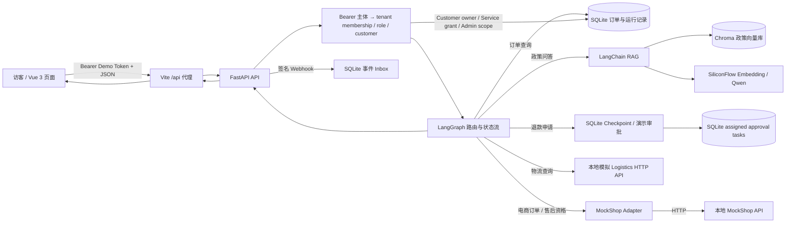

# Enterprise Support Agent V2｜企业售后智能客服 Agent

一个面向售后场景的 Python 全栈 Agent 演示项目，展示如何将自然语言请求接入可追踪、可评估、具备权限边界的业务流程。项目从 Dify 工作流迁移到代码实现，覆盖 FastAPI、SQLite、LangChain、LangGraph、RAG、自动化测试、Docker 与 Vue 演示界面。

## 项目亮点

- **端到端请求链路**：虚构请求人/审批人身份与租户校验 → FastAPI → LangGraph 确定性路由 → SQLite 只读订单、政策 RAG、本地模拟物流 HTTP API 或演示审批 → 结构化答复与运行记录。
- **可核验的政策问答**：政策来源引用、证据展示、无证据安全降级，以及针对退款时限、质量问题、物流和隐私边界的约束规则。
- **可靠性与安全边界**：Customer/Service/Approver/Admin 的租户内权限、审批任务分配与自批拒绝、checkpoint 完整性预检、锁文件与 CI。RAG 引用白名单不等于语义 grounding；离线边界测试记录了无关/冲突/注入证据的剩余风险。
- **可运行的演示界面**：Vue 3 + Vite 展示对话、平台订单/物流、售后资格和明确确认后的 MockShop 演示申请。
- **学习材料与验收证据**：五章代码导读、故障案例库、需求追踪矩阵和运行验证记录。

## 项目定位

本仓库是个人学习与技术演示项目，使用虚构数据和固定演示身份，不是生产客服系统。订单查询为只读；退款审批只记录 `approved_demo`，不会退款、改址或删除数据。真实身份认证、生产级 RBAC 与多实例部署不在当前范围。

**技术栈：** Python 3.12 · FastAPI · SQLite · LangChain · LangGraph · Chroma · SiliconFlow/Qwen · Vue 3 · Vite · Docker

**当前验证摘要（2026-11-23）：**本机全量 pytest **145 passed**；WSL 实际部署后三容器 healthy，SQLite schema 检查及 Phase 6/V2.1 verifier 通过，认证 `/chat` 对节假日问题返回与 POL-06 一致的直接答复。OOS-v2 15-case 回归中，Hit@4、Macro Recall@4、答案要点筛查、拒答要点筛查和引用来源匹配均为 100%，规则筛查 Bad Case 为 0；这些筛查结果不等于语义准确率，OOS-v2 是已观察回归集而非盲测。逐案例答复与证据留存在 [`OOS-v2 答复档案`](data/evaluation/oos/rag_oos_v2_holdout_answers.json)。人工回看发现并修正 HOLDOUT-07 对已明确退款工作日规则的矛盾拒答。GitHub Actions 负责锁定依赖、全量测试、Vue 构建、Compose 配置和容器 smoke。更多边界和逐例记录见 [`OOS-v2 报告`](data/evaluation/oos/rag_oos_v2_holdout_report.md) 与 [`分诊复核`](data/evaluation/oos/rag_oos_v2_manual_triage.md)。

## 项目架构



Vue 只调用本地 FastAPI；模型 Key 保留在后端 `.env`。Customer 只读本人订单，Service 需要客户授权，Approver 仅访问分配任务，Admin 管理操作受 tenant 限制。订单查询为只读；退款批准只记录演示状态 `approved_demo`。Docker/WSL 用于运行后端与持久化数据，开发前端单独通过 Vite 启动。

项目重视真实理解与工程取舍，不堆叠技术；通过代码、运行观察和评估展示完整链路。当前使用模拟数据，不是生产客服系统，不执行真实退款、改址或删除操作。

## 本地运行

```powershell
python -m pip install uv==0.11.11
uv sync --locked --extra dev
uv run --locked uvicorn support_agent.main:app --reload --app-dir src
```

直接在本机运行 API 时，还需在两个终端分别启动模拟物流服务（8091）和 MockShop API（8092）：`uv run --locked uvicorn support_agent.mock_logistics:app --host 127.0.0.1 --port 8091 --app-dir src`、`uv run --locked uvicorn support_agent.mock_shop_api:app --host 127.0.0.1 --port 8092 --app-dir src`。Docker Compose 会自动启动这两个 mock 服务并连接 Agent。

如果本机 pip 默认镜像返回 HTTP 403（例如 TUNA simple 页面对 pip 的 User-Agent 拒绝），可仅对本次安装覆盖镜像，不必改全局 pip 配置：

```powershell
python -m pip install -i https://mirrors.aliyun.com/pypi/simple uv==0.11.11
uv sync --locked --extra dev --default-index https://mirrors.aliyun.com/pypi/simple
```

打开 <http://127.0.0.1:8000/docs>。健康检查为 `GET /health`（无需认证）；订单查询为 `GET /orders/{order_id}`；Agent 对话为 `POST /chat`，以及审批和执行记录接口均需 Bearer 演示身份。V1 导入订单使用 `legacy-demo`；固定案例 `1001` 使用 `demo-a`。

### 本地演示身份

默认演示令牌（只用于本地学习，公开且不是生产凭据）：

- `demo-a-local-token` → `user-demo-a` → `demo-a`
- `demo-a-approver-local-token` → `user-demo-a-approver` → `demo-a` → 演示审批人
- `demo-a-approver-alt-local-token` → 同租户备用演示审批人
- `demo-a-service-local-token` → 同租户客服；只可访问管理员授予的客户范围
- `demo-a-admin-local-token` → 同租户管理员；可管理本租户用户角色/客服授权/审批分配，但不能因此读取所有订单
- `demo-b-local-token` → `user-demo-b` → `demo-b` → 店铺 B 请求人
- `legacy-demo-local-token` → `user-legacy-demo` → `legacy-demo`

请求使用 `Authorization: Bearer demo-a-local-token`。令牌只映射主体；服务端从 SQLite 的租户成员表读取角色和客户绑定，不信任调用方传入的 user/tenant/role。Customer 只读自己的订单；Service 需同租户有效客户授权；Approver 仅能查看分配给自己的审批任务；Admin 管理范围被限制在所属租户且不自动获得订单权限。审批决定只写入演示任务状态，不执行真实退款。公开令牌仍是演示选择器，不是真实认证凭据，不用于保护真实数据。

SQLite 默认写入 `data/support_agent.db`。删除该文件会重建演示数据库；它是本地运行数据，不应提交到 Git。

### Vue 演示前端

后端启动后，在新终端运行：

```powershell
cd frontend
npm install --legacy-peer-deps
npm run dev
```

打开 <http://127.0.0.1:5173>。Vite 将 `/api` 请求转发到本地 FastAPI。页面包含聊天、订单/政策证据、店铺身份切换、资格检查和确认后的演示申请。详细说明见 [`docs/vue_frontend.md`](docs/vue_frontend.md)。

## 演示方式

1. **确认后端就绪**：打开 <http://127.0.0.1:8000/health> 应返回 `{"status":"ok"}`；Swagger 接口文档在 <http://127.0.0.1:8000/docs>。
2. **启动前端**：在 `frontend/` 运行 `npm run dev`，浏览器进入 <http://127.0.0.1:5173>。Demo Token 默认预填 `demo-a-local-token`，仅用于本地演示。
3. **展示确定性订单查询**：输入“查询订单1001”，页面应显示订单状态与订单卡片。
4. **展示政策 RAG**：输入“退款多久能到账？”，查看回答中的政策编号和可展开的证据来源。
5. **展示模拟物流 API**：输入“查询订单1001物流”，LangGraph 在完成租户订单校验后，经 HTTP 请求本地虚构 Logistics API，页面显示模拟运单与轨迹；其他租户查该订单不会调用物流服务。
6. **展示审批中断与恢复**：请求人输入“帮我给订单1001申请退款”，先确认请求人身份不能自批，再切换到“审批人”角色作出决定。批准只记录 `approved_demo`，不会执行真实退款。
7. **展示电商 Adapter**：以店铺 A 请求人选择虚构订单 `2003`，或切到店铺 B 请求人选择 `2006`；另一店铺的订单应不可见。
8. **展示资格与申请边界**：侧栏输入 `2003` 和虚构原因，检查资格后通过明确按钮创建 `pending_demo`。该状态不代表平台已批准或退款完成。
9. **Webhook**：使用本地模拟服务/验收流程发送签名事件；重复 event_id 不应重复改变业务状态。

演示问题仅用虚构项目数据。政策问答会由后端调用 `.env` 配置的模型服务；不要输入个人信息、真实客户问题或秘密内容。模型请求额度依服务商账户配置而定。

V2.1 接口说明、测试口径与面试材料见 [`API 参考`](docs/api_reference_v2_1.md)、[`评估记录`](docs/evaluation_v2_1.md)、[`面试讲解`](docs/interview_guide_v2_1.md) 和 [`架构图`](ARCHITECTURE.md)。

## 测试

```powershell
uv run --locked pytest
```

## 政策检索（阶段 2）

复制 `.env.example` 为 `.env`，在本机 `.env` 中填写 SiliconFlow API Key；不要把真实 Key 发到聊天或提交到 Git。Windows + WSL 用户可保持 `PROJECT_DATA_DIR` 留空，默认使用本项目的 `/mnt/d/project_2/data`；其他环境在 `.env` 中将其设置为项目内的数据路径，例如 `PROJECT_DATA_DIR=./data`。Docker 部署时该数据目录必须预先存在；若路径写错，Compose 会阻止挂载，不会静默创建空目录。然后在项目虚拟环境运行：

```powershell
if (!(Test-Path .env)) { Copy-Item .env.example .env }
# 编辑 .env，填写 SILICONFLOW_API_KEY
\.venv\Scripts\Activate.ps1
python scripts/index_policies.py
python scripts/search_policies.py "定制商品出现质量问题怎么办？"
python scripts/ask_policy.py "定制商品出现质量问题怎么办？"
```

当前政策较短，第一版每个政策文件形成一个检索块；向量索引保存在 `data/vector_store/`。`ask_policy.py` 和 `POST /chat` 会把召回证据传给配置的聊天模型并检查引用是否来自本次检索结果；引用检查不是完整事实核验，仍需结合评估集检查回答是否被证据支持。

## 人工审批（阶段 4）

退款请求会暂停并保存在 `data/checkpoints.sqlite`，同时建立带 tenant、requester、actor、approver 和状态的 SQLite 审批任务。只有被分配的独立演示审批人能查看/决定；审批人自己发起的请求在创建任务前以 `forbidden_role` 拒绝。批准只写入 `approved_demo` 状态，不修改订单、不执行退款。`POST /chat` 返回待审批 `thread_id` 后，可通过 Swagger 查看状态并调用 `POST /approvals/{thread_id}/decision` 恢复流程；恢复前会按当前认证身份重新核验分配。令牌仍为公开演示值，不构成生产 RBAC。

### 本地模拟物流 API

Compose 启动 `mock-logistics`、`mock-shop` 和 Agent 三个本地服务。Agent 先校验当前身份的 tenant/store/customer 范围，再通过 typed HTTP client 和 Adapter 请求 MockShop；物流服务使用 `X-Demo-Service-Key`，并解析校验 JSON 轨迹。所有订单和轨迹都是固定虚构样例，不访问商业 API。配置项见 `.env.example`。

## 评估与追踪（阶段 5）

运行 `python scripts/evaluate_agent_routes.py` 评估标注路由、订单参数和临时数据库工具结果；运行 `python scripts/evaluate_agent_safety.py` 检查写操作边界；`pytest` 执行故障注入和 API 回归。RAG 评估使用 `python scripts/evaluate_retrieval.py`，需本机配置 SiliconFlow Key。评估口径、已知 Bad Case 和追踪字段见 [`docs/evaluation_and_observability.md`](docs/evaluation_and_observability.md)。每个 API 响应均带 `X-Trace-ID`，日志为 JSON 并输出到标准输出。

RAG 答案层增加了可审计的政策约束规则，详细人工复核和 Top-4/Top-8 输出见 [`docs/rag_answer_manual_review.md`](docs/rag_answer_manual_review.md) 与 `data/evaluation/v2_rag_answers_constraints_v3.json`。OOS Markdown 报告同时生成结构化 Bad Case ledger；初筛类别不是根因，须人工复核。最近的 RAG 无关/冲突/注入边界特征测试使用假模型，不计作真实模型安全或正确率证据。

## 端到端演示

启动、验证订单/租户隔离、政策引用和退款审批的完整步骤见 [`docs/demo_runbook.md`](docs/demo_runbook.md)。当前 WSL Docker 部署已完成用户实测验收。

## 项目架构与讲解

系统架构和指标摘要见 [`docs/project_story.md`](docs/project_story.md)；完整 3/10 分钟讲稿、20 个技术问题与 5 个故障案例见 [`docs/interview_kit.md`](docs/interview_kit.md)。中文代码学习手册见 [`docs/learning/README.md`](docs/learning/README.md)，12 类故障案例见 [`docs/troubleshooting/fault_cases.md`](docs/troubleshooting/fault_cases.md)。

当前已完成/待推进事项见 [`docs/project_status.md`](docs/project_status.md)；项目代理接续说明与约束见根目录 [`AGENTS.md`](AGENTS.md)。

## Docker（WSL）

确保项目根目录已有本机 `.env`，且 `PROJECT_DATA_DIR` 指向已存在的数据目录。为避开 `/mnt/d` 上的 BuildKit 权限问题，在 WSL 中从 `/opt/project2` 构建；Compose 将数据目录绝对挂载到 Windows 同源的 `/mnt/d/project_2/data`。数据目录必须预先存在；路径错误会使容器启动失败，不会自动建一个空目录：

```bash
cd /opt/project2
docker compose up --build -d
docker compose ps
```

首次 Docker 部署前，在项目虚拟环境中先运行一次 `python scripts/index_policies.py`，生成本机 `data/vector_store/`；该向量库被 Git 和 Docker 构建上下文排除，避免依赖未跟踪的本机文件。Compose 会从 `.env` 读取模型凭据和数据路径；订单库、审批 checkpoint 和 Chroma 向量库都保存在挂载的数据目录。等待容器状态为 `healthy` 后再打开 API 文档。

从 WSL `/opt/project2` 运行 `bash scripts/verify_phase6.sh` 可检查原有 Agent 主链。新增 `bash scripts/verify_v21.sh` 覆盖两店铺隔离、售后资格与幂等申请、Webhook 签名、重复事件和状态同步。`scripts/update_wsl_and_verify.sh` 会先等待服务健康，再只读核验 SQLite 完整性、schema version 和店铺范围复合主键，最后运行 RAG smoke 与两份业务验收；失败时返回非零状态。

2026-11-23 实际 WSL 验收：三容器 healthy，SQLite `integrity_check=ok`、`user_version=1`，Webhook event 和平台订单状态主键包含平台/租户/店铺维度；Phase 6 与 V2.1 verifier 全 PASS。后端变更继续使用既有 WSL 同步流程，不要从 Windows checkout 执行 Compose `up`。

Dockerfile 将依赖安装与本地源码安装分层，修改源码时可复用依赖缓存；pip 使用 TUNA 镜像并放宽下载超时。

API 地址为 <http://localhost:8000/docs>。订单数据库保存在宿主机 `data/support_agent.db`，容器重建后仍会保留。查看日志和停止服务：

```bash
docker compose logs -f
docker compose down
```

`/opt/project2` 中需放置与 Windows `D:\project_2` 同步的代码、Dockerfile、Compose 和政策文件。当前 WSL 配置默认将 `/mnt/d/project_2/data` 挂载到容器 `/app/data`；可用 `.env` 的 `PROJECT_DATA_DIR` 覆盖。订单库、审批 checkpoint 与 Chroma 索引均从此数据目录读取并保存。

容器中的相对路径配置（`DATABASE_PATH`、`CHECKPOINT_DB_PATH`、`VECTOR_STORE_PATH`）按工作目录 `/app` 解析，不依赖 pip 安装后 `site-packages` 中的源码位置。`.env` 从当前工作目录向上加载。

`systemctl is-active docker` 为空而 `is-enabled` 为 `enabled`，systemd 未报告 Docker unit 正在运行。用户实测 Ubuntu WSL 为 Stopped 时触发计划任务后，`dockerd` 就绪、容器 healthy、health 200。当前 Windows 计划任务配置为用户登录时触发，不能据此保证登录前自动恢复。详情见 [`docs/wsl_docker_lifecycle.md`](docs/wsl_docker_lifecycle.md)。

## 迁移说明

V1 资产来源、字段差异和 RET-01/QUA-01 对照见 [`docs/migration.md`](docs/migration.md)。新规则作为 V2 明确规则单独维护，不修改 V1 原始规则。

## 当前边界

Bearer 演示令牌映射到固定虚构用户和租户；它不是生产认证。`GET /agent-runs/{run_id}` 只返回当前身份拥有的最小执行记录，不保存原始问题。退款审批只记录演示状态，不执行真实业务操作。最新 WSL 运行验收是用户报告结果：三容器 healthy，phase6 与 V2.1 verifier 全通过；不代表生产认证或真实平台集成。
