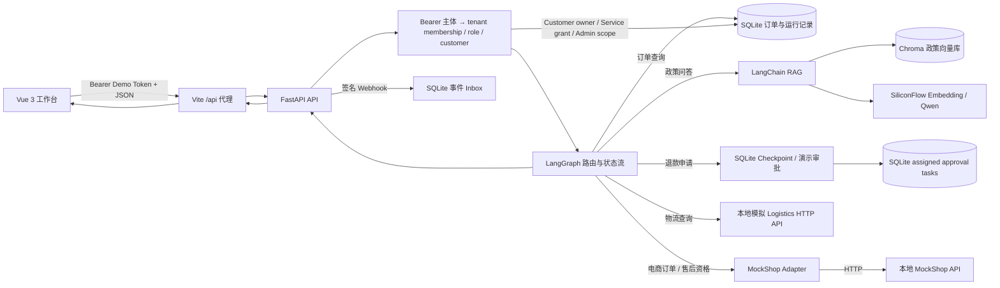

# Enterprise Support Agent V2｜企业售后智能客服 Agent

一个面向电商售后场景的 Python 全栈 Agent 工程演示：把订单查询、政策问答、物流查询与人工审批组织成可观察、可评估、带租户边界的工作流。项目将 Dify 原型迁移为代码实现，覆盖 FastAPI、SQLite、LangChain、LangGraph、Chroma RAG、Langfuse、pytest、Docker Compose 和 Vue 3。

## 项目概览

- **业务流程**：身份与租户校验 → FastAPI → LangGraph 路由 → 订单查询、政策 RAG、模拟物流或审批流程。
- **Vue 工作台**：Dashboard、智能客服、订单、审批、知识库、评估和可观测性页面。
- **RAG 与观测**：Chroma Top-K 检索、政策来源与证据展示；Langfuse 可记录请求、Graph 节点和模型 Generation。
- **工程验证**：角色与租户隔离、审批任务分配、pytest、GitHub Actions 和 Docker Compose。

**技术栈：** Python 3.12 · FastAPI · SQLite · LangChain · LangGraph · Chroma · Langfuse · Vue 3 · Vite · Docker Compose

## 业务流程与演示

**Vue 工作台 → FastAPI 身份与租户校验 → LangGraph → SQLite 订单 / Chroma 政策 RAG / 模拟物流 / 审批中断 → 答复与运行记录**

| 功能 | 演示内容 |
|---|---|
| 智能客服 | 订单查询、政策问答、引用证据和节点执行事件 |
| 人工审批 | 请求人提交后暂停，由分配的审批人恢复处理 |
| 电商与物流 | MockShop Adapter、虚构售后资格、模拟物流 API 和 Webhook 幂等 |
| 工作台与评估 | 按当前身份展示订单、运行记录、开发集和已观察的 OOS 结果 |
| 可观测性 | 本地运行记录；启用 Langfuse 后查看请求、Graph 节点和模型调用 |

本地可以从“查询订单1001”或“退款多久能到账？”开始体验；审批流程使用 `approved_demo` 状态。订单、身份和物流均为虚构演示数据。

**验证记录：**本机 pytest **157 passed**，Vue 生产构建通过；合成政策请求已在 Langfuse Cloud 生成包含请求根 Span、Graph 节点和 `ChatOpenAI` Generation 的 Trace。2026-11-23 WSL 部署版本的 Phase 6 与 V2.1 验收通过。RAG 回归结果与评估口径见 [`评估记录`](docs/evaluation_and_observability.md)。

## 项目架构



Vue 通过本地 FastAPI 调用后端；模型 Key 存放在后端 `.env`。Customer 查询本人订单，Service 需客户授权，Approver 处理分配任务，Admin 管理范围受租户约束。退款审批只记录 `approved_demo`，不调用外部电商平台执行退款。

## 本地运行

```powershell
python -m pip install uv==0.11.11
uv sync --locked --extra dev
uv run --locked uvicorn support_agent.main:app --reload --app-dir src
```

直接在本机运行 API 时，还需在两个终端分别启动模拟物流服务（8091）和 MockShop API（8092）：`uv run --locked uvicorn support_agent.mock_logistics:app --host 127.0.0.1 --port 8091 --app-dir src`、`uv run --locked uvicorn support_agent.mock_shop_api:app --host 127.0.0.1 --port 8092 --app-dir src`。Docker Compose 会自动启动这两个 mock 服务并连接 Agent。

如果本机 pip 默认镜像返回 HTTP 403（例如 TUNA simple 页面对 pip 的 User-Agent 拒绝），可仅对本次安装覆盖镜像，不必改全局 pip 配置：

```powershell
python -m pip install -i https://mirrors.aliyun.com/pypi/simple uv==0.11.11
uv sync --locked --extra dev --default-index https://mirrors.aliyun.com/pypi/simple
```

打开 <http://127.0.0.1:8000/docs>。健康检查为 `GET /health`（无需认证）；订单查询为 `GET /orders/{order_id}`；Agent 对话为 `POST /chat`，以及审批和执行记录接口均需 Bearer 演示身份。V1 导入订单使用 `legacy-demo`；固定案例 `1001` 使用 `demo-a`。

### 本地演示身份

固定演示令牌用于复现角色和租户边界：

- `demo-a-local-token` → `user-demo-a` → `demo-a`
- `demo-a-approver-local-token` → `user-demo-a-approver` → `demo-a` → 演示审批人
- `demo-a-approver-alt-local-token` → 同租户备用演示审批人
- `demo-a-service-local-token` → 同租户客服；只可访问管理员授予的客户范围
- `demo-a-admin-local-token` → 同租户管理员；可管理本租户用户角色/客服授权/审批分配，但不能因此读取所有订单
- `demo-b-local-token` → `user-demo-b` → `demo-b` → 店铺 B 请求人
- `legacy-demo-local-token` → `user-legacy-demo` → `legacy-demo`

请求使用 `Authorization: Bearer demo-a-local-token`。令牌映射主体，服务端从 SQLite 租户成员记录读取角色和客户绑定；权限由数据库查询和 API 共同校验。

SQLite 默认写入 `data/support_agent.db`。删除该文件会重建演示数据库；它是本地运行数据，不应提交到 Git。

### Vue 演示前端

后端启动后，在新终端运行：

```powershell
cd frontend
npm install --legacy-peer-deps
npm run dev
```

打开 <http://127.0.0.1:5173>。Vite 将 `/api` 请求转发到本地 FastAPI。工作台含 Dashboard、智能客服、订单、审批、RAG 知识库、评估中心和可观测性页面。详细说明见 [`docs/vue_frontend.md`](docs/vue_frontend.md) 与 [`企业工作台 / Langfuse 指南`](docs/enterprise_workbench_guide.md)。

## 演示流程

1. 确认 <http://127.0.0.1:8000/health> 返回 `{"status":"ok"}`，启动 Vue 前端并打开 <http://127.0.0.1:5173>。
2. 在智能客服输入“查询订单1001”，查看订单状态与权限范围。
3. 输入“退款多久能到账？”，查看政策回答、来源编号和检索证据。
4. 输入“查询订单1001物流”，查看本地模拟物流服务返回的轨迹。
5. 输入“帮我给订单1001申请退款”，然后切换到审批人处理待办。
6. 在售后演示面板检查订单 `2003` 或 `2006` 的资格并创建模拟申请。

完整启动步骤见 [`演示指南`](docs/demo_runbook.md)。所有订单、身份和物流信息均为虚构样例；审批流程不会调用真实退款接口。运行配置的政策问答会请求对应模型服务。

接口和评估口径见 [`API 参考`](docs/api_reference_v2_1.md)、[`评估记录`](docs/evaluation_v2_1.md)、[`架构图`](ARCHITECTURE.md)。

## 测试

```powershell
uv run --locked pytest
```

## 政策检索（阶段 2）

复制 `.env.example` 为 `.env`，设置 `SILICONFLOW_API_KEY`。Docker Compose 部署时还要将 `PROJECT_DATA_DIR` 设为本机已存在的数据目录，例如 `./data`。密钥保存在本机 `.env`，不要提交到 Git。然后在项目虚拟环境运行：

```powershell
if (!(Test-Path .env)) { Copy-Item .env.example .env }
# 编辑 .env，填写 SILICONFLOW_API_KEY
\.venv\Scripts\Activate.ps1
python scripts/index_policies.py
python scripts/search_policies.py "定制商品出现质量问题怎么办？"
python scripts/ask_policy.py "定制商品出现质量问题怎么办？"
```

每个短政策文件形成一个检索块；向量索引保存在 `data/vector_store/`。`ask_policy.py` 和 `POST /chat` 将召回证据传给配置的聊天模型，并检查回答引用是否来自本次检索结果。

## 人工审批（阶段 4）

退款请求会暂停并保存在 `data/checkpoints.sqlite`，同时建立包含 tenant、requester、actor 和 approver 的 SQLite 审批任务。只有分配的审批人能查看和决定；请求人自批会在建任务前被拒绝。决定只更新 `approved_demo` 演示状态。

### 本地模拟物流 API

Compose 启动 `mock-logistics`、`mock-shop` 和 Agent 三个服务。Agent 校验 tenant/store/customer 范围后通过 Adapter 请求 MockShop；物流服务使用服务密钥并返回 JSON 轨迹。配置项见 `.env.example`。

## 评估与追踪（阶段 5）

运行 `python scripts/evaluate_agent_routes.py` 评估标注路由、订单参数和临时数据库工具结果；运行 `python scripts/evaluate_agent_safety.py` 检查写操作边界；`pytest` 执行故障注入和 API 回归。RAG 评估使用 `python scripts/evaluate_retrieval.py`，需本机配置 SiliconFlow Key。评估口径、已知 Bad Case 和追踪字段见 [`docs/evaluation_and_observability.md`](docs/evaluation_and_observability.md)。每个 API 响应均带 `X-Trace-ID`，日志为 JSON 并输出到标准输出。

RAG 评估报告、答复样例和 Bad Case 记录见 [`评估记录`](docs/evaluation_and_observability.md) 与 [`答复复核`](docs/rag_answer_manual_review.md)。

## 端到端演示

启动和体验完整流程的步骤见 [`演示指南`](docs/demo_runbook.md)。

## 架构与接口

系统结构见 [`架构图`](ARCHITECTURE.md)，接口约定见 [`API 参考`](docs/api_reference_v2_1.md)，完整运行步骤见 [`演示指南`](docs/demo_runbook.md)。代码学习材料和故障记录分别见 [`学习目录`](docs/learning/README.md) 与 [`故障案例`](docs/troubleshooting/fault_cases.md)。

## Docker Compose

适用于安装了 Docker Engine 或 Docker Desktop，并带有 Docker Compose 插件的 Linux、macOS 和 Windows 环境。首次运行前，在仓库根目录准备后端 `.env` 和宿主机数据目录。

Linux/macOS 示例：

```bash
cp .env.example .env
mkdir -p data
```

在 `.env` 中设置 `PROJECT_DATA_DIR=./data` 和 `SILICONFLOW_API_KEY`。Windows PowerShell 示例：

```powershell
Copy-Item .env.example .env
New-Item -ItemType Directory -Force data
```

Windows Docker Desktop 可将 `PROJECT_DATA_DIR` 设为绝对路径，例如 `D:/projects/enterprise-support-agent-v2/data`；确认 Docker Desktop 已允许访问该盘。所有平台都要求目标数据目录预先存在，因为 Compose 使用显式 bind mount。

首次启动前，用本机 Python 环境生成政策向量索引：

```bash
uv sync --locked --extra dev
uv run python scripts/index_policies.py
```

随后构建并启动三个容器：

```bash
docker compose config --quiet
docker compose up --build -d
docker compose ps
```

待 `support-agent` 健康后，打开 <http://localhost:8000/health> 和 <http://localhost:8000/docs>。若 8000 端口已被占用，可在 `compose.yaml` 将宿主机端口左侧改为空闲端口，例如 `8001:8000`，并使用对应地址。查看日志或停止服务：

```bash
docker compose logs -f support-agent
docker compose down
```

数据库、checkpoint 和 Chroma 索引保存在 `PROJECT_DATA_DIR` 指定的宿主机目录中，容器重建或 `docker compose down` 后仍保留。删除该数据目录会删除本地运行数据。Dockerfile 分层安装锁定依赖和项目源码，修改源码时可以复用依赖缓存。

### WSL 环境

当前 Windows + WSL 部署使用 WSL Linux 文件系统目录 `/opt/project2` 构建，并把持久数据挂载到 `/mnt/d/project_2/data`。在 `.env` 设置 `PROJECT_DATA_DIR=/mnt/d/project_2/data`，从 `/opt/project2` 运行 Compose。该构建目录用于避开本机在 `/mnt/d` 上遇到的 BuildKit 权限问题；其他 Docker 环境不需要 WSL 或 `/opt/project2`。WSL 专用验收脚本见 `scripts/verify_phase6.sh`、`scripts/verify_v21.sh` 和 `scripts/update_wsl_and_verify.sh`。

## 迁移说明

V1 资产来源、字段差异和 RET-01/QUA-01 对照见 [`docs/migration.md`](docs/migration.md)。新规则作为 V2 明确规则单独维护，不修改 V1 原始规则。

## 企业工作台与 Langfuse

Vue 工作台现含 Dashboard、智能客服、订单、人工审批、RAG 知识库、评估中心和本地可观测性。仪表盘、订单与审批列表来自经过身份/租户范围校验的 FastAPI 和 SQLite 查询；聊天时间线由真实 LangGraph 节点包装器生成。节点事件随请求响应返回，当前不支持 token 流式输出。

Langfuse 使用 Python SDK v5 和 LangChain CallbackHandler，默认关闭。启用时在后端 `.env` 设置 `LANGFUSE_ENABLED=true`、`LANGFUSE_PUBLIC_KEY`、`LANGFUSE_SECRET_KEY` 和 `LANGFUSE_BASE_URL`；密钥只由后端读取。已用合成政策问题验证 Cloud Trace，包含请求、Graph 节点和 `ChatOpenAI` Generation。

评估页面读取仓库中的开发集、报告和 OOS 回归文件；这些数据集分开展示。评估口径、观测字段和工作台结构见 [`评估与可观测性说明`](docs/evaluation_and_observability.md) 和 [`工作台指南`](docs/enterprise_workbench_guide.md)。

本机验证记录：后端全量测试 **157 passed**，Vue 生产构建、Python compileall 与 Compose 静态配置通过；Langfuse 合成 Trace 验收通过。当前工作台版本尚未部署到 WSL；此前 WSL 验收对应 2026-11-23 的部署版本。
