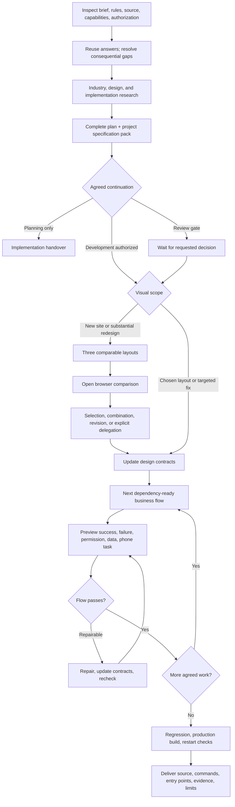
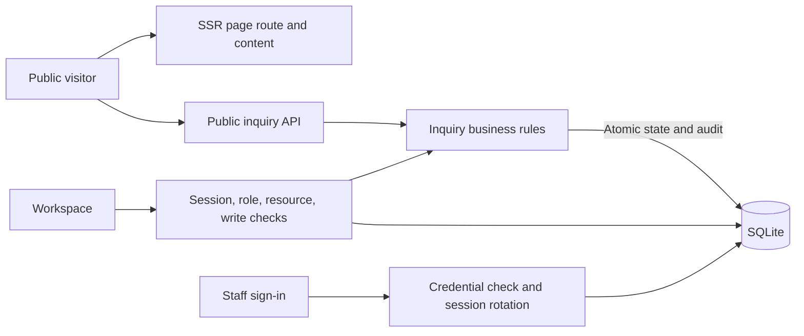

# Fullstack Web Delivery

[English](README.md) · [中文](README.zh-CN.md) · **v0.9.1**

[](https://github.com/KarmenLoop/fullstack-web-delivery/actions/workflows/verify.yml)
[](https://github.com/KarmenLoop/fullstack-web-delivery/releases/latest)
[](https://nodejs.org/)
[](LICENSE)
[](skills/fullstack-web-delivery/SKILL.md)

**Turn a website brief into a complete plan, project-specific specs, runnable increments, and checked local handoff—without inventing product facts or skipping acceptance.**

Fullstack Web Delivery is a **portable agent skill** for planning and shipping complete websites, plus a **fictional React / Express / SQLite business example (SENSU)** you can run on loopback. The skill adds workflow discipline—adaptive discovery, industry research, client-specific UI/UX, authentication and persistent data, preview, and evidence-based acceptance. It does **not** grant host tools, cloud credentials, email delivery, payments, or a production deploy.

Built and maintained by [KarmenLoop](https://github.com/KarmenLoop) / [KARMENLOOP](https://karmenloop.com). Current release: **[v0.9.1](https://github.com/KarmenLoop/fullstack-web-delivery/releases/tag/v0.9.1)**. License: **KarmenLoop Source-Available No-Modification License 1.0**.


*Local SENSU capture from v0.9.1. Fictional business and synthetic data; older studies keep their recorded versions.*


[Download v0.9.1](https://github.com/KarmenLoop/fullstack-web-delivery/releases/tag/v0.9.1) · [Guide](docs/tutorial.en.md) · [中文教程](docs/tutorial.zh-CN.md) · [Example walkthrough](docs/example-guide.md) · [Verification bounds](docs/verification.md)

---

## Why this exists

Most “build me a site” prompts collapse into pretty pages with no honest boundary between **planning**, **visual choice**, **business flow**, and **acceptance**. Agents invent unanswered facts, ship frontend without authorization or storage, treat screenshots as proof, or bolt every interaction pattern onto every project.

This package treats website delivery as a **systems workflow**:

- reuse answered requirements and inspect technical facts yourself;
- ask only for missing, consequential decisions;
- deliver a **complete plan and project specification pack before implementation**;
- for new sites or substantial visual redesigns, open **three comparable layouts** before expanding templates;
- build **dependency-ready business increments** (UI + API + rules + auth + storage + feedback together);
- verify normal, failure, access, data, mobile-task, and interaction scenarios with distinct evidence types.

It does **not** replace your host’s model, tools, or permissions. It does not claim every documented install path has been runtime-proven. What it ships is a stable method layer plus a concrete local example you can operate end to end.

---

## Snapshot

| | |
|---|---|
| **What you install** | Portable skill tree under `skills/fullstack-web-delivery/` (`SKILL.md`, `references/`, tutorials, optional Codex metadata, optional Python spec renderer) |
| **What you can run** | `examples/sensu-enterprise` — React SSR, Express, local SQLite |
| **Version** | **0.9.1** (`VERSION`, example `package.json`, release tag) |
| **Example runtime** | Node **22.13+** within Node 22; npm |
| **Local preview** | `http://127.0.0.1:4319` (loopback; set `PORT` / `SITE_ORIGIN` if needed) |
| **Staff demo access** | Random credentials in `.local/demo-access.json` after `npm run setup` — keep private |
| **Spec handoff** | Project UI/UX prompt, page/action/motion contracts, module specs, traceability (`docs/specifications.md`, populated under `docs/generated/sensu/`) |
| **Studies (example)** | `/interaction-lab`, `/motion-atlas`, `/motion-atlas#material` (WebGL2 specimen; static fallback without it) |
| **CI** | GitHub Actions **Verify**: repository/publication checks + example test/build/HTTP routes |
| **License** | Source-available, **no modification / no derivative distribution** of the Materials without written permission; independently created project outputs are a separate exception (see [LICENSE](LICENSE)) |

---

## Is / Is not

| Is | Is not |
|---|---|
| Website-delivery **skill** + runnable fictional business example | Hosted website builder SaaS or template marketplace |
| Plan → specification pack → increments → evidence handoff | “Generate the whole site in one shot” with no acceptance |
| Real local auth, roles, SQLite persistence, and audit in SENSU | Email, payment, external CRM, or production deployment |
| Three-layout visual comparison for new/redesign scope | Palette pick treated as layout selection |
| Six interaction studies and a motion atlas to **select by task** | Mandate to bolt all six effects onto every client site |
| Honest NOT_RUN / device / performance limits in verification docs | Claim that CI equals physical-device or full a11y/security audit |
| Unmodified skill usable in personal or commercial project work | Permission to fork-modify or redistribute altered Materials |

---

## Architecture

Three pieces stay deliberately separate:

1. **Method layer (skill)** — `SKILL.md` routes discovery, research, planning, visual decisions, implementation, and delivery. Conditional `references/` load only what the project needs. The skill adds instructions, not execution privileges.
2. **Specification convenience** — After answered discovery, the skill expects a filled project specification pack in the same planning handoff. An optional dependency-free Python renderer (`skills/fullstack-web-delivery/scripts/generate_project_specs.py`) can emit the same documents; hosts may write them directly.
3. **Runnable example (SENSU)** — One Express process serves SSR pages and same-origin APIs against local SQLite. Public content rendering, anonymous inquiry writes, session auth, and role-checked workspace mutations are distinct layers—not microservices.

### Delivery workflow



### Request architecture (SENSU example)



A saved inquiry is **local persistence**, not an email-sent claim. Direct API writes that violate role or CSRF rules are rejected server-side; hiding a control in the browser is not authorization.

---

## What the skill actually drives

### Adaptive discovery and research

- Start from who must accomplish what and what success looks like.
- Ask about four to six consequential gaps per round from a candidate pool—not a fixed forty-question quota.
- Inspect runtime, routes, APIs, and tools yourself; ask humans for business facts and material preferences.
- Research the client’s industry and mature references before inventing a skin; record adoption, rejection, licenses, and cost.

### Complete plan + specification pack

Before implementation, deliver the site plan (layers, sitemap, templates, form-to-admin flow, APIs, roles, data, milestones, acceptance) and a **project-specific** pack: UI/UX implementation prompt, page audiences/content/actions, state and motion contracts, module specs, and requirement-to-acceptance traceability. Empty templates are not a handoff. See [docs/specifications.md](docs/specifications.md) and the populated [docs/generated/sensu/](docs/generated/sensu/README.md) example.

### Visual decisions

For a new site or substantial visual redesign: three materially different layouts on the same realistic content, opened for comparison with matched desktop/phone views and tradeoffs. A selected palette alone does not select a layout. Preserve specifically chosen layouts and targeted-fix scope. Details: [docs/visual-decisions.md](docs/visual-decisions.md).

### Business increments (inquiry example)

| Increment | Exit evidence |
|---|---|
| Baseline and design | Reachable page; visual and task checks |
| Visitor inquiry | Receipt matches a saved SQLite record |
| Employee access | Same reference visible; direct write denied for read-only |
| Administrator handling | Legal transition + matching audit history |
| Responsive interaction | Operated behavior and actual viewport evidence |
| Final acceptance | Production pages, core flow, agreed restart persistence |

### Interaction, motion, and materials (selectable)

- **Interaction lab** — six operable studies at `/interaction-lab`; choose by task, do not install all six on every site ([docs/interaction-studies.md](docs/interaction-studies.md)).
- **Motion atlas** — scroll drivers, command search, coordinated department feedback, reduced-motion paths ([docs/motion-guide.md](docs/motion-guide.md)).
- **Reflective material** — WebGL2 specimen at `/motion-atlas#material` with fallback when WebGL2 is unavailable ([docs/metal-material-study.md](docs/metal-material-study.md)).

---

## Quickstart

### A. Run the SENSU example (no skill install required)

**Requirements:** Node 22.13+ within Node 22, npm, and a free loopback port (default **4319**).

```sh
cd examples/sensu-enterprise
npm ci
npm run setup
npm run build
npm start
```

Open `http://127.0.0.1:4319/`. Staff entry: `/login`. Workspace: `/admin`.

Setup writes random local access details to `.local/demo-access.json`. **Do not commit, paste, or screenshot those credentials.**

**First useful task**

1. Submit a fictional inquiry from the public site; save the returned reference.
2. Sign in with the generated **read-only** account; find that reference; confirm status writes are unavailable.
3. Sign out; use the **administrator** account; advance New → In progress → Done; inspect history.
4. Refresh (or restart the owned process) and confirm the same record and valid session expectations still hold.

Tests: `npm test`. With production mode running: `npm run verify:http`. Stop with Ctrl+C. Destructive cleanup of disposable local inquiries: `npm run data:clear -- --confirm-local` (accounts preserved). Full walkthrough: [docs/example-guide.md](docs/example-guide.md).

### B. Install the portable skill

Choose the **complete** release ZIP for the example and bilingual guides, or the smaller **skill** ZIP for the portable workflow only. Place the `fullstack-web-delivery` folder in **one** host-supported skill directory, using a **fresh** destination. Refresh discovery or start a new session; open the installed `SKILL.md` and confirm version **0.9.1**.

For a fresh Codex-style agents directory, create `~/.agents/skills` (or the project `.agents/skills`) and copy the complete skill folder there. Other local agent hosts document their own skill roots—see [docs/platforms.md](docs/platforms.md) and validate the target version before relying on native discovery. A file-capable agent can also be pointed at the absolute `SKILL.md` path; that proves only the reading route you exercise.

**Suggested first prompt**

```text
Use $fullstack-web-delivery.
Project: [business, audience, primary task].
Existing material: [paths or supplied context].
Required capabilities: [public pages, accounts, forms, administration, integrations].
Visual and writing constraints: [known decisions or references].
Authority: deliver the complete plan first, then continue local development.
Review gates: [only the gates I explicitly require].
Acceptance: [critical end-to-end tasks and devices].
```

If you ask only for a plan, implementation should not start. If you authorize local development without another gate, plan delivery should lead into work—beginning with three-layout comparison when visual scope requires it.

Long form: [docs/tutorial.en.md](docs/tutorial.en.md) · [docs/quickstart.md](docs/quickstart.md).

---

## Documentation map

| Doc | Use it when you need… |
|---|---|
| [Tutorial (EN)](docs/tutorial.en.md) · [中文](docs/tutorial.zh-CN.md) | Download, install, first task, update/remove |
| [Quickstart](docs/quickstart.md) | Skill prompt shape + SENSU commands |
| [Workflow](docs/workflow.md) | Decision routing and increment order |
| [Platforms](docs/platforms.md) | Documented skill directories and evidence matrix |
| [Specifications](docs/specifications.md) | Spec pack shape and renderer |
| [Generated SENSU pack](docs/generated/sensu/README.md) | Populated contracts example |
| [Example guide](docs/example-guide.md) | End-to-end inquiry / roles / API map |
| [Visual decisions](docs/visual-decisions.md) | Three-layout comparison |
| [Interaction studies](docs/interaction-studies.md) | Six-pattern lab |
| [Motion guide](docs/motion-guide.md) · [Metal study](docs/metal-material-study.md) | Atlas and reflective material |
| [Verification](docs/verification.md) | What was run, what remains NOT_RUN |
| [Licensing](docs/licensing.md) · [LICENSE](LICENSE) | Source-available terms in plain language |
| [CHANGELOG](CHANGELOG.md) | Release history through 0.9.1 |
| [PRODUCT.md](PRODUCT.md) | Product purpose and brand constraints |
| [SECURITY](SECURITY.md) / [SUPPORT](SUPPORT.md) / [CONTRIBUTING](CONTRIBUTING.md) | Ops |

---

## Validation (honest)

**Hosted CI (`Verify` workflow)** on push/PR: Python specification tests, `check_repository.py`, `check_publication.py` (bilingual docs must contain version **0.9.1**, local links must resolve, bound media/source digests must match), plus the SENSU suite (`npm test`, setup, build, production HTTP route verification) on Ubuntu with Node 22.

**Maintainer evidence** (see [docs/verification.md](docs/verification.md) and `evidence/`) additionally records browser operation, captures, restart readback, and version-scoped studies through **0.9.x**. Treat each evidence file’s stated scope as authoritative—do not promote an older capture into a newer claim.

**Not claimed**

- public deployment of SENSU or any client site;
- email, payment, or external CRM integration;
- physical-device / measured FPS certification from still frames;
- complete accessibility, security, or performance audits;
- runtime proof of every documented third-party host install path;
- permission to modify or redistribute altered Materials under the default license.

Package and CI checks validate structure, example automation, and publication identity. They do not certify every host’s model conversation or production readiness.

---

## FAQ

### What is Fullstack Web Delivery, in one sentence?

A source-available **website-delivery agent skill** that turns a brief into a plan, project-specific specifications, and verified local increments—plus a **React / Express / SQLite** fictional enterprise example you can run end to end on loopback.

### Who should use it?

Operators and developers who already use local coding agents to ship client websites and want a repeatable method for discovery, specs, visual choice, auth/data increments, and honest acceptance—not another generic UI template dump.

### Is SENSU a real customer website?

No. SENSU is a **fictional** local demonstration. Deployment, real accounts, mail, payments, and external services need separate configuration, authorization, and checks.

### Does installing the skill start a server or create accounts?

No. Installing the skill does not start a process, create accounts, grant tool permissions, or import cloud credentials. Running SENSU is a separate Node workflow under `examples/sensu-enterprise`.

### How is this different from “ask the agent to build a site”?

The skill requires a **complete plan and specification pack before implementation**, dependency-ordered **business increments**, explicit visual comparison when redesigning, and acceptance evidence that separates browser operation, API checks, screenshots, source review, and independent review. It also forbids inventing unanswered product facts.

### Do I have to use all six interaction patterns and the metal card?

No. Studies exist so you can **select by task**. The skill explicitly tells agents not to add every effect to every site. Metal/WebGL2 is an optional specimen with a readable fallback.

### Which Node version does the example need?

Node **22.13+** within the Node **22** line (`engines` in `examples/sensu-enterprise/package.json`). Local publication checks used Node 22.x; hosted CI uses Node 22.

### Can I modify the skill or example and publish a fork?

Under the default [LICENSE](LICENSE), you may view, download, exact-copy, install, and use the **unmodified** Materials, including commercial project work with the unmodified skill. **Modifying, adapting, or distributing derivative Materials** requires prior written permission from KarmenLoop. Independently created websites produced with the unmodified skill are a separate exception and are not claimed by this license. Copying or adapting the included example source is **not** that exception.

### Where should I look if docs disagree?

Trust `VERSION` / release tag **v0.9.1**, [CHANGELOG.md](CHANGELOG.md), [docs/verification.md](docs/verification.md), and the tutorials. Historical `evidence/v0.x-*` folders stay scoped to the version that produced them.

### Soft discoverability

Useful search phrases that match what this repo actually is: **website delivery skill**, **agent workflow for fullstack web**, **React Express SQLite local demo**, **project specification pack for agents**, **inquiry form with staff admin and audit**, **motion atlas / interaction lab for task-specific UI**. Avoid stuffing; the substance is in the skill and example, not keyword density.

---

## License and contact

[KarmenLoop Source-Available No-Modification License 1.0](LICENSE) — see also [NOTICE](NOTICE), [THIRD_PARTY_NOTICES.md](THIRD_PARTY_NOTICES.md), and [docs/licensing.md](docs/licensing.md). This is **not** an OSI-approved open-source license because it restricts modification and derivative distribution of the Materials.

Maintainer: [KarmenLoop](https://github.com/KarmenLoop) · Site: [karmenloop.com](https://karmenloop.com) · Permission requests: info@karmenloop.com

Issues: [GitHub Issues](https://github.com/KarmenLoop/fullstack-web-delivery/issues) · Support policy: [SUPPORT.md](SUPPORT.md). Prefer synthetic data when filing example bugs.
