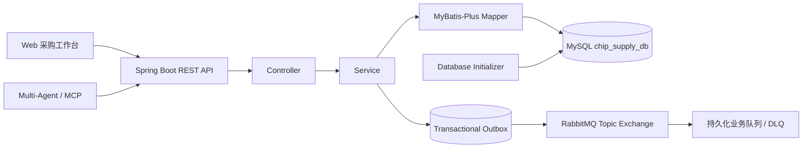

# ChipSupply Procurement Platform

> 面向芯片供应链的企业级采购协同平台，覆盖物料、供应商、库存预警、采购订单与履约跟踪全流程。


## 项目定位

本项目将芯片采购业务抽象为一套完整的供应链业务平台，并配套原生 Web 运营工作台。平台既可独立承载采购协同流程，也可作为 `ChipChain-Procurement-Agent` 的业务数据底座，通过稳定的 REST API 支撑多智能体查询、分析和订单执行。

仓库内置一套脱敏的场景化业务数据，用于本地初始化、接口联调和流程验证，不对应真实企业或交易。

## 核心能力

- **芯片物料中心**：覆盖 MCU、存储、电源管理、模拟、接口与传感器六类芯片，支持 MPN、封装、温度等级、MOQ 与交期管理。
- **供应网络管理**：维护供应商档案、信用等级和供货关系，支持多供应商比价与供应风险识别。
- **库存与预警**：提供入库、出库、安全库存校验和库存预警接口，联动物料补货决策。
- **采购订单闭环**：支持订单创建、明细查询、状态流转、金额重算和业务规则校验。
- **缺货预测与智能补货**：结合近 180 天需求节奏、安全库存、MOQ 和供应交期，输出可解释的缺货风险、补货数量与资金建议，并通过人工审批后再下单。
- **供应商风险雷达**：以信用、准时履约、平均交期、合作状态和供应集中度进行五维动态评分，支持备选供应商与双源保障决策。
- **订单异常预警中心**：主动识别审批停滞、发运信息缺失、交付逾期和物流异常，提供面向业务人员的处理建议与订单钻取入口。
- **三单匹配与采购对账**：对采购订单、仓储收货单和供应商发票进行数量与金额核验，自动区分匹配通过、差异冻结和待补单据，并支持在线补录后实时重算。
- **可靠事件驱动与链路追踪**：以 MySQL Transactional Outbox、RabbitMQ Publisher Confirm、持久化 Topic Queue、幂等消费者与 DLQ 保证事件可恢复投递，并用统一 Trace ID 串联采购、流程、仓储、库存与财务模块。
- **Agent 最小权限接入**：服务账号使用独立 RBAC 角色，只能读取业务数据并创建/修改待审核订单；库存写入、状态流转和审计日志均不可访问。
- **字段级生产防护**：Agent 请求采用字段白名单，订单状态、金额、创建人、实际到货日期和数据库维护字段由服务端控制，防止通过请求体越权。
- **版本化业务数据**：首次启动自动建库建表并写入可追踪的数据版本，保证环境一致性和可重复部署。
- **可观测 API**：记录请求方法、路径、HTTP 状态和耗时，并支持按环境控制 SQL 与参数日志。

## 架构



## 技术栈

| 模块 | 技术 |
| --- | --- |
| 运行时 | Java 17 |
| Web 框架 | Spring Boot 3.1 |
| 数据访问 | MyBatis-Plus、Spring JDBC |
| 数据库 | MySQL 8 |
| API 文档 | SpringDoc OpenAPI / Swagger UI |
| 前端 | HTML、CSS、JavaScript |
| 测试 | Spring Boot Test |

## 快速开始

### 1. 环境要求

- Java 17+
- Maven 3.8+
- MySQL 8+

### 2. 配置

应用读取 `src/main/resources/application.yml`，推荐通过环境变量覆盖本地配置：

| 环境变量 | 默认值 | 说明 |
| --- | --- | --- |
| `SERVER_PORT` | `8082` | HTTP 服务端口 |
| `CHIP_DB_URL` | `jdbc:mysql://localhost:3306/chip_supply_db?...` | JDBC 连接地址 |
| `CHIP_DB_USER` | `root` | 数据库用户 |
| `CHIP_DB_PASSWORD` | `123456` | 本地开发默认值，部署时必须覆盖 |
| `CHIP_SEED_DATA` | `true` | 是否写入预置业务数据 |
| `CHIP_SQL_LOG_LEVEL` | `debug` | SQL 日志级别 |

### 3. 构建并运行

```bash
mvn clean test package
java -jar target/ChipSupplyProcurementPlatform-1.0.0.jar
```

启动后访问：

- 采购工作台：`http://localhost:8082`
- Swagger UI：`http://localhost:8082/swagger-ui/index.html`
- REST API：`http://localhost:8082/api`

## API 概览

| 资源 | 基础路径 | 示例能力 |
| --- | --- | --- |
| 物料 | `/api/parts` | 分页、检索、供应商物料查询 |
| 供应商 | `/api/suppliers` | 分页、检索、维护 |
| 库存 | `/api/inventory` | 入库、出库、预警、可用量检查 |
| 采购订单 | `/api/orders` | 创建、修改、明细、统计、状态流转 |
| 物流 | `/api/logistics` | 物流记录查询与维护 |
| 统计 | `/api/statistics` | 采购与库存指标 |
| 决策中心 | `/api/intelligence` | 智能补货、供应商风险雷达、订单异常预警 |
| 采购控制塔 | `/api/control-tower` | 三单匹配、收货/发票补录、事件链路追踪 |

## 预置业务数据

| 内容 | 规模 / 规则 |
| --- | --- |
| 芯片分类 | 6 类 |
| 采购物料 | 24 条，12 个 MPN，每个 MPN 对应两家供应商 |
| 供应商 / 客户 / 员工 | 6 / 3 / 3 个业务主体 |
| 库存 | 24 条，覆盖安全库存预警场景 |
| 采购订单 | 72 笔，覆盖近六个月 |
| 报价快照 | 24 页版本化供应商报价 |

数据源位于 `docs/chip_catalog.json`，运行时建表和种子数据位于 `src/main/resources/db/`。如需完全重置预置数据，请创建空数据库后重新启动应用；初始化器通过数据集版本避免重复插入。

## 项目结构

```text
chip-portal/                       原生采购工作台
docs/                              数据字典与芯片目录
scripts/                           数据生成与界面校验脚本
src/main/java/com/chipsupply/
  controller/                      REST 接口
  service/                         业务规则
  mapper/                          数据访问
  entity/                          领域实体
  init/                            数据库初始化
src/main/resources/db/             Schema 与 Seed
src/test/                          自动化测试
```

## 与多智能体项目协作

`ChipChain-Procurement-Agent` 通过 MCP 将 Agent 工具映射到本项目的 REST API。两者采用独立数据库：本项目的 `chip_supply_db` 保存供应链业务数据，Agent 项目的数据库保存账号、会话、检查点和沙箱绑定，避免业务状态与推理状态耦合。

订单写入采用纵深防御：Agent 侧先进行确定性比价并等待人工批准，本平台再按认证身份执行接口级
RBAC 和字段级白名单检查。即使绕过对话提示，Agent 仍不能推进订单状态、修改库存、读取审计日志、
伪造创建人或把新订单直接写成已审核/采购中状态；所有新订单只能从“待审核”开始。

## 验证

```bash
mvn test
```

> 安全提示：仓库内数据库密码仅作为本地开发默认值。共享或生产部署应通过环境变量覆盖密码，并限制数据库与 Swagger 的网络访问范围。
