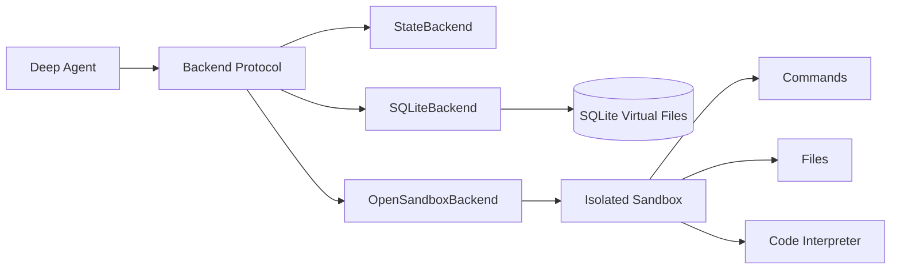

# DeepAgents Backend Lab

> A focused engineering lab for exploring persistent virtual filesystems, isolated code execution, and pluggable backend protocols in DeepAgents.


## Why this repository exists

Agent systems need more than an LLM loop. They need a controlled place to read and write files, execute commands, preserve state, and move artifacts across trust boundaries. This repository isolates those infrastructure concerns into small, inspectable backend experiments.

It complements the production-oriented `ChipChain-Procurement-Agent` project: ideas are validated here first, then integrated into a larger multi-agent application with lifecycle management, observability, persistence, and guardrails.

## Implementations

| Module | Purpose | Persistence | Execution isolation |
| --- | --- | --- | --- |
| `statebackend.py` | Minimal DeepAgents chat using the built-in `StateBackend` | LangGraph in-memory checkpoint | No |
| `sqlitebackend.py` | Backend protocol implementation backed by SQLite virtual files | SQLite file or memory DB | No |
| `opensandboxbackend.py` | DeepAgents `BaseSandbox` adapter for OpenSandbox | Sandbox lifecycle | Yes |
| `opensandbox_test.py` | End-to-end sandbox, command, file and interpreter smoke test | Ephemeral sandbox | Yes |

## Architecture



## Engineering focus

- Protocol-oriented backend design instead of coupling agents to a concrete filesystem.
- Thread-safe SQLite access for read-modify-write operations used by LangGraph worker pools.
- Command execution and file transfer primitives compatible with DeepAgents sandbox helpers.
- Explicit network policy and sandbox lifecycle management.
- Small runnable examples that make backend trade-offs easy to compare.

## Quick start

```bash
python -m venv .venv
# Windows: .venv\Scripts\activate
# macOS/Linux: source .venv/bin/activate
python -m pip install -r requirements.txt
```

Copy `.env.example` to `.env` and provide only the credentials required by the example you want to run.

```bash
python statebackend.py
python opensandbox_test.py
python opensandboxbackend.py
```

`SQLiteBackend` is designed to be imported by tests or another DeepAgents application:

```python
from sqlitebackend import SQLiteBackend

backend = SQLiteBackend("agent-files.sqlite")
backend.write("/notes/plan.md", "# Execution plan")
```

## Security note

Do not commit `.env` files or API keys. OpenSandbox examples assume a separately operated sandbox server at `http://localhost:8080`; review image, network, timeout and credential policies before exposing it outside a local development environment.
