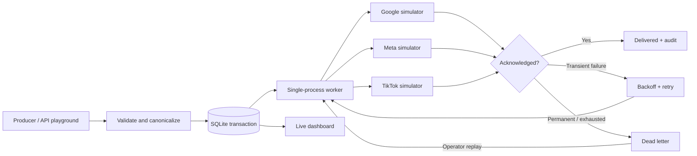

<div align="center">


# Conversion Signal Gateway

**Delivery, without doubt.**

A durable delivery gateway for predicted customer-value signals, with an interactive failure lab.

Node.js · SQLite · Vanilla JavaScript · Zero third-party runtime dependencies

[Quick start](#quick-start) · [Try the demo](#try-the-demo) · [Architecture](docs/architecture.md) · [API reference](docs/api.md) · [Demo script](docs/demo-script.md)


</div>

## The problem

A useful customer-value prediction only matters if it reaches the bidding system reliably. Repeated conversions, destination outages, rate limits and lost acknowledgements can turn a good prediction into a bad signal.

This project explores that last mile: **validate a conversion, persist it, fan it out, recover failed deliveries and explain exactly what happened.** It focuses on delivery infrastructure; it does not train an LTV model or operate advertising campaigns.

**Independent portfolio project.** Google Ads, Meta and TikTok are explicitly labeled simulators. No real advertising APIs are called, no vendor credentials are needed, and no affiliation with those companies or AdZeta is implied. The demo values are synthetic and are not model predictions or evidence of ROAS improvement.

## Quick start

Requires **Node.js 22.13 or newer**. Tested locally on Node.js 22.14.0. The built-in SQLite module prints an experimental-feature warning on Node 22; no flag or separate database installation is required. [Node.js documentation](https://nodejs.org/download/release/v22.14.0/docs/api/sqlite.html).

From the cloned or downloaded project directory:

```sh
cd conversion-signal-gateway
npm start
```

Open **[http://127.0.0.1:4318](http://127.0.0.1:4318)**. There is no install step, build step or API-key setup for local use. The server creates `data/gateway.sqlite`, seeds 120 synthetic events and starts the worker. The database is excluded from Git.

```sh
npm test          # behavior and HTTP integration tests
npm run check    # JavaScript syntax checks
npm run dev      # restart the server when source files change
```

The frontend is served directly; refresh the browser after editing HTML, CSS or JavaScript.

## Try the demo

### 1. Break a destination, automatically

Click **Run failure demo**. The gateway accepts 240 unique events plus 24 repeated submissions, takes Meta offline for nine seconds and restores it automatically. Google and TikTok continue receiving signals while Meta deliveries retry. The walkthrough completes after the retry queue drains, typically in about 20–30 seconds on a local machine.

Open an event to inspect its payload, model version, destination states and timestamped attempt history.

### 2. Exercise the hard cases

| Destination mode | What happens                                              | What to observe                                                        |
| ---------------- | --------------------------------------------------------- | ---------------------------------------------------------------------- |
| Healthy          | Every attempt is acknowledged                             | Queue drains to zero                                                   |
| Rate limited     | First two attempts return a simulated 429                 | Retry delay respects a 1.5-second minimum                              |
| Offline          | Every attempt returns a simulated 503                     | Healthy destinations continue; six failed attempts dead-letter the job |
| Reject           | First attempt returns a simulated permanent 422           | Dead letter appears immediately                                        |
| Lost ACK         | Simulator accepts the signal but loses the first response | Retry succeeds with one simulated conversion receipt                   |

To recover dead letters, restore the destination to **Healthy**, then click **Replay dead letters**. Previous attempts stay visible in the audit trail. Guided scenarios temporarily lock destination controls to keep the walkthrough deterministic.

### 3. Send a larger batch

Click **Send 1,000 events**. This submits 1,000 unique events and 100 exact repeats. With three destinations, it creates **3,000 delivery jobs**, not 3,300. This is an interactive workload, not a production throughput benchmark.

### 4. Use the API playground

Send an event, resend the same JSON, then change its value without changing its ID. Expect `202 Accepted`, `200 OK` with a duplicate result, and `409 Conflict`, respectively. You can also export the latest 10,000 audit entries as JSON.

## What is implemented

- **Transactional ingestion:** validation, event persistence, destination jobs and acceptance audit entries are atomic. An invalid event or conflicting ID rolls back the entire batch.
- **Idempotent intake:** a unique `event_id` and canonical payload fingerprint distinguish a repeat from a conflicting reuse.
- **Durable fan-out:** one independently tracked delivery per event and destination, backed by SQLite in WAL mode.
- **Bounded recovery:** six attempts, exponential backoff with equal jitter, a 16-second retry-delay cap, and a dead-letter workflow.
- **Restart recovery:** jobs interrupted while processing return to the retry queue on startup.
- **Auditability:** acceptance, duplicate detection, attempts, errors, replay and delivery all retain timestamps. Model version and original value remain inspectable on the event.
- **Measured UI:** delivery counts, duplicate submissions, P95 delivery latency and a rolling throughput chart come from the database. No chart history or performance results are fabricated.
- **Local-first safeguards:** loopback binding by default, bearer authentication for non-loopback binding, same-origin write checks, request-size limits, write rate limiting and a restrictive content security policy.

## Architecture



The gateway promises **at-least-once attempts**, not universal exactly-once delivery. The simulators persist unique receipts per `(event_id, destination)` so a lost acknowledgement can be demonstrated without a second simulated side effect. A real integration must use the destination's actual identity, deduplication, consent and attribution contracts; a locally generated key alone cannot provide that guarantee. [Design decisions and limits →](docs/architecture.md)

## API example

The server validates timestamps against its current time. Generate a current timestamp rather than copying a fixed historical example:

```js
// Node.js 22.13+; save as send-signal.mjs, then run: node send-signal.mjs
const response = await fetch('http://127.0.0.1:4318/api/events', {
  method: 'POST',
  headers: { 'Content-Type': 'application/json' },
  body: JSON.stringify({
    event_id: 'evt_example_001',
    customer_id: 'cus_pseudonymous_042',
    occurred_at: new Date().toISOString(),
    value: 187.5,
    currency: 'USD',
    model_version: 'pltv-demo-v1',
    campaign: 'high-intent-search',
    destinations: ['google', 'meta', 'tiktok']
  })
});
console.log(response.status, await response.json());
```

[Full schema, limits, endpoints and response codes →](docs/api.md)

## Configuration

The process reads environment variables directly. `.env.example` is a reference; `.env` files are **not** loaded by `npm start`.

| Variable  | Default               | Purpose                                                                           |
| --------- | --------------------- | --------------------------------------------------------------------------------- |
| `HOST`    | `127.0.0.1`           | Listen address                                                                    |
| `PORT`    | `4318`                | HTTP port                                                                         |
| `DB_PATH` | `data/gateway.sqlite` | Database path, relative to the repository or absolute                             |
| `API_KEY` | Unset                 | Optional locally; at least 24 characters and mandatory on non-loopback interfaces |

Use one server process per database file. To start on another local port in PowerShell:

```powershell
$env:PORT = '4320'
npm start
```

### Docker

```sh
docker build -t conversion-signal-gateway .
docker volume create signal-gateway-data
# Set API_KEY in your shell to a long random secret before running this command.
docker run --rm -p 127.0.0.1:4318:4318 \
  -e API_KEY -v signal-gateway-data:/app/data conversion-signal-gateway
```

The container binds to `0.0.0.0` internally and therefore requires the key. The host port stays loopback-only. The dashboard prompts for the key and stores it in that tab's session storage. In PowerShell, use backticks instead of backslashes for multiline commands, or put the command on one line.

The Dockerfile is provided for reproducible packaging; see [verification notes](docs/verification.md) for what was exercised in this workspace.

## Scope and tradeoffs

This is a deliberately compact reliability lab: a Node HTTP server, synchronous SQLite operations, one bounded worker and a buildless frontend. It favors inspectable behavior and easy local setup. It has no tenants, vendor OAuth, production delivery adapters, calibrated LTV model, distributed leases, retention scheduler or production monitoring backend. Metrics query retained data and are intended for demo-sized datasets.

Do not use the sandbox controls or a shared bearer key as a public multi-user production service. A hosted portfolio version needs deployment-specific HTTPS, access controls, resource limits and isolation. [Security notes →](SECURITY.md)

## Repository map

```text
src/             HTTP API, durable store, worker and simulators
public/          Responsive dashboard and API playground
test/            Reliability behavior and HTTP integration tests
docs/            API, architecture, demo script and verification notes
.github/         CI on Linux and Windows with Node 22
Dockerfile       Non-root container with a persistent data directory
```

## License

[MIT](LICENSE). Built by Luan Tomimoto.

Publishing under `LuanTomimoto`? See the [publication checklist](docs/publishing.md).
