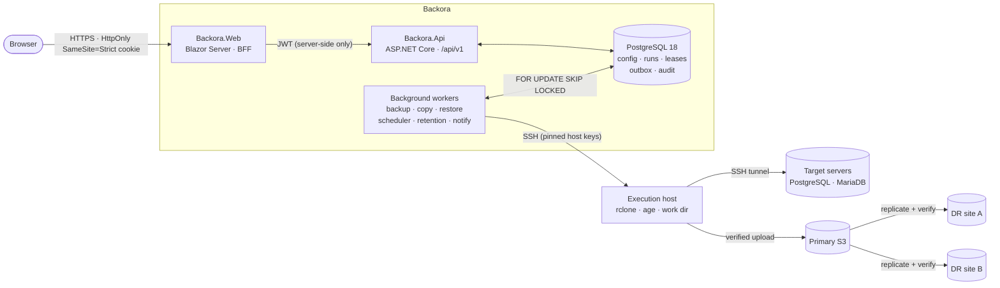

<div align="center">


### Enterprise database backup with multi-site disaster recovery, client-side encryption and provable restores

[](https://dotnet.microsoft.com/)
[](https://learn.microsoft.com/aspnet/core/blazor/)
[](https://www.postgresql.org/)
[](deploy/production/README.md)
[](backend/docs/07-operations.md)
[](LICENSE)

[Overview](#overview) · [Highlights](#highlights) · [Tour](#product-tour) · [Architecture](#architecture) · [Quick start](#quick-start) · [Security](#security) · [Docs](#documentation)

<br />


</div>

---

## Overview

**Backora** schedules, runs, verifies and replicates database backups across your fleet, and proves you can get the data back.

Backups run as scripts on your own servers over pinned SSH. Each archive is checksummed, then uploaded to S3-compatible object storage and copied to any number of disaster-recovery sites. You can encrypt it on your own host before it leaves your network. Every step is a leased, resumable operation in PostgreSQL. A worker restart or a deploy never kills a running backup, and nothing is marked *protected* until it has been verified.

> **Built for operators who have to answer one question with certainty:** *"If this server disappears right now, can we restore it, and from where?"*

## Highlights

| | |
|---|---|
| 🛡️ **Verified, not just copied** | Every artifact is SHA-256 manifested at backup time. Uploads are checked twice: once with `rclone check` and once with an independent S3 listing. Local copies are cleaned up only after both checks pass. |
| 🌍 **Multi-site disaster recovery** | One primary site plus any number of DR sites per job. Each copy is its own recovery point and can be restored on its own. Copies within the same account are done server-side. |
| 🔐 **Client-side encryption** | Optional customer-key encryption with [age](https://age-encryption.org) (X25519). Ciphertext is produced on your execution host, and Backora never stores the private key. |
| ♻️ **Crash-safe execution** | Lease-based workers use `FOR UPDATE SKIP LOCKED`. Remote processes are detached and adopted by another replica after a crash. Stall detection and retries with backoff are built in. |
| 🧭 **Safe restores** | Pre-checks verify objects, sizes, free space and tooling. The operator gives a reason and types a confirmation phrase. Data goes to an isolated directory, never over existing data, and is checked byte for byte against the manifest. |
| 🗂️ **PostgreSQL & MariaDB, physical & logical** | Ships `pg_basebackup`, `pg_dump`, `mariadb-backup` and `mysqldump` templates. You can also write your own script templates with typed settings and per-job overrides. |
| 👥 **Enterprise access control** | Six built-in roles, per-permission policies on every endpoint, TOTP two-factor, personal access tokens and a complete audit trail. |
| 📈 **Operational insight** | Protection overview, needs-attention queue, run history, storage growth and failure classification. Built-in OpenTelemetry traces and metrics. |

## Product tour

> All screens below are rendered from the real application with **fictional demo data**. No real hosts, jobs or customers appear.

<table>
<tr>
<td width="50%" valign="top">

#### Backup jobs
Every job with its schedule, last run, next run and protection state. Tabs filter by *Needs attention*, *Active* and *Paused*.


</td>
<td width="50%" valign="top">

#### Guided job creation
Five steps: source, primary storage and retention, schedule with a live preview, DR sites, then review. A protection plan summary stays on screen throughout.


</td>
</tr>
<tr>
<td width="50%" valign="top">

#### Live run tracking
Each run moves through Queued → Connect → Back up → Verify → Copy to sites. Progress for every site comes from real transfer stats, never simulated.


</td>
<td width="50%" valign="top">

#### Infrastructure
Protected servers with connection health, guided server onboarding with host-key trust, and a map of storage and DR sites.


</td>
</tr>
</table>

<details>
<summary><b>Light and dark themes</b></summary>
<br />


</details>

## Architecture



| Layer | Responsibility |
|---|---|
| `Backora.Domain` | Entities and state machines (`BackupRun`, `OffloadRun`, `RestoreRun`). Pure policies for scheduling (Cronos, time zones, DST), retention, script rendering and shell quoting. |
| `Backora.Application` | Use cases, validators, operation processors, scheduler, retention and notification services. |
| `Backora.Infrastructure` | EF Core and migrations, Identity, AES-GCM secret protection, SSH.NET, AWS S3, MailKit, Microsoft Teams, PostgreSQL lease store. |
| `Backora.Api` | Minimal APIs, permission policies, rate limiting, RFC 9457 errors, OpenAPI, health checks, OpenTelemetry. It also hosts the lease-based workers (backup, copy and restore dispatchers, plus the cluster-locked scheduler, retention and notification services), each of which can be switched on or off per replica. |
| `Backora.Web` | Blazor Server BFF that keeps tokens server-side, with typed API clients and every screen. |
| `Backora.Tools` | `migrate`, `create-admin`, `rotate-keys`, `import-legacy`, `verify-import`. |

Design decisions and trade-offs are documented in [02 — Architecture](backend/docs/02-architecture.md).

## Quick start

**Requirements:** Docker Engine 24+ with Compose v2, 2 vCPU and 4 GB RAM, a DNS name, and the SSH private key of your execution host.

```bash
git clone https://github.com/MustafaMta/Backora.git
cd Backora/deploy/production

# Generate config and secrets. TLS mode: acme | internal | files
./generate-config.sh backora.example.com admin@example.com acme

# Provide the execution host key (the API only ever opens SSH to this host)
cp /path/to/execution_host_ed25519 secrets/execution_host_key && chmod 600 secrets/execution_host_key

docker compose up -d --build
docker compose ps    # every service healthy; the migrator exits with code 0
```

Open `https://backora.example.com`, sign in as the bootstrap admin and change the password. Turn on two-step verification, then trust the execution host under **Execution host**.

The stack runs PostgreSQL, the migrator, the API, the web app and a Caddy TLS proxy. Only the proxy is published. Every container is read-only and runs with all Linux capabilities dropped. See the [production deployment guide](deploy/production/README.md) for TLS modes, upgrades, backups of Backora itself and Kubernetes/OpenShift manifests.

<details>
<summary><b>Local development</b></summary>

```bash
# Lab stack with disposable SSH targets and an S3-compatible store
cd backend/deploy && ./generate-env.sh && docker compose --profile lab up -d --build

# Tests
dotnet test backend/Backora.sln
dotnet test frontend/tests/Backora.Web.Tests
```

See [07 — Development, deployment, configuration, monitoring and tests](backend/docs/07-operations.md).
</details>

## How a backup flows

1. **Schedule.** The cluster-singleton scheduler creates a run when it is due. Time zones and DST are handled correctly, and missed runs follow the job's policy.
2. **Execute.** A worker leases the run and connects through the execution host to the target over pinned SSH. It renders the template with per-job settings and starts it as a detached process.
3. **Verify.** Artifacts are checked for presence, size and SHA-256 and recorded in a manifest. Size guards catch backups that suddenly shrink.
4. **Upload.** rclone uploads to the primary site, encrypting with age first if the site uses a customer key. The result is verified with `rclone check` and an independent S3 listing.
5. **Replicate.** One queued copy per DR site is created in the same transaction. Each copy is verified on the DR side against the manifest.
6. **Retain.** The retention planner expires recovery points per site and always keeps a configurable minimum.

## Security

- **Users:** ASP.NET Core Identity with PBKDF2-SHA512 (600k iterations), lockout, TOTP 2FA with recovery codes, and uniform responses that don't reveal whether an account exists.
- **Sessions:** the BFF pattern keeps tokens off the browser. Access tokens last 15 minutes. Refresh tokens rotate on every use, and reusing one revokes the whole session family.
- **Secrets:** SSH keys, S3 credentials and secret variables are encrypted at rest with AES-GCM and rotatable keys. They are write-only through the API.
- **Remote execution:** host keys are explicitly trusted, never auto-accepted. Shell quoting is strict, and rclone config is written as a 0600 file, never on the command line.
- **Encryption keys:** for encrypted restores the private key goes to the execution host only through a 0600 FIFO and is never persisted.
- **Audit:** every change and every denied restore is audited with a correlation ID.

| Role | Scope |
|---|---|
| Platform Administrator | Everything, including users and roles |
| Backup Administrator | Servers, credentials, templates, jobs, storage, retention, restores, settings |
| Backup Operator | Read operations, run and cancel jobs, view logs, test connections |
| Restore Operator | Read operations, execute restores, view logs |
| Auditor | Read operations, audit trail, settings and users (read-only) |
| Read-only Viewer | Read operations |

Full model: [05 — Security](backend/docs/05-security.md).

## Documentation

| | |
|---|---|
| [Architecture](backend/docs/02-architecture.md) | Components, decisions and trade-offs, request flow |
| [Database design](backend/docs/03-database-design.md) | Schema, constraints, least-privilege roles |
| [API reference](backend/docs/04-api-reference.md) | REST `/api/v1`, OpenAPI at `/openapi/v1.json` |
| [Security model](backend/docs/05-security.md) | Authentication, authorization, secrets, encryption |
| [Backup engine](backend/docs/06-backup-engine.md) | Execution, verification, DR replication, restore safety, retention |
| [Operations](backend/docs/07-operations.md) | Development, deployment, configuration, monitoring, tests |
| [Known limitations](backend/docs/08-known-limitations.md) | What is not implemented yet, stated plainly |
| [Design system](frontend/docs/DESIGN.md) | UI tokens, components and patterns |
| [Production deployment](deploy/production/README.md) | Docker Compose stack with TLS |

## Project layout

```
backend/
  src/        Domain · Contracts · Application · Infrastructure · Api · Tools
  tests/      Unit · Integration (Testcontainers) · Security
  database/   Built-in backup templates and database roles
  deploy/     Lab stack and Kubernetes manifests
frontend/
  src/        Backora.Web (Blazor BFF) · Backora.Components · Backora.DesignSystem
  tests/      bUnit component tests
deploy/
  production/ Docker Compose + Caddy TLS proxy
  openshift/  Route helpers
```

## License

Released under the [MIT License](LICENSE).
