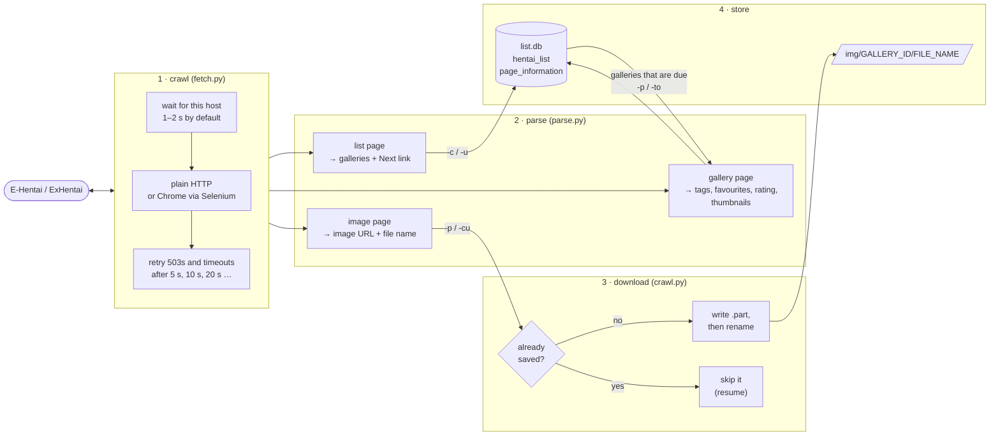

<p align="center">
  
</p>

# ehentai-crawler

[](https://github.com/NatLee/ehentai-crawler/actions/workflows/ci.yml)
[](pyproject.toml)
[](LICENSE)

A command-line crawler for E-Hentai and ExHentai. It walks the gallery list into a SQLite
database, then visits each gallery for its tags, favourite count and rating, and, if you want,
downloads its images into `img/<gallery id>/`. It is made to run unattended for days: it paces
itself per host, retries with backoff, skips what it already has, and waits out the site's
"slow down" pages instead of hammering through them.

> [!IMPORTANT]
> **Be a good guest.** The site is run by people who pay for its bandwidth. Read and follow its
> Terms of Service, keep the default pace (1–2 s between requests to the same host), and don't
> run several copies against it. Its [robots.txt](https://e-hentai.org/robots.txt) asks automated
> clients to stay out of `/s/`, the per-image pages that image downloading (`-p`, `-cu`) needs;
> list and tag crawling (`-c`, `-u`, `-to`) stay outside it. The site limits how many images you
> can load, and it bans IPs that load pages too fast. The content is for adults: check the
> site's rules and your local laws before you start.

## Contents

- [Install](#install)
- [Quick start](#quick-start)
- [How it works](#how-it-works)
- [Example run](#example-run)
- [Options](#options)
- [Settings](#settings)
- [What you get](#what-you-get)
- [Try it offline](#try-it-offline)
- [Upgrading from the 2019 version](#upgrading-from-the-2019-version)
- [Development](#development)

## Install

Python 3.10 or newer.

```sh
pip install "git+https://github.com/NatLee/ehentai-crawler"
```

That gives you the `ehentai-crawler` command. To load pages in a real Chrome instead of plain
HTTP (see `FETCHER` below), add the `browser` extra; Selenium then finds or downloads a matching
ChromeDriver by itself:

```sh
pip install "ehentai-crawler[browser] @ git+https://github.com/NatLee/ehentai-crawler"
```

From a clone, `pip install -e .` works too, and `python main.py …` is the same as
`ehentai-crawler …`.

## Quick start

1. **Pick the site.** ExHentai is the default, as it always was, and needs your login cookies.
   Copy `ipb_member_id` and `ipb_pass_hash` from your browser after logging in, and put them in
   the environment (or in `setting.ini`, which git ignores):

   ```sh
   export EHENTAI_IPB_MEMBER_ID=1234567
   export EHENTAI_IPB_PASS_HASH=0123456789abcdef0123456789abcdef
   ```

   For E-Hentai, no cookies are needed: add `--no-ex-mode` or set `EHENTAI_EX_MODE=false`.

2. **Build the list.** This reads the front page and follows the "Next" links until it reaches
   galleries it already has (all of them, the first time):

   ```sh
   ehentai-crawler -c
   ```

3. **Visit the galleries.** Tags, favourites and ratings only, or with images:

   ```sh
   ehentai-crawler -to
   ehentai-crawler -p
   ```

4. **Come back later.** Run `-c` again for new galleries, then `-to` or `-p`. Only galleries that
   are new, changed since the last visit, or missing images are visited again. Stopped halfway?
   Run the same command again: finished galleries and saved images are skipped.

Just one gallery? `ehentai-crawler -cu https://exhentai.org/g/<id>/<token>/` saves it to
`img/<id>/` without touching the database.

Then the long part: leave it running overnight. The panda has the archive covered.

<p align="center">
  
</p>

## How it works



The parser only reads HTML text and never touches the network, so the tests feed it small
hand-written pages. Worker threads fetch and parse; all database writes happen on the main
thread, one transaction per gallery or list page, so an interrupted run never leaves half a
row behind.

When the site pushes back, the crawler reacts like this:

| The site… | The crawler… |
|---|---|
| answers 503, 429 or another 5xx, or times out | waits 5 s, 10 s, 20 s … (at most 300 s) and tries again, up to `MAX_RETRIES` times |
| shows the "IP temporarily banned" page while you read the list | waits until the ban ends (the page says when; one hour if not) and carries on |
| shows that page while you crawl galleries | stops, keeps everything finished so far, and exits with status 255 |
| says a gallery was removed or not found | marks it `removed = 1` and stops visiting it |
| serves its 509 "quota exceeded" image | stops downloading; the remaining galleries get tags only |
| shows the "Content Warning" page | sends the `nw=1` cookie, and follows the "View Gallery" link if the page shows anyway |
| answers ExHentai requests with an empty page | stops and tells you to check the cookies |

## Example run

These commands ran against the bundled [fake site](#try-it-offline), not the real one, so the
titles and tags are placeholders. In a terminal, `-c` and `-p` also draw a progress bar.

```console
$ ehentai-crawler -c
2026-11-03 23:14:30,569 - INFO : list done: 2 page(s) read, 5 added, 0 updated

$ ehentai-crawler -c
2026-11-03 23:14:30,850 - INFO : reached galleries already stored (newest: 2026-01-03 10:00); stopping
2026-11-03 23:14:30,851 - INFO : list done: 1 page(s) read, 0 added, 1 updated

$ ehentai-crawler -p
2026-11-03 23:14:31,111 - INFO : 5 galleries to visit with 24 workers
2026-11-03 23:14:31,133 - WARNING : gallery 1003 was removed or is unavailable; marking it removed
2026-11-03 23:14:31,207 - INFO : galleries done: 4 crawled (4 with every image), 1 removed, 0 failed

$ rm img/1005/page002.jpg
$ ehentai-crawler -cu http://127.0.0.1:8000/g/1005/0a1b2c3d4e/
2026-11-03 23:14:31,447 - INFO : gallery 1005: 1 of 3 images saved, 2 already there, 0 failed -> img/1005

$ ehentai-crawler -c --ex-mode
ehentai-crawler: error: https://exhentai.org/ needs the ExHentai login cookies. Set EHENTAI_IPB_MEMBER_ID and EHENTAI_IPB_PASS_HASH (or [ExHentaiAccess] in setting.ini), or use E-Hentai with --no-ex-mode.
```

## Options

The six options of the original version keep their names, short forms and meaning. They take an
optional yes/no (`-c` and `-c yes` crawl, `-c no` doesn't). When you give several, they run in
the order below.

| Option | What it does |
|---|---|
| `-c`, `--crawl_list` | Crawl the gallery list from the front page; stop at galleries already stored. |
| `-u`, `--update_crawl_list` | Crawl the whole list again and refresh every stored row. |
| `-p`, `--crawl_each_page` | Visit every gallery that is due: tags, favourites, rating and images. |
| `-to`, `--crawl_tag_only` | The same without images. |
| `-cu`, `--crawl_with_url URL` | Download one gallery by URL into the image folder (not stored in the database). |
| `-ds`, `--database_sync PATH` | Merge a database crawled on another machine into this one. |

<details>
<summary>Full <code>ehentai-crawler --help</code></summary>

```text
usage: ehentai-crawler [-h] [--version] [-c [BOOL]] [-u [BOOL]] [-p [BOOL]] [-to [BOOL]]
                       [-cu GALLERY_URL] [-ds OTHER_DATABASE_PATH] [--config PATH]
                       [--ex-mode | --no-ex-mode] [--fetcher {http,browser}]
                       [--headless | --no-headless] [--number-of-thread NUMBER_OF_THREAD]
                       [--request-delay REQUEST_DELAY] [--max-retries MAX_RETRIES]
                       [--timeout TIMEOUT] [--image-folder-path IMAGE_FOLDER_PATH]
                       [--database-path DATABASE_PATH] [--log-level {DEBUG,INFO,WARNING,ERROR}]

EHentai Crawler: build the gallery list first (-c), then crawl tags only (-to) or tags and images
(-p) for every gallery in it. -cu downloads one gallery by URL, -ds merges a database crawled on
another machine. Run with no options to see this help.

options:
  -h, --help            show this help message and exit
  --version             show program's version number and exit

what to crawl (run in this order when several are given):
  -c [BOOL], --crawl_list [BOOL]
                        Crawl the gallery list from the front page; stop at galleries already
                        stored.
  -u [BOOL], --update_crawl_list [BOOL]
                        Crawl the whole gallery list again and refresh every stored row.
  -p [BOOL], --crawl_each_page [BOOL]
                        Crawl tags and download images of every stored gallery that needs it.
  -to [BOOL], --crawl_tag_only [BOOL]
                        Like -p, but only tags, favourites and ratings; no images.
  -cu GALLERY_URL, --crawl_with_url GALLERY_URL
                        Download one gallery by URL into the image folder (not stored in the
                        database).
  -ds OTHER_DATABASE_PATH, --database_sync OTHER_DATABASE_PATH
                        Merge another crawler's database into this one.

settings:
  --config PATH         settings file [EHENTAI_CONFIG, default: ./setting.ini]
  --ex-mode, --no-ex-mode
                        Crawl ExHentai instead of E-Hentai (needs the two login cookies).
                        [EHENTAI_EX_MODE, default: True]
  --fetcher {http,browser}
                        How pages are loaded: 'http' (plain requests) or 'browser' (Chrome through
                        Selenium, needs pip install 'ehentai-crawler[browser]'). [EHENTAI_FETCHER,
                        default: http]
  --headless, --no-headless
                        Hide the Chrome window (browser fetcher only). [EHENTAI_HEADLESS, default:
                        False]
  --number-of-thread NUMBER_OF_THREAD
                        Galleries crawled at the same time. [EHENTAI_NUMBER_OF_THREAD, default:
                        24]
  --request-delay REQUEST_DELAY
                        Minimum seconds between two requests to the same host; a random extra of
                        up to the same amount is added. [EHENTAI_REQUEST_DELAY, default: 1.0]
  --max-retries MAX_RETRIES
                        Retries for timeouts and server errors, with exponential backoff.
                        [EHENTAI_MAX_RETRIES, default: 5]
  --timeout TIMEOUT     Seconds to wait for one response. [EHENTAI_TIMEOUT, default: 60.0]
  --image-folder-path IMAGE_FOLDER_PATH
                        Images go to <folder>/<gallery id>/<file name>.
                        [EHENTAI_IMAGE_FOLDER_PATH, default: img]
  --database-path DATABASE_PATH
                        SQLite file with the gallery list and metadata. [EHENTAI_DATABASE_PATH,
                        default: list.db]
  --log-level {DEBUG,INFO,WARNING,ERROR}
                        How chatty the log is. [EHENTAI_LOG_LEVEL, default: INFO]

Settings are read from, later wins: built-in defaults, setting.ini (or --config / EHENTAI_CONFIG),
environment variables EHENTAI_<KEY>, then the flags above. The ExHentai cookies are only read from
the settings file or from EHENTAI_IPB_MEMBER_ID and EHENTAI_IPB_PASS_HASH, never from flags. Be
gentle with the site: the defaults wait 1-2 s between requests to it.
```

</details>

Exit status: 0 when done, 1 when the site kept failing or its pages no longer look as expected,
2 for bad input (options, settings, a URL that isn't a gallery), 130 after Ctrl+C, and 255 when
the site bans the IP during a gallery crawl.

## Settings

Every setting has one name and three ways to set it. Later ones win:

1. the default in the table,
2. `setting.ini` in the current folder (or the file given by `--config` / `EHENTAI_CONFIG`);
   start from [`setting.example.ini`](setting.example.ini),
3. an environment variable `EHENTAI_<KEY>`,
4. a command-line flag. The cookies and URLs have no flag, so they stay out of your shell history.

| Key (section) | Default | Environment variable | Flag | What it does |
|---|---|---|---|---|
| `EX_MODE` (Mode) | `True` | `EHENTAI_EX_MODE` | `--ex-mode` / `--no-ex-mode` | Crawl ExHentai instead of E-Hentai (needs the two login cookies). |
| `FETCHER` (Mode) | `http` | `EHENTAI_FETCHER` | `--fetcher` | `http` (plain requests) or `browser` (Chrome through Selenium; needs the `browser` extra). |
| `HEADLESS` (Mode) | `False` | `EHENTAI_HEADLESS` | `--headless` / `--no-headless` | Hide the Chrome window (browser fetcher only). |
| `EHENTAI_INDEX` (HentaiUrl) | `https://e-hentai.org/` | `EHENTAI_EHENTAI_INDEX` | — | E-Hentai front page. |
| `EHENTAI_GALLERY` (HentaiUrl) | `https://e-hentai.org/g/` | `EHENTAI_EHENTAI_GALLERY` | — | E-Hentai gallery URL prefix. |
| `EXHENTAI_INDEX` (HentaiUrl) | `https://exhentai.org/` | `EHENTAI_EXHENTAI_INDEX` | — | ExHentai front page. |
| `EXHENTAI_GALLERY` (HentaiUrl) | `https://exhentai.org/g/` | `EHENTAI_EXHENTAI_GALLERY` | — | ExHentai gallery URL prefix. |
| `IPB_MEMBER_ID` (ExHentaiAccess) | empty | `EHENTAI_IPB_MEMBER_ID` | — | ExHentai login cookie `ipb_member_id`. Only ever sent to ExHentai. |
| `IPB_PASS_HASH` (ExHentaiAccess) | empty | `EHENTAI_IPB_PASS_HASH` | — | ExHentai login cookie `ipb_pass_hash`. Only ever sent to ExHentai. |
| `NUMBER_OF_THREAD` (Parallel) | `24` | `EHENTAI_NUMBER_OF_THREAD` | `--number-of-thread` | Galleries crawled at the same time. `REQUEST_DELAY` still sets the pace per host. |
| `REQUEST_DELAY` (Politeness) | `1.0` | `EHENTAI_REQUEST_DELAY` | `--request-delay` | Minimum seconds between two requests to the same host, plus a random extra of up to the same amount. |
| `MAX_RETRIES` (Politeness) | `5` | `EHENTAI_MAX_RETRIES` | `--max-retries` | Retries for timeouts and server errors, with exponential backoff. |
| `TIMEOUT` (Politeness) | `60.0` | `EHENTAI_TIMEOUT` | `--timeout` | Seconds to wait for one response. |
| `USER_AGENT` (Politeness) | `ehentai-crawler/VERSION (+repo URL)` | `EHENTAI_USER_AGENT` | — | User-Agent of plain HTTP requests (the browser keeps Chrome's own). |
| `IMAGE_FOLDER_PATH` (ImageFolder) | `img` | `EHENTAI_IMAGE_FOLDER_PATH` | `--image-folder-path` | Images go to `<folder>/<gallery id>/<file name>`. |
| `DATABASE_PATH` (Database) | `list.db` | `EHENTAI_DATABASE_PATH` | `--database-path` | SQLite file with the gallery list and metadata. |
| `LOG_LEVEL` (Logging) | `INFO` | `EHENTAI_LOG_LEVEL` | `--log-level` | `DEBUG`, `INFO`, `WARNING` or `ERROR`. |

Keep real cookies out of git: `setting.ini` is in `.gitignore`, and the crawler never logs them.

## What you get

Images keep the file names the site shows, without spaces:

```text
img
├── 1001
│   └── single.png
├── 1002
│   └── single.png
├── 1004
│   └── single.png
└── 1005
    ├── page001.jpg
    ├── page002.jpg
    └── page003.jpg
```

`list.db` is a SQLite file with two tables. Open it with
[DB Browser for SQLite](https://sqlitebrowser.org/) or the `sqlite3` command.

- `hentai_list`: one row per gallery from the list: `gallery_id`, `url_hash` (the token in the
  gallery URL), `big_tag` (category), `title`, `timestamp` (posted, as the list shows it),
  `uploader`, `pages`, and `removed` (1 once the site says it is gone).
- `page_information`: one row per visited gallery: `tags` as JSON (`{"namespace": ["tag", …]}`),
  `favorited_time`, `rating_count`, `average_score`, `last_update_time` (when it was crawled,
  one hour early as a safety margin), and `all_downloaded_check` (1 when every image is saved).

```console
$ sqlite3 -header -column list.db "SELECT gallery_id, big_tag, title, timestamp, uploader, pages, removed FROM hentai_list"
gallery_id  big_tag    title                 timestamp         uploader    pages  removed
----------  ---------  --------------------  ----------------  ----------  -----  -------
1005        Misc       Sample Gallery One    2026-01-03 10:00  uploader-a  3      0
1004        Image Set  Sample Gallery Two    2026-01-02 09:30  uploader-b  1      0
1003        Misc       Sample Gallery Three  2026-01-01 08:00  (Disowned)  2      1
1002        Misc       Sample Gallery Four   2025-12-31 23:59  uploader-a  1      0
1001        Image Set  Sample Gallery Five   2025-12-30 12:00  uploader-c  1      0

$ sqlite3 -header -column list.db "SELECT gallery_id, json_extract(tags, '$.sample') AS sample_tags, favorited_time, rating_count, average_score FROM page_information WHERE gallery_id = 1005"
gallery_id  sample_tags           favorited_time  rating_count  average_score
----------  --------------------  --------------  ------------  -------------
1005        ["alpha","beta two"]  1012            7             4.25
```

Crawling on two machines? Give each its own database, then merge one into the other. Rows are
matched by gallery ID, the newer row wins, and a "removed" mark from either side is kept:

```sh
ehentai-crawler -ds /path/to/other/list.db
```

## Try it offline

The tests come with a tiny fake site (`tests/fake_site.py`) that serves hand-written pages with
placeholder text and a few bytes of text as "images". It is handy for trying options without
bothering the real site. From a clone:

```sh
pip install -e .
python -m tests.fake_site 8000 &        # fake site at http://127.0.0.1:8000/

export EHENTAI_EX_MODE=false
export EHENTAI_EHENTAI_INDEX=http://127.0.0.1:8000/
export EHENTAI_EHENTAI_GALLERY=http://127.0.0.1:8000/g/
export EHENTAI_REQUEST_DELAY=0          # fine for your own fake site, never for the real one

ehentai-crawler -c && ehentai-crawler -p
```

Every example on this page was produced this way.

## Upgrading from the 2019 version

Your `list.db` and image folders work as they are: the tables and the folder layout did not
change. What did:

- **No more bundled ChromeDriver.** Pages load over plain HTTP by default, which is what the old
  Chrome setup amounted to (it had JavaScript and images switched off). For Chrome, install the
  `browser` extra and set `FETCHER = browser`; Selenium fetches a matching driver. This also
  fixes the old start-up crash with current Selenium (`executable_path` was removed in 4.10).
- **Settings.** `setting.ini` is now yours and ignored by git; the template is
  `setting.example.ini`. An old `setting.ini` still works: the `<YOUR_…>` placeholders count as
  "no cookie", and `EHENTAI_LIST` / `EXHENTAI_LIST` are ignored because the site now pages with
  "Next" links instead of `?page=N`.
- **Fixes.** `-cu` works (it passed the gallery token where a URL belonged and retried forever),
  `-c False` now means "don't", removed galleries are no longer crawled again on every run, a
  merge keeps the other side's "removed" mark, and merge errors no longer drop into a debugger.
- **New.** Resume (saved images are skipped, downloads go through `.part` files), a pace limit
  per host, retries with backoff, ban waits that follow what the site says, and settings from
  environment variables and flags.
- **Tags** are written as JSON. Old rows hold the same structure as a Python literal;
  `ast.literal_eval` reads both, and `json_extract` works on new rows.

## Development

```sh
pip install -e ".[dev]"
python -m pytest            # 130+ tests, all offline against the fake site
ruff check . && ruff format --check .
mypy                        # strict
```

The code lives in `ehentai_crawler/`: `settings.py` (one table of settings for the INI file,
environment and flags), `fetch.py` (pace, retries, HTTP and Chrome), `parse.py` (HTML in,
dataclasses out), `crawl.py` (the pipeline), `db.py` (SQLite) and `cli.py`.

Found a page the parser no longer understands? Open an issue with the error message. Please
don't attach the page itself.

## License

[MIT](LICENSE)
