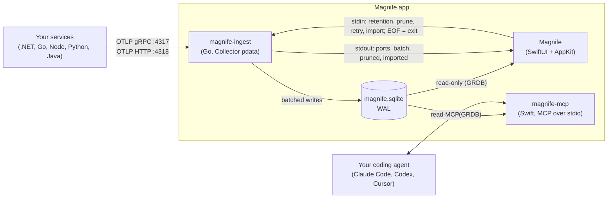

<div align="center">


# Magnife

**See your OpenTelemetry traces the moment your app sends them.**

A native macOS app that receives OTLP from what you run on your own Mac and shows traces and logs at once.
No Docker, no Jaeger, no vendor account.

[Why](#why) · [Features](#features) · [Install](#install) · [Quick start](#quick-start) · [How it works](#how-it-works) · [Engineering](#engineering-notes) · [Roadmap](#roadmap)


</div>

## Why

Seeing local telemetry usually means running Jaeger, Grafana or the Aspire dashboard in Docker, or a browser-based viewer. Magnife is the Proxyman idea for OpenTelemetry. It is one native app that starts listening on 4317 and 4318 when it opens. Point your service at it and the first trace shows up in seconds.

It is for backend and full-stack developers on a Mac who instrument with OpenTelemetry in .NET, Go, Node, Python or Java.

## Features

- **Built-in OTLP receiver** on `127.0.0.1:4317` (gRPC) and `:4318` (HTTP, protobuf and JSON). It listens as soon as the app opens. If another collector holds a port, Magnife says which process has it.
- **Live trace list**: service, route, duration, span count and status, newest first. It holds still while you scroll, and Pause freezes it.
- **Waterfall and span detail**: an AppKit outline that opens a 30,000-span trace in about 50 ms. Exceptions come first, with their stack traces, then attributes, events and the resource.
- **Logs correlated to traces**: a span's logs, a trace's logs, and a Logs view filtered by level and service.
- **⌘K search and filters**: `service:checkout-api status:error >50ms`, any attribute, saved filters in the sidebar.
- **Detectors that say what and where**: slow SQL, N+1 queries and failed HTTP calls. Each finding names the query or call, the service and the route it ran under.
- **Menu bar extra and notifications**: a recent-error count, the last failed traces, and a native notification when a trace fails.
- **Local persistence with retention**: SQLite in WAL mode. Stored traces are on screen in under a second after relaunch.
- **Share a trace as a file**: File > Export Trace… writes standard OTLP JSON Lines, and File > Import Traces… (or a drag and drop) opens it on a teammate's Mac.
- **Your coding agent reads your traces** *(new)*: a built-in MCP server lets Claude Code, Codex or Cursor list traces, open a span tree and find slow SQL, N+1 queries and failed calls, in the same words as the window. [Set it up](#use-it-from-your-coding-agent).

<table>
  <tr>
    <td width="50%"></td>
    <td width="50%"></td>
  </tr>
  <tr>
    <td align="center">N+1 detection, with the normalized statement</td>
    <td align="center">⌘K search: one query language for search and filters</td>
  </tr>
  <tr>
    <td width="50%"></td>
    <td width="50%"></td>
  </tr>
  <tr>
    <td align="center">Logs filtered by level and service</td>
    <td align="center">First run: copy the variables for your language</td>
  </tr>
</table>

## Install

Requires macOS 26 or later, on Apple silicon or Intel.

**One line** (downloads the latest release, checks its SHA-256, installs to `/Applications` and opens it):

```sh
curl -fsSL https://raw.githubusercontent.com/NsRF/Magnife/main/scripts/install.sh | bash
```

**Disk image**: download [**Magnife.dmg**](https://github.com/NsRF/Magnife/releases/latest/download/Magnife.dmg) from the [latest release](https://github.com/NsRF/Magnife/releases/latest), open it and drag Magnife to Applications.

Releases are signed with a Developer ID and notarized by Apple, so the app opens like any downloaded app.

**Updates**: from 0.1.3, Magnife updates itself through [Sparkle](https://sparkle-project.org). Choose **Magnife > Check for Updates…**, or say yes when it asks on the second launch whether to check automatically. The only network request Magnife makes is that check, to this repository's GitHub Releases, and it makes none until you choose one of those. To move from 0.1.2 or earlier, run the one-line install again.

To uninstall, quit Magnife and delete `/Applications/Magnife.app` and `~/Library/Application Support/Magnife`.

## Quick start

Requirements to build from source: macOS 26 or later, Xcode 27 (Swift 6.4) and Go 1.27 (`brew install go`). With an [installed release](#install), skip the build and point your service at it as below.

```sh
git clone https://github.com/NsRF/Magnife.git
cd Magnife
app/build.sh --open            # builds the Go helper and the app, installs ~/Applications/Magnife.app
scripts/send-sample-traces     # 5 sample traces from 3 services, over gRPC and HTTP
```

Then point your own service at it. These variables work for every OpenTelemetry SDK:

```sh
export OTEL_SERVICE_NAME=my-service
export OTEL_EXPORTER_OTLP_ENDPOINT=http://localhost:4318
export OTEL_EXPORTER_OTLP_PROTOCOL=http/protobuf    # or grpc with http://localhost:4317
```

| SDK | Notes | Tested live |
| --- | --- | --- |
| .NET | `AddOtlpExporter()` reads the variables. Its default is gRPC on 4317. | grpc, http/protobuf |
| Go | `otlptracehttp` / `otlptracegrpc` (and the log exporters) read the endpoint. | grpc, http/protobuf |
| Node | `@opentelemetry/sdk-node` exports traces and logs over OTLP by default. | grpc, http/protobuf, http/json |
| Python | Run under `opentelemetry-instrument`. The distro defaults to gRPC on 4317. | grpc, http/protobuf |
| Java | `-javaagent:opentelemetry-javaagent.jar` with the same variables. | documented |

The live checks are scripted in [`scripts/interop`](scripts/interop/README.md): 13 SDK and protocol combinations pass. Apps in Docker Desktop containers can use `http://host.docker.internal:4318`.

## Use it from your coding agent

Magnife ships an MCP server, `magnife-mcp`, so an agent that changes your code can look at what that code did at run time. It reads the same local database as the window, read-only, and works while Magnife is quit. It makes no network requests.

The quickest way: open **Settings > Agents** (or **Help > Connect a Coding Agent…**), pick your agent and click **Copy Command**. It has your copy's own path. By hand:

```sh
# Claude Code, for every project
claude mcp add --scope user magnife -- /Applications/Magnife.app/Contents/Helpers/magnife-mcp
# Codex
codex mcp add magnife -- /Applications/Magnife.app/Contents/Helpers/magnife-mcp
```

If the install script put Magnife in `~/Applications`, use that path. For Cursor, Claude Desktop or VS Code, add it to the client's MCP settings:

```json
{ "mcpServers": { "magnife": { "command": "/Applications/Magnife.app/Contents/Helpers/magnife-mcp" } } }
```

Then ask things like "what failed in my last request?" or "why is GET /orders slow?". The agent has seven read-only tools:

| Tool | What it gives the agent |
| --- | --- |
| `find_problems` | Every slow SQL query, N+1 query and failed HTTP call in the newest traces, with trace and span ids |
| `list_traces` | The newest traces, narrowed with the ⌘K query language (`status:error service:orders >200ms`) |
| `get_trace` | One trace's span tree, findings, error messages and exceptions |
| `get_span` | A span's attributes, events, stack traces, resource and logs |
| `search_logs` | Logs by trace, service, level or text |
| `list_services` | The services Magnife has seen |
| `compare_traces` | Two traces matched span by span: what got slower, what is new or missing, how many times each query ran |

The tools and their limits are in [docs/mcp.md](docs/mcp.md).

## How it works



Magnife is two programs that share one SQLite file, plus a third that only reads it:

- **[`ingest/`](ingest/README.md)**: a Go helper built on the OpenTelemetry Collector's `pdata` decoders. It receives OTLP, converts it to rows and writes them in batches. It is the **only writer**. Each committed batch is one JSON line on stdout, so the app refreshes exactly when there is something new.
- **[`app/`](app/)**: a SwiftUI app with AppKit where SwiftUI was too slow (the live lists and the waterfall). It starts the helper as a child process and opens the database **read-only**. The helper exits when its stdin closes, so it dies with the app, even after `kill -9`.
- **`magnife-mcp`**: the MCP server for coding agents, a small Swift program in `Contents/Helpers` built on the app's own reader, query parser and detectors (`app/Sources/MagnifeKit/MCP`).
- **[`docs/schema.sql`](docs/schema.sql)** is the contract between the two: tables, JSON columns and the line protocol. Tests on both sides read it, and the Go helper embeds a byte-identical copy.

More detail is in [ARCHITECTURE.md](ARCHITECTURE.md).

## Engineering notes

Measured numbers, all from the project log ([docs/PROGRESS.md](docs/PROGRESS.md)):

- **Ingest:** 5,000 spans/s for 60 s, 300,010 spans and 81,292 logs, none lost. The p99 from export to batch line was 142 ms.
- **Launch:** stored traces on screen in 470–543 ms with 12,000 to 300,000 spans in the store.
- **Big traces:** 30,000 spans open in 51–55 ms, auto-collapsed above 500 spans.
- **Search:** the slowest ⌘K keystroke over a 100,000-span store took 62–69 ms, against a 100 ms budget.

Security for a local listener:

- It binds loopback only, and HTTP answers only `localhost` Hosts and Origins, which defends against DNS rebinding.
- Bodies are capped at 32 MiB, with 4 decodes at once.
- Values nested deeper than 64 levels are refused before decoding.
- The database files are `0600` in a `0700` folder.

Tests:

- 349 Swift unit tests (Swift Testing) and the Go test suite.
- An in-app self-test with more than 560 end-to-end checks against the real helper (`app/tools/selftest.sh`).
- Light and dark snapshots of every page (`app/tools/snap.sh`), and the SDK interop matrix.
- Shared trace files are pinned by one golden file. The Swift exporter writes it byte for byte and the Go importer reads it back, so OTLP JSON cannot drift on either side.

It was built spec-first: [brief](docs/BRIEF.md) → [MVP spec](docs/MVP.md) → [32 user stories with acceptance tests](docs/STORIES.md) → [UX spec](docs/ux.md) → three architecture reviews ([M1](docs/architecture-review-2026-11-02.md), [M2](docs/architecture-review-2026-11-02-m2.md), [M3](docs/architecture-review-2026-11-02-m3.md)). Every decision and its reason is numbered in [PROGRESS.md](docs/PROGRESS.md#decisions).

### Known issues

- At a sustained 5,000 spans/s, switching between Traces and Logs takes 95–137 ms against a 100 ms budget (story S-030, tracked in [PROGRESS.md](docs/PROGRESS.md#blocked)).
- No Homebrew cask yet: it comes once the project has enough users for the official cask list ([docs/RELEASE.md](docs/RELEASE.md) B8).

## Testing

```sh
cd ingest && go test ./...                    # helper
cd app && swift test                          # MagnifeKit
app/tools/selftest.sh                         # end to end in the app; APP_SELFTEST_ONLY=sharing for one area
app/tools/snap.sh                             # every page, light and dark
scripts/interop/run-all.sh                    # real SDKs (needs Go, Node, .NET, Python)
```

## Project layout

```text
app/        SwiftUI app (Magnife) and its UI-free library (MagnifeKit), with tests and tools
ingest/     Go helper (magnife-ingest) and the sample sender
docs/       the contract (schema.sql), specs, stories, UX, reviews, release steps
scripts/    sample sender, local install, SDK interop apps
```

## Roadmap

- [x] v0.1: receiver, live list, waterfall, logs, search and filters, detectors, menu bar, retention
- [x] v0.2: export and import traces as files
- [x] v0.2: side-by-side comparison of two traces (Trace > Compare With…, ⇧⌘K)
- [ ] v0.2: metrics with charts
- [x] v0.3: an MCP server so coding agents can query local traces ([docs/mcp.md](docs/mcp.md))
- [ ] v0.3: AI agent view (calls, tools, tokens and cost for coding agents), and Settings > Agents to connect one in a click
- [ ] v0.4: forwarding to a remote backend (OTLP proxy)

## Contributing

Issues and pull requests are welcome. See [CONTRIBUTING.md](CONTRIBUTING.md) for the setup and the few rules the code depends on. Please follow the [code of conduct](CODE_OF_CONDUCT.md), and report security problems privately ([SECURITY.md](SECURITY.md)).

## License

[MIT](LICENSE) © Nasser Farhat
