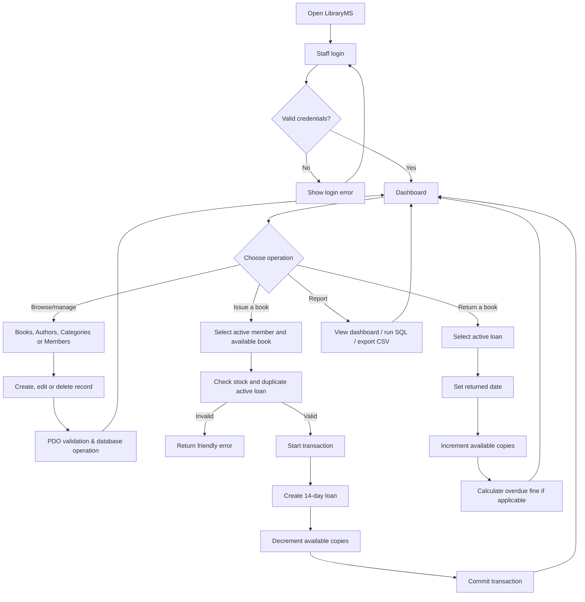

<div align="center">
  
  <h1>Library Management System</h1>
  <p><strong>LibraryMS — a complete, database-driven library operations system</strong></p>

  <a href="https://github.com/PHILTEC24/Library-system"></a>
  
  
  
</div>

## Overview

**LibraryMS** is a web-based library management application built for a database tools course project. It gives authorised library staff a practical interface for managing books, authors, categories, sub-categories, members, loans and returns.

The application uses **PHP 8 + PDO** for secure server-side operations and **MySQL/MariaDB** for relational data storage. Its schema enforces third normal form, foreign keys, unique constraints and referential integrity. The interface is responsive and uses **Bootstrap 5**, Bootstrap Icons, custom CSS and JavaScript for confirmation prompts, live table search and alert dismissal.

### Core capabilities

- Secure login and role-aware staff sessions
- Dashboard with live library statistics and overdue alerts
- CRUD management for books, authors, categories and members
- 14-day book issue workflow with availability and transaction checks
- Book return workflow with automatic overdue-day calculation
- Active-loan and overdue-loan tracking
- CSV exports for books, members and loans
- Responsive navigation and live client-side search
- PDO prepared statements and HTML output escaping

## Languages & technologies

| Area | Technology | Purpose |
|---|---|---|
| Backend | PHP 8.1+ | Authentication, validation, CRUD and transactions |
| Database | MySQL 8+ / MariaDB 10.4+ | Schema, constraints and seeded data |
| Database access | PDO | Prepared statements and safe parameter binding |
| Markup | HTML5 | Page structure and forms |
| Styling | CSS3, Bootstrap 5 | Responsive layout and components |
| Interaction | JavaScript, Bootstrap Icons | Live search, confirmations and alerts |
| Reporting | SQL, CSV | Analytical queries and downloadable exports |
| Diagramming | Mermaid | User-flow documentation |
| Local platform | XAMPP / Apache | Development and deployment environment |
| Source control | Git & GitHub | Collaboration and versioning |

## Interactive features

<details>
<summary><strong>Try the live-search experience</strong></summary>

Every searchable table has an automatic **Search** box. Enter a title, member name, ISBN or another visible value and matching rows are filtered instantly in the browser.

</details>

<details>
<summary><strong>Test transaction safeguards</strong></summary>

The issue and return workflows use database transactions. An unavailable book or duplicate active loan prevents the operation, and stock/count changes are committed only when the complete transaction succeeds.

</details>

<details>
<summary><strong>Export a report</strong></summary>

Open **Books**, **Members** or **Loans** and select **Export CSV**. The application generates a downloadable spreadsheet that can be opened in Excel or LibreOffice.

</details>

## How the system works



## Screenshots

| Dashboard | Books | Loans |
|---|---|---|
|  |  |  |

| Issue a book | Business rules |
|---|---|
|  |  |

## Project structure

```text
Library-system/
├── index.php                 # Entry router
├── README.md                 # Project documentation
├── LICENSE                   # MIT licence
├── assets/
│   ├── css/style.css         # Custom responsive styling
│   └── js/main.js            # Live search, confirmations and alerts
├── auth/
│   ├── login.php             # Staff login
│   └── logout.php            # Session logout
├── authors/                  # Author CRUD
├── books/                    # Book CRUD and CSV export
├── categories/               # Category CRUD
├── config/
│   └── database.php          # PDO database connection
├── dashboard/
│   └── index.php             # Statistics and overdue information
├── database/
│   ├── library_db.sql        # Schema and complete seed data
│   ├── queries.sql           # Loan, overdue and aggregate reports
│   ├── logo.png              # Project logo
│   └── erd.png               # Entity relationship diagram
├── docs/
│   ├── report.html           # HTML project report
│   ├── report.pdf            # PDF project report
│   └── screenshots/          # Application screenshots
├── includes/
│   ├── auth_check.php        # Protected-route session guard
│   ├── footer.php            # Shared footer and scripts
│   ├── functions.php         # Escaping, flash and helper functions
│   ├── header.php            # Shared page head
│   └── navbar.php            # Shared navigation
├── loans/                    # Issue, return, list and export loans
└── members/                  # Member CRUD and CSV export
```

## Installation

### Requirements

- XAMPP or another Apache/PHP/MySQL environment
- PHP 8.1 or newer
- MySQL 8.0+ or MariaDB 10.4+
- A modern web browser

### 1. Install XAMPP

Download XAMPP from <https://www.apachefriends.org>, install it and start **Apache** and **MySQL** from the XAMPP Control Panel.

### 2. Place the project

Clone or download the repository into the Apache web root:

```powershell
cd C:\xampp\htdocs
git clone https://github.com/PHILTEC24/Library-system.git library-system
```

The application entry point should be:

```text
C:\xampp\htdocs\library-system\index.php
```

If cloned under another folder name, update `BASE_URL` in PHP entry files or use `library-system` as shown below.

### 3. Import the database

Open <http://localhost/phpmyadmin>, select **Import**, choose:

```text
C:\xampp\htdocs\library-system\database\library_db.sql
```

and click **Import**. The SQL script creates `library_db`, tables, relationships, constraints and sample records.

### 4. Configure the connection

Check [config/database.php](config/database.php). The default XAMPP credentials are:

```php
$host = 'localhost';
$db   = 'library_db';
$user = 'root';
$pass = '';
```

Update these values only if your MySQL root account or server differs.

### 5. Start LibraryMS

Visit <http://localhost/library-system>. Use one of the seeded accounts:

| Username | Password | Role |
|---|---|---|
| `admin` | `password` | Administrator |
| `librarian` | `password` | Librarian |

> Change or remove demo credentials before using the application in production.

## Database design

<p align="center">
  
</p>

The database separates authors, categories and sub-categories from books, while a `book_authors` table supports primary authors, co-authors, editors and translators. Members and staff users create loan records for individual books. `ON DELETE` constraints and application checks protect important historical and inventory relationships.

## Business rules

- Members must be active before borrowing.
- A member cannot have two active loans for the same book.
- A book cannot be issued when `available_copies` is zero.
- Loans receive an automatic 14-day due date.
- Issue and return operations use database transactions.
- Overdue returns calculate a fine of $0.50 per overdue day.
- Records linked to active loans or other records are protected from unsafe deletion.

## Useful SQL

Additional reporting queries are available in [database/queries.sql](database/queries.sql), including:

- Currently borrowed books
- Overdue loans and days overdue
- Loans per category
- Available copies against borrowed copies
- Members with the most loans
- Books that have never been borrowed

## Team & attribution

**Project lead:** **EGABO AARON**

The supplied team register contains the following twelve names and registration numbers:

| # | Member | Registration number |
|---:|---|---:|
| 1 | EGABO AARON — **Group Lead** | 258-154 |
| 2 | ALIMPA ANNE HILLARY | 269-896 |
| 3 | KABAJUNGU RITAH | 267-640 |
| 4 | KIRABO ALICE | 274-961 |
| 5 | MUAWIA MOHAMED | 229-449 |
| 6 | IBRAHIM ISHAG | — |
| 7 | NATOZO PATIENCE | 258-901 |
| 8 | MARTHA | — |
| 9 | NIWASIIMA ASHELYCOLE | 275-353 |
| 10 | ONYANGO JOHN STEVEN | 270-472 |
| 11 | RWOTHOMIO EVANS, E. | 275-372 |
| 12 | TUSABEGE PHILBERT | 272-210 |

## Security

- PDO prepared statements prevent SQL injection
- Passwords are stored with PHP `password_hash()` and checked with `password_verify()`
- Output is escaped with `htmlspecialchars()` through the shared `e()` helper
- Protected pages check the staff session
- Successful login regenerates the PHP session ID
- Database availability and duplicate-loan rules are checked again during transactions

## License

This project is licensed under the **MIT License**. See [LICENSE](LICENSE) for the full text.

Copyright (c) 2026 EGABO AARON and contributors.
