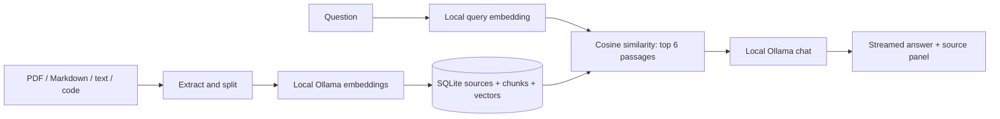

# LocalLens


[](https://github.com/PersiOnOff/locallens/actions/workflows/ci.yml)
[](LICENSE)
[](src/SelfHostedAi.Api/SelfHostedAi.Api.csproj)
[](client/package.json)

**Ask your private documents. Follow the evidence. Keep inference on your machine.**

A self-hosted workspace for PDFs, notes, documentation and source code, built with
ASP.NET Core, React, SQLite and local Ollama models. No cloud provider or telemetry
is configured. Initial model and image downloads require internet.

[Quick start](#start-in-one-command) · [See it in action](#a-question-a-source-a-little-more-context) · [Limits](#supported-inputs-and-limits) · [Contribute](CONTRIBUTING.md)

## Start in one command

Install Docker with Compose v2. Clone this repository, enter its directory and run:

```sh
git clone https://github.com/PersiOnOff/locallens.git
cd locallens
docker compose up --build
```

Open **http://localhost:8080**. Add a document, wait for indexing, and ask a question.

On first launch, the `models` service downloads `qwen2.5:3b` and `nomic-embed-text`. The interface can open while models are downloading; it shows their readiness. Wait for both downloads before uploading a large library. Follow progress with:

```sh
docker compose logs -f models
```

The first launch requires internet for packages, container images and model weights. With those cached, document indexing and chat use local services. CPU mode works by default. Allow roughly **8 GB of available RAM and 10 GB of free disk space** as a starting budget; actual usage depends on models, context and library size. GPU acceleration is optional and is not enabled by this Compose file.

### Try the sample

Choose **Connect a local repository**, leave the path as `.` and import. The default read-only mount contains the fictional documents in `samples/`. After indexing, ask:

> How long do customers have to request a refund, and what are the exceptions?

Open a source chip below the answer to inspect its passage. Switch to **File connections** to see the link from `welcome.md` to `policy.md`.

## A question, a source, a little more context


_An edited walkthrough captured from the running application using fictional
sample documents and real local Ollama models. Keyframe timing is for readability,
not an inference-speed benchmark._

### Two sides of the same workspace

| Light — paper and sage                                                        | Dark — graphite and soft green                                                     |
| ----------------------------------------------------------------------------- | ---------------------------------------------------------------------------------- |
|  |  |

The theme switch stays in the header, and your choice stays in this browser.

<details>
<summary>Explore the welcome screen, source preview and file graph</summary>

| A place to begin                                      | Follow the connections                                                                    |
| ----------------------------------------------------- | ----------------------------------------------------------------------------------------- |
|  |  |


</details>

## What you can do

- **Documents first.** Upload PDFs, Markdown and UTF-8 text, then ask questions across the library or selected files.
- **Evidence within reach.** Inspect retrieved passages with PDF page numbers or text line ranges. Code blocks have syntax highlighting.
- **Two quiet themes.** Paper and sage by day, deep graphite and soft green at night, including code blocks and the graph.
- **Local inference.** Embeddings and answers run through Ollama. No cloud provider or telemetry is configured.
- **Explore connections.** Import a local folder and browse a graph of resolved relative imports and Markdown links.
- **Persistent and inspectable.** SQLite stores sources, chunks and vectors; model weights live in a separate Docker volume. Interrupted indexing resumes after restart.

## Configuration

Defaults work without an `.env` file. Copy `.env.example` to `.env` to customize:

| Variable            | Default            | Purpose                                              |
| ------------------- | ------------------ | ---------------------------------------------------- |
| `PORT`              | `8080`             | Localhost web port                                   |
| `CHAT_MODEL`        | `qwen2.5:3b`       | Local Ollama chat model                              |
| `EMBEDDING_MODEL`   | `nomic-embed-text` | Local Ollama embedding model                         |
| `REPOSITORIES_PATH` | `./samples`        | Existing folder mounted read-only as the import root |

Use forward slashes for Windows host paths, for example `D:/Projects/MyRepository`. The import dialog takes a **relative** directory inside this root, not a host absolute path. `.` imports the root. Imports are snapshots: existing paths are skipped on repeat import; delete and reimport changed files to refresh their content. **Reindex** regenerates embeddings from the stored snapshot.

After changing models, run `docker compose up --build` again to download them. Existing documents whose embedding-model name differs are marked for reindexing and excluded from retrieval. Reindex them in their source preview. If you replace model weights under the same tag, manually reindex the entire library; model digests are not tracked.

### Persistence and stopping

```sh
docker compose down
```

This preserves named `knowledge` and `models` volumes. Document deletion removes that source and its chunks from SQLite. Existing answer transcripts in an open browser session can still contain retrieved excerpts until you start a new conversation. Chat history is held only in browser memory.

Back up the `knowledge` volume while the app is stopped. It contains extracted source text and embeddings, not original PDF binaries. Volume deletion permanently removes its data; routine `down` does not delete volumes.

## How it works



Text is split into overlapping chunks (1,400 characters, 200-character overlap). PDF chunks retain their page number. Nomic embedding requests distinguish document and query prefixes. Retrieval uses exact cosine search, keeping only the best candidates in memory. Source lists poll metadata without loading document content. Six retrieved excerpts ground each answer; the model receives a bounded recent conversation history.

Citations are model-generated pointers to retrieved excerpts, **not a guarantee that every claim is supported**. Retrieval similarity is not confidence. Inspect the evidence when accuracy matters. Documents are treated as untrusted context; models can still be vulnerable to misleading content or prompt injection. LocalLens does not execute document instructions, tools or source code.

## Supported inputs and limits

| Input           | Behavior                                                                                                   |
| --------------- | ---------------------------------------------------------------------------------------------------------- |
| PDF             | Extractable text, page references; no OCR or image/table interpretation                                    |
| Markdown / text | UTF-8; line references; Markdown links contribute graph edges                                              |
| Source files    | C#, TS/JS/React, Python, Java, Go, Rust, HTML/CSS, SQL, shell, JSON/YAML/XML, csproj                       |
| File graph      | Relative `from`, `import`, `require` and Markdown links; conservative heuristic, not a full compiler graph |

Initial single-user limits: **20 MB/file**, **300,000 extracted characters/file**, **500 PDF pages**, **300 chunks/file**, **500 sources/library**, **2,000 candidate files/import**. One indexing worker and one concurrent chat request keep local load bounded. Exact SQLite vector search is intended for small personal libraries; large corpora need a dedicated vector index. Questions are limited to 4,000 characters. Request timeout is five minutes.

Scanned PDFs must be OCR-processed before uploading. Password-protected or invalid PDFs fail with an actionable message. Images, binary files, archives, remote URL ingestion, remote Git cloning and autonomous code execution are out of scope. Import scanning skips symlinks, dotfiles, VCS/build/dependency folders, lock files and common secret/credential filenames. **This is not a secret detector**: review the mounted folder before importing. Configuration files may contain sensitive data.

## Privacy and deployment

The default deployment binds the web port to `127.0.0.1`; Ollama is not exposed to the host. Ollama cloud features are disabled. Use local model names, not cloud model tags. The application container runs as a non-root user with capabilities dropped. Cross-origin browser writes are rejected, and remote Markdown images are not loaded.

This is a **single-user local tool without authentication**. Do not publish its port on a public interface. Use an authenticated reverse proxy and an appropriate deployment design before providing remote access. The app trusts the configured Ollama URL: a remote endpoint receives your question and retrieved content. The SQLite volume is not encrypted by the app; protect it using host filesystem permissions and disk encryption.

## Local development

Requirements: .NET 10 SDK, Node.js 24, Python 3.12+ for integration tests, and local Ollama for real inference.

```sh
ollama pull qwen2.5:3b
ollama pull nomic-embed-text
dotnet run --project src/SelfHostedAi.Api
```

In a second terminal:

```sh
cd client
npm ci
npm run dev
```

Open http://localhost:5173. Vite proxies `/api` to http://127.0.0.1:5080. Production serves the built React client from ASP.NET Core, as packaged in the Dockerfile. API settings live under `Lens` in `appsettings.json`; override using environment variables such as `Lens__RepositoryRoot`, `Lens__DataDirectory`, `Lens__OllamaUrl`, `Lens__ChatModel`, `Lens__EmbeddingModel`. Configure the repository root to use local imports.

### Checks

```sh
dotnet build SelfHostedAi.slnx
dotnet run --project tests/LocalLens.Tests
python tests/smoke.py
npm --prefix client ci
npm --prefix client test
npm --prefix client run lint
npm --prefix client run build
docker compose config --quiet
```

The console suite tests chunk coverage, overlap, vectors, path confinement, SQLite persistence and model isolation. The Python integration suite starts the real API and SQLite against a deterministic local Ollama **protocol fixture**; it verifies upload, indexing, streaming, citations, graph, provider failure, retry and deletion. Fixture tests do not measure model quality. With Compose and both models ready, run `python tests/real_smoke.py` for a real-model check using the fictional refund policy; it leaves that sample in your library. GitHub Actions runs these checks and builds the production container.

## Troubleshooting

- **Waiting for Ollama / missing models:** inspect `docker compose logs models ollama`. Model downloads may take several minutes. Retry the initializer with `docker compose up models` if downloads failed.
- **Indexing failed:** verify the embedding model is installed, then open the document and choose Reindex.
- **Slow CPU response:** use a smaller local chat model, shorten the question or select fewer documents. Verify that Docker has enough available memory.
- **No matching sources:** wait for indexing, clear document filters, and reindex sources after changing the embedding model.
- **Repository folder unavailable:** set `REPOSITORIES_PATH` to an existing readable directory and recreate the app container.
- **Upload rejected:** check UTF-8 encoding, size/character limits and extractable PDF text.
- **Public host name rejected:** the default allowed hosts are localhost and loopback addresses. Remote deployment requires explicit host configuration as well as authentication and TLS.

## Contributing

Small, focused contributions are welcome. Start with [CONTRIBUTING.md](CONTRIBUTING.md),
report a problem using the [bug form](https://github.com/PersiOnOff/locallens/issues/new/choose),
or suggest a concrete improvement. Please use fictional documents in public reports.

See the [changelog](CHANGELOG.md) for the initial feature set and its boundaries.

## License

MIT. See [LICENSE](LICENSE). Model weights and dependencies retain their own licenses.
