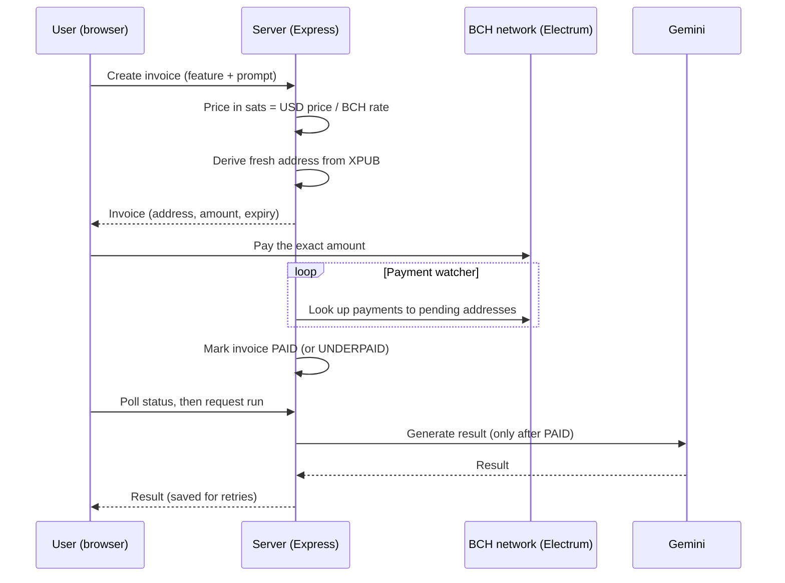

# BCH Blaze AI

**Pay-per-request AI, paid for with Bitcoin Cash.** No subscription, no card, no minimum spend: pay a few cents in BCH for one AI result.

> Built for **BCH BLAZE 2026** (DoraHacks) · Mainnet Track · solo project

**🚀 Live Demo:** [BCH Blaze AI](https://bch-blaze-client.onrender.com/)

**📊 Project Presentation:** [View Presentation](https://docs.google.com/presentation/d/1WIeqcOh9E5GoQmr7C5Cx34vciwGmKZGqSYi5gd3Bv40/edit?slide=id.p1#slide=id.p1)

> ⚠️ **Mainnet notice.** The production configuration uses real Bitcoin Cash. Transactions are irreversible. Every paid request costs a few US cents of real BCH.

---

## Table of contents

1. [What it does](#what-it-does)
2. [Try it in 2 minutes](#try-it-in-2-minutes)
3. [How a payment works](#how-a-payment-works)
4. [Features](#features)
5. [Public HTTP 402 API (for scripts and agents)](#public-http-402-api-for-scripts-and-agents)
6. [Architecture](#architecture)
7. [API overview](#api-overview)
8. [Technology](#technology)
9. [Repository layout](#repository-layout)
10. [Local development](#local-development)
11. [Environment variables](#environment-variables)
12. [Deployment](#deployment)
13. [Security and privacy notes](#security-and-privacy-notes)
14. [Known limitations](#known-limitations)

---

## What it does

BCH Blaze AI sells small AI tasks one request at a time. Bitcoin Cash fees are tiny, so a payment of two or three cents is practical, which is what makes true pay-per-use possible.

Two AI features are available:

| Feature          | What you get                            | Price |
| ---------------- | --------------------------------------- | ----- |
| `market-insight` | A short analysis of a topic you provide | $0.03 |
| `prompt-suggest` | Five improved versions of your prompt   | $0.02 |

Prices are configured in US cents and converted to satoshis at request time using the current BCH/USD rate.

> The market-insight prompt tells the model that it has **no live market data** and must not present current prices or statistics as facts. Output is informational text, **not financial advice**.

## Try it in 2 minutes

1. Open the live demo and sign in. The login page has **Demo login** buttons (User and Admin) that fill in the demo credentials for you. You can also register, or use Google or GitHub.
2. Go to **Dashboard → Market insight**, choose a feature and type a prompt.
3. Press **Pay**. The app creates an invoice with a unique BCH address, an exact amount and a 15-minute timer.
4. Pay in one of two ways:
   - **Connect a wallet** with WizardConnect (scan the QR code with a compatible wallet and approve the transaction), or
   - **Pay manually** from any BCH wallet by scanning the invoice QR code or copying the address.
5. When the payment is detected, the AI result appears and is saved to your history.

Supported wallets shown in the app: **Electron Cash, Selene Wallet, Bitcoin.com Wallet**.

## How a payment works



Key properties:

- **Fresh address per invoice.** The server derives addresses from an extended public key (XPUB). It never holds the receiving wallet's private key.
- **Server-side verification.** A background watcher checks pending invoice addresses on the BCH network. The browser's claim that it paid is never trusted.
- **Fast detection.** The watcher marks an invoice paid when a transaction paying at least the invoice amount appears for its address. It does not wait for a block confirmation, which suits micro-payments.
- **Underpayment is handled.** A payment below the invoice amount marks the invoice `UNDERPAID` instead of unlocking the AI.
- **AI runs only after payment.** An unpaid or expired invoice cannot run.
- **No double charge.** A paid invoice stores its result; retrying returns the saved result.
- **Expiry and limits.** Invoices expire after 15 minutes. Each user can have at most 5 pending invoices.

## Features

**Payments**

- Mainnet BCH invoices with QR code, countdown and live status.
- **WizardConnect** wallet connection: the wallet shares public keys only, and signs transactions on request.
- **Quick pay:** approve a funding amount once, then run several requests without another wallet prompt. A separate session wallet is kept in the browser, and unused funds can be returned to your refund address.

**Product**

- Email/password sign-in, Google and GitHub sign-in, and password reset by email OTP.
- Usage summary and request history per user.
- Public pricing endpoint and an animated "How it works" page (`/blaze`).

**Admin**

- User management and invoice list.
- Usage statistics and analytics charts.
- First-party activity analytics: online visitors, events, pages, sessions, users, visitors and IP addresses.

**Agent-friendly**

- An account-free HTTP `402 Payment Required` endpoint that returns payment instructions to scripts and AI agents.

## Public HTTP 402 API (for scripts and agents)

No account is needed. Send a prompt without an invoice ID:

```http
POST /api/v1/insight
Content-Type: application/json

{"input":"What are the risks and drivers for Bitcoin Cash?"}
```

The server answers `402 Payment Required` with payment instructions, including `invoiceId`, `payTo`, `amountSats`, `amountBch` and `expiresAt`. Pay the exact amount, then call the same endpoint with the invoice ID:

```http
POST /api/v1/insight
X-Invoice-Id: <invoiceId>
```

While payment is pending the endpoint keeps returning the payment status. After payment it returns the AI result. This endpoint currently creates `market-insight` invoices.

Rate limits apply: 5 new invoices per 10 minutes and 60 status polls per minute per client.

## Architecture

| Component           | Responsibility                                                                             |
| ------------------- | ------------------------------------------------------------------------------------------ |
| `client/` (Next.js) | Public pages, auth UI, user dashboard, wallet payments, admin dashboard                    |
| `server/` (Express) | Auth, invoices, pricing, payment watcher, Gemini calls, usage, admin, activity tracking    |
| PostgreSQL (Prisma) | Users, invoices, usage results, auth records, activity sessions and events                 |
| Redis (optional)    | Queue for activity tracking. Without `REDIS_URL`, tracking writes directly to the database |
| BCH network         | Payment detection via Electrum-compatible servers                                          |
| Gemini API          | Generates the AI result after payment is confirmed                                         |
| Other services      | BCH/USD price API, email delivery, OAuth providers                                         |

Background workers in the server: **payment watcher** (polls pending invoices; faster while invoices are pending, slower when idle), **invoice sweeper** (expires old invoices) and **tracking worker** (processes queued activity events).

## API overview

All endpoints are under `/api/v1` unless noted.

| Endpoint                           | Auth   | Purpose                                               |
| ---------------------------------- | ------ | ----------------------------------------------------- |
| `GET /pricing`                     | Public | Feature prices                                        |
| `POST /insight`                    | Public | Account-free 402 invoice flow                         |
| `POST /invoices`                   | User   | Create an invoice                                     |
| `GET /invoices/:id`                | User   | Invoice and payment status                            |
| `POST /invoices/:id/run`           | User   | Run (or retry) a paid invoice                         |
| `GET /usage`, `GET /usage/summary` | User   | Usage history and totals                              |
| `/admin/*`                         | Admin  | Users, invoices, stats, analytics                     |
| `POST /track`                      | Public | Ingest browser activity events                        |
| `GET /track/*`                     | Admin  | Online, events, pages, sessions, visitors, users, IPs |
| `/api/auth/*` (no `/v1`)           | Mixed  | Better Auth: sessions and social sign-in              |

## Technology

- **Frontend:** Next.js 16, React 19, TypeScript, Tailwind CSS, WizardConnect, libauth, Axios, Socket.IO client
- **Backend:** Node.js 22, Express 5, TypeScript, Prisma 7, PostgreSQL, Better Auth, Zod, optional Redis and BullMQ
- **AI:** Google Gemini through `@google/genai`
- **Payments:** Bitcoin Cash mainnet, address derivation from an XPUB, wallet signing through WizardConnect, Electrum-compatible servers
- **Deployment:** Docker images, Render Blueprint, GitHub Actions build checks

## Repository layout

```text
client/                     Next.js frontend
  src/app/                  Routes: (public), (user)/dashboard, (admin)/admin-dashboard
  src/features/             auth, invoices, wizard (wallet), usage, pricing,
                            tracking-post, admin_dashboard, Blaze
server/                     Express API
  prisma/                   Prisma schema files and migrations
  src/app/modules/          auth, invoice, public-api, pricing, usage, ai,
                            chain, admin, tracking
  src/workers/              paymentWatcher, invoiceSweeper, tracking worker
  docs/                     Architecture and BCH environment notes
render.yaml                 Render Blueprint (frontend and backend)
.github/workflows/cicd.yml  Build checks
RENDER_DEPLOYMENT.md        Render variable map
DOCKER_DEPLOYMENT.md        Manual Docker build and run
```

## Local development

**Requirements:** Node.js 22, pnpm, a PostgreSQL database. Redis is optional.

**Backend**

```bash
cd server
pnpm install --frozen-lockfile
pnpm generate
pnpm migrate          # prisma migrate dev
pnpm dev
```

**Frontend** (in another terminal)

```bash
cd client
pnpm install --frozen-lockfile
pnpm dev
```

Open `http://localhost:3000`.

**Testing without real money:** set `BCH_NETWORK=testnet`. With `CHAIN_MODE=mock` (never allowed in production) the backend exposes development routes that simulate payments.

## Environment variables

Create local `.env` files and never commit them. The server validates its required variables at startup (see `server/src/app/config/env.ts`).

**Server (required)**

| Group        | Variables                                                                                                 |
| ------------ | --------------------------------------------------------------------------------------------------------- |
| Core         | `NODE_ENV`, `PORT`, `DATABASE_URL`, `FRONTEND_ORIGIN`, `CHAIN_MODE` (`real` or `mock`)                    |
| Tokens       | `ACCESS_TOKEN_SECRET`, `REFRESH_TOKEN_SECRET`, `ACCESS_TOKEN_EXPIRES_IN`, `REFRESH_TOKEN_EXPIRES_IN`      |
| Better Auth  | `BETTER_AUTH_SECRET`, `BETTER_AUTH_URL`                                                                   |
| OAuth        | `GOOGLE_CLIENT_ID`, `GOOGLE_CLIENT_SECRET`, `GITHUB_CLIENT_ID`, `GITHUB_CLIENT_SECRET`                    |
| Bitcoin Cash | `BCH_NETWORK` (`mainnet` or `testnet`), `BCH_XPUB`, `CHAIN_API_URL`, `PRICE_API_URL`, `BCH_CHECK_ADDRESS` |
| AI           | `AI_PROVIDER`, `GEMINI_API_KEY`, `GEMINI_MODEL`                                                           |
| Email        | `SMTP_HOST`, `SMTP_PORT`, `SMTP_USER`, `SMTP_PASS`, `SMTP_FROM`, `BREVO_API_KEY`, `MAIL_FROM`             |

**Server (optional):** `REDIS_URL`

**Client:** `NEXT_PUBLIC_API_BASE_URL` (backend URL ending in `/api/v1`), `NEXT_PUBLIC_ELECTRUM_WS_URL`, `NEXT_PUBLIC_BACKEND_URL`, `BASE_URL` (server-side backend address).

Never put a secret in a `NEXT_PUBLIC_` variable. Next.js embeds those values in browser code at build time.

## Deployment

`render.yaml` defines two Docker web services: `bch-blaze-server` and `bch-blaze-client`. It does not create PostgreSQL or Redis, so connect your own. It selects `CHAIN_MODE=real` and `BCH_NETWORK=mainnet`.

1. Create a Render Blueprint from the repository and fill in the `sync: false` variables.
2. Apply database migrations before serving traffic (they do not run automatically):
   ```bash
   cd server
   pnpm exec prisma migrate deploy
   ```
3. Set `NEXT_PUBLIC_API_BASE_URL` before the client build, because it is embedded at build time.
4. Set `FRONTEND_ORIGIN` and `BETTER_AUTH_URL` on the backend to the deployed origins, and configure OAuth callback URLs.
5. Verify payment, email, AI and tracking flows, then share the **frontend** URL.

Free Render services sleep when idle, so the first request after inactivity can be slow. See `RENDER_DEPLOYMENT.md` and `DOCKER_DEPLOYMENT.md` for details.

## Security and privacy notes

- **Receiving wallet is protected.** Only an XPUB is on the server, so a server breach cannot spend the receiving funds.
- **Quick-pay session wallet.** Its private key is stored in the browser's `localStorage` and never sent to the backend. Only fund it with an amount you are comfortable keeping in that browser, and use the withdraw action before clearing browser data.
- **Rate limiting** protects login, registration, invoice creation and the public API.
- **Activity analytics** can record visitor and session IDs, paths, timestamps, device details and IP-derived location, and admins can see IP addresses. Review the data collection and retention policy before a public launch.
- **Demo accounts** are for evaluation only. Use strong, unique credentials and remove demo logins for any real deployment.

## Known limitations

- Payments are detected without waiting for a block confirmation. This is fast, but a double-spend before confirmation is theoretically possible, so this design suits micro-payments only.
- Only two AI features are available, and the public 402 API serves `market-insight` only.
- The AI has no live market data. Output is informational and not financial advice.
- The CI workflow builds and type-checks; there is no automated test suite yet.
