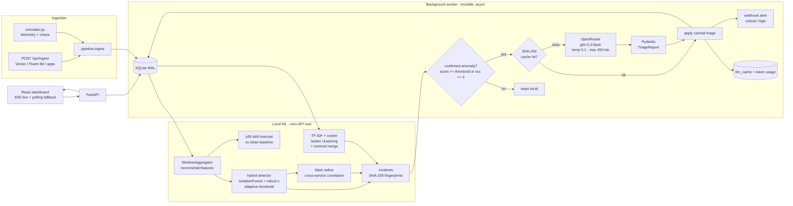

# TraceForge

[](https://github.com/Rusty-Hope/traceforge/actions/workflows/ci.yml)
[](https://github.com/Rusty-Hope/traceforge/actions/workflows/docker.yml)
[](https://github.com/Rusty-Hope/traceforge/releases)
[](https://github.com/Rusty-Hope/traceforge/pkgs/container/traceforge)
[](LICENSE)
[](requirements.txt)
[](frontend/package.json)

**Hybrid ML & background-LLM telemetry / incident-triage engine. Local-first, single-binary, zero-cost hot path.**

TraceForge ingests telemetry (synthetic chaos or your real services), detects anomalies and clusters noisy stack traces into canonical incident fingerprints with **local scikit-learn models**, and only then — on confirmed, deduplicated anomalies — lets a **background LLM worker** produce structured root-cause triage via OpenRouter. It also forecasts p95 drift, correlates blast radius across services, fires webhook alerts, and exports post-mortems.

## Dashboard

| Live Telemetry & Incident Triage Feed | Incident Detail, Blast Radius & LLM Triage |
|---|---|
|  |  |

## Design principles

1. **Zero chatbot UI.** The LLM never appears in the interface. No prompt box, no assistant panel — it is an invisible asynchronous worker writing validated JSON into SQLite. The dashboard treats its output as native telemetry metadata.
2. **No generic AI aesthetics.** High-density, monochrome, industrial: zinc tones, 1px borders, monospace metrics. No gradients, no glow, no sparkle icons.
3. **Real ML first, LLM second.** 100% of the hot path (ingestion, windowing, anomaly detection, clustering) runs locally at zero API cost. OpenRouter is called only for clusters that are statistically confirmed *and* not already in the dedup cache.

## Architecture



## Pipeline

| Stage | Where | Cost |
|---|---|---|
| Telemetry stream + chaos scenarios (latency spike, memory leak, DB pool exhaustion, cascade) | `backend/simulator.py` | free |
| External ingestion — JSON batch from Vector / Fluent Bit / your apps, optional token auth | `POST /api/ingest` | free |
| Incremental sliding-window features per service (error rate, p95/mean latency, token entropy, rps, status mix) | `WindowAggregator` | free |
| Hybrid anomaly detection — IsolationForest + per-feature robust z (median/MAD), adaptive threshold | `AnomalyDetector` | free |
| p95 drift forecast — risk vs clean baseline, pushed over SSE | `pipeline` | free |
| Blast radius — cross-service error-rate correlation (Pearson) | `pipeline` | free |
| Log fingerprinting — template normalization → TF-IDF → cosine leader clustering → SHA-256, near-duplicate merge on refit | `LogClusterer` | free |
| Eligibility gate (score ≥ threshold or recurring cluster ≥ 3 occurrences) | `backend/llm_triage.py` | free |
| SHA-256 dedup cache lookup + token accounting | `llm_triage.py` + `llm_cache` | free |
| Structured triage (severity, root cause, remediation, patch snippet) | OpenRouter, JSON mode, temp 0.1 | ~1 call per new fingerprint |
| Webhook alert (Slack/Telegram-compatible) on high/critical triage | `llm_triage._dispatch_alert` | free |
| Markdown post-mortem: ML evidence + blast radius + LLM analysis + human feedback + notes | `backend/reporting.py` | free |
| Retention — raw events pruned after N hours; windows/incidents kept forever | `pipeline.prune_old_events` | free |

## Quickstart

### Prebuilt container (GitHub Packages / GHCR)

```bash
docker run --rm -p 8000:8000 \
  -e OPENROUTER_API_KEY="${OPENROUTER_API_KEY:-}" \
  -v traceforge-data:/data \
  ghcr.io/rusty-hope/traceforge:latest
# dashboard + API → http://localhost:8000
```

### Docker Compose (full stack)

```bash
cp .env.example .env    # paste OPENROUTER_API_KEY, or leave empty for ML-only mode
docker compose up --build
# web (nginx)  → http://localhost:5173
# api (uvicorn) → http://localhost:8000/docs
```

### Local

```bash
cp .env.example .env
make install            # venv + deps
make api                # terminal 1 — API + background simulator + triage worker
make web-dev            # terminal 2 — Vite dev server (proxies /api), or: make web-build to serve the UI from the API itself
```

### Without spending a single token

```bash
make mock-llm           # OpenRouter-compatible mock + webhook receiver on :9938
# then:
OPENROUTER_BASE_URL=http://127.0.0.1:9938/v1 \
OPENROUTER_API_KEY=mock \
ALERT_WEBHOOK_URL=http://127.0.0.1:9938/alerts \
make api
# watch alerts fire:  curl localhost:9938/alerts
```

### Tests

```bash
make test               # 35 tests: ML units, pipeline idempotency & cluster merges,
                        # blast radius, LLM cache & schema contracts, FastAPI endpoints
```

### Offline ML-only demo

```bash
make simulate           # 240 ticks, DB pool exhaustion @80, latency spike @150 — pure local ML, no server
```

## Demo flow

1. Open the dashboard — detectors warm up, then `IFOREST 7/7` and `SSE LIVE` go green.
2. **CHAOS INJECTION** → `cascade_failure` → **INJECT INCIDENT** (fast-forward on). Hundreds of synthetic events materialize instantly; flagged windows light up red on the chart.
3. The triage feed deduplicates hundreds of raw errors into canonical incidents; within seconds the background worker attaches structured triage — severity, root-cause component, remediation steps, patch snippet — and fires the webhook.
4. Click an incident: ML evidence, blast-radius correlation, raw samples. Confirm or reject the LLM verdict (human feedback loop), resolve it, add resolution notes.
5. **POST-MORTEM .MD** exports everything: detection, blast radius, triage, feedback, notes.
6. Keyboard: `j` / `k` navigate the feed, `esc` closes the panel. Incidents are deep-linkable: `/?incident=8`.

## Feeding real telemetry

```bash
curl -X POST localhost:8000/api/ingest -H 'content-type: application/json' -d '[
  {"service": "checkout", "level": "ERROR", "status_code": 500, "latency_ms": 812,
   "message": "psycopg2.OperationalError: connection pool exhausted, timeout: 30000 ms"}
]'
```

Set `INGEST_TOKEN` to require an `X-Ingest-Token` header. The same pipeline (clustering, detection, triage) runs on external events — the simulator is just another producer.

## Configuration

All settings live in `.env` (see `.env.example`). Highlights:

| Variable | Default | Purpose |
|---|---|---|
| `OPENROUTER_API_KEY` | — | empty key = local-ML-only mode (incidents marked `disabled`) |
| `LLM_MODEL` | `z-ai/glm-5.3-flash` | any OpenRouter model |
| `LLM_TEMPERATURE` / `LLM_MAX_TOKENS` | `0.1` / `450` | deterministic, bounded triage output |
| `WINDOW_SIZE_S` | `15` | sliding feature window |
| `ANOMALY_THRESHOLD` | `0.62` | static floor; rises adaptively per service (99.5th pct of clean scores) |
| `CLUSTER_SIMILARITY` | `0.60` | cosine threshold for joining a fingerprint |
| `TRIAGE_MIN_OCCURRENCES` | `3` | recurring-cluster eligibility |
| `TRIAGE_INTERVAL_S` / `TRIAGE_BATCH` | `4` / `2` | worker cadence + rate discipline |
| `RETENTION_HOURS` | `24` | raw-event pruning (windows/incidents are kept) |
| `INGEST_TOKEN` | — | shared secret for `POST /api/ingest` |
| `ALERT_WEBHOOK_URL` / `ALERT_MIN_SEVERITY` | — / `high` | webhook alerts on triaged incidents |

## API surface

| Route | Purpose |
|---|---|
| `GET /api/health` · `/api/engines` | liveness; clusterer/forest/LLM-cache + token-usage stats |
| `GET /api/stream` | SSE: `window_anomaly`, `drift`, `incident_created`, `incident_triaged` |
| `GET /api/metrics/timeseries` | window features + anomaly scores + forecast risk (chart feed) |
| `GET /api/services` | per-service detector state |
| `GET /api/incidents` · `/{id}` | triage feed; detail + raw samples + token provenance |
| `POST /api/incidents/{id}/status` | acknowledge / resolve |
| `POST /api/incidents/{id}/feedback` | human verdict on the LLM triage (accuracy loop) |
| `POST /api/incidents/{id}/notes` | resolution notes (included in the post-mortem) |
| `GET /api/incidents/{id}/postmortem` | Markdown export |
| `POST /api/ingest` | external telemetry batch (token-gated) |
| `POST /api/simulate/incident` | chaos injection (`fast_forward: true` materializes immediately) |

## Cost discipline

- The hot path never touches the network: every event, window, score, and fingerprint is computed locally.
- The LLM sees only a ~15-line statistical digest per **new** fingerprint — never bulk telemetry.
- Cache key = `sha256(prompt_version | model | fingerprint)`: a re-appearing fingerprint costs **zero** tokens, and rotating the model or prompt automatically invalidates stale analyses.
- Token usage is recorded per call and displayed on the dashboard (`LLM TOKENS SPENT` / per-incident provenance).
- Worker sweeps are bounded (`batch=2` per 4s) regardless of backlog size.

## Layout

```
backend/        FastAPI app, SQLite models (WAL), ML engine, simulator, LLM worker, reporting, SSE, ingest
frontend/       React 18 + TypeScript + Tailwind + Recharts industrial dashboard
tests/          pytest suite: ML units + pipeline integration + LLM contracts + API integration
Dockerfile      Single-container build (API + built frontend on :8000)
docker-compose.yml
pyproject.toml  PEP 621 project metadata & pytest config
Makefile        install / api / web-dev / test / simulate / mock-llm / up
```

## Contributing & License

- See [CONTRIBUTING.md](CONTRIBUTING.md), [CODE_OF_CONDUCT.md](CODE_OF_CONDUCT.md), [SECURITY.md](SECURITY.md), and [CHANGELOG.md](CHANGELOG.md).
- Released under the [MIT License](LICENSE).
