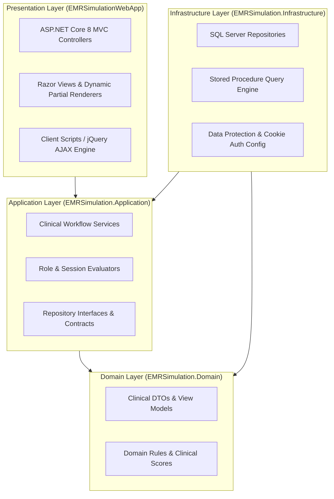
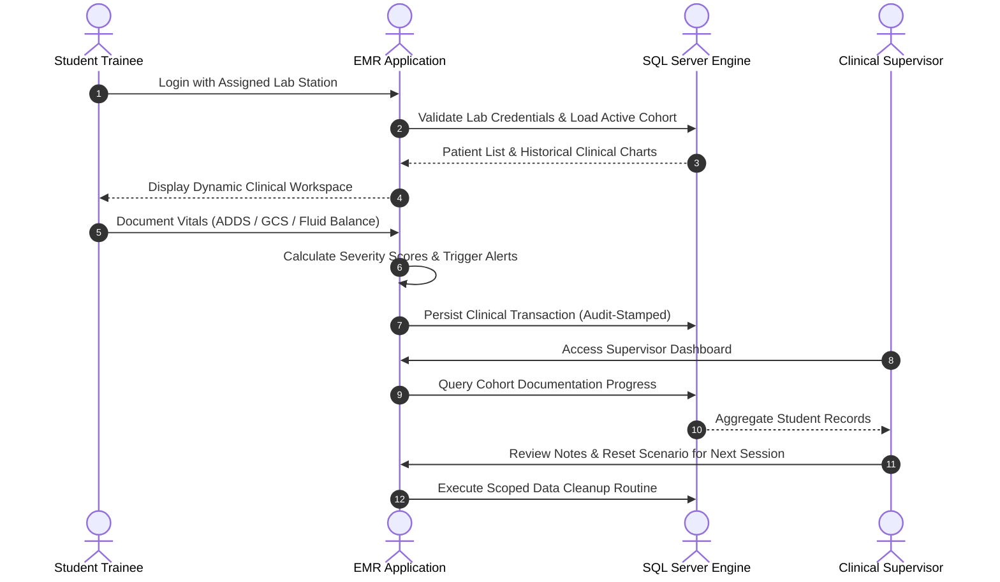

# Clinical EMR Simulator

<div align="center">


### Hospital-Grade Electronic Medical Records Training Platform for Clinical and Nursing Education

[](https://dotnet.microsoft.com/)
[](#system-architecture)
[](https://www.microsoft.com/sql-server)
[](#clinical-modules-overview)
[](LICENSE.md)
[](#quick-start-guide)
[](SECURITY.md)

[Explore Modules](#clinical-modules-overview) • [System Architecture](#system-architecture) • [Quick Start](#quick-start-guide) • [Security & IP](#intellectual-property-and-anti-theft-notice) • [Contributing](CONTRIBUTING.md)

</div>

---

## Overview

The **Clinical EMR Simulator** is an enterprise-grade training web application designed to bridge the gap between academic healthcare education and real-world clinical documentation. Engineered with **ASP.NET Core 8** and **Clean Architecture**, it provides healthcare students, nursing trainees, and university supervisors with a safe, responsive, and realistic environment to practice electronic patient care management without patient risk.

Like flight simulators for aviators, this platform prepares future healthcare professionals for bedside documentation standards, early patient deterioration detection, complex fluid balances, and rigorous medication administration workflows.

---

## Key Features

- **Multi-Role Clinical Access**: Distinct environments for Student Clinicians and Clinical Supervisors.
- **14 Integrated Clinical Documentation Modules**: Modeled after accredited hospital charting standards.
- **Real-Time Clinical Alert Scoring**: Automated early warning scoring (ADDS, Braden Scale, Glasgow Coma Scale, FRAT).
- **Single Page Architecture (SPA-Like UX)**: High-performance dynamic interface powered by asynchronous AJAX routing and Bootstrap 5.
- **Audited Administration Workflows**: Dual-signature verification, role-stamped progress notes, and medication co-signing.
- **Automated Data Lifecycle Management**: Supervisor tools for instant scenario resets and student simulation cleanup.

---

## Clinical Modules Overview

| Module | Purpose | Key Clinical Capabilities |
| :--- | :--- | :--- |
| **ADDS Chart** | Adult Deterioration Detection System | Multi-vital entry (RR, HR, BP, SpO2, Temp, Consciousness), color-coded threshold scoring, alert triggers. |
| **Neurological Chart** | Glasgow Coma Scale (GCS) Assessment | Eye, verbal, and motor scoring, pupil size and reaction tests, bilateral limb response tracking. |
| **Braden Scale** | Pressure Injury Risk Management | Sensory, moisture, activity, mobility, nutrition, and friction scoring with automated risk categorization. |
| **Fall Risk Assessment (FRAT)** | Patient Fall Prevention | Multi-factor risk scoring, automated overrides for sedation and acute mobility changes, targeted clinical interventions. |
| **Medication Regular Chart** | Scheduled Drug Administration | Prescription scheduling, dosage checks, multi-shift administration logs, co-signing validation. |
| **Medication PRN Chart** | As-Needed Medication Tracking | Real-time interval checks, indication verification, post-administration outcome reviews. |
| **Medication Master List** | Formulary Management | Supervisor catalog control, active drug lists, and lab-specific formulary isolation. |
| **IV Fluid Chart & Orders** | Intravenous Fluid Therapy | Physician fluid order tracking, rate calculations, bag change verifications, student administration records. |
| **Fluid Balance Chart** | 24-Hour Input / Output Management | Detailed intake (IV, oral, enteral) versus output (urine, vomitus, drainage, gastric) with automated balance calculation. |
| **Food Intake Monitoring** | Nutritional Care Tracking | Seven-period meal monitoring, portion estimation, special diet flags, and feeding assistance notes. |
| **Progress Notes** | Multidisciplinary Clinical Notes | Chronological notes auto-stamped with author role (Student vs Supervisor) and shift context. |
| **RISKMAN Reporting** | Clinical Incident & Hazard Analysis | 50-field comprehensive clinical incident reporting with dedicated high-fidelity print stylesheets. |
| **Victorian Maternity Record** | Specialized Obstetric Tracking | Clinical assessment documentation modeled after regional healthcare maternity templates. |
| **Supervisor Command Center** | Simulation Control | Bulk lab resets, single-patient wipes, scenario initialization, and cohort progress oversight. |

---

## System Architecture

The solution adheres strictly to **Clean Architecture** and Domain-Driven principles, enforcing decoupling between domain logic, data persistence, and UI presentation.



### Layer Breakdown

1. **EMRSimulation.Domain**: Plain C# domain models, clinical DTOs (Data Transfer Objects), and calculation models. Zero external dependencies.
2. **EMRSimulation.Application**: Service contracts (`IPatientService`, `ILabService`, `ILoginService`), business validation, and authorization orchestration.
3. **EMRSimulation.Infrastructure**: Concrete implementations of data access utilizing Microsoft SQL Server, high-performance stored procedures, and secure database connections.
4. **EMRSimulationWebApp**: Modern ASP.NET Core 8 presentation layer with responsive Bootstrap 5 styling, partial view caching, and dynamic AJAX routing.

---

## Role-Based Clinical Workflow



---

## Quick Start Guide

### Prerequisites

Ensure you have the following components installed:
- **[.NET 8.0 SDK](https://dotnet.microsoft.com/download/dotnet/8.0)** or newer
- **[Microsoft SQL Server Express](https://www.microsoft.com/sql-server/sql-server-downloads)** (2019 or 2022 recommended)
- **[SQL Server Management Studio (SSMS)](https://learn.microsoft.com/sql/ssms/download-sql-server-management-studio-ssms)** or Azure Data Studio

---

### Step 1: Database Initialization

1. Launch **SQL Server Management Studio (SSMS)** and connect to your local SQL Server instance (typically `.\SQLEXPRESS` or `localhost`).
2. Create an empty database named:
   ```sql
   CREATE DATABASE EmrSimulator;
   ```
3. Open and execute the baseline setup script `EmrSimulator_full_After_update_2026-01-13.sql` in SSMS against the `EmrSimulator` database.
4. Verify that tables, stored procedures, and sample educational records have completed execution successfully.

---

### Step 2: Configuration

Review the connection configuration in `EMRSimulationWebApp/EMRSimulationWebApp/appsettings.Development.json`:

```json
{
  "ConnectionStrings": {
    "EmrSimulationConnection": "Server=.\\SQLEXPRESS;Database=EmrSimulator;Integrated Security=true;Encrypt=false;TrustServerCertificate=true;Connection Timeout=30;"
  }
}
```

> **Security Note:** In staging and production environments, connection strings should always be supplied via environment variables (`ConnectionStrings__EmrSimulationConnection`) or Azure Key Vault rather than committed appsettings.

---

### Step 3: Build and Run

1. Open PowerShell or your terminal in the root repository folder.
2. Build the complete solution:
   ```powershell
   dotnet build EMRSimulationWebApp/EMRSimulationWebApp/EMRSimulationWebApp.sln
   ```
3. Launch the web application:
   ```powershell
   cd EMRSimulationWebApp/EMRSimulationWebApp
   dotnet run
   ```
4. Access the web simulator in your browser at:
   ```text
   http://localhost:5031
   ```

---

## Default Simulation Accounts

For local demonstration and academic testing, the seed script provisions sandbox accounts:

### Student Lab Stations
| Lab Location | Username | Purpose |
| :--- | :--- | :--- |
| Berwick Campus Lab | `berlab` | Clinical Nursing Practice Station |
| Mt Helen Campus Lab | `mthlab` | Clinical Simulation Laboratory |
| Gippsland Campus Lab | `giplab` | Acute Patient Care Ward |

### Supervisor Stations
| Location | Username | Privileges |
| :--- | :--- | :--- |
| Berwick Supervisor | `bersuper` | Scenario control, record audit, student reset |
| Mt Helen Supervisor | `mthsuper` | Scenario control, record audit, student reset |
| Gippsland Supervisor | `gipsuper` | Scenario control, record audit, student reset |

> **Notice:** These accounts are intended exclusively for isolated offline educational simulations. Never reuse demo credentials in publicly accessible environments.

---

## Intellectual Property and Anti-Theft Notice

This software, its domain models, proprietary database schemas, and clinical user interfaces represent proprietary engineering work and academic assets.

- **Non-Commercial Educational Evaluation Only**: This project is published under a restrictive Non-Commercial Evaluation License. Unauthorized commercial distribution, re-licensing, white-labeling, or deployment as a paid SaaS platform is strictly prohibited.
- **Trademark Notice**: Institutional names, university campus references, and health service logos remain the exclusive intellectual property of their respective trademark holders.
- **Academic Integrity**: Plagiarism or misrepresenting this codebase as original student coursework is a violation of academic integrity policies.
- **Digital Fingerprinting**: Key UI layouts, stored procedure signatures, and architectural patterns contain embedded provenance identifiers for copyright verification.

For complete terms, review the [LICENSE.md](LICENSE.md) file.

---

## Security and Vulnerability Disclosure

We take healthcare simulation software security seriously. If you discover a potential vulnerability, please review our [Security Policy](SECURITY.md) and report it responsibly rather than posting publicly.

---

## Author & Acknowledgements

- **Lead Engineer & Architect**: Sagar Biswas
- **Institutional Context**: Developed in collaboration with academic health simulation programs at Federation University Australia.
