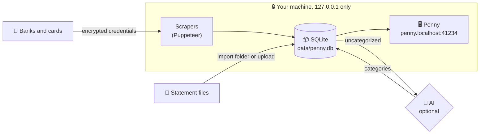

<div dir="rtl">

<div align="center">

# Penny

**אפליקציית כסף רגועה למשקי בית בישראל, שרצה אצלכם במחשב.**
הבנקים, התקציב והעתיד שלכם במקום אחד, בלי שהנתונים יוצאים מהבית.

[](https://github.com/Sergey-Bar/Penny/releases)
[](https://github.com/Sergey-Bar/Penny/stargazers)
[](https://github.com/Sergey-Bar/Penny/releases/latest)
[](https://github.com/Sergey-Bar/Penny/actions/workflows/ci.yml)
[](#רישיון)

[הורדה](#התקנה) · [דמו לחיץ](https://sergey-bar.github.io/Penny/demo/) · [מה חדש](#מה-חדש-ב-020) · [למי זה](#למי-זה-מתאים) · [יכולות](#יכולות) · [איך זה עובד](#איך-זה-עובד) · [אבטחה](#אבטחה-במבט-אחד) · [תרומה לפרויקט](#תרומה-לפרויקט) · [אתר](https://sergey-bar.github.io/Penny/) · [English](README.en.md)

**דמו חי** (משק בית מומצא, מתאפס לבד, שום דבר לא יוצא ממנו): <https://penny-finance-demo.vercel.app>

**הורדה:** [](https://github.com/Sergey-Bar/Penny/releases/latest) [](https://github.com/Sergey-Bar/Penny/releases/latest) [](#docker)


</div>

> [!WARNING]
> זה כלי אישי שרץ רק על המחשב שלכם. משיכת נתונים אוטומטית מבנקים עלולה להפר את תנאי השימוש שלהם. השתמשו בו רק לחשבונות שלכם ועל המחשב שלכם. **אל תפעילו אותו כשירות באינטרנט.**

## מה חדש ב-0.2.0

- **כסף על השולחן:** סכום אחד בשנה לכל מה שאפשר לחסוך (דמי ניהול גבוהים, ביטוחים כפולים, עמלות, ריבית, כסף שיושב בעו"ש), עם הצעד הבא לכל סעיף.
- **חכמה גם בלי AI:** סיווג אוטומטי ממילון של כ-200 בתי עסק ישראליים ומהזיכרון של מה שלימדתם; "למה ההוצאות השתנו" לפי בית עסק; זיהוי תרומות וזיכוי מס לפי סעיף 46.
- **לוח בקרה מלא** עם אריחים, עץ חשבונות, הלוואות, השקעות עם קניות ומכירות, חלוקת הוצאות עם אנשים, תקציב מעטפות ודירוג אשראי.
- **מספרים נכונים:** חיובים ב-1 לחודש נספרים בחודש שלהם, חשבון מקס לא נספר פעמיים, בדיקת יתרה מול התנועות.
- **Windows מתעדכנת לבד**, וסיכום בטלגרם שלוש פעמים בשבוע.

הרשימה המלאה ב-[CHANGELOG.md](CHANGELOG.md). אפשר גם [לנסות את הדמו באתר](https://sergey-bar.github.io/Penny/demo/) בלי להתקין.

## למה?

הבנקים בישראל לא מאפשרים לייצא נתונים בצורה נוחה, אפליקציות תקציב בינלאומיות לא מכירות שקלים, נקודות זיכוי או קרן השתלמות, ורוב אפליקציות הכסף בענן מבקשות את סיסמת הבנק שלכם לשרתים שלהן.

כאן הכול רץ על המחשב שלכם. התנועות נמשכות ישירות מהבנקים ומחברות האשראי, נשמרות בקובץ SQLite אחד שאפשר להעתיק ולגבות, ומסווגות לקטגוריות על ידי AI לבחירתכם, או בלי AI בכלל. ואז האפליקציה עוזרת בשאלות שבאמת חשובות בישראל: האם אני עומד בתקציב החודש, האם יש לי כרית ביטחון, האם אני משלם יותר מדי דמי ניהול, והאם אני מקבל את כל הטבות המס שמגיעות לי.

שום דבר לא יוצא מהמחשב, חוץ מהפניות שאתם בוחרים: לבנק, ולספק AI אם בחרתם ספק בענן.

## למי זה מתאים

- **משקי בית בישראל** שרוצים לראות את כל הכסף במקום אחד: עו"ש, כרטיסי אשראי, הלוואות, חסכונות ופנסיה, בשקלים ועם המונחים המקומיים.
- **מי שלא מוכן למסור את סיסמת הבנק לשירות בענן.** האפליקציה רצה על המחשב שלכם, מאזינה רק ל-127.0.0.1, והנתונים נשמרים בקובץ מקומי (פרטי ההתחברות לבנק מוצפנים ב-AES-256-GCM).
- **זוגות ומשפחות** שמנהלים כסף משותף, כל אחד עם פרופיל משלו.
- **דוברי עברית קודם כול** (מימין לשמאל), עם ממשק מלא גם באנגלית.

זה פחות מתאים אם אתם מחפשים שירות ענן שנגיש מכל מקום, או כלי לניהול כספים של עסק.

## יכולות

### הכסף של היום-יום
- **לוח בקרה** עם אריחים שאפשר להסתיר ולהחזיר (יתרה צפויה, כסף על השולחן, תזרים, מבנה ההוצאות, מי הוציא מה), ומסך **פוקוס** רגוע עם השורה התחתונה בלבד.
- **תנועות** לפי שבועות, עם צבעי קטגוריות, חיפוש, סינון, עריכה מרובה, פיצול ותגיות. הוספת מזומן או תנועה ידנית בטופס מהיר שמתחיל מהסכום.
- **תקציבים** עם קצב הוצאה, תצוגת 50/30/20, טבלה, מבט מעטפות (כמה מההכנסה כבר קיבל תפקיד) ופירוט לכל קטגוריה.
- **כסף על השולחן.** סכום אחד בשנה לכל מה שאפשר לחסוך: עמלות, ריבית על מינוס, תוספת על שער המט"ח, דמי ניהול מעל השוק, ביטוחים חופפים, כסף שיושב בעו"ש וזיכוי על תרומות. ליד כל סעיף הצעד הבא, ומה שסימנתם כבוצע נספר כחיסכון.
- **למה ההוצאות השתנו.** החודש מול אותם ימים בחודש הקודם או בשנה שעברה, לפי בית עסק: מחיר, כמות, חדש, נעלם או חד-פעמי.
- **חלוקה עם אנשים.** מסמנים מי חייב לכם חלק מהוצאה, ורואים לכל אדם כמה הוא חייב, עם "החזיר/ה הכל" בלחיצה.
- **משפחות קטגוריות.** קבוצות ותתי-קטגוריות חולקות משפחת צבע. בוחרים קטגוריה לפי צבע, א-ב או קבוצה, ויוצרים קטגוריות משלכם.
- **בריאות פיננסית** עם ציון, וכפתור אזהרות אחד שמרכז את כל מה שדורש תשומת לב.
- **מה צפוי.** חיובים קרובים, חיובים קבועים ותחזית תזרים, כולל יתרה נפרדת לכל חשבון בנק עם רצועת טווח, וכרטיס לכל כרטיס אשראי שמחובר לחשבון שמשלם אותו.
- **הוצאות מתוכננות.** רכישה שיודעת מראש (חופשה, מכשיר, תיקון) נרשמת פעם אחת, נכנסת לתחזית, ומתחברת לבד לתנועה האמיתית כשזו מגיעה.
- **חלק עסקי ודוח עסקי.** תנועה שמעורבת בה גם עבודה מסומנת באחוז עסקי; הסכום המקורי נשמר לתזרים ולחיובי הכרטיסים, והדוחות האישיים מציגים רק את החלק של משק הבית. הדוח העסקי ("עוד" ← דוח עסקי) מרכז את החלק הזה לפי חודש, קטגוריה ובית עסק, עם ייצוא CSV.

### כלים לכסף בישראל
יותר מ-25 מחשבונים וכלים מודרכים, מסודרים לפי שלבי החיים. כל כלי מציין לאיזו שנה הנתונים שלו נכונים.

| תחום | כלים |
|---|---|
| מס | בדיקת נקודות זיכוי והחזר מס (כולל רשימת מסמכים לטופס 135), הפקדות עם הטבת מס לפנסיה ולקרן השתלמות, קיזוז הפסדים (טופס 867), נטו מברוטו |
| פנסיה ופרישה | דמי הניהול שלכם מול השוק (עם קישורים לגמל-נט, פנסיה-נט וביטוח-נט), מדריך לדוח המסלקה הפנסיונית, בחירת מסלול השקעה, קצבה או היוון, פיצויים במעבר עבודה, גשר לפרישה מוקדמת עד גיל 67 |
| רשת ביטחון | קרן חירום, רשימת ביטוחים ובדיקת ביטוח כפול, צ'קליסט הר הכסף לכסף שנשכח, בדיקת זכויות (מענק עבודה, מילואים, חיסכון לכל ילד, הנחה בארנונה) |
| החלטות גדולות | משכנתא עם מסלולים משתנים כל 5 שנים ומגבלות בנק ישראל, פירעון מוקדם מול השקעה, שכירות או קנייה, דירה בהנחה, עלות רכב, ליסינג או קנייה |
| יום-יום | בדיקת עמלות בנק מול המסלול הבסיסי, יציאה מחובות, עלות הלוואה, יעדי חיסכון, תקציב חופשה, השקעה לילדים |

וגם **מרכז ידע** עם מדריכים קצרים ומקוריים בעברית ובאנגלית, וטיפ יומי.

### משק הבית
- **פרופילים שחולקים משק בית אחד**, עם מסך "מי משתמש?". כל אחד שומר סידור בית והגדרות נגישות משלו.
- **פיפ**, חבר קטן שמצב הרוח שלו משקף את מצב הכסף של הבית. פיפ הוא גם המאמן של הבית: התראות, תובנות והצעות בפאנל צד, עם מונה אחד בכל המסכים. לכל פרופיל תמונה משלו (או האות הראשונה על צבע).
- **חשבונות במקום אחד:** עץ חשבונות עם סכום לכל קבוצה, דף לכל חשבון, הלוואות עם התקדמות, אחזקות עם קניות ומכירות, ודירוג אשראי לאורך זמן.
- **יעדים**, שווי נקי, השקעות ויתרות פנסיה (מסונכרנות מכלל, הראל, מיטב, מנורה ומגדל, או מיובאות מדוח של הסוכן), ו"מסמך למשפחה" ליום שמישהו אחר יצטרך למצוא הכול.
- **ביטוחים** במקום אחד: פוליסות, מה מכוסה ומה ההשתתפות העצמית, המועד לחידוש, הסוכן, המסמכים, והתשלומים שמתחברים מהבנק לפוליסה.
- **מצב דמו** עם משק בית מלא ומדומה: אפשר להתרשם מכל המסכים בלי להתחבר לבנק ובלי לגעת בנתונים האמיתיים.

### הכנסת נתונים
- **אוטומטי (בטא):** 18 בנקים וחברות אשראי בישראל דרך [`israeli-bank-scrapers`](https://github.com/eshaham/israeli-bank-scrapers), בסנכרון יומי. בטא: בנק יכול לשנות את האתר שלו ולשבור חיבור עד שהסקרייפר מתוקן; ייבוא קבצי דוחות עובד תמיד.
- **ידני:** גוררים קובץ CSV, XLSX או XLS לאפליקציה או לתיקיית ייבוא שהיא עוקבת אחריה. תנועה שמגיעה משני המקורות נשמרת פעם אחת.
- **גיליון חכם:** מדביקים טבלה מכל מקור, מאקסל או מ-Google Sheets ועד קובץ מהבנק או רשימה שכתבתם, ומתקנים כל תא בגיליון עצמו: תאריך, סכום, סוג, חשבון, קטגוריה, תגיות, בעלים ואחוז עסקי. כפילויות מזוהות לפי חשבון לפני השמירה, ואפשר לבטל את כל הייבוא.
- **אונבורדינג** שמלווה משתמש חדש: פרופיל ותמונה, חיבור או ייבוא, יעד חודשי, תקציבים, ספק AI (אופציונלי) וסיור קצר. אפשר לדלג, להמשיך מאותה נקודה ולפתוח אותו שוב.

### שפה ונגישות
- **עברית קודם כול**, עם פריסה מלאה מימין לשמאל, וגם אנגלית. שמות בנקים, קטגוריות, מספרים ותאריכים מותאמים לשפה.
- **תפריט נגישות** (Alt+A): גודל טקסט, ניגודיות, עצירת אנימציות, גופן קריא, הדגשת קישורים ועוד, נשמר לכל פרופיל. כולל הצהרת נגישות לפי ת"י 5568 ו-WCAG 2.2 AA.
- **מצב פרטיות** (Ctrl/⌘+Shift+P) מסתיר סכומים מהמסך.
- **ערכות נושא:** בהיר, כהה או לפי המכשיר, עם תנועה רכה בכל פתיחה וסגירה.

### ועוד
- **לשאול את הכסף** בשפה רגילה, ו**בוט טלגרם** עם משוב מיידי על הוצאות.
- **גישה מהטלפון ברשת הביתית** (בהפעלה מפורשת), עם אפשרות להתקין כאפליקציה.
- **אפליקציית שולחן** ל-macOS ול-Windows, עם מתקין ועדכון עצמי ב-Windows.


### כל השאר, בשורה אחת
- **כללים** לבתי עסק שחוזרים: קטגוריה, תגיות ובעלים נקבעים לבד בכל סנכרון וייבוא.
- **תובנות:** תחזית יתרה, זיהוי חיובים קבועים ומנויים, חריגות בהוצאות, תשלומים שנותרו והתחייבויות צפויות.
- **מעקבים** לתקופה (למשל "אוכל בחוץ עד סוף החודש"), **סקירות מודרכות** בחמישה סבבים קצרים, **סיכום חודשי** ו**המסע שלכם** עם הרגעים הגדולים של הבית.
- **עצמאות כלכלית (FI):** מתי ההשקעות יוכלו לממן את ההוצאות, עם אירועים בחיים.
- **שווקים:** מדדים, מטבעות וסחורות, שערי מט"ח ומחירי קרנות לאחזקות; **השקעות פרטיות** (סבבים ועסקאות) עם השקעה, יתרה ורווח ממומש.
- **ייבוא מכל טקסט:** מדביקים דוח, קבלה או הודעה, וספק ה-AI שבחרתם מוציא ממנו תנועות.
- **ספקי AI לבחירה:** Claude, Ollama מקומי (כולל הורדת מודלים מתוך האפליקציה), סוכני CLI שכבר מותקנים אצלכם, או בלי AI. וגם שרת MCP לסוכן AI.
- **קוד חד-פעמי (OTP)** מהבנק מוזן ישר באפליקציה או בטלגרם במהלך הסנכרון.
- **גיבוי ושחזור:** גיבוי אוטומטי, גיבוי לפני כל שינוי במבנה, שחזור מקובץ, ייצוא כל הנתונים ומחיקה מלאה.
- **נעילת אפליקציה** בסיסמה או PIN, ו**מרחבי עבודה** נפרדים עם גישה לכמה משתמשים.
- **אפליקציה לשולחן העבודה** (Electron) ל-Windows ול-macOS, או **שירות מערכת** שמתחיל עם המחשב, עם כתובת ידידותית מקומית.

## צילומי מסך

<table>
<tr>
<td width="50%"></td>
<td width="50%"></td>
</tr>
<tr>
<td width="50%"></td>
<td width="50%"></td>
</tr>
</table>

צילומי מסך של משק הבית לדוגמה. ליצירה מחדש: `npm run demo` ואז `node scripts/capture-demo-tour.mjs`.

## מוסדות נתמכים

| סוג | מוסדות |
|---|---|
| בנקים | הפועלים, לאומי, דיסקונט, מזרחי טפחות, מרכנתיל, הבינלאומי, אוצר החייל, פאגי, יהב, מסד, איגוד, וואן זירו, ביחד בשבילך, בהצדעה |
| כרטיסי אשראי | ישראכרט, ויזה כאל, מקס, אמריקן אקספרס |
| פנסיה וחיסכון | כלל, הראל, מיטב, מנורה, מגדל (יתרות, דרך `israeli-pension-scrapers`) |

המוסד שלכם לא ברשימה? ייבאו את קבצי הדוחות שלו, או הוסיפו סקרייפר (ראו [תרומה לפרויקט](#תרומה-לפרויקט)).

## ספקי AI

ה-AI אופציונלי. הוא מסווג תנועות חדשות לקטגוריות ועונה על שאלות ב"לשאול את הכסף".

| | Claude API | Ollama | כלי CLI של סוכן קוד | בלי |
|---|---|---|---|---|
| איפה רץ | הענן של Anthropic | המחשב שלכם | הענן של הספק, דרך ה-CLI שכבר יש לכם | בשום מקום |
| עלות | שבריר שקל לסנכרון | חינם | המנוי הקיים שלכם | חינם |
| הגדרה | מפתח API | התקנת Ollama והורדת מודל | Claude Code, Codex, Gemini CLI, OpenCode או Kilo, במצב קריאה בלבד | כלום |

אפשר להחליף ספק בכל רגע ב**הגדרות ← AI**. גם בלי AI תנועות חדשות מקבלות קטגוריה: קודם לפי מה שתיקנתם בעבר לאותו בית עסק, ואז לפי מילון מובנה של כ-200 בתי עסק ישראליים (סופרים, דלק, חשמל ומים, עיריות, קופות חולים, תקשורת ועוד). ה-AI, אם בחרתם בו, מקבל רק את מה שנשאר.

## איך זה עובד

<div dir="ltr">



</div>

## דרישות

- **Node.js 22 ומעלה**, רק להתקנה מקוד המקור
- **Windows 10/11, macOS 13 ומעלה או Ubuntu 22 ומעלה** (עם systemd)
- לבניית אפליקציית השולחן מהמקור (אופציונלי): `npm run desktop:build`. המתקינים המוכנים לא דורשים Node.js.
- חשבונות בנק **בלי אימות דו-שלבי** לסנכרון אוטומטי (וואן זירו היא החריגה). בלי זה, משתמשים בקבצי דוחות.

## התקנה

### אפליקציה לשולחן העבודה (מומלץ)

הדרך הקלה: מורידים, מתקינים, פותחים. בלי Node.js ובלי טרמינל. הסנכרון משתמש ב-Chrome או Edge שכבר מותקנים.

| מערכת | קובץ ב[גרסה האחרונה](https://github.com/Sergey-Bar/Penny/releases/latest) | פעם ראשונה |
|---|---|---|
| Windows 10/11 | `Penny-Setup-<גרסה>.exe` | אם SmartScreen מזהיר על אפליקציה לא חתומה: "מידע נוסף" ← "הפעל בכל זאת" |
| Mac עם שבב Apple (M1 ומעלה) | `Penny-<גרסה>-arm64.dmg` | גוררים ל-Applications. בפתיחה הראשונה: הגדרות המערכת ← פרטיות ואבטחה ← "פתח בכל זאת" |
| Mac עם מעבד Intel | `Penny-<גרסה>-x64.dmg` | כמו למעלה |

הנתונים נשמרים ב-`%APPDATA%\Penny\data` ‏(Windows) או ב-`~/Library/Application Support/Penny/data` ‏(Mac). כשיוצאת גרסה חדשה מופיע באנר באפליקציה; מריצים את המתקין החדש מעל הישן והנתונים נשארים.

### Docker

מריץ את האפליקציה, הסקרייפרים ו-Chromium בקונטיינר, מבודד מהמחשב. עובד ב-Windows, ב-Mac ובלינוקס עם [Docker Desktop](https://www.docker.com/products/docker-desktop/).

<div dir="ltr">

```bash
# macOS / Linux
curl -fsSL https://raw.githubusercontent.com/Sergey-Bar/Penny/main/install-docker.sh | bash
```

```powershell
# Windows (PowerShell)
irm https://raw.githubusercontent.com/Sergey-Bar/Penny/main/install-docker.ps1 | iex
```

</div>

המתקין בודק ש-Docker מותקן ורץ (ב-Windows מציע להתקין את Docker Desktop דרך winget, ב-Mac דרך Homebrew), מוריד את הגרסה האחרונה לתיקייה `~/Penny` (אפשר לשנות עם `PENNY_DIR`), בונה, מפעיל ופותח את `http://127.0.0.1:41234`. הרצה חוזרת של אותה פקודה: אם יש גרסה חדשה היא מציעה לעדכן (גיבוי קודם, וחזרה לגרסה הקודמת אם החדשה לא עולה תקין), ואחרת פשוט מפעילה. מתוך שכפול של המאגר אפשר גם `./Penny-docker.sh` (ב-Windows: `Penny-docker.bat`) או `docker compose up -d --build`.

- זמין רק בכתובת `127.0.0.1`. מסד הנתונים ומפתח ההצפנה נשמרים בווליום ושורדים עדכונים.
- הגדרות נכנסות ל-`.env` (העתיקו מ-`.env.example`).
- הבנייה מריצה את כל הבדיקות. אם בדיקה נכשלת, לא נוצר אימג'.
- **עדכונים:** כשיוצאת גרסה חדשה מופיע באנר (והודעה בטלגרם, אם הוגדר). מריצים `./Penny-update.sh` (או `Penny-update.bat`): הסקריפט עובר לגרסה האחרונה שפורסמה, מגבה את מסד הנתונים והמפתח, בונה (כולל בדיקות), מחליף, וחוזר לגרסה הקודמת אם החדשה לא תקינה.
- **קבצי דוחות:** שמים אותם בתיקייה `imports/` ליד `docker-compose.yml`.
- **Ollama על המחשב המארח:** מגדירים `PENNY_ALLOW_REMOTE_OLLAMA=1` ומשתמשים ב-`http://host.docker.internal:11434`.

### מקוד המקור

<div dir="ltr">

```bash
git clone https://github.com/Sergey-Bar/Penny.git
cd Penny
npm install
npm run setup
```

</div>

למפתחים, או למי שרוצה שירות שרץ תמיד. ‏`npm run setup` בונה את האפליקציה, מתקין שירות שרץ תמיד (LaunchAgent ב-macOS, ‏systemd בלינוקס, Task Scheduler ב-Windows), ופותח את האפליקציה. אפליקציית השולחן מגיעה מהמתקין, ובנייה שלה מהמקור היא `npm run desktop:build`. ב-Windows הוא גם מוסיף את השורה `127.0.0.1 penny.localhost` לקובץ hosts, וזה השלב היחיד שמבקש הרשאות מנהל.

בהפעלה הראשונה של אפליקציית השולחן תופיע אזהרה על קובץ לא חתום, כי היא עדיין לא חתומה: הגדרות המערכת ← פרטיות ואבטחה ← Open Anyway ‏(macOS) או "מידע נוסף" ← "הפעל בכל זאת" (Windows). פעם אחת בלבד.

אחר כך פותחים את **`http://penny.localhost:41234`** ושומרים כמועדף.

### דמו ציבורי ב-Vercel

<div dir="ltr">

[](https://vercel.com/new/clone?repository-url=https%3A%2F%2Fgithub.com%2FSergey-Bar%2FPenny)

</div>

מעלה את האפליקציה המלאה עם משק בית לדוגמה, כך שכל אחד יכול לעבור על כל המסכים. ב-Vercel האפליקציה תמיד רצה כדמו:
הנתונים נשמרים ב-`/tmp` ומתחילים מחדש בכל מופע חדש, שום דבר לא יוצא לבנק, לספק AI או לטלגרם, ואי אפשר לנעול, למחוק או
להשתלט על הדמו המשותף. היא עונה רק בכתובות ה-Vercel של הפריסה; דומיין משלכם מוסיפים ל-`PENNY_ALLOWED_HOSTS`. לא לנתונים אמיתיים.

## ייבוא קבצי דוחות

לחשבונות שאי אפשר לסנכרן, או לחודשים שהבנק כבר לא מציג:

- **העלאה:** הגדרות ← חשבונות וייבוא ← "ייבוא קובץ", ובוחרים את החשבון.
- **תיקיית ייבוא:** האפליקציה עוקבת אחרי תיקייה (מוצגת באותו עמוד; ב-Docker זו `./imports`) עם תת-תיקייה לכל חשבון, למשל `max (1234)`. קובץ שנזרק לשם מיובא ועובר ל-`imported/`, או ל-`failed/` עם הסבר למה. לחשבון שלא מסתנכרן, יוצרים תיקייה בשם שלו.

תנועה שמגיעה גם מהסנכרון וגם מקובץ נשמרת פעם אחת (אותו חשבון ואותו סכום, בהפרש של יום לכל היותר). הגרסה מהסנכרון מנצחת ושומרת את הקטגוריה, ההערות והתגיות שלכם.

### ייבוא חכם בגיליון

הגדרות ← חשבונות וייבוא ← ייבוא קבצים ← "ייבוא חכם בגיליון". מדביקים טבלה כמו שהיא. שורת כותרת מזוהה לבד (תאריך, תיאור, סכום, סוג, חשבון, קטגוריה, תגיות, בעלים, אחוז עסקי, הערה) ובלי כותרת נפתח שיוך עמודות. כל תא נערך במקום, Enter עובר לתא שמתחת, Ctrl+D מעתיק את התא שמעל, ואפשר להוריד תבנית CSV או להעתיק את שורת הכותרת.

בחירת חשבון לכל שורה קובעת איך היא נשמרת: במזומן היא נהיית תנועה ידנית שאפשר לערוך תמיד, ובחשבון אמיתי היא נכנסת כמו ייבוא קובץ כך שהסנכרון הבא לא מכפיל אותה. תנועה שכבר קיימת באותו חשבון (אותו סכום, יום אחד הפרש) מסומנת ומדולגת, אבל אפשר לכלול אותה מחדש. קטגוריות מוצעות מבית העסק שלמדתם, ואחרי שמירה אפשר לבטל את כל הייבוא בבת אחת.

### ייבוא דוח פנסיה

דוח תקופתי של סוכן ביטוח או יועץ (פנסיה, השתלמות, גמל והביטוחים שבדוח) אפשר לייבא כ-JSON: הגדרות ← חשבונות וייבוא ← פנסיה, השתלמות ובתי השקעות ← "ייבוא דוח פנסיה". כל מוצר נכנס לנכסים עם שווי מתאריך הדוח, דמי הניהול וההפקדה החודשית, וכל ביטוח נכנס לפוליסות. הדוח נבדק מול הסכום הכולל שלו, וייבוא חוזר של אותו דוח מעדכן ולא מכפיל. האפליקציה לא קוראת PDF — כל כלי שחולץ את הנתונים ל-JSON לפי [הדוגמה](public/pension-report.example.json) מתאים; הפורמט המלא ב-[docs/pension-report.md](docs/pension-report.md).

## מצב דמו

רוצים לראות את Penny בלי לחבר בנק? ‏`npm run demo` יוצר משק בית מדומה בתיקייה זמנית נפרדת (`penny-demo-data` בתיקיית הקבצים הזמניים של המערכת) ומפעיל את האפליקציה עליו: שני חשבונות בנק, שני כרטיסים, חיבור בנקאות פתוחה, שלושה בתי השקעות מחוברים, חמישה חודשים של תנועות, תקציבים, יעדים, נכסים, ביטוחים והוצאות מתוכננות. כל מסכי החיבורים נראים כאילו חוברו באמת, אבל הדמו לא יוצא מהמחשב: סנכרון, בדיקת חיבור לבנק, AI, טלגרם ובדיקת עדכונים חסומים עם אותה הודעה, ושום דבר שם אמיתי. הקובץ `data/penny.db` שלכם לא נפתח בכלל.

הדמו נשמר בין הפעלות, כדי שאפשר יהיה לשנות בו דברים ולבדוק. ‏`npm run dev:demo` מפעיל אותו שוב, ו-`npm run demo:reset` מוחק אותו ומתחיל מאפס.

## חיבור סוכן AI ב-MCP

האפליקציה חושפת שרת MCP קטן וקריאה בלבד, כדי שקלוד, ChatGPT או כל סוכן שתומך ב-MCP יוכלו לשאול על הכסף של הבית בשפה רגילה: לאן הלך החודש, מה נשאר בכל תקציב, מה צפוי עד המשכורת ושווי נקי.

השרת רץ על stdio ולא מאזין לשום פורט, והוא מבקש הכול מהאפליקציה דרך ה-API המקומי שלה. אין בו שום פעולה שכותבת, מסווגת, מסנכרנת או מוחקת. האפליקציה צריכה לרוץ, ואם נעילת האפליקציה דולקת צריך לפתוח אותה קודם.

<div dir="ltr">

```json
{
  "mcpServers": {
    "penny": { "command": "node", "args": ["/path/to/Penny/scripts/mcp.mjs"] }
  }
}
```

</div>

אפשר גם `claude mcp add penny -- node /path/to/Penny/scripts/mcp.mjs`, או `npm run mcp` ידנית. ‏`PENNY_BASE_URL` ו-`PENNY_WORKSPACE_ID` קובעים לאן לפנות ואיזו סביבה לקרוא. הכלים וההסבר המלא: [docs/mcp.md](docs/mcp.md).

## פקודות שימושיות

| מה רוצים | מה מריצים |
|---|---|
| להשתמש באפליקציה | לפתוח את `http://penny.localhost:41234` |
| לפתח עם רענון חי | `npm run dev` ← `http://127.0.0.1:3000` |
| להתרשם עם נתוני דמו | `npm run demo` ← `http://127.0.0.1:3000` |
| לחזור לדמו אחרי שינויים | `npm run dev:demo` |
| לאפס את נתוני הדמו | `npm run demo:reset` |
| להחיל שינויים על השירות שרץ תמיד | `npm run service:reload` |
| להריץ בדיקות | `npx vitest run` (יחידה) · `npx playwright test` (מקצה לקצה) |
| לחבר סוכן AI | `npm run mcp` ← [docs/mcp.md](docs/mcp.md) |
| בדיקת טיפוסים ולינט | `npx tsc --noEmit` · `npm run lint` |

### פקודות השירות

| פקודה | מה היא עושה |
|---|---|
| `npm run service:status` | האם רץ? האם מאזין רק ל-loopback? |
| `npm run service:start` / `:stop` | הפעלה או עצירה עכשיו |
| `npm run service:reload` | בנייה מחדש והפעלה |
| `npm run service:logs` | צפייה בלוגים של השרת |
| `npm run service:open` | פתיחת האפליקציה בדפדפן |
| `npm run service:uninstall` | הסרת ההפעלה האוטומטית ושורת ה-hosts. התיקייה `data/` לא נגעת. |

## הסרה

<div dir="ltr">

```bash
npm run uninstall
```

</div>

עוצר ומסיר את השירות, מסיר את שורת ה-hosts ב-Windows, ומסיר התקנות קודמות של אפליקציית השולחן אם נשארו.

**נשאר בכוונה:** התיקייה `data/` (התנועות, התקציבים ומפתח ההצפנה) והמאגר עצמו. להסרה מלאה: `rm -rf data/ && cd .. && rm -rf Penny/`.

## אבטחה במבט אחד

| חשש | הגנה |
|---|---|
| פרטי התחברות שמורים | AES-256-GCM. קובץ המפתח חייב הרשאות `0600`, אחרת השרת לא עולה |
| חשיפה ברשת | מאזין רק ל-`127.0.0.1`. גישה מהטלפון ברשת הביתית היא בהפעלה מפורשת, דורשת נעילה, ועוברת ב-HTTP לא מוצפן - רק ברשת שאתם סומכים עליה |
| CSRF בדפדפן | בדיקת Origin / Referer בכל בקשה. פעולות מחיקה דורשות אישור מפורש |
| נעילת אפליקציה | קוד נעילה אופציונלי עם נעילה אוטומטית |
| זיהוי בוטים | ארגז החול של Chromium פעיל כברירת מחדל (`PENNY_DISABLE_CHROMIUM_SANDBOX=1` לביטול) |
| שרשרת אספקה | `israeli-bank-scrapers`, ‏`better-sqlite3` ו-`@anthropic-ai/sdk` נעולים לגרסאות מדויקות, ו-CI, ‏Docker והריליס מתקינים עם `--ignore-scripts` |
| הקשחת דפדפן | CSP קפדני, `X-Frame-Options: DENY`, ‏`Permissions-Policy` נעול |
| שינויי סכמה | גיבוי אוטומטי של מסד הנתונים לפני כל מיגרציה שמשנה נתונים |

**הפעילו הצפנת דיסק מלאה** (BitLocker, ‏FileVault או LUKS). קובץ המפתח יושב ליד מסד הנתונים, כך שהצפנת הדיסק היא קו ההגנה האחרון אם המחשב הולך לאיבוד.

מודל האיומים המלא ומדיניות הדיווח על חולשות: [SECURITY.md](SECURITY.md).

## איפה הנתונים שלכם

- `data/penny.db`: תנועות, קטגוריות, תקציבים, פרופילים והגדרות
- `data/.encryption-key`: מפתח AES של 32 בתים, בהרשאות `0600`
- `data/*.bak` ו-`data/backups/`: גיבויים אוטומטיים לפני מיגרציות, לפני שחזור, ולפני כל שינוי סכמה
- `data/backups/*.pennybak`: קובצי גיבוי מוצפנים שאתם יוצרים (הגדרות ← נתונים ← גיבוי ושחזור, או `npm run backup`)
- לוגים של השירות: `~/Library/Logs/Penny/` ‏(macOS), ‏`~/.local/state/penny/log/` (לינוקס)

מגבים את `data/` כמו כל תיקייה. כדי לעבור למחשב חדש, מעתיקים את `data/` ומריצים `npm run service:install`.

קובץ גיבוי אחד מכיל את מסד הנתונים ואת מפתח ההצפנה של פרטי הבנק, מוצפן בסיסמה שתבחרו (AES-256-GCM עם scrypt). השחזור בודק את הסיסמה ואת תוכן הקובץ לפני שהוא נוגע במשהו, שומר עותק של מסד הנתונים הקיים בתיקיית `backups`, ומבקש אישור מפורש.

## מפת הקוד

<div dir="ltr">

```
Penny/
├── src/
│   ├── app/              Next.js App Router: pages (home, transactions, budget, fi,
│   │                     investments, calculators, learn, settings, setup, profiles…) and api/
│   ├── components/       UI by area: home, dashboard, transactions, calculators, fi,
│   │                     settings, setup, profiles, a11y, layout, ui (shared primitives)
│   ├── content/          Knowledge-center guides
│   ├── i18n/messages/    he.json and en.json
│   ├── lib/              Pure, tested logic: budgets, pacing, tax, pension, mortgage,
│   │                     Israeli defaults with sources (il-defaults.ts), Pip
│   └── server/
│       ├── ai/           Claude, Ollama and CLI-agent providers
│       ├── bot/          Telegram bot
│       ├── db/           SQLite, numbered migrations, queries
│       ├── scrapers/     Bank and card sync
│       ├── pension/      Pension and savings sync
│       └── lib/          Encryption, dedupe, transfer detection, import folder
├── tests/                Vitest unit tests (and tests/e2e overlap and contrast scanners)
├── e2e/                  Playwright end-to-end tests
├── desktop/              Electron desktop shell and installer
├── scripts/service/      Service installers
└── data/                 Database and key (gitignored)
```

</div>

## פתרון בעיות

- **פורט 41234 תפוס:** `netstat -ano | findstr :41234` ‏(Windows) או `lsof -nP -iTCP:41234 -sTCP:LISTEN`. עוצרים את התהליך האחר ומפעילים שוב.
- **`penny.localhost` לא נפתח ב-Windows:** מריצים את ההתקנה שוב מטרמינל עם הרשאות מנהל, או משתמשים ב-`http://127.0.0.1:41234`, שתמיד עובד.
- **לינוקס: "systemd user instance not available":** ‏`loginctl enable-linger $USER`.
- **סנכרון בנק נכשל עם דף של Cloudflare:** נסו `PENNY_DISABLE_CHROMIUM_SANDBOX=1`, או ייבאו את קובץ הדוח של אותו חודש.
- **משהו נראה ישן אחרי עדכון:** רעננו את הדף בכוח (Ctrl+F5).

## מפת דרכים

- [x] עברית קודם כול, עם פריסה מלאה מימין לשמאל
- [x] 18 בנקים וחברות אשראי, ועוד ייבוא קבצי דוחות
- [x] קטגוריות מותאמות עם משפחות צבע
- [x] פרופילים למשק הבית, אונבורדינג ותפריט נגישות
- [x] כלי מס, פנסיה, ביטוח ומשכנתא לישראל
- [x] ייבוא דוח פנסיה של הסוכן (JSON): מוצרים, דמי ניהול, הפקדות וביטוחים
- [ ] קריאה אוטומטית של דוח המסלקה הפנסיונית
- [x] ייצוא CSV לכל התנועות
- [x] ייבוא חכם בגיליון: הדבקה, שיוך עמודות, הצעות קטגוריה וכפילויות לפי חשבון
- [x] גיבוי ושחזור בקובץ מוצפן אחד, וגם `npm run backup`
- [x] כסף על השולחן, למה ההוצאות השתנו וזיכוי על תרומות
- [x] סיווג בלי AI: זיכרון בתי עסק ומילון מובנה
- [x] חלוקת הוצאות, תקציב מעטפות ודירוג אשראי
- [x] עדכון אוטומטי ב-Windows, ודמו לחיץ באתר
- [x] ייצוא OFX
- [x] גיבוי אוטומטי מוצפן לתיקייה בענן, וקובץ אבחון לתמיכה
- [ ] אפליקציה ייעודית לטלפון

## תרומה לפרויקט

הפרויקט נבנה קודם כול לשימוש אישי, ואחר כך כקוד פתוח. ההוראות המלאות להתקנת סביבת פיתוח: [CONTRIBUTING.md](CONTRIBUTING.md). נשמח ל-Pull Requests על:

- **בנקים:** מוסיפים ל-`BANK_PROVIDERS` ב-[src/lib/types.ts](src/lib/types.ts) וממפים ב-[src/server/scrapers/index.ts](src/server/scrapers/index.ts).
- **ספקי AI:** מממשים את `AIProvider` מ-[src/server/ai/types.ts](src/server/ai/types.ts) ורושמים ב-[src/server/ai/factory.ts](src/server/ai/factory.ts).
- **נתונים ישראליים:** מדרגות מס, תקרות ושיעורים נמצאים ב-[src/lib/il-defaults.ts](src/lib/il-defaults.ts), כל אחד עם השנה והמקור שלו. עדכונים עם מקור רשמי מבורכים במיוחד.
- **שפות:** מוסיפים `<locale>.json` תחת [src/i18n/messages/](src/i18n/messages/) לפי המפתחות של `en.json`, ורושמים ב-[src/i18n/routing.ts](src/i18n/routing.ts).

כללים:

- TypeScript במצב strict. בלי `any` בלי הערה שמסבירה למה.
- כל פונקציה טהורה חדשה מקבלת בדיקת Vitest. ‏`npx tsc --noEmit` ו-`npx vitest run` חייבים לעבור.
- קומיטים לפי Conventional Commits: ‏`feat:`, ‏`fix:`, ‏`style:`, ‏`chore:`, ‏`docs:`, ‏`refactor:`.
- הערות בקוד מסבירות *למה*, לא *מה*. בלי מקפים ארוכים (em dash) בקוד, בקומיטים ובתיעוד.
- טקסט בממשק לא מזכיר מתחרים, והטקסט העברי לא משתמש בשם המוצר.

## רישיון

MIT. ראו [LICENSE](LICENSE) ו-[NOTICE.md](NOTICE.md) לקרדיט לפרויקטים שעליהם נבנינו.

## תודות

- [`israeli-bank-scrapers`](https://github.com/eshaham/israeli-bank-scrapers), הלב של כל חיבור לבנק
- [Next.js](https://nextjs.org/),‏ [React](https://react.dev/),‏ [`shadcn/ui`](https://ui.shadcn.com/) על [`base-ui`](https://base-ui.com/)
- [`better-sqlite3`](https://github.com/WiseLibs/better-sqlite3) ו-[`next-intl`](https://next-intl.dev/)
- [BoopFace](https://github.com/CX-ArtLab/BoopFace) של CX ArtLab ‏(MIT), הפנים של פיפ
- [Anthropic Claude](https://www.anthropic.com/) ו-[Ollama](https://ollama.com/)

</div>
