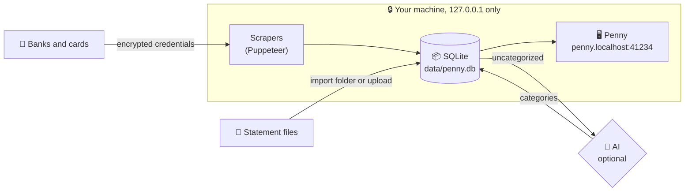

<div dir="rtl">

<div align="center">

# Penny

**אפליקציית כסף רגועה למשקי בית בישראל, שרצה אצלכם במחשב.**
הבנקים, התקציב והעתיד שלכם במקום אחד, בלי שהנתונים יוצאים מהבית.

[](https://nextjs.org/)
[](https://react.dev/)
[](https://www.typescriptlang.org/)
[](https://sqlite.org/)
[](#רישיון)
[](https://github.com/Sergey-Bar/Penny/releases/latest)
[](https://github.com/Sergey-Bar/Penny/actions/workflows/ci.yml)

[הורדה](#התקנה) · [יכולות](#יכולות) · [איך זה עובד](#איך-זה-עובד) · [אבטחה](#אבטחה-במבט-אחד) · [תרומה לפרויקט](#תרומה-לפרויקט) · [אתר](https://sergey-bar.github.io/Penny/) · [English](README.en.md)

**הורדה:** [](https://github.com/Sergey-Bar/Penny/releases/latest) [](https://github.com/Sergey-Bar/Penny/releases/latest) [](#docker)


</div>

> [!WARNING]
> זה כלי אישי שרץ רק על המחשב שלכם. משיכת נתונים אוטומטית מבנקים עלולה להפר את תנאי השימוש שלהם. השתמשו בו רק לחשבונות שלכם ועל המחשב שלכם. **אל תפעילו אותו כשירות באינטרנט.**

## למה?

הבנקים בישראל לא מאפשרים לייצא נתונים בצורה נוחה, אפליקציות תקציב בינלאומיות לא מכירות שקלים, נקודות זיכוי או קרן השתלמות, ורוב אפליקציות הכסף בענן מבקשות את סיסמת הבנק שלכם לשרתים שלהן.

כאן הכול רץ על המחשב שלכם. התנועות נמשכות ישירות מהבנקים ומחברות האשראי, נשמרות בקובץ SQLite אחד שאפשר להעתיק ולגבות, ומסווגות לקטגוריות על ידי AI לבחירתכם, או בלי AI בכלל. ואז האפליקציה עוזרת בשאלות שבאמת חשובות בישראל: האם אני עומד בתקציב החודש, האם יש לי כרית ביטחון, האם אני משלם יותר מדי דמי ניהול, והאם אני מקבל את כל הטבות המס שמגיעות לי.

שום דבר לא יוצא מהמחשב, חוץ מהפניות שאתם בוחרים: לבנק, ולספק AI אם בחרתם ספק בענן.

## יכולות

### הכסף של היום-יום
- **שני מצבים.** *פשוט* מציג מספר אחד ברור, את החודש לפי שורות, וכל קטגוריה לפי שבועות (תקציב לשבוע, הוצאה, נשאר). *מתקדם* מוסיף לוח מלא, תובנות ומסך בית שאפשר לסדר.
- **תנועות** לפי שבועות, עם צבעי קטגוריות, חיפוש, סינון, עריכה מרובה, פיצול ותגיות. הוספת מזומן או תנועה ידנית בטופס מהיר שמתחיל מהסכום.
- **תקציבים** עם קצב הוצאה, תצוגת 50/30/20, כרטיס חודשי ופירוט לכל קטגוריה.
- **משפחות קטגוריות.** קבוצות ותתי-קטגוריות חולקות משפחת צבע. בוחרים קטגוריה לפי צבע, א-ב או קבוצה, ויוצרים קטגוריות משלכם.
- **בריאות פיננסית** עם ציון, וכפתור אזהרות אחד שמרכז את כל מה שדורש תשומת לב.
- **מה צפוי.** חיובים קרובים, חיובים קבועים ותחזית תזרים.

### כלים לכסף בישראל
יותר מ-25 מחשבונים וכלים מודרכים, מסודרים לפי שלבי החיים. כל כלי מציין לאיזו שנה הנתונים שלו נכונים.

| תחום | כלים |
|---|---|
| מס | בדיקת נקודות זיכוי והחזר מס (כולל רשימת מסמכים לטופס 135), הפקדות עם הטבת מס לפנסיה ולקרן השתלמות, קיזוז הפסדים (טופס 867), נטו מברוטו |
| פנסיה ופרישה | דמי הניהול שלכם מול השוק (עם קישורים לגמל-נט, פנסיה-נט וביטוח-נט), מדריך לדוח המסלקה הפנסיונית, בחירת מסלול השקעה, קצבה או היוון, פיצויים במעבר עבודה, גשר לפרישה מוקדמת עד גיל 67 |
| רשת ביטחון | קרן חירום, רשימת ביטוחים ובדיקת ביטוח כפול, צ'קליסט הר הכסף לכסף שנשכח, בדיקת זכויות (מענק עבודה, מילואים, חיסכון לכל ילד, הנחה בארנונה) |
| החלטות גדולות | משכנתא עם מסלולים משתנים כל 5 שנים ומגבלות בנק ישראל, פירעון מוקדם מול השקעה, שכירות או קנייה, דירה בהנחה, עלות רכב, ליסינג או קנייה |
| יום-יום | בדיקת עמלות בנק מול המסלול הבסיסי, יציאה מחובות, עלות הלוואה, יעדי חיסכון, תקציב חופשה, השקעה לילדים |

וגם **מרכז ידע** עם מדריכים קצרים ומקוריים בעברית ובאנגלית, וטיפ יומי.

### משק הבית
- **פרופילים שחולקים משק בית אחד**, עם מסך "מי משתמש?". כל אחד שומר סידור בית והגדרות נגישות משלו.
- **פיפ**, חבר קטן שמצב הרוח שלו משקף את מצב הכסף של הבית. כל פרופיל בוחר לעצמו פיפ, והוא גם תמונת הפרופיל.
- **יעדים**, שווי נקי, השקעות ויתרות פנסיה (מסונכרנות מכלל, הראל, מיטב, מנורה ומגדל), ו"מסמך למשפחה" ליום שמישהו אחר יצטרך למצוא הכול.

### הכנסת נתונים
- **אוטומטי:** 18 בנקים וחברות אשראי בישראל דרך [`israeli-bank-scrapers`](https://github.com/eshaham/israeli-bank-scrapers), בסנכרון יומי.
- **ידני:** גוררים קובץ CSV, XLSX או XLS לאפליקציה או לתיקיית ייבוא שהיא עוקבת אחריה. תנועה שמגיעה משני המקורות נשמרת פעם אחת.
- **אונבורדינג** שמלווה משתמש חדש: פרופיל ופיפ, חיבור או ייבוא, יעד חודשי, תקציבים, ספק AI (אופציונלי) וסיור קצר. אפשר לדלג, להמשיך מאותה נקודה ולפתוח אותו שוב.

### שפה ונגישות
- **עברית קודם כול**, עם פריסה מלאה מימין לשמאל, וגם אנגלית. שמות בנקים, קטגוריות, מספרים ותאריכים מותאמים לשפה.
- **תפריט נגישות** (Alt+A): גודל טקסט, ניגודיות, עצירת אנימציות, גופן קריא, הדגשת קישורים ועוד, נשמר לכל פרופיל. כולל הצהרת נגישות לפי ת"י 5568 ו-WCAG 2.2 AA.
- **מצב פרטיות** (Ctrl/⌘+Shift+P) מסתיר סכומים מהמסך.
- **ערכות נושא:** בהיר, כהה וזכוכית, בארבעה צבעי הדגשה או בצבע שלכם.

### ועוד
- **לשאול את הכסף** בשפה רגילה, ו**בוט טלגרם** עם משוב מיידי על הוצאות.
- **גישה מהטלפון ברשת הביתית** (בהפעלה מפורשת), עם אפשרות להתקין כאפליקציה.
- **אפליקציה בשורת התפריטים / מגש המערכת** ב-macOS וב-Windows.

## צילומי מסך

<table>
<tr>
<td width="50%"></td>
<td width="50%"></td>
</tr>
<tr>
<td></td>
<td></td>
</tr>
</table>

ליצירה מחדש: `npm run docs:screenshots`.

## מוסדות נתמכים

| סוג | מוסדות |
|---|---|
| בנקים | הפועלים, לאומי, דיסקונט, מזרחי טפחות, מרכנתיל, הבינלאומי, אוצר החייל, פאגי, יהב, מסד, איגוד, וואן זירו, ביחד בשבילך, בהצדעה |
| כרטיסי אשראי | ישראכרט, ויזה כאל, מקס, אמריקן אקספרס |
| פנסיה וחיסכון | כלל, הראל, מיטב, מנורה, מגדל (יתרות, דרך `israeli-pension-scrapers`) |

המוסד שלכם לא ברשימה? ייבאו את קבצי הדוחות שלו, או הוסיפו סקרייפר (ראו [תרומה לפרויקט](#תרומה-לפרויקט)).

## ספקי AI

ה-AI אופציונלי. הוא מסווג תנועות חדשות לקטגוריות ועונה על שאלות ב"לשאול את הכסף".

| | Claude API | Ollama | כלי CLI של סוכן קוד | בלי |
|---|---|---|---|---|
| איפה רץ | הענן של Anthropic | המחשב שלכם | הענן של הספק, דרך ה-CLI שכבר יש לכם | בשום מקום |
| עלות | שבריר שקל לסנכרון | חינם | המנוי הקיים שלכם | חינם |
| הגדרה | מפתח API | התקנת Ollama והורדת מודל | Claude Code, Codex, Gemini CLI, OpenCode או Kilo, במצב קריאה בלבד | כלום |

אפשר להחליף ספק בכל רגע ב**הגדרות ← AI**. קטגוריות שתיקנתם נזכרות לכל בית עסק בכל מקרה.

## איך זה עובד

<div dir="ltr">



</div>

## דרישות

- **Node.js 22 ומעלה**, רק להתקנה מקוד המקור
- **Windows 11, macOS 13 ומעלה או Ubuntu 22 ומעלה** (עם systemd)
- לאפליקציית המגש, שנבנית מקומית: Xcode Command Line Tools ב-macOS, ‏.NET 8 SDK ב-Windows. ‏`npm run setup` מציע להתקין אותם.
- חשבונות בנק **בלי אימות דו-שלבי** לסנכרון אוטומטי (וואן זירו היא החריגה). בלי זה, משתמשים בקבצי דוחות.

## התקנה

### אפליקציה לשולחן העבודה (מומלץ)

הדרך הקלה: מורידים, מתקינים, פותחים. בלי Node.js ובלי טרמינל. הסנכרון משתמש ב-Chrome או Edge שכבר מותקנים.

| מערכת | קובץ ב[גרסה האחרונה](https://github.com/Sergey-Bar/Penny/releases/latest) | פעם ראשונה |
|---|---|---|
| Windows 10/11 | `Penny-Setup-<גרסה>.exe` | אם SmartScreen מזהיר על אפליקציה לא חתומה: "מידע נוסף" ← "הפעל בכל זאת" |
| Mac עם שבב Apple (M1 ומעלה) | `Penny-<גרסה>-arm64.dmg` | גוררים ל-Applications. בפתיחה הראשונה: הגדרות המערכת ← פרטיות ואבטחה ← "פתח בכל זאת" |
| Mac עם מעבד Intel | `Penny-<גרסה>-x64.dmg` | כמו למעלה |

הנתונים נשמרים ב-`%APPDATA%\Penny\data` ‏(Windows) או ב-`~/Library/Application Support/Penny/data` ‏(Mac). כשיוצאת גרסה חדשה מופיע באנר באפליקציה; מריצים את המתקין החדש מעל הישן והנתונים נשארים.

### Docker

מריץ את האפליקציה, הסקרייפרים ו-Chromium בקונטיינר, מבודד מהמחשב. עובד ב-Windows, ב-Mac ובלינוקס עם [Docker Desktop](https://www.docker.com/products/docker-desktop/).

<div dir="ltr">

```bash
git clone https://github.com/Sergey-Bar/Penny.git
cd Penny
./Penny-docker.sh        # Windows: Penny-docker.bat
```

</div>

הסקריפט בונה, מפעיל ופותח את `http://127.0.0.1:41234`. אפשר גם ישירות: `docker compose up -d --build`.

- זמין רק בכתובת `127.0.0.1`. מסד הנתונים ומפתח ההצפנה נשמרים בווליום ושורדים עדכונים.
- הגדרות נכנסות ל-`.env` (העתיקו מ-`.env.example`).
- הבנייה מריצה את כל הבדיקות. אם בדיקה נכשלת, לא נוצר אימג'.
- **עדכונים:** כשיוצאת גרסה חדשה מופיע באנר (והודעה בטלגרם, אם הוגדר). מריצים `./Penny-update.sh` (או `Penny-update.bat`): הסקריפט עובר לגרסה האחרונה שפורסמה, מגבה את מסד הנתונים והמפתח, בונה (כולל בדיקות), מחליף, וחוזר לגרסה הקודמת אם החדשה לא תקינה.
- **קבצי דוחות:** שמים אותם בתיקייה `imports/` ליד `docker-compose.yml`.
- **Ollama על המחשב המארח:** מגדירים `PENNY_ALLOW_REMOTE_OLLAMA=1` ומשתמשים ב-`http://host.docker.internal:11434`.

### מקוד המקור

<div dir="ltr">

```bash
git clone https://github.com/Sergey-Bar/Penny.git
cd Penny
npm install
npm run setup
```

</div>

למפתחים, או למי שרוצה שירות שרץ תמיד ואפליקציה במגש המערכת. ‏`npm run setup` בונה את האפליקציה, מתקין שירות שרץ תמיד (LaunchAgent ב-macOS, ‏systemd בלינוקס, Task Scheduler ב-Windows), בונה ורושם את אפליקציית המגש, ופותח את האפליקציה. ב-Windows הוא גם מוסיף את השורה `127.0.0.1 penny.localhost` לקובץ hosts, וזה השלב היחיד שמבקש הרשאות מנהל.

בהפעלה הראשונה של אפליקציית המגש תופיע אזהרה על קובץ לא חתום, כי בניתם אותו בעצמכם: לחיצה ימנית ← Open ‏(macOS) או "מידע נוסף" ← "הפעל בכל זאת" (Windows). פעם אחת בלבד.

אחר כך פותחים את **`http://penny.localhost:41234`** ושומרים כמועדף.

## ייבוא קבצי דוחות

לחשבונות שאי אפשר לסנכרן, או לחודשים שהבנק כבר לא מציג:

- **העלאה:** הגדרות ← חשבונות וייבוא ← "ייבוא קובץ", ובוחרים את החשבון.
- **תיקיית ייבוא:** האפליקציה עוקבת אחרי תיקייה (מוצגת באותו עמוד; ב-Docker זו `./imports`) עם תת-תיקייה לכל חשבון, למשל `max (1234)`. קובץ שנזרק לשם מיובא ועובר ל-`imported/`, או ל-`failed/` עם הסבר למה. לחשבון שלא מסתנכרן, יוצרים תיקייה בשם שלו.

תנועה שמגיעה גם מהסנכרון וגם מקובץ נשמרת פעם אחת (אותו חשבון ואותו סכום, בהפרש של יום לכל היותר). הגרסה מהסנכרון מנצחת ושומרת את הקטגוריה, ההערות והתגיות שלכם.

## פקודות שימושיות

| מה רוצים | מה מריצים |
|---|---|
| להשתמש באפליקציה | לפתוח את `http://penny.localhost:41234` |
| לפתח עם רענון חי | `npm run dev` ← `http://127.0.0.1:3000` |
| להחיל שינויים על השירות שרץ תמיד | `npm run service:reload` |
| להריץ בדיקות | `npx vitest run` (יחידה) · `npx playwright test` (מקצה לקצה) |
| בדיקת טיפוסים ולינט | `npx tsc --noEmit` · `npm run lint` |

### פקודות השירות

| פקודה | מה היא עושה |
|---|---|
| `npm run service:status` | האם רץ? האם מאזין רק ל-loopback? |
| `npm run service:start` / `:stop` | הפעלה או עצירה עכשיו |
| `npm run service:reload` | בנייה מחדש והפעלה |
| `npm run service:logs` | צפייה בלוגים של השרת |
| `npm run service:open` | פתיחת האפליקציה בדפדפן |
| `npm run service:uninstall` | הסרת ההפעלה האוטומטית ושורת ה-hosts. התיקייה `data/` לא נגעת. |

## הסרה

<div dir="ltr">

```bash
npm run uninstall
```

</div>

עוצר ומסיר את השירות, מסיר את שורת ה-hosts ב-Windows, ומסיר את אפליקציית המגש וההפעלה שלה בכניסה למערכת.

**נשאר בכוונה:** התיקייה `data/` (התנועות, התקציבים ומפתח ההצפנה) והמאגר עצמו. להסרה מלאה: `rm -rf data/ && cd .. && rm -rf Penny/`.

## אבטחה במבט אחד

| חשש | הגנה |
|---|---|
| פרטי התחברות שמורים | AES-256-GCM. קובץ המפתח חייב הרשאות `0600`, אחרת השרת לא עולה |
| חשיפה ברשת | מאזין רק ל-`127.0.0.1`. גישה מהטלפון ברשת הביתית היא בהפעלה מפורשת ומוגנת בקוד גישה |
| CSRF בדפדפן | בדיקת Origin / Referer בכל בקשה. פעולות מחיקה דורשות אישור מפורש |
| נעילת אפליקציה | קוד נעילה אופציונלי עם נעילה אוטומטית |
| זיהוי בוטים | ארגז החול של Chromium פעיל כברירת מחדל (`PENNY_DISABLE_CHROMIUM_SANDBOX=1` לביטול) |
| שרשרת אספקה | `israeli-bank-scrapers`, ‏`better-sqlite3` ו-`@anthropic-ai/sdk` נעולים לגרסאות מדויקות |
| הקשחת דפדפן | CSP קפדני, `X-Frame-Options: DENY`, ‏`Permissions-Policy` נעול |
| שינויי סכמה | גיבוי אוטומטי של מסד הנתונים לפני כל מיגרציה שמשנה נתונים |

**הפעילו הצפנת דיסק מלאה** (BitLocker, ‏FileVault או LUKS). קובץ המפתח יושב ליד מסד הנתונים, כך שהצפנת הדיסק היא קו ההגנה האחרון אם המחשב הולך לאיבוד.

מודל האיומים המלא ומדיניות הדיווח על חולשות: [SECURITY.md](SECURITY.md).

## איפה הנתונים שלכם

- `data/penny.db`: תנועות, קטגוריות, תקציבים, פרופילים והגדרות
- `data/.encryption-key`: מפתח AES של 32 בתים, בהרשאות `0600`
- `data/*.bak`: גיבויים אוטומטיים לפני מיגרציות
- לוגים של השירות: `~/Library/Logs/Penny/` ‏(macOS), ‏`~/.local/state/penny/log/` (לינוקס)

מגבים את `data/` כמו כל תיקייה. כדי לעבור למחשב חדש, מעתיקים את `data/` ומריצים `npm run service:install`.

## מפת הקוד

<div dir="ltr">

```
Penny/
├── src/
│   ├── app/              Next.js App Router: pages (home, transactions, budget, fi,
│   │                     investments, calculators, learn, settings, setup, profiles…) and api/
│   ├── components/       UI by area: home, dashboard, transactions, calculators, fi,
│   │                     settings, setup, profiles, a11y, layout, ui (shared primitives)
│   ├── content/          Knowledge-center guides
│   ├── i18n/messages/    he.json and en.json
│   ├── lib/              Pure, tested logic: budgets, pacing, tax, pension, mortgage,
│   │                     Israeli defaults with sources (il-defaults.ts), Pip
│   └── server/
│       ├── ai/           Claude, Ollama and CLI-agent providers
│       ├── bot/          Telegram bot
│       ├── db/           SQLite, numbered migrations, queries
│       ├── scrapers/     Bank and card sync
│       ├── pension/      Pension and savings sync
│       └── lib/          Encryption, dedupe, transfer detection, import folder
├── tests/                Vitest unit tests (and tests/e2e overlap and contrast scanners)
├── e2e/                  Playwright end-to-end tests
├── menubar/              Tray companions (Swift for macOS, C# for Windows)
├── scripts/service/      Service installers
└── data/                 Database and key (gitignored)
```

</div>

## פתרון בעיות

- **פורט 41234 תפוס:** `netstat -ano | findstr :41234` ‏(Windows) או `lsof -nP -iTCP:41234 -sTCP:LISTEN`. עוצרים את התהליך האחר ומפעילים שוב.
- **`penny.localhost` לא נפתח ב-Windows:** מריצים את ההתקנה שוב מטרמינל עם הרשאות מנהל, או משתמשים ב-`http://127.0.0.1:41234`, שתמיד עובד.
- **לינוקס: "systemd user instance not available":** ‏`loginctl enable-linger $USER`.
- **סנכרון בנק נכשל עם דף של Cloudflare:** נסו `PENNY_DISABLE_CHROMIUM_SANDBOX=1`, או ייבאו את קובץ הדוח של אותו חודש.
- **משהו נראה ישן אחרי עדכון:** רעננו את הדף בכוח (Ctrl+F5).

## מפת דרכים

- [x] עברית קודם כול, עם פריסה מלאה מימין לשמאל
- [x] 18 בנקים וחברות אשראי, ועוד ייבוא קבצי דוחות
- [x] קטגוריות מותאמות עם משפחות צבע
- [x] פרופילים למשק הבית, אונבורדינג ותפריט נגישות
- [x] כלי מס, פנסיה, ביטוח ומשכנתא לישראל
- [ ] קריאה אוטומטית של דוח המסלקה הפנסיונית
- [ ] ייצוא CSV / OFX
- [ ] אפליקציה ייעודית לטלפון

## תרומה לפרויקט

הפרויקט נבנה קודם כול לשימוש אישי, ואחר כך כקוד פתוח. ההוראות המלאות להתקנת סביבת פיתוח: [CONTRIBUTING.md](CONTRIBUTING.md). נשמח ל-Pull Requests על:

- **בנקים:** מוסיפים ל-`BANK_PROVIDERS` ב-[src/lib/types.ts](src/lib/types.ts) וממפים ב-[src/server/scrapers/index.ts](src/server/scrapers/index.ts).
- **ספקי AI:** מממשים את `AIProvider` מ-[src/server/ai/types.ts](src/server/ai/types.ts) ורושמים ב-[src/server/ai/factory.ts](src/server/ai/factory.ts).
- **נתונים ישראליים:** מדרגות מס, תקרות ושיעורים נמצאים ב-[src/lib/il-defaults.ts](src/lib/il-defaults.ts), כל אחד עם השנה והמקור שלו. עדכונים עם מקור רשמי מבורכים במיוחד.
- **שפות:** מוסיפים `<locale>.json` תחת [src/i18n/messages/](src/i18n/messages/) לפי המפתחות של `en.json`, ורושמים ב-[src/i18n/routing.ts](src/i18n/routing.ts).

כללים:

- TypeScript במצב strict. בלי `any` בלי הערה שמסבירה למה.
- כל פונקציה טהורה חדשה מקבלת בדיקת Vitest. ‏`npx tsc --noEmit` ו-`npx vitest run` חייבים לעבור.
- קומיטים לפי Conventional Commits: ‏`feat:`, ‏`fix:`, ‏`style:`, ‏`chore:`, ‏`docs:`, ‏`refactor:`.
- הערות בקוד מסבירות *למה*, לא *מה*. בלי מקפים ארוכים (em dash) בקוד, בקומיטים ובתיעוד.
- טקסט בממשק לא מזכיר מתחרים, והטקסט העברי לא משתמש בשם המוצר.

## רישיון

MIT. ראו [LICENSE](LICENSE) ו-[NOTICE.md](NOTICE.md) לקרדיט לפרויקטים שעליהם נבנינו.

## תודות

- [`israeli-bank-scrapers`](https://github.com/eshaham/israeli-bank-scrapers), הלב של כל חיבור לבנק
- [Next.js](https://nextjs.org/),‏ [React](https://react.dev/),‏ [`shadcn/ui`](https://ui.shadcn.com/) על [`base-ui`](https://base-ui.com/)
- [`better-sqlite3`](https://github.com/WiseLibs/better-sqlite3) ו-[`next-intl`](https://next-intl.dev/)
- [BoopFace](https://github.com/CX-ArtLab/BoopFace) של CX ArtLab ‏(MIT), הפנים של פיפ
- [Anthropic Claude](https://www.anthropic.com/) ו-[Ollama](https://ollama.com/)

</div>
