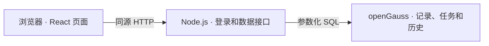

# 温故 · 滚动复习

温故是一个可以在自己电脑上运行的滚动复习网站。学完一个知识点后，记下科目、学习日期和要点，网站会按复习周期生成任务。每天打开「今日学习」，就能看到到期和逾期的内容；复习后还可以根据记忆情况安排加强复习。

## 从一条学习记录开始

假设今天学了「二叉树遍历」。选择短间隔周期后，系统会安排第 1、3、7、14 天，以及第 1、3、6 个月的复习。如果第 1 天复习时发现基本忘了，可以记录这次结果，并从这次复习起额外安排第 1、3、7 天的加强复习。已经逾期的安排会继续出现在待复习列表，同一个知识点的多项到期任务可以一次完成。

| 功能 | 用法 |
| --- | --- |
| 记录学习 | 添加知识点、选择科目和日期，可填写备注；支持预设周期和自定义周期 |
| 今日学习 | 查看当天到期和逾期的任务，标记完成、选择记忆效果或推迟到明天 |
| 按日回看 | 在「学习记录」切换过去和未来，按科目、关键词和日期筛选 |
| 调整计划 | 暂停当天及之后的未完成安排，支持当天撤销暂停；已逾期的任务仍保留 |
| 管理记录 | 编辑、归档或删除学习记录，按需导出和导入 JSON 备份 |

## 应用结构



前端使用 React 和 Vite。Node.js 提供页面与数据接口，使用连接池访问 openGauss。Docker Compose 管理 Web 和数据库容器，数据保存在独立数据卷中。

## Docker 快速启动

需要 Docker Engine、Docker Compose 和可拉取镜像的网络。克隆仓库或下载源码 ZIP 后，进入包含 `compose.yaml` 的目录。

1. 复制配置模板。Windows PowerShell 用 `Copy-Item .env.example .env`，Linux 用 `cp .env.example .env`。
2. 编辑 `.env`，分别为 `APP_PASSWORD`、`PGPASSWORD` 和 `GAUSS_ADMIN_PASSWORD` 设置密码。访问密码至少 12 位。数据库密码使用 12–24 位大小写字母、数字和符号组合，建议使用 `@` 作为符号。
3. 启动并查看状态。

   ```sh
   docker compose up -d --build
   docker compose ps
   docker compose logs --tail=60 web db
   ```

4. 打开 <http://localhost:8788>，用登录页显示的访问密码登录。<http://localhost:8788/health> 会实时查询数据库。
   首次建库会自动加入 6 条标有「示例记录」的学习记录，包含到期、逾期、已完成和未来复习。记录日期以首次启动当天为基准。使用原有数据库重新启动时会保留已有记录。
5. 停止用 `docker compose down`。之后再次启动会使用原来的 `study-data` 数据卷。数据库账户在数据卷首次初始化时创建，已初始化时要在数据库中修改密码并同步更新 `.env`。

本地部署使用 openGauss Lite 5.0.3，数据库端口只在 Compose 网络内访问。Web 端口默认绑定在本机。登录页会显示访问密码，当前配置面向本机演示。如果更改 `WEB_PORT`，同时调整 `PUBLIC_URL`。

## 连接已有的 CentOS openGauss

在 CentOS 上用具有相应权限的 openGauss 管理员，创建独立的实验账户和数据库。先用 `SHOW password_encryption_type;` 核对加密配置。为创建与 pg 的 MD5 认证兼容的实验账户，可在管理员确认后暂用 `gs_guc reload -D "$PGDATA" -c "password_encryption_type=0"` 并重新连接，建完账户后恢复原值。替换示例密码，执行以下 SQL 后连接新数据库并授予应用账户建表权限。

```sql
CREATE USER wengu_app WITH LOGIN PASSWORD '替换为实验数据库密码';
CREATE DATABASE wengu_lab OWNER wengu_app TEMPLATE template0 ENCODING 'UTF8' DBCOMPATIBILITY 'PG';
```

```sql
-- 连接到 wengu_lab 后执行
GRANT USAGE, CREATE ON SCHEMA public TO wengu_app;
```

让 openGauss 监听虚拟机的网络地址，并在 `pg_hba.conf` 中用 `host wengu_lab wengu_app <实际客户端地址或受限网段> md5` 放行实验账户。端口以实例实际配置为准，并在 CentOS 防火墙中放行对应来源。Node 的 pg 驱动需要兼容的 MD5 认证，本例使用专用实验账户并限制网络范围。实例配置修改后按相应参数的要求重载或重启。

在项目 `.env` 中清空 `COMPOSE_PROFILES`，将 `PGHOST` 设为 Windows 上的 Docker 容器可达的 CentOS IP，设置实际的 `PGPORT`、`PGDATABASE`、`PGUSER` 和 `PGPASSWORD`。重新执行 `docker compose up -d --build`。应用启动时执行 `SELECT version()` 确认服务端为 openGauss，再在目标数据库中建表。

## 数据库设计与访问

浏览器通过 `GET /api/state` 和 `PUT /api/state` 读取、保存。Node.js 用连接池访问 openGauss，SQL 的业务参数经参数绑定传递。

| 表 | 内容和关系 |
| --- | --- |
| `wengu_subject` | 科目，科目名为主键 |
| `wengu_study_record` | 学习记录，通过外键引用科目 |
| `wengu_review_task` | 单次复习安排，多条任务属于一条学习记录 |
| `wengu_review_event` | 完成历史和记忆效果，多条历史属于一条学习记录 |
| `wengu_workspace` | 同步版本、自定义周期和暂停撤销快照 |
| `wengu_session` | 登录会话的令牌摘要与有效期 |

学习记录、任务和完成历史各自成表。周期列表、撤销时需要的任务快照以 JSON 保留。新增、编辑、删除、复习及撤销操作在数据库事务中提交，版本号避免两个页面同时保存时覆盖彼此。外键保证归属有效，删除学习记录时级联删除相关任务和完成历史。

查看 [建表 SQL](db/schema.sql)、[数据访问代码](db/store.mjs) 和 [Docker 配置](compose.yaml)。

## 验证

- 运行 `npm ci`、`npm run build`、`npm test`，检查页面构建和复习逻辑。
- Docker 启动后，运行 `node --env-file=.env tests/smoke.mjs`，验证真实数据库连接、记录增改删、任务和历史保存及版本冲突。脚本会清理自己创建的记录。
- 手工验收时可将学习日期选为昨天，使用包含 `1d` 的周期，添加后在「今日学习」完成复习，再从「学习记录」查看结果。重启 Web 容器后刷新，检查数据是否仍在。

源码共享时只上传源文件和配置模板。实际 `.env`、数据库卷、备份和依赖目录由部署环境保管。
