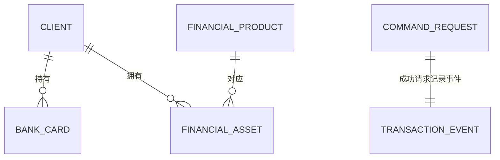

# GaussDB 金融场景综合实践

基于 **GaussDB、Java 11 与 JDBC** 实现客户、银行卡、理财产品及资产管理，使用中文命令行菜单完成开户、开卡、申购、赎回和销户；配套 SQL、云端运行日志、截图与数据库运维记录。

本仓库对应课程的**实验五**。在基础业务和管理运维之外，完成了**数据查询与分析**、**数据正确性与可靠性**两个进阶方向。


*菜单实际输出：客户基本信息、银行卡与资产详情。*

**快速导航：** [环境与运行](#环境与运行) · [基础功能](#基础功能) · [进阶一：报表分析](#进阶一报表分析) · [进阶二：事务与并发](#进阶二事务与并发) · [管理与运维](#管理与运维) · [测试与结果](#测试与结果) · [问题处理与总结](docs/实验记录.md)

## 实验记录与材料

| 项目 | 内容 |
| --- | --- |
| 实验主题 | 金融场景下 GaussDB Java 编程综合实践 |
| 实验日期 | 2026 年 11 月 3 日 |
| 班级、姓名、学号、成员分工 | 待填写 |
| 实验报告 | [A4 竖版 PDF，20 页](docs/实验五_GaussDB金融场景综合实践_A4竖版报告.pdf) |
| 详细操作记录 | [环境、关键步骤、问题排查与总结](docs/实验记录.md) |
| 进阶说明 | [目标、实现、验证及代码位置](docs/进阶实现.md) |
| 验收清单 | [基础与进阶逐项记录](docs/实施与验收清单.md) |

## 环境与运行

### 实际环境与依赖

| 组件 | 实测配置 |
| --- | --- |
| GaussDB | 北京四；集中式 1 主 2 备；4 vCPU / 16 GB；40 GB 存储 |
| 服务端内核 | GaussDB Kernel 507.0.0，build `d414f3bb` |
| 控制台版本 | V2.0-10.0.0 |
| 客户端 | CentOS 7.6.1810，x86_64；与数据库处于同一 VPC |
| JDK | OpenJDK 11.0.10+9，Eclipse OpenJ9 |
| gsql | 505.1.0，build `21af9b4f` |
| JDBC | 官方 `Centralized/Euler2.5_X86_64` 分发目录的 `gaussdbjdbc.jar` |
| 数据库 / 编码 / 模式 | `finance` / `UTF8` / `finance` |
| 用户 | `db_dev` 为普通开发用户；`test` 用于权限验证 |

驱动类为 `com.huawei.gaussdb.jdbc.Driver`，连接前缀为 `jdbc:gaussdb://`。官方驱动元数据中的版本字段为构建占位符，使用分发目录和 SHA-256 标识实际依赖：

```text
72ffc8da0de0a41c7c6b6c71f727c78a344a97d06e3d7449bcfeb9c90f580c71
```

安装脚本包含官方驱动与 JDK 下载地址及驱动摘要校验。临时教学实例的历史地址仅用于对应运行记录；重新实验时填写当前实例的私网地址。密码通过交互式终端输入，不写入配置。

### 1. 下载、安装与编译

在同 VPC 的 x86_64 Linux 客户端执行，安装脚本使用 `/root/finance-lab`：

```bash
git clone https://github.com/SmartR168/GaussDB.git /root/finance-lab
cd /root/finance-lab
bash scripts/setup.sh
source scripts/env.sh

# 修改 Java 源码后可单独重新编译
bash scripts/compile.sh
```

`setup.sh` 配置 JDK、gsql 和官方 JDBC 驱动，记录版本并编译；`compile.sh` 以 Java 11、UTF-8 编译 `src/` 下的完整源码。

### 2. 创建数据库与普通用户

以下操作要求目标实例尚无同名 `finance` 数据库及 `db_dev`、`test` 用户：

```bash
bash scripts/run.sh provision <当前数据库私网IP>
```

依次输入数据库 root 密码，设置并确认两个普通用户密码，按提示输入 `CREATE`。程序创建 UTF8 数据库、普通用户和归属 `db_dev` 的模式，并生成无密码的 `config/db.properties`。已有同名对象时停止，先检查对象状态。

若连接已准备好的本实验库，可复制 [配置模板](config/db.properties.example) 并修改地址：

```bash
cp config/db.properties.example config/db.properties
```

```properties
JDBC_DRIVER=com.huawei.gaussdb.jdbc.Driver
DB_URL=jdbc:gaussdb://<当前数据库私网IP>:8000/finance
USER=db_dev
```

### 3. 建表、初始化与验收

```bash
bash scripts/run.sh acceptance
```

交互输入 `db_dev` 密码后，程序按顺序完成建表、原始数据初始化、DAO、业务、事务、并发和报表检查，导出三类 CSV 及切换前快照。

首次验收要求空实验库，六张表均不存在，测试 ID `900000` 以上及 `lab5_` 请求号未使用。不要对已完成的数据库重复执行初始化。数据库或用户创建流程与业务初始化是两个步骤。

对应 SQL：

1. [`01_schema.sql`](scripts/01_schema.sql)：四张业务表、请求表、事件表、约束与索引。
2. [`02_seed.sql`](scripts/02_seed.sql)：讲义原始 28 条记录，行数为 **10 / 10 / 4 / 4**。
3. [`report_client.sql`](scripts/report_client.sql)、[`report_product.sql`](scripts/report_product.sql)、[`report_month.sql`](scripts/report_month.sql)：三类报表。
4. [`03_independent_verify.sql`](scripts/03_independent_verify.sql)：以 gsql 独立核对。

### 4. 启动中文业务菜单

```bash
bash scripts/run.sh launch
```

| 菜单 | 功能 | 菜单 | 功能 |
| --- | --- | --- | --- |
| 1 | 客户列表 | 8 | 产品列表 |
| 2 | 客户详情 | 9 | 理财申购 |
| 3 | 修改客户 | 10 | 理财赎回 |
| 4 | 开户 | 11 | 客户资产汇总 |
| 5 | 开卡 | 12 | 产品持仓 |
| 6 | 销卡 | 13 | 指定日期区间月度统计 |
| 7 | 销户 | 0 | 退出 |

## 基础功能

业务使用四张基础表：`client`、`bank_card`、`financial_product`、`financial_asset`。客户与银行卡、客户与资产、产品与资产均是一对多关系。



| 层次 | 对应代码 | 作用 |
| --- | --- | --- |
| 连接与 SQL | [DBUtils.java](src/expt/db/finance/DBUtils.java) | JDBC、参数绑定、结果转换、资源关闭 |
| 数据访问 | [dao/](src/expt/db/finance/dao) | 客户、银行卡、产品和资产的增删改查，返回实际影响行数 |
| 业务 | [Service.java](src/expt/db/finance/Service.java) | 参数校验、所属者校验、冻结限制、销户检查、事务 |
| 交互 | [FlowControl.java](src/expt/db/finance/FlowControl.java)、[launch.java](src/expt/db/finance/launch.java) | 中文命令行菜单 |
| 初始化 | [initTables.java](src/expt/db/finance/initTables.java)、[initData.java](src/expt/db/finance/initData.java) | 按 SQL 创建对象、写入并核对原始数据 |

DAO 和业务层共同核对影响行数，修改或删除不存在记录时不会报告成功。客户仍有银行卡或持仓时禁止销户；销卡和赎回校验所属者；冻结资产禁止赎回。


*中文菜单返回 10 名原始客户。开户、修改、开卡、申购、赎回、销卡、销户形成完整业务测试流程。*

## 进阶一：报表分析

**目标：** 将原有单项查询扩展为客户资产分析、产品持仓和时间统计，并避免多表关联重复计算。

- 客户资产报表：银行卡数、持仓数、金额、收益、可用金额和冻结金额；保留零持仓客户。
- 产品持仓报表：资产数、不同客户数、金额、收益及冻结金额。
- 月度报表：起日包含、止日不含，按显式 `YYYY-MM` 分组。
- 通过菜单 11—13 查询，或执行 `bash scripts/run.sh reports` 导出 UTF-8 CSV。

卡与资产分别预聚合后再关联客户，验证两张卡、三项资产时金额为 **304**，不会被连接放大为 **608**；测试覆盖零持仓与 7 月 31 日、8 月 1 日边界，夹具最后回滚。


*2018-07-01 至 2018-08-01：4 笔持仓、4 名客户、申购金额合计 10、收益合计 32010。*

实现位置：[Reports.java](src/expt/db/finance/Reports.java)、[三份报表 SQL](scripts)、[ScenarioTest.reportFixture](src/expt/db/finance/ScenarioTest.java)。结果文件：[客户资产](data/report_client.csv)、[产品持仓](data/report_product.csv)、[月度统计](data/report_month.csv)。

## 进阶二：事务与并发

**目标：** 避免重复提交、部分写入、重复赎回与销户检查竞争。

- **原子事务**：持仓变化、请求结果和事件记录同时提交；中途异常全部回滚。
- **幂等请求**：请求号唯一，绑定动作及完整业务参数摘要。同号同参数重放原结果，同号不同参数拒绝。
- **并发协调**：统一先锁客户，再处理持仓；真实两个线程分别使用独立连接竞争。
- **历史保留**：赎回删除持仓，但请求与事件保留，销户后仍可检查交易历史。


*相同请求号并发申购：一笔提交、一笔重放，资产／请求／事件各 1 条。同一持仓用不同请求号并发赎回：仅一笔成功，另一笔以 `P0002` 失败且回滚。*

实现位置：[Service.java](src/expt/db/finance/Service.java)、[ScenarioTest.java](src/expt/db/finance/ScenarioTest.java)、[`command_request` 与 `transaction_event`](scripts/01_schema.sql)。完整说明见 [进阶实现](docs/进阶实现.md)。

两项进阶按课程的**复杂性与技术深度（8 分）、新颖性与改进价值（6 分）、全面性与验证充分性（6 分）**说明实现与证据，不按功能数量或每个方向 10 分计算。

## 管理与运维

| 项目 | 实际操作与结果 | 核对入口 |
| --- | --- | --- |
| 普通用户权限 | 无模式权限拒绝；仅 USAGE 仍拒绝；授予 client SELECT 后读 10 行；其他表和 UPDATE 仍拒绝 | `bash scripts/run.sh permissions <私网IP>`；[日志](logs/cloud/permissions_verified.txt) |
| DN 主备倒换 | 主节点由 `root_0` 变为 `root_1`，三节点正常；使用原浮动地址重新连接 | 切换完成后 `bash scripts/run.sh verify` |
| 数据一致性 | 六表完整有序 CSV 逐字节相同，SHA-256 一致 | [前快照](data/before_switch)、[后快照](data/after_switch)、[比较结果](data/snapshot_verification.json) |
| 自动备份 | 保留 5 天；周六、周日；03:00—04:00（GMT+08:00） | [策略截图](evidence/07_backup_policy_saved.png) |
| 手动备份 | `backup-bd5f` 完成，58.22 MB | [备份截图](evidence/24_manual_backup_complete.png)、[完成任务](evidence/25_backup_task_complete.png) |
| 参数与目录 | `autoanalyze=on`；UTF8；检查模式、表归属和索引 | [独立 gsql 日志](logs/cloud/gsql_independent_verify.txt) |


*倒换后 `root_1` 为主、`root_0` 为备。*


*通过新连接比较六张表的完整有序快照。*

独立交叉检查命令：

```bash
gsql -h <当前数据库私网IP> -p 8000 -d finance -U db_dev \
  -f scripts/03_independent_verify.sql
```

`permissions` 的三阶段测试要求 `test` 初始未被授权；`verify` 不重做建表、初始化和业务变更，但会导出报表及切换后快照。重新实验时先运行本轮 `acceptance` 生成基准，不能拿其他实例的历史快照充当本轮基准。

## 测试与结果

验收在云端分阶段完成，原始失败日志与修正后的通过日志均保留。各阶段含重复核对项目，**不将其累加为独立测试总数**。

| 阶段 | 真实结果 | 记录 |
| --- | --- | --- |
| DAO、业务与可靠性 | 首轮前 51 项通过，随后报表日期夹具报错 | [cloud_acceptance.txt](logs/cloud/cloud_acceptance.txt) |
| 修正后的报表续测 | 14 项通过，生成报表及基准快照 | [cloud_reports_verified.txt](logs/cloud/cloud_reports_verified.txt) |
| 普通用户权限 | 5 项通过 | [permissions_verified.txt](logs/cloud/permissions_verified.txt) |
| 主备倒换后新连接 | 15 项通过，六表快照一致 | [post_switch_verify.txt](logs/cloud/post_switch_verify.txt) |
| 独立 gsql | 脚本完整执行，三类异常计数均为 0 | [gsql_independent_verify.txt](logs/cloud/gsql_independent_verify.txt) |
| 中文菜单 | 客户列表、详情、产品及三类报表，0 正常退出 | [menu_demo.txt](logs/cloud/menu_demo.txt) |

最终行数为 `client=10`、`bank_card=10`、`financial_product=4`、`financial_asset=4`、`command_request=4`、`transaction_event=4`。未完成请求、缺失事件和孤立持仓均为 **0**。


本地报表逻辑检查可执行：

```bash
python3 tests/check_reports.py
```

该脚本使用 SQLite 夹具核对聚合及边界逻辑，云端实际结果以以上 GaussDB 日志为准。`resume-reports` 是本次日期修正后的续测动作，仅适用于前 51 项业务已经完成的相应状态。

## 目录

```text
├── src/expt/db/finance/     # JDBC、DAO、业务、菜单与验收程序
├── scripts/                # 安装、编译、启动、建表、种子及查询 SQL
├── config/                 # 不含密码的配置模板
├── tests/                  # 本地报表逻辑检查
├── data/                   # CSV 报表与主备切换前后快照
├── logs/cloud/             # 实际云端执行日志
├── evidence/               # 实际操作及结果截图
└── docs/                   # 实验报告、操作记录和进阶说明
```

## 数据口径与来源

表字段、原始 28 条初始化记录、基础业务流程及运维要求依据课程《GaussDB案例》案例五 5.1—5.7；评价与材料要求依据《数据库课程期末大作业说明》。JDBC、gsql 及 JDK 下载来源见 [setup.sh](scripts/setup.sh)。

沿用讲义的整数申购金额与收益字段：原始申购金额为 4、3、2、1，收益为 8001—8004；不据此推导投资回报率。`p_amount` 不额外解释为最低申购门槛。只实现讲义中的理财产品类型 `a_type=1`；月度报表统计当前持仓的申购日期，已赎回交易可在事件表查询。

问题排查、日期兼容修正、实验总结及后续改进见 [实验记录](docs/实验记录.md)。
