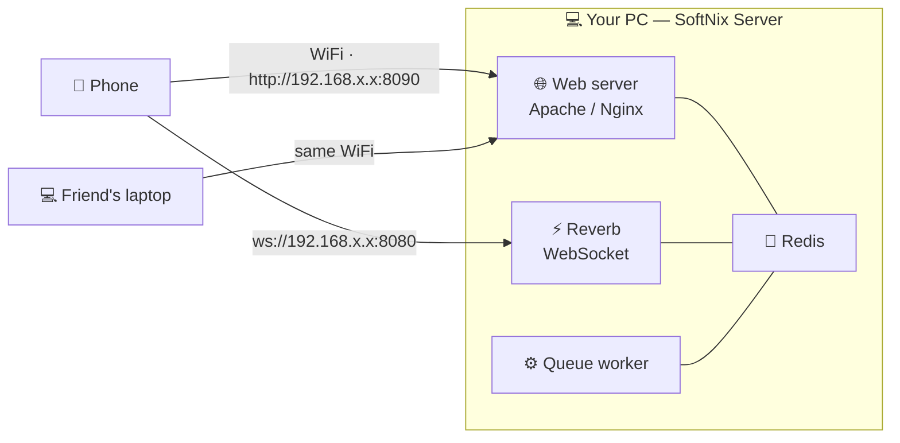

# SoftNix Server

### Local + Live PHP Server for Windows

**A free, fast and secure local development server for PHP & Laravel — with a one-click Realtime mode for WebSockets, queues and WiFi sharing.**

 

  

[Features](#-features) •
[Screenshots](#-screenshots) •
[Install](#-installation) •
[Quick start](#-quick-start) •
[Realtime mode](#-realtime-mode) •
[FAQ](#-faq) •
[Support](#-support)

 

---

## ✨ Why SoftNix Server?

Most local servers stop at "Apache + PHP + MySQL". SoftNix Server gives you all of that **plus the things modern
PHP apps need** — Redis, WebSockets, queue workers, HTTPS domains and sharing your app with phones on the same WiFi —
in one small app with **one click per task**.

- 🆓 **Free** — no license key, no nag popups, no ads.
- ⚡ **Realtime built-in** — Redis + Laravel Reverb (WebSocket) + Queue worker + WiFi share with QR code.
- 🔒 **Secure by default** — services listen on `127.0.0.1`, every download is SHA-256 verified, no tracking.
- 🪶 **Tiny installer** (~2 MB) — it downloads only the servers you choose, from their official websites.
- 🔄 **Auto-updates** — new versions are offered inside the app; your projects and databases are always kept.
- 🧩 **All-in-one** — PHP extensions, Xdebug, Node versions, PostgreSQL, dump viewer, database snapshots, public share links
  and one-click deploy to your hosting: the tools you used to install separately, built in (and downloaded only when you use them).

---

## 🚀 Features

<table>
<tr>
<td width="50%" valign="top">

### 🌐 Web server
- **Apache** (mod_php) **or Nginx** (PHP FastCGI) — switch any time
- **PHP 8.2 · 8.3 · 8.4 · 8.5** — install and switch in one click
- **Automatic domains** — every folder in `www` becomes `https://folder.test`
- **HTTPS** with a local certificate authority (trusted once)
- Laravel `public/` folder detected automatically
- **PHP extensions on/off** with a tick (gd, intl, zip, sodium, pgsql…)
- **PHP quick settings** — upload size, memory limit, max execution time
- **Xdebug** on/off for VS Code / PhpStorm (downloaded when first turned on)
- **Dashboard at `http://localhost`** — all projects, services and tools (only on this PC)
- Edit `php.ini`, custom server config, view logs from the menu

</td>
<td width="50%" valign="top">

### 🗄️ Databases
- **MariaDB / MySQL** with multiple versions
- **phpMyAdmin** at `http://localhost/phpmyadmin` (local only)
- **Adminer** — also opens **SQLite** files
- **SQLite** support + `sqlite3` command line
- One-click **project database** with its own user (`.env` filled for you)
- **PostgreSQL** (optional download, `postgres` / `postgres`, this PC only)
- **Database snapshots** — save a project's database in one click and restore it later
- Import `.sql` files and **import databases from Laragon**

</td>
</tr>
<tr>
<td valign="top">

### 🧰 Laravel & PHP tools
- **Quick app**: Laravel, **WordPress**, blank PHP
- **Composer** and **Node.js 20 / 22 / 24** (switch versions) on the terminal PATH
- **Dumps & Logs** — `dump()` / `dd()` shown in a window instead of the page, and `laravel.log` live with an *Errors only* filter
- **Scheduler on/off** per project (runs `schedule` every minute — no Windows Task Scheduler)
- Run migrations, install Reverb, open terminal in a project
- **Procfile** — keep `npm run dev`, schedulers or any command running with *Start all*
- Built-in **Terminal** with the right PHP / MySQL / Composer / Node

</td>
<td valign="top">

### ⚡ Realtime mode
- **Redis** (password protected, local only)
- **Laravel Reverb** WebSocket server
- **Queue worker** that restarts when it stops
- **WiFi / LAN share** — open your app on phones and other PCs
- **QR code** for instant phone testing
- Firewall rule limited to your **private network & local subnet**
- 🌍 **Share online** — a temporary public `https://…trycloudflare.com` link for client demos and webhook tests (bKash, SSLCommerz, Stripe)

</td>
</tr>
<tr>
<td valign="top">

### ✉️ Mail
- **Mailpit** catches every email locally (web inbox)
- Switch a project's mail to Mailpit or **real SMTP** (Gmail etc.) in one click
- Release caught emails through your real SMTP

</td>
<td valign="top">

### 🎛️ App
- Light & **dark theme**, system tray, start with Windows
- **First-time setup** downloads everything you pick (~170 MB)
- Logs viewer, settings window, port editor
- **Auto-update** from GitHub Releases (SHA-256 verified)
- **Deploy to live** — uploads only the changed files to your hosting over SSH (key login), runs migrations, maintenance page while it updates
- **Settings → Downloads** — see and remove optional add-ons
- Clean uninstall — **keeps your projects and databases**

</td>
</tr>
</table>

---

## 📸 Screenshots

| Main window | Menu |
|:---:|:---:|
|  |  |
| **Realtime mode + QR** | **Dark mode** |
|  |  |
| **Project tools** (Menu → www → project) | **Dashboard at `http://localhost`** |
|  |  |

---

## 📦 Installation

1. **Download** `SoftNixServer-Setup-x.y.z.exe` from the [latest release](https://github.com/SoftnixOfficial/SoftNixServer/releases/latest).
2. **Run it.** It installs to `C:\softnix` and adds the Microsoft **.NET 8 Desktop Runtime** and **VC++ Runtime** if they are missing.
3. **First-time setup** opens automatically — choose PHP version, Apache, MariaDB, phpMyAdmin, Composer, Node, Mailpit, Redis → **Install**.
4. Click **Start all**. Done! Open <http://localhost>.

> [!NOTE]
> The installer is not code-signed yet, so Windows SmartScreen may show *"Windows protected your PC"*.
> Click **More info → Run anyway**. Every server SoftNix downloads is checked with SHA-256 before use.

### Requirements
- Windows 10 (1809+) or Windows 11, 64-bit
- Internet connection for the first-time downloads
- Free ports 80 / 443 / 3306 (stop Laragon / XAMPP / IIS first, or change the ports in Settings)

---

## 🏁 Quick start

| I want to… | Do this |
|---|---|
| Create a Laravel app | **Menu → Quick app → Laravel** → open `https://myapp.test` |
| Create a WordPress site | **Menu → Quick app → WordPress** → the installer opens in your browser |
| Use an existing project | Copy its folder into `C:\softnix\www` → **Menu → Apache/Nginx → Sync domains** |
| Connect a database | **Menu → www → your project → Connect MySQL database** (or *Use SQLite*) |
| Open phpMyAdmin | Click **Database** or open <http://localhost/phpmyadmin> |
| Run `npm run dev` with Start all | **Menu → Procfile** → add `vite: myapp \| npm run dev` |
| Switch PHP version | **Menu → PHP → Version** |
| Turn a PHP extension on / off | **Menu → PHP → Extensions** → tick it |
| Bigger upload / memory limit | **Menu → PHP → Quick settings** |
| Debug with Xdebug | **Menu → PHP → Xdebug** → VS Code "Listen for Xdebug" |
| Use another Node version | **Menu → Tools → Node version** |
| See `dump()` / `dd()` and `laravel.log` | Click **Dumps** |
| Run Laravel's scheduler | **Menu → www → your project → Scheduler** |
| Save / restore the database | **Menu → www → your project → Database snapshot** |
| Show your project to a client (public link) | **Menu → www → your project → Share online** |
| Upload changes to your hosting | **Menu → www → your project → Deploy to live** |
| Use PostgreSQL | **Menu → Quick add → PostgreSQL**, then project → *Use PostgreSQL database* |
| See all projects in the browser | Open <http://localhost> |

**MySQL login:** user `root`, password `root` (like XAMPP / Laragon). MySQL accepts connections from this PC only.
Prefer a strong random password? **Settings → MySQL → Use a strong random root password**.

---

## ⚡ Realtime mode

Test chat apps, live notifications, multiplayer games and dashboards **on real phones** — no internet hosting needed.

1. Click **⚡ Realtime** and choose your Laravel project.
2. SoftNix starts Redis, Reverb and the queue worker, and fills the project's `.env`.
3. **Scan the QR code** with your phone (same WiFi) — your app opens live.

> [!IMPORTANT]
> Realtime mode is for your **local network only** (same WiFi). It never exposes your PC to the internet.

---

## 🔀 Apache or Nginx?

| | Apache | Nginx |
|---|---|---|
| PHP | mod_php (fast, simple) | php-cgi FastCGI pool (4 workers) |
| `.htaccess` | ✅ Supported | ❌ Not used (rules are generated) |
| Best for | WordPress, classic PHP, most projects | Matching an Nginx production server |
| Switch | **Menu → Apache/Nginx → Web server** | Domains, HTTPS and Realtime work on both |

---

## 🔒 Security

- All servers listen on **127.0.0.1**; only the Realtime LAN port is opened, and only to your private network.
- **Redis** always uses a password; phpMyAdmin, Adminer and Mailpit are reachable **only from this PC**.
- Downloads are **HTTPS only** and **SHA-256 verified** before they are used. Archives are checked against path tricks.
- Secrets (Redis password, random MySQL password, SMTP password) are encrypted with **Windows DPAPI**.
- Administrator rights are requested only for the hosts file, the firewall rule and uninstall cleanup.
- **No tracking.** The app checks GitHub for updates (can be turned off in Settings).
- **Anonymous usage count:** the installer sends *install / update / uninstall* (with an optional reason you pick when
  uninstalling), and the app sends one "still in use" signal per day — only a random ID, the app version and the Windows
  version. No name, no files, no projects. To turn it off, run the setup with `/NOSTATS`.
- **Feedback** you send from *Help → Report a bug / Request a feature* goes to the SoftNix team (your email only if you type it).

---

## ❓ FAQ

<b>Port 80 is already in use</b>

Another server is running (Laragon, XAMPP, IIS, Skype…). Stop it, or change the port in **Settings → Ports**.
SoftNix shows which program uses the port.

<b>https://myapp.test does not open</b>

Click **Yes** when Windows asks for permission to update the hosts file, and trust the local certificate once
(**Menu → SSL**). You can always use <code>http://localhost/myapp/</code>.

<b>How do I update?</b>

SoftNix checks for updates when it starts. When a new version is out you'll see <b>Update now</b> — it downloads,
verifies and installs the update and restarts the app. Or use <b>Help → Check for updates</b>.

<b>Will uninstalling delete my projects?</b>

No. Uninstall removes the app, the downloaded servers, logs, the hosts entries, the firewall rule and the local certificate.
Your <code>www</code> (projects), <code>data</code> (databases) and <code>etc</code> (settings) folders are kept.

<b>I'm moving from Laragon — how do I bring my projects?</b>

<b>Menu → Tools → Move from Laragon</b> (SoftNix also asks on first start). Pick your projects and databases: they are
<b>copied</b> into SoftNix, and Laravel <code>.env</code> / WordPress <code>wp-config.php</code> are pointed at SoftNix's MySQL
automatically. Laragon's own files are never changed. If Laragon is still running, SoftNix tells you and offers a free port.

---

## 💬 Support

Found a bug or need help? We're happy to help.

Inside the app: **Help → Report a bug** or **Help → WhatsApp support**.

---

## ☕ Support the project

SoftNix Server is free. If it saves you time, you can buy the developer a coffee — thank you! ❤️

<!-- PayPal (hidden for now). To show it, remove these comment marks:
&nbsp;

-->

---

## 👨‍💻 Developer

<table>
<tr>
<td></td>
<td>
<b>Ali Ajgor</b> 
Founder & Lead Developer, <b>SoftNix</b> 
<a href="mailto:support@softnix.bd">support@softnix.bd</a> ·
<a href="https://github.com/SoftnixOfficial">github.com/SoftnixOfficial</a>
</td>
</tr>
</table>

---

## 📜 License & credits

SoftNix Server is **freeware** — free for personal and commercial use. Selling it, rebranding it or distributing
modified copies is not allowed. See [LICENSE.md](LICENSE.md).

SoftNix Server downloads and runs these open-source projects, each under its own license:
Apache HTTP Server, Nginx, PHP, MariaDB, MySQL, Redis, Mailpit, phpMyAdmin, Adminer, Composer, Node.js, SQLite and WordPress.
They are not part of SoftNix Server and belong to their respective owners.

 

Made with ❤️ by **SoftNix**

© 2026 SoftNix. All rights reserved.

