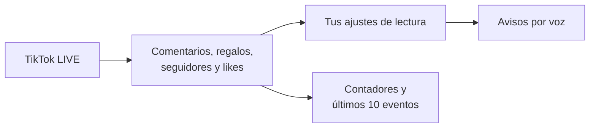

  
  <h1>TikVoz</h1>
  
Escucha lo que pasa en tu TikTok LIVE mientras transmites.

  
  

## Descargar para Android

**[Descargar TikVoz 0.5.0 (.apk)](https://github.com/Suarezsh/TikVoz/releases/download/v0.5.0/TikVoz-0.5.0.apk)**

Abre el enlace en tu celular y toca el archivo descargado para instalarlo. Requiere **Android 9 o posterior de 64 bits**. La APK pesa **48,31 MB**.

## Cómo funciona

| En TikVoz | Qué puedes hacer |
| --- | --- |
| **Conexión** | Escribir el usuario del directo y ver la onda verde cuando se conecta. |
| **Lectura por voz** | Elegir qué tipos de evento se leen y si se anuncian el nombre y los emojis. |
| **Configuración** | Escuchar una muestra y ajustar el perfil de voz, la velocidad y la cola de mensajes. |
| **Actividad reciente** | Consultar los últimos diez eventos y los contadores del directo. |
| **Notificación** | Revisar el estado, abrir TikVoz o desconectar mientras usas TikTok. |

## Tu primer directo con TikVoz

1. Escribe el usuario de una cuenta que esté en directo y pulsa **Conectar**.
2. Abre **Menú → Configuración** para elegir qué quieres escuchar.
3. Vuelve a TikTok. Puedes consultar el estado de la conexión desde la notificación.
4. Cuando termines, pulsa **Desconectar**. Para salir de la app, usa **Menú → Cerrar TikVoz**.

## Novedades de la versión 0.5.0

- Nuevo logo de TikVoz en la cabecera, el icono de Android y la notificación.
- Menú lateral accesible desde todas las pantallas.
- Onda verde animada junto al usuario cuando el directo está conectado.

[Ver el historial de versiones](https://github.com/Suarezsh/TikVoz/releases)

## Desarrollador

**SUAREZ SH** · [sfysh.com](https://sfysh.com)
