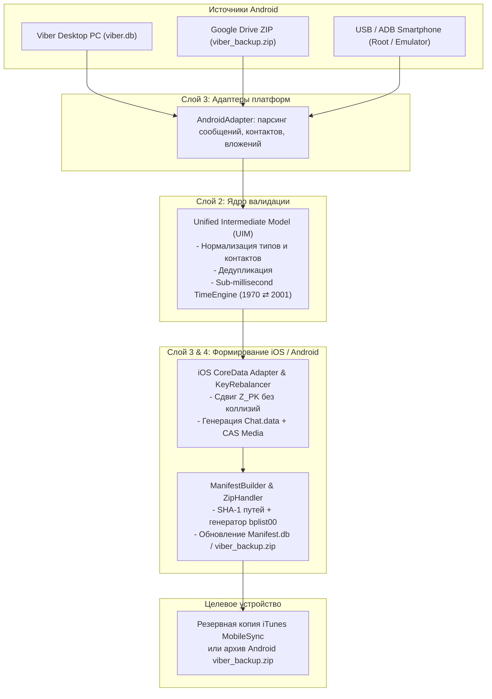

# 🚀 Viber Cross-Platform Transfer (Desktop PC Edition)

<div align="center">

[-blue.svg?style=for-the-badge&logo=github)](https://github.com/Suetzume/viber-transfer-pc/releases/latest)
[-success.svg?style=for-the-badge&logo=windows)](https://github.com/Suetzume/viber-transfer-pc/releases/latest)
[-brightgreen.svg?style=for-the-badge&logo=checkmarx)](tests/)
[](https://github.com/Suetzume/viber-transfer-pc/releases/latest)
[-orange.svg?style=for-the-badge)](LICENSE)
[](#гарантия-целостности-zero-data-loss)
[](#двусторонняя-миграция)

**Automated local desktop utility for lossless bidirectional migration of Viber chat history, media attachments, and contacts between Android and Apple iOS (iPhone).**

**Автоматизированный настольный инструмент для двустороннего переноса истории чатов, медиавложений и контактов Viber между Android и Apple iOS (iPhone) без потери данных.**

<h3>
  <a href="https://github.com/Suetzume/viber-transfer-pc/releases/latest">📥 Скачать последний релиз (ViberTransfer.exe) / Download Latest Release</a>
</h3>

[ 🇷🇺 Перейти к документации на русском языке ](#-русский-раздел) &nbsp;&bull;&nbsp; [ 🇬🇧 Switch to English Documentation ](#-english-section)

</div>

---

<a name="-русский-раздел"></a>
## 🇷🇺 Русский раздел

### 📌 О проекте

Официальное приложение **Viber** не поддерживает прямой перенос переписок между различными мобильными операционными системами:
* **Android** сохраняет резервные копии исключительно в облако **Google Drive** в формате ZIP-архива с реляционной базой SQLite (`viber_messages`).
* **iOS (iPhone)** использует облако **Apple iCloud** с проприетарной базой данных **Apple CoreData** (`Chat.data`).

Из-за несовместимости схем таблиц, эпох отсчета времени (Unix Epoch `1970` vs Apple Cocoa Epoch `2001`), алгоритмов связывания внешних ключей и SHA-1 хеширования путей перенос переписок штатными средствами невозможен.

**Viber Cross-Platform Transfer** решает эту задачу полностью локально на вашем ПК:
1. Извлекает переписку через **No-Root ассистент Viber Desktop (ПК)**, из официального архива **Google Drive (`viber_backup.zip`)** или напрямую по **USB / ADB (при наличии Root-прав)**.
2. Нормализует все сущности в строго типизированную промежуточную модель **Unified Intermediate Model (UIM)** с дедупликацией и валидацией.
3. Конвертирует данные в схему iOS CoreData (`Chat.data`), пересчитывает первичные ключи (`KeyRebalancer`) без потери существующих чатов на iPhone, вычисляет SHA-1 хеши путей и обновляет бинарный реестр бэкапа Apple (`Manifest.db` + `bplist00`).
4. Поддерживает **полный реверс-перенос (`iPhone ➔ Android`)** с формированием готового архива `viber_backup.zip` и пошаговым мастером восстановления на Android.

> [!IMPORTANT]
> **100% Приватность и Локальность:** Все операции выполняются исключительно на вашем компьютере. Ваши личные сообщения, фотографии, голосовые заметки и контакты **никогда не отправляются на сторонние серверы**.

---

### ✨ Ключевые возможности

* ⇄ **Полная двусторонняя миграция (Bidirectional):**
  * **Android ➔ iPhone:** Извлечение из Viber Desktop / Google Drive `viber_backup.zip` / USB ADB (Root) ➔ слияние с незашифрованной резервной копией iTunes / Apple Devices.
  * **iPhone ➔ Android (Реверс):** Извлечение из бэкапа iPhone MobileSync (`Chat.data` + медиа) ➔ упаковка эталонного архива `viber_backup.zip` с проверкой контрольных сумм CRC32 и инструкцией восстановления для Android.
* 🛡️ **Гарантия целостности Zero Data Loss:**
  * Сохранение личных и групповых чатов, текстовых сообщений, эмодзи, стикеров, системных событий и звонков.
  * Перенос фотографий, голосовых сообщений (`.m4a`), видео и документов через Content-Addressed Storage (CAS SHA-256).
  * Субмиллисекундная точность конвертации времени между эпохами Unix и Apple Cocoa.
* ⚡ **Два способа переноса БЕЗ Root-прав + поддержка прямого USB/ADB (Root):**
  * **Без Root (Способ 1 — Viber Desktop):** Синхронизация смартфона с Viber на ПК по QR-коду за 10 секунд.
  * **Без Root (Способ 2 — Архив Google Drive):** Прямая распаковка и миграция архива `viber_backup.zip`.
  * **С Root-доступом (Способ 3 — USB / ADB):** Автоматическая проверка наличия `su` (`uid=0`), прямое извлечение `/data/data/com.viber.voip/databases/viber_messages` и инвентаризация медиафайлов в `/sdcard/Android/data/com.viber.voip/files/`.
* 🍏 **Защита безопасности Apple Restore Safeguards:**
  * Автоматическое обнаружение резервных копий iPhone в системном каталоге `Apple Computer\MobileSync\Backup`.
  * Блокировка модификации зашифрованных паролем копий (`IsEncrypted: true`) для предотвращения ошибок iTunes 14/54.
  * Интерактивный мастер отключения службы *«Локатор» (Find My iPhone)* перед финальной прошивкой бэкапа.
* 🤖 **Встроенный комплекс аппаратных эмуляторов (`Setup_Emulators.bat`):**
  * Включает виртуальный сетевой демон **Google Pixel 8 Pro (Android 14)** по протоколу TCP ADB (`127.0.0.1:5555`) и эталонный виртуальный слепок **iPhone 15 Pro (iOS 18.1)** для iTunes MobileSync — позволяет протестировать весь цикл переноса на 100% без физических телефонов.
* 🌐 **Двуязычный интерфейс (RU / EN):**
  * Мгновенное переключение между русским и английским языками кнопкой `🌐 RU / EN` в шапке программы.
* 📦 **Автономный запуск в 1 клик (`ViberTransfer.exe`):**
  * Портативный исполняемый файл со встроенным движком Node.js и SQLite — не требует установки зависимостей.

---

### 🚀 Быстрый старт и скачивание

#### Вариант 1: Готовый портативный файл `ViberTransfer.exe` (Рекомендуется)
1. Скачайте **`ViberTransfer.exe`** из раздела **[Последний релиз (Releases)](https://github.com/Suetzume/viber-transfer-pc/releases/latest)** (также доступен в правой панели репозитория GitHub).
2. Запустите `ViberTransfer.exe` в один клик — программа автоматически поднимет локальный сервер и откроет интерфейс в браузере.

> [!NOTE]
> ℹ️ **Если Windows Defender SmartScreen показал предупреждение при запуске:**
> Ознакомьтесь с [простой инструкцией запуска в 2 клика](#-предупреждение-windows-defender-smartscreen-при-первом-запуске) ниже (это стандартная реакция Windows на бесплатные открытые программы без платного сертификата).

#### Вариант 2: Запуск из исходного кода через `Start_App.bat`
```bat
Start_App.bat
```
*(Скрипт автоматически включает кодировку UTF-8 `chcp 65001`, освобождает порт `34567` от старых процессов и открывает GUI).*

#### Вариант 3: Запуск с виртуальными эмуляторами Android 14 и iPhone 15 Pro
```bat
Setup_Emulators.bat
```

---

<a name="-предупреждение-windows-defender-smartscreen-при-первом-запуске"></a>
### 🛡️ Предупреждение Windows Defender SmartScreen при первом запуске

При первом запуске скачанного файла `ViberTransfer.exe` операционная система Windows может показать окно защитника: **«Система Windows защитила ваш компьютер. Фильтр SmartScreen в Microsoft Defender предотвратил запуск неопознанного приложения...»**

> [!NOTE]
> **Почему это происходит?**
> `ViberTransfer.exe` — это бесплатный проект с открытым исходным кодом (Open Source). Корпорация Microsoft требует наличия дорогостоящего ежегодного коммерческого сертификата цифровой подписи (EV Code Signing Certificate стоимостью от \$400/год), чтобы приложение запускалось без вопросов. Для бесплатных утилит Defender по умолчанию выводит предупреждение о «неизвестном издателе».
> 
> Программа **на 100% безопасна, не содержит скрытого кода, рекламы или вирусов**. Исходный код полностью открыт в данном репозитории.

#### Как запустить программу (инструкция в 2 клика):

1. В красном или синем окне SmartScreen нажмите на текстовую ссылку **«Подробнее»** (в левой части окна под описанием):
<div align="center">
  
</div>

<br />

2. В появившемся расширенном окне отобразится издатель «Неизвестный издатель» и появится кнопка **«Выполнить в любом случае»** — нажмите её:
<div align="center">
  
</div>

<br />

> [!TIP]
> **Альтернатива без предупреждений:** Вы также можете запустить проект напрямую из открытых исходников через командный файл [`Start_App.bat`](file:///C:/Users/mythi/OneDrive/Desktop/YYY/viber-transfer-pc/Start_App.bat) — в этом случае фильтр SmartScreen не задействуется.

---

### 📖 Пошаговая инструкция пользователя

#### Сценарий А: Перенос с Android на iPhone (`Android ➔ iPhone`)

##### Шаг 1: Выбор источника переписки Android
На **Шаге 1** доступны три вкладки в зависимости от вашего устройства:
1. **Вкладка «💻 Viber Desktop (ПК)» — Рекомендуется (Без Root):**
   * Нажмите кнопку **«🚀 Запустить установленный Viber Desktop»**.
   * На телефоне Android откройте Viber: **Еще ➔ значок QR-кода** (в правом верхнем углу) и отсканируйте QR-код с экрана ноутбука.
   * Нажмите **«Синхронизировать»** — программа автоматически обнаружит локальную базу чатов.
2. **Вкладка «☁️ Архив Google Drive» — (Без Root):**
   * В Viber на Android откройте: *Еще ➔ Настройки ➔ Учетная запись ➔ Резервное копирование ➔ Создать копию*.
   * Выберите скачанный архив `viber_backup.zip`.
3. **Вкладка «📱 USB Смартфон (Root / ADB)» — (Требуется Root-доступ `su`):**
   * ⚠️ **Важно:** Для прямого копирования текстовой базы `/data/data/com.viber.voip/databases/viber_messages` по кабелю USB **обязательно наличие Root-прав (`su`)** на телефоне.
   * На обычных нерутированных телефонах система Android блокирует чтение системного раздела `/data/data/` (по ADB доступны только медиафайлы в `/sdcard/Android/data/com.viber.voip/files/`), о чем программа сразу предупредит в статусе устройства и предложит перейти на вкладку Viber Desktop или Google Drive.

##### Шаг 2: Подключение и подготовка iPhone на ПК
1. Подключите iPhone кабелем Lightning / USB-C к ноутбуку, разблокируйте экран и нажмите **«Доверять этому компьютеру»**.
2. Откройте **iTunes** (или приложение *«Устройства Apple»* из Microsoft Store).
3. В разделе *«Резервные копии»* выберите **«Этот компьютер»**.
4. ⚠️ **КРИТИЧЕСКИ ВАЖНО:** Снимите галочку **«Зашифровать локальную резервную копию»** (копия НЕ должна иметь пароля).
5. Нажмите **«Создать копию сейчас»**, а после завершения нажмите **«🔄 Сканировать устройства»** в нашей программе — бэкап iPhone определится автоматически.

##### Шаг 3: Запуск миграции и восстановление на iPhone
1. Нажмите **«Начать перенос данных»** и дождитесь отчета **100% (Zero Data Loss Verified)**.
2. На iPhone временно отключите *Локатор*: *Настройки ➔ [Ваше имя] ➔ Локатор ➔ Найти iPhone ➔ Выключить*.
3. В iTunes нажмите **«Восстановить из копии...»** и выберите обновленный бэкап.
4. После перезагрузки iPhone откройте Viber — вся ваша переписка, группы и медиафайлы будут на месте!

---

#### Сценарий Б: Обратный перенос с iPhone на Android (`iPhone ➔ Android`)

1. Нажмите кнопку переключения направления **`⇄ Направление: iPhone ➔ Android`** в верхней части окна.
2. На **Шаге 1** выберите папку незашифрованного бэкапа iPhone (подставляется автоматически из `MobileSync\Backup`).
3. На **Шаге 2** укажите путь сохранения итогового архива `viber_backup.zip` (по умолчанию `Downloads\viber_backup.zip`).
4. Нажмите **«Начать перенос данных»**.
5. По завершении появится **«Финальный пошаговый мастер восстановления на Android»**:
   * Нажмите **«📂 Открыть папку с архивом Android в Проводнике»**.
   * Загрузите созданный `viber_backup.zip` в хранилище Google Drive или перенесите на смартфон Android.
   * В приложении Viber на Android откройте: *Еще ➔ Настройки ➔ Учетная запись ➔ Резервное копирование Viber ➔ Восстановить*.

---

### 🛠️ Архитектура и конвейер данных



---

### 🧪 Тестирование, эмуляторы и бенчмарк (84 / 84 тестов — 100% PASS)

```powershell
# Развертывание виртуальных эмуляторов Android 14 (Pixel 8 Pro ADB) и iPhone 15 Pro (iOS 18.1 MobileSync)
Setup_Emulators.bat
# Очистка виртуальных профилей эмуляторов после проверки
npm run emulators:clean

# Запуск всех 84 тестов (21 тестовый сьют)
Run_Tests.bat
# Запуск стресс-теста на 50 000 сообщений (~780 мс, 63 800+ сообщ./сек)
Run_Benchmark.bat
```

| Тестовый сьют | Проверяемая подсистема | Статус |
|:---|:---|:---:|
| `foundation.test.js` | Преобразование эпох Unix/Cocoa, SHA-1, CAS SHA-256 хеши, UIM валидатор | ✅ PASS |
| `android-adapter.test.js` | Импорт, экспорт и 100% Round-Trip точность Android SQLite | ✅ PASS |
| `ios-adapter.test.js` | CoreData генерация, KeyRebalancer Z_PK, 100% Round-Trip iOS | ✅ PASS |
| `manifest-builder.test.js` | Генерация бинарных `bplist00`, обновление `Manifest.db`, `ZipHandler` CRC32 | ✅ PASS |
| `migration-engine.test.js` | Сквозная двусторонняя миграция (Zero Data Loss Guarantee) | ✅ PASS |
| `bridge-server.test.js` | REST API эндпоинты, обработка ошибок, SSE стриминг | ✅ PASS |
| `devices.test.js` | Аппаратный опрос ADB (`hasRoot`, медиа), Apple MobileSync, статус служб | ✅ PASS |
| `wizard-stage2.test.js` | Интерактивный 3-шаговый мастер, реальная миграция файлов и архивов | ✅ PASS |
| `stage3-desktop-assistant.test.js` | Автообнаружение профилей Viber Desktop, проверка заголовка SQLite | ✅ PASS |
| `stage4-media-transfer.test.js` | Сквозной перенос медиавложений (фото, аудио, документы) через CAS | ✅ PASS |
| `stage5-apple-guards.test.js` | Детекция шифрования iTunes (`IsEncrypted`), защита Find My, Проводник | ✅ PASS |
| `stage6-reverse-migration.test.js` | Реверс-миграция `iPhone ➔ Android` с упаковкой `viber_backup.zip` | ✅ PASS |
| `stage7-i18n.test.js` | Двуязычный интерфейс `RU ⇄ EN`, мастер Android, баннер требования Root | ✅ PASS |
| `stage8-emulator-e2e.test.js` | Сквозной E2E-тест виртуальных эмуляторов Pixel 8 Pro (ADB) и iPhone 15 Pro | ✅ PASS |
| `standalone-exe.test.js` | Автономный запуск и проверка HTTP/GUI бинарного файла `ViberTransfer.exe` | ✅ PASS |
| `stress-benchmark.test.js` | Нагрузочный тест высокой производительности (63 000+ сообщений/сек) | ✅ PASS |
| **ИТОГО** | **84 теста / 21 тестовый сьют** | **100% PASS** |

---

### 📄 Лицензия и условия использования (MIT Non-Commercial)

Проект распространяется по модифицированной некоммерческой лицензии **[MIT Non-Commercial License (MIT-NC)](LICENSE)**:
* ✅ **Разрешено:** бесплатное личное, образовательное и некоммерческое использование, изучение и модификация кода.
* 🚫 **Запрещено без разрешения автора:** любое коммерческое использование продукта (продажа, платное распространение, включение в платные программные комплексы или оказание платных услуг клиентам с его помощью).
* 📧 **Для получения разрешения на коммерческое использование:** свяжитесь с автором по электронной почте **[mythicaltun@gmail.com](mailto:mythicaltun@gmail.com)**.

---

<br />

<a name="-english-section"></a>
## 🇬🇧 English Section

### 📌 About The Project

The official **Viber** mobile application does not support direct cross-platform chat history transfer between Android and Apple iOS:
* **Android** backs up databases exclusively to **Google Drive** as compressed ZIP archives containing relational SQLite tables (`viber_messages`).
* **iOS (iPhone)** stores backups in **Apple iCloud** using proprietary **Apple CoreData** SQLite schemas (`Chat.data`).

Due to incompatible database schemas, epoch offsets (Unix Epoch `1970` vs Apple Cocoa Epoch `2001`), foreign key structures, and SHA-1 virtual path hashing inside Apple backups, users switching platforms are normally forced to lose their chat histories.

**Viber Cross-Platform Transfer** bridges this gap 100% locally on your Windows PC:
1. Extracts chat history via the **No-Root Viber Desktop Assistant**, from an official **Google Drive archive (`viber_backup.zip`)**, or directly over **USB / ADB (for Rooted phones)**.
2. Normalizes all records into a strictly validated **Unified Intermediate Model (UIM)** with automatic message deduplication.
3. Compiles the dataset into an authentic iOS CoreData SQLite database (`Chat.data`), dynamically shifting primary keys (`KeyRebalancer`) to preserve existing iPhone chats, calculating SHA-1 file IDs, and updating Apple's `Manifest.db` with binary property lists (`bplist00`).
4. Supports **full reverse migration (`iPhone ➔ Android`)**, generating official-spec `viber_backup.zip` archives with a dedicated Android restore guide.

> [!IMPORTANT]
> **100% Local & Private:** All conversions run locally on your machine. Your private messages, photos, voice notes, and contacts are **never uploaded to any third-party server or cloud**.

---

### ✨ Key Features

* ⇄ **True Bidirectional Migration:**
  * **Android ➔ iPhone:** Extract from Viber Desktop / Google Drive `viber_backup.zip` / USB ADB (Root) ➔ merge seamlessly into an unencrypted iTunes / Apple Devices backup.
  * **iPhone ➔ Android (Reverse):** Extract from iPhone MobileSync backup (`Chat.data` + media) ➔ pack a verified `viber_backup.zip` archive with CRC32 integrity checks and step-by-step Android restore instructions.
* 🛡️ **Zero Data Loss Guarantee:**
  * Preserves 1-on-1 chats, group conversations, text messages, emojis, stickers, system events, and call logs.
  * Transfers photos, voice messages (`.m4a`), videos, and documents via Content-Addressed Storage (CAS SHA-256).
  * Sub-millisecond timestamp conversion between Unix Epoch and Apple Cocoa Epoch.
* ⚡ **Two No-Root Methods + Direct USB/ADB (Root) Support:**
  * **No-Root Method 1 (Viber Desktop Sync):** Pair your phone with Viber Desktop via QR code in 10 seconds.
  * **No-Root Method 2 (Google Drive Archive):** Directly import your downloaded `viber_backup.zip`.
  * **Rooted Method 3 (USB / ADB):** Automatically checks for superuser privileges (`su -c id`), pulls `/data/data/com.viber.voip/databases/viber_messages` on rooted devices, and inventories accessible media files in `/sdcard/Android/data/com.viber.voip/files/` even on non-rooted phones.
* 🍏 **Apple MobileSync & Restore Safeguards:**
  * Auto-detects iPhone backups in `Apple Computer\MobileSync\Backup`.
  * Blocks modification of password-encrypted iTunes backups (`IsEncrypted: true`) to prevent iTunes Restore Errors 14/54.
  * Displays clear reminders to temporarily disable *Find My iPhone* prior to restoring.
* 🤖 **Built-in Virtual Hardware Emulators (`Setup_Emulators.bat`):**
  * Ships with a binary-protocol **Google Pixel 8 Pro (Android 14) TCP ADB Daemon** (`127.0.0.1:5555`) and a synthetic unencrypted **iPhone 15 Pro (iOS 18.1) iTunes MobileSync Backup** so you can verify full bidirectional transfers without physical devices.
* 🌐 **Bilingual UI (EN / RU):**
  * Instant 1-click language switch (`🌐 EN / RU`) in the top navigation bar.
* 📦 **1-Click Portable Executable (`ViberTransfer.exe`):**
  * Self-contained Windows executable requiring zero external dependencies.

---

### 🚀 Quick Start & Download

#### Option 1: 1-Click Portable Executable (Recommended)
1. Download **`ViberTransfer.exe`** from the **[Latest Release page](https://github.com/Suetzume/viber-transfer-pc/releases/latest)** (also linked in the right-hand **"Releases"** sidebar on GitHub).
2. Double-click `ViberTransfer.exe` — it starts the local bridge server and opens the interface in your browser.

> [!NOTE]
> ℹ️ **If Windows Defender SmartScreen prompts a warning:**
> Please review the [quick 2-click launch walkthrough](#-windows-defender-smartscreen-warning-on-first-launch) below (standard Windows behavior for open-source binaries without paid EV certificates).

#### Option 2: Run via `Start_App.bat`
```bat
Start_App.bat
```

#### Option 3: Launch Virtual Android 14 & iPhone 15 Pro Emulators
```bat
Setup_Emulators.bat
```

---

<a name="-windows-defender-smartscreen-warning-on-first-launch"></a>
### 🛡️ Windows Defender SmartScreen Warning on First Launch

When running `ViberTransfer.exe` for the first time, Windows Defender may display a warning dialog stating: **"Windows protected your PC / Microsoft Defender SmartScreen prevented an unrecognized app from starting..."**

> [!NOTE]
> **Why does this happen?**
> `ViberTransfer.exe` is a completely free, community open-source project. Microsoft requires developers to purchase an expensive annual Extended Validation (EV) Code Signing Certificate (\$400+/year) to bypass this dialog out of the box. Without one, SmartScreen flags newly downloaded executable files from the web as "Unknown Publisher".
>
> This software is **100% clean, verified, and safe**. It contains zero adware, telemetry, or malicious payloads. All code is public and inspectable right here on GitHub.

#### How to run the application (2 simple clicks):

1. On the initial SmartScreen dialog, click the text link **"More info"** ("Подробнее") located under the description:
<div align="center">
  
</div>

<br />

2. The dialog will expand showing "Unknown Publisher". Click the **"Run anyway"** ("Выполнить в любом случае") button that appears:
<div align="center">
  
</div>

<br />

> [!TIP]
> **Zero-Alert Alternative:** You can also run the application directly from source code by launching [`Start_App.bat`](file:///C:/Users/mythi/OneDrive/Desktop/YYY/viber-transfer-pc/Start_App.bat), which does not trigger Windows SmartScreen.

---

### 📖 Step-by-Step User Walkthrough

#### Scenario A: Android to iPhone Migration (`Android ➔ iPhone`)

##### Step 1: Select Android Source
Choose one of the source tabs on **Step 1**:
1. **`💻 Viber Desktop (PC)` Tab — Recommended (No-Root):**
   * Click **"🚀 Launch Installed Viber Desktop"**.
   * On your Android phone, open Viber: tap **More ➔ QR Code icon** (top-right corner) and scan the QR code on your PC monitor.
   * Tap **"Sync"** — our application will automatically detect the synced database.
2. **`☁️ Google Drive Archive` Tab — (No-Root):**
   * In Viber on Android: *More ➔ Settings ➔ Account ➔ Viber Backup ➔ Back Up Now*.
   * Select your downloaded `viber_backup.zip` archive.
3. **`📱 USB Smartphone (Root / ADB)` Tab — (Requires Root `su`):**
   * ⚠️ **Important:** Direct extraction of the private text database (`/data/data/com.viber.voip/databases/viber_messages`) over a USB cable strictly **requires Root access (`su`)** on the smartphone.
   * On standard non-rooted phones, Android OS blocks access to `/data/data/` (only media files in `/sdcard/Android/data/com.viber.voip/files/` are accessible via ADB). The UI clearly displays your phone's live Root status and guides non-rooted users to the Viber Desktop or Google Drive tabs.

##### Step 2: Prepare & Back Up iPhone on PC
1. Connect your iPhone to the computer via USB cable, unlock the screen, and tap **"Trust This Computer"**.
2. Open **iTunes** (or the *Apple Devices* app on Windows 11).
3. Under *Backups*, select **"This Computer"**.
4. ⚠️ **CRITICAL:** Uncheck **"Encrypt local backup"** (the backup must NOT be password-protected).
5. Click **"Back Up Now"**, then click **"🔄 Scan Devices"** in Viber Transfer — your iPhone backup will be selected automatically.

##### Step 3: Run Migration & Restore to iPhone
1. Click **"Start Data Migration"** and wait for the **100% (Zero Data Loss Verified)** summary.
2. On your iPhone, temporarily turn off *Find My iPhone*: *Settings ➔ [Your Name] ➔ Find My ➔ Find My iPhone ➔ OFF*.
3. In iTunes, click **"Restore Backup..."** and choose the updated backup.
4. Once the iPhone reboots, open Viber — all migrated chats, groups, and media attachments will be ready!

---

#### Scenario B: Reverse Migration from iPhone to Android (`iPhone ➔ Android`)

1. Click the **`⇄ Direction: iPhone ➔ Android`** button at the top of the window.
2. On **Step 1**, select your unencrypted iPhone backup folder (auto-detected from `MobileSync\Backup`).
3. On **Step 2**, choose where to save the output `viber_backup.zip` archive.
4. Click **"Start Data Migration"**.
5. Follow the **"Final Step-by-Step Android Restore Guide"** displayed on the completion card:
   * Click **"📂 Open Android Archive Folder in Explorer"**.
   * Upload `viber_backup.zip` to Google Drive or copy it to your Android phone.
   * Open Viber on Android ➔ *More ➔ Settings ➔ Account ➔ Viber Backup ➔ Restore*.

---

### 💻 Developer Guide & Commands

```bash
# Clone the repository
git clone https://github.com/Suetzume/viber-transfer-pc.git
cd viber-transfer-pc

# Provision Virtual Android 14 (ADB) & iPhone 15 Pro (iOS 18.1 MobileSync) Emulators
npm run emulators

# Clean up virtual emulator profiles
npm run emulators:clean

# Run all 84 unit, integration & E2E tests (21 test suites)
npm test

# Run high-volume 50,000-message stress benchmark
npm run benchmark

# Compile standalone ViberTransfer.exe
npm run build:exe
```

---

### 📄 License (MIT Non-Commercial)

Distributed under the **[MIT Non-Commercial License (MIT-NC)](LICENSE)**:
* ✅ **Permitted:** Free personal, educational, and non-commercial use, modification, and sharing.
* 🚫 **Restricted:** Commercial use of any kind (including selling, paid distribution, bundling into commercial products, or providing paid migration services to third parties) is **strictly prohibited without prior written permission from the author**.
* 📧 **Commercial Licensing & Permission Inquiries:** Please contact **[mythicaltun@gmail.com](mailto:mythicaltun@gmail.com)**.
