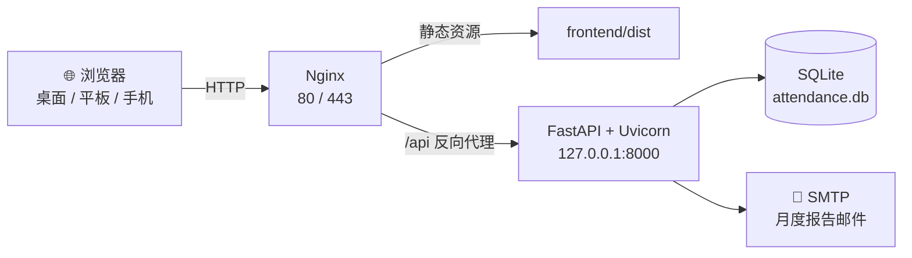

<a id="readme-top"></a>

<div align="center">


<br>

**签到 · 时长排行 · 考核 · 违规扣时 · 出勤分析 · 邮件月报**

为社团、学生组织、志愿队、运动队与各类团队打造的开源考勤系统

<br><br>


**简体中文** · [English](README.en.md)

</div>

<br>

> [!NOTE]
> RollCall 围绕**出勤时长**组织数据：逐人登记每次活动的时长，自动累计与排行，结合月度计划计算出勤率，再叠加考核成绩、违规扣时、CSV 报表与邮件月报——一个系统管完所有考勤事务。

<p align="center">
<b>🎯 完美适用于</b>&nbsp; 学生组织 &nbsp;·&nbsp; 社团 &nbsp;·&nbsp; 志愿队 &nbsp;·&nbsp; 运动队 &nbsp;·&nbsp; 兴趣小组 &nbsp;·&nbsp; 小型团队
</p>

<br>

<div align="center">

[✨ 为什么选择](#-为什么选择-rollcall) ·
[📋 功能](#-功能模块) ·
[📸 截图](#-界面预览) ·
[🚀 快速开始](#-快速开始) ·
[🌐 部署](#-部署到服务器) ·
[📧 邮件月报](#-邮件月报) ·
[🏗️ 架构](#-系统架构) ·
[❓ FAQ](#-常见问题) ·
[🤝 贡献](#-参与贡献)

</div>

<br>

<p align="center">
  
</p>

---

## ✨ 为什么选择 RollCall

<table>
<tr>
<td width="50%" valign="top"><b>🧩 开箱即用</b> — 一键启动脚本，SQLite 本地存储，无需安装数据库服务</td>
<td width="50%" valign="top"><b>🕒 时长导向</b> — 围绕出勤时长建模，累计 / 扣除 / 排行 / 出勤率一体</td>
</tr>
<tr>
<td width="50%" valign="top"><b>🔒 数据自持</b> — 自托管部署，数据留在自己手里，内网环境也能跑</td>
<td width="50%" valign="top"><b>📱 多端适配</b> — 桌面 / 平板 / 手机自适应，浏览器直接使用</td>
</tr>
</table>

<br>

| 对比维度 | 纸质 / Excel 签到 | 云端考勤 SaaS | **✅ RollCall** |
|:---|:---:|:---:|:---:|
| 费用 | 免费 | 按人 / 月付费 | ✅ 免费开源 |
| 部署方式 | — | 依赖厂商 | ✅ 自托管 / 内网 |
| 时长累计与排行 | 手动统计 | 有限支持 | ✅ 原生能力 |
| 考核 + 违规扣时 | 手动统计 | 通常不支持 | ✅ 内置 |
| 邮件月报 | 手动发送 | ✅ | ✅ |
| 数据归属 | 自己 | 厂商 | ✅ 完全自持 |

---

## 📋 功能模块

<table>
<tr>
<td width="50%"><b>📋 出勤签到</b><br><sub>逐人登记活动时长，支持增加 / 扣除两种模式，按日期查看当日统计与明细</sub></td>
<td width="50%"><b>🏆 时长排行</b><br><sub>全员净出勤时长排行榜，支持全部时间与按月查看，前三名奖牌标识</sub></td>
</tr>
<tr>
<td width="50%"><b>📝 考核成绩</b><br><sub>考试分数录入，记录考试名称、考核项目与分数，自动计算平均分</sub></td>
<td width="50%"><b>⚠️ 违规扣时</b><br><sub>违规行为录入，自动扣除出勤时长并计入排行与出勤率</sub></td>
</tr>
<tr>
<td width="50%"><b>📊 出勤分析</b><br><sub>按月统计出勤率与平均考核分数，进度条可视化，一键导出 CSV 报表</sub></td>
<td width="50%"><b>📜 操作日志</b><br><sub>自动记录全部增删操作，按签到 / 考核 / 违规筛选，含时间、详情与操作人 IP</sub></td>
</tr>
<tr>
<td width="50%"><b>👥 成员管理</b><br><sub>成员名册、届别分组筛选、邮箱维护、停用与恢复</sub></td>
<td width="50%"><b>📧 邮件月报</b><br><sub>定时或一键向成员推送个人月度报告，支持按届别 / 指定成员推送</sub></td>
</tr>
</table>

---

## 📸 界面预览

#### 📋 出勤签到

逐人登记每日出勤时长，实时统计当日签到人数、累计出勤时长、扣除时长。

<p align="center">
  
</p>

<table>
<tr>
<td align="center"><br><sub><b>🏆 时长排行</b></sub></td>
<td align="center"><br><sub><b>📝 考核与违规</b></sub></td>
</tr>
</table>

#### 📊 出勤分析

按月统计出勤率与考核分数，支持导出 CSV。

<p align="center">
  
</p>

<table>
<tr>
<td align="center"><br><sub><b>📜 操作日志</b></sub></td>
<td align="center"><br><sub><b>👥 成员管理</b></sub></td>
</tr>
</table>

<details>
<summary><b>📱 移动端界面</b>（点击展开）</summary>

<br>

<table>
<tr>
<td align="center"><br><sub>移动端 · 签到</sub></td>
<td align="center"><br><sub>移动端 · 分析</sub></td>
<td align="center"><br><sub>移动端 · 登录</sub></td>
</tr>
</table>

</details>

<details>
<summary><b>🗂️ 弹窗界面</b>（点击展开）</summary>

<br>

<table>
<tr>
<td align="center"><br><sub><b>📧 邮件推送</b> · SMTP 设置 / 发送报告 / 发送记录</sub></td>
<td align="center"><br><sub><b>🔑 修改密码</b></sub></td>
</tr>
</table>

</details>

---

## 🚀 快速开始

**环境要求**：Python 3.10+ 与 Node.js 18+。

Windows 下双击 `start.bat`，或在 PowerShell 中运行：

```powershell
.\start.ps1
```

首次启动会自动安装依赖。启动后浏览器访问：

| 地址 | 说明 |
|:---|:---|
| http://127.0.0.1:5173 | 前端页面 |
| http://127.0.0.1:8000/docs | 后端接口文档（Swagger） |

按 <kbd>Ctrl</kbd> + <kbd>C</kbd> 停止服务。

> [!IMPORTANT]
> 初始访问密码为 `2006`。进入系统后请立即在「修改密码」中更换为高强度密码。

> [!TIP]
> 以上默认只能在本机访问。想让**手机、平板或其他电脑**访问？见下方 [🌐 部署到服务器](#-部署到服务器)。

<details>
<summary><b>手动启动</b>（不使用启动脚本时）</summary>

```bash
# 后端
cd backend
pip install -r requirements.txt
python -m uvicorn app.main:app --host 127.0.0.1 --port 8000

# 前端（另开一个终端）
cd frontend
npm install
npm run dev
```

</details>

<details>
<summary><b>演示数据</b>（一键生成虚构数据体验效果）</summary>

```bash
cd backend
python seed_demo.py          # 空库时写入演示数据
python seed_demo.py --force  # 清空后重新生成
```

> [!WARNING]
> `--force` 会清空现有成员与全部记录，请勿在正式数据上执行。

</details>

---

## 🌐 部署到服务器

系统部署到服务器后，手机、平板和其他电脑都能通过浏览器访问，也不需要你的电脑一直开机。

### 方式一：局域网快速试用（2 分钟）

适合和队友在同一个 Wi-Fi 下临时使用。`start.bat` / `start.ps1` 启动后，前端已默认监听所有网卡，其他设备直接访问：

```text
http://<你的电脑内网IP>:5173
```

内网 IP 可用 `ipconfig`（Windows）或 `ip addr`（Linux/macOS）查看。首次访问时注意放行防火墙（Windows 会弹出授权提示）。

> [!NOTE]
> 局域网模式依赖你的电脑保持开机，且只有同一网络内的设备能访问，适合训练/活动现场临时使用。

### 方式二：云服务器部署（推荐 · 长期使用）

部署一次，之后随时随地访问。核心架构：**Nginx(80/443) → FastAPI(127.0.0.1:8000) → SQLite**。

| 步骤 | 操作 |
|:---:|:---|
| 1️⃣ 构建前端 | `npm --prefix frontend ci && npm --prefix frontend run build` 生成 `frontend/dist` |
| 2️⃣ 上传代码 | 把 `backend/` 与 `frontend/dist` 上传到服务器（如 `/opt/rollcall/`） |
| 3️⃣ 后端常驻 | systemd 托管 uvicorn，开机自启、崩溃自动重启 |
| 4️⃣ 反向代理 | Nginx 托管静态页面，并把 `/api` 转发到后端 |
| 5️⃣ 公网访问 | 安全组放行 80/443；绑定域名 + Certbot 开启 HTTPS |
| 6️⃣ 手机访问 | 浏览器打开你的域名/IP 即用，可「添加到主屏幕」当 App 用 |

> [!TIP]
> 前端通过**相对路径** `/api` 请求后端，Nginx 反代后前后端同源——**不需要修改任何接口地址或配置**。

每一步的具体命令、`systemd` / `Nginx` 配置文件模板、每日自动备份与安全加固，见完整图文教程 **[docs/DEPLOYMENT.md](docs/DEPLOYMENT.md)**。

### 迁移本地数据到服务器

把本地的 `backend/data/attendance.db` 复制到服务器相同路径（或用 `ATTENDANCE_DB_PATH` 环境变量指定），全部记录即刻保留：

```bash
scp backend/data/attendance.db user@your-server-ip:/opt/rollcall/backend/data/
```

> [!WARNING]
> 复制数据库前请先停止服务；若服务在运行中，请改用 SQLite `.backup` 命令或同时复制 `-wal` / `-shm` 文件。

---

## 📧 邮件月报

向每位填写了邮箱的成员发送**当月个人月度报告**——包含当月出勤时长、累计总时长、违规情况、考核分数及下月计划安排。

1. 在**成员管理**中为成员填写邮箱地址
2. 打开侧边栏「**邮件推送**」→ **SMTP 设置**，填写发信邮箱（如 QQ 邮箱 `smtp.qq.com:465` + 授权码），先发送测试邮件验证
3. **发送报告**标签页选择月份与推送范围（全员 / 按届别 / 指定成员），一键推送
4. **发送记录**标签页查看每次发送结果；可勾选「每月最后一天自动推送」

> [!TIP]
> 邮件的发件人名称（即报告落款）可在 SMTP 设置中自由修改，无需改代码。

---

## 🏗️ 系统架构



| 层级 | 技术 |
|:---|:---|
| 前端 |   Lucide Icons |
| 后端 |  Uvicorn |
| 数据库 |  本地文件（WAL 模式） |
| 认证 | PBKDF2-SHA256 + 会话 Token |

生产部署（Nginx + systemd + 备份 + HTTPS）见 **[docs/DEPLOYMENT.md](docs/DEPLOYMENT.md)**。

---

## 🛠️ 配置与数据

| 配置 | 默认值 | 说明 |
|:---|:---|:---|
| `ATTENDANCE_DB_PATH` | `backend/data/attendance.db` | 数据库文件路径（环境变量） |
| 访问密码 | `2006` | 首次登录后在界面内修改 |
| 前端端口 | `5173` | Vite 开发服务器 |
| 后端端口 | `8000` | FastAPI / Uvicorn |

<details>
<summary><b>💾 数据备份</b></summary>

<br>

数据保存在 `backend/data/attendance.db`。停止服务后复制该文件即可完成备份。

> [!WARNING]
> 运行期间请使用 SQLite `.backup` 命令备份，或同时保留同目录的 `-wal` 与 `-shm` 文件，否则可能丢失最近写入。

```bash
sqlite3 backend/data/attendance.db ".backup backup-$(date +%F).db"
```

</details>

---

## 🎨 自定义品牌

项目内置中性占位 Logo 与「RollCall」品牌文案，换成你自己的组织标识：

1. 用你的 Logo 覆盖 `frontend/public/assets/logo.svg`（PNG 亦可，同步修改引用路径）
2. 全局搜索 `RollCall` 替换为你的名称（主要在 `frontend/src/App.jsx` 与 `frontend/index.html`）
3. 邮件落款在「邮件推送 → SMTP 设置」中修改，无需改代码

---

## 🗺️ 路线图

- [x] 出勤签到 / 时长排行 / 考核 / 违规 / 分析 / 日志
- [x] 邮件月报（手动 + 每月定时推送）
- [x] 届别分组与定向推送
- [ ] 多用户与角色权限
- [ ] Docker 一键部署
- [ ] 界面多语言（i18n）
- [ ] 数据导入 / 导出增强

欢迎在 Issue 中提出你想要的功能。

---

## ⭐ Star History

<p align="center">
  <a href="https://star-history.com/#SuperPatrick06/RollCall&Date">
    
  </a>
</p>

如果 RollCall 对你有帮助，欢迎点一个 ⭐ Star，让它被更多人看到！

---

## ❓ 常见问题

<details>
<summary><b>默认密码是什么？在哪修改？</b></summary>

<br>

初始密码为 `2006`。登录后点击侧边栏「修改密码」即可更换；密码使用 PBKDF2-SHA256 加盐哈希存储。

</details>

<details>
<summary><b>需要联网或付费吗？</b></summary>

<br>

完全免费且不需要联网。所有数据保存在本地 SQLite 文件中，内网环境可正常运行；只有邮件推送功能需要能访问你的 SMTP 服务器。

</details>

<details>
<summary><b>手机上可以使用吗？</b></summary>

<br>

可以。界面针对手机做了全屏适配（底部导航栏）。把系统部署到服务器后（见 [docs/DEPLOYMENT.md](docs/DEPLOYMENT.md)），手机浏览器直接访问即可。

</details>

<details>
<summary><b>数据存在哪里？安全吗？</b></summary>

<br>

数据保存在 `backend/data/attendance.db`，随时可复制备份。系统采用共享访问密码 + 会话 Token 的简单认证模型，适合小团队内部使用；如需按人分配权限，可关注路线图中的多用户计划。

</details>

---

## 🤝 参与贡献

欢迎 Issue 和 Pull Request！较大的改动建议先开 Issue 讨论方案。

```bash
# 开发自测
cd backend && python -m pytest        # 后端测试
cd frontend && npm run build          # 前端构建
cd frontend && npm run visual-check   # 视觉检查（生成截图）
```

---

## 📄 开源许可

本项目基于 [MIT License](LICENSE) 开源。

<div align="center">

**如果这个项目对你有帮助，欢迎 ⭐ Star 支持一下**

<br>

<sub>📖 <a href="README.en.md">English Docs</a> &nbsp;·&nbsp; 🚀 <a href="docs/DEPLOYMENT.md">部署指南</a> &nbsp;·&nbsp; 📄 <a href="LICENSE">MIT License</a></sub>

<br><br>

<a href="#readme-top">回到顶部 ⬆</a>

</div>
