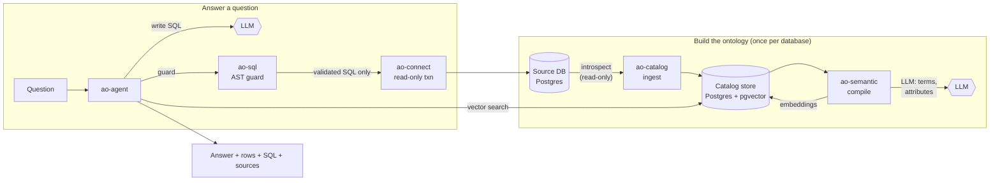
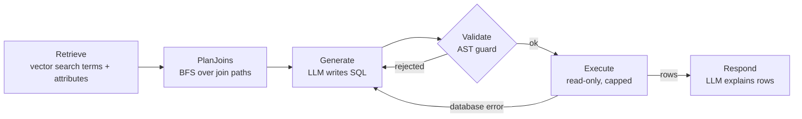

# Auto Ontology (Rust)

Ask your database questions in plain language and get back **read-only SQL you can see, the rows it returned, and the tables it used**.

This is a Rust-native rebuild of [NVIDIA Auto Ontology](https://github.com/NVIDIA/auto-ontology). It reads a database's structure, has an LLM compile it into an *ontology* (business terms, column meanings, join paths), and answers questions with SQL grounded in that ontology. Two independent locks stop that SQL from ever writing to your data. The same core powers a command line (`aoq`) and a native desktop Studio built on [gpui-kit](https://github.com/longbridge/gpui-kit).

> **Status: MVP complete (2026-11-09).** Postgres only, single user, local. Every MVP exit criterion is verified with evidence (see [Project status](#project-status)). It is a working prototype, not a production service: read [Known limitations](#known-limitations) before relying on it.


---

## Contents

- [What it does](#what-it-does)
- [How it works](#how-it-works)
- [Security model: two locks on every query](#security-model-two-locks-on-every-query)
- [Quickstart](#quickstart)
- [The `aoq` command line](#the-aoq-command-line)
- [Studio (desktop app)](#studio-desktop-app)
- [Configuration](#configuration)
- [Repository layout](#repository-layout)
- [How it is verified](#how-it-is-verified)
- [Project status](#project-status)
- [Known limitations](#known-limitations)
- [Roadmap](#roadmap)
- [How this project is built (the ADD method)](#how-this-project-is-built-the-add-method)
- [Credits and license](#credits-and-license)

## What it does

```text
$ aoq ask pagila "How many films are in the Action category?"
✓ Retrieve: public.sales_by_film_category, public.film_category, public.rental_by_category, public.film_list, …
✓ PlanJoins: public.sales_by_film_category, public.film_category, public.rental_by_category, public.film_list, …
✓ Generate
✓ Validate
SQL:
SELECT pg_catalog.count(*) FROM "public"."film_list" WHERE category = 'Action'
✓ Execute: 1 rows
✓ Respond
count
64

64
tables: public.film_list
SQL:
SELECT pg_catalog.count(*) FROM "public"."film_list" WHERE category = 'Action'
```

(Real output from the dev stack. Progress goes to stderr; the rows, the model's answer, which here is just "64", the source tables and the final SQL go to stdout.)

On the pagila sample database with a local 7B model (Ollama `qwen2.5-coder:7b`), the MVP answered **5 of 5** recorded questions with values matching hand-written SQL, all on the first attempt, in 8–12 s each.

## How it works

Three stages, each a crate you can use on its own:



1. **Ingest** (`aoq ingest`). Reads tables, views, columns, primary keys and foreign keys from the source database in one read-only snapshot and stores them as a catalog. Re-ingesting applies a diff, so unchanged tables keep their ontology.
2. **Compile** (`aoq compile`). For every table without a term, the LLM receives the table's structure plus up to three sample values per column, and names a business **term** (e.g. `Customer`) and an **attribute** per column. Declared foreign keys become semantic join paths. Terms and attributes are embedded into pgvector for retrieval. Columns that look secret (`password`, `token`, `api_key`, …) and binary columns are never sampled.
3. **Ask** (`aoq ask`, Studio). The agent runs a fixed pipeline, streaming each step as an event:



A failed attempt (guard rejection or database error) goes back to Generate with **every** earlier failure attached, up to 3 attempts. The whole question has a 120 s deadline. If Respond fails, you still get the rows.

## Security model: two locks on every query

LLM-written SQL runs against your data, so the design assumes the model can be wrong or manipulated, and puts two independent locks between it and the database.

**Lock 1: the AST guard ([`ao-sql`](crates/ao-sql/src/lib.rs)).** SQL is parsed, never pattern-matched. It must be exactly one `SELECT`-style query over tables that exist in the catalog. Functions come from an allowlist and are re-rendered `pg_catalog.`-qualified, so a user-defined function cannot shadow them. Custom operators and keyword-shaped functions are refused. CTE names are scoped lexically, identifiers fold like Postgres, and every table is re-rendered as `"schema"."table"`. **Only the guard's re-rendered SQL is ever executed**, never the model's text.

**Lock 2: the connector ([`ao-connect`](crates/ao-connect/src/lib.rs)).** Each query gets a fresh connection running:
- `BEGIN READ ONLY`, with `statement_timeout`, an idle-in-transaction timeout, `search_path = pg_catalog, public` and standard-conforming strings
- one prepared statement wrapped as `SELECT row_to_json(t) … LIMIT cap+1`, with a row cap, a per-row byte cap and a total byte cap
- a client-side deadline of the statement timeout plus 2 s
- `DISCARD ALL` and close afterwards

Write attempts come back as SQLSTATE `25006` and are classified as such. We recommend a read-only database role as well (the dev stack uses `ao_reader`).

**Prompt injection.** Every untrusted text (your question, catalog names and samples, earlier failed SQL and errors, result rows) reaches the model only inside its own tagged block. Inside each block, `<`, `>` and `&` are escaped, so text cannot close its block or open another. Instructions live only in the system message, which never changes between retries.

**Secrets.** Database URLs and passwords never appear in output. Errors are scrubbed, and a malformed `AO_SOURCES` is reported without echoing its contents. In the Respond prompt, values of secret-named result columns are masked as `***`.

Two independent reviewers attacked these rules with executable probes (see [How it is verified](#how-it-is-verified)). One known gap remains: masking is by column name, so `SELECT api_token AS t` gets past it ([Known limitations](#known-limitations)).

## Quickstart

**Prerequisites:** Rust (rustup; the server pins **1.94**, Studio pins **1.99.0**, and both install automatically from `rust-toolchain.toml`), Docker, `psql`, and [cargo-nextest](https://nexte.st) for the test suite. You also need an LLM: [Ollama](https://ollama.com) locally, or any OpenAI-compatible endpoint (e.g. NVIDIA NIM).

```bash
git clone https://github.com/TinDang97/rust-auto-ontology.git
cd rust-auto-ontology

# 1. Dev Postgres (pgvector, pg17) on 127.0.0.1:55432 with a read-only role
make dev-up

# 2. Clone the reference (test oracle) and load the pagila sample database from it
make reference seed verify-infra

# 3. A local model (or point .env at a hosted endpoint instead)
ollama pull qwen2.5-coder:7b
ollama pull nomic-embed-text            # any embedding model works
cp .env.example .env                    # then set EMBED_MODEL=nomic-embed-text

# 4. Build the ontology and ask
cargo run -p ao-cli --bin aoq -- migrate
cargo run -p ao-cli --bin aoq -- ingest pagila
cargo run -p ao-cli --bin aoq -- compile pagila     # ~3 min for 23 tables on a laptop 7B model
cargo run -p ao-cli --bin aoq -- ask pagila "How many films are there for each rating?"
```

> The MVP evidence used an embedding model named `granite-embed-r2` (768 dimensions) registered locally in Ollama. Any embedder works, but **compile and ask must use the same one**: vectors of another dimension are never compared, and the agent then reports "not ready".

## The `aoq` command line

| Command | What it does |
|---|---|
| `aoq migrate` | Creates or upgrades the catalog store schema (`ao.*` tables, pgvector). |
| `aoq ingest <db>` | Reads the source's structure into the catalog. Re-running applies a diff. |
| `aoq compile <db>` | Builds terms, attributes, semantic FKs and embeddings for tables without a term. A second run makes no LLM calls. |
| `aoq ask <db> "<question>"` | Streams steps and SQL to stderr, then prints the rows, the answer and the sources. |
| `aoq ask <db> "<question>" --json` | Prints one JSON object: `answer`, `sql`, `columns`, `rows`, `truncated`, `attempts`, `provenance`. On failure, prints `{"error": "…"}`. |
| `aoq status <db>` | Prints `tables`, `terms`, `attributes` and `semantic_fks` counts. |

**Exit codes:** `0` ok · `2` configuration (including an unknown database name) · `3` not ready (not ingested or not compiled) · `4` unanswerable after all attempts · `1` anything else (including an invalid question).

`aoq` reads configuration from the environment plus `./.env` in the current directory only. It never searches parent directories and never overrides variables that are already set.

## Studio (desktop app)

A native window on gpui-kit that runs the same agent in-process. You pick a database, ask, and watch the steps tick off, then the SQL, the answer with its source tables, and the result grid.

| Light | Dark (mid-run) |
|---|---|
|  |  |
| **Error with recovery step** | **Empty state** |
|  |  |

```bash
cd apps/studio          # its own workspace and toolchain (Rust 1.99.0)
cargo run --release     # reads the same .env as aoq (start it from the folder holding .env)
```

- Light and dark follow your OS appearance. `AO_STUDIO_THEME=light|dark` pins one.
- `AO_STUDIO_ASK="pagila|How many films per rating?"` submits a question at startup (used for screenshots). `AO_STUDIO_TRACE=1` logs every agent event to stderr.
- Studio has its own `Cargo.lock` and toolchain, because gpui-kit 0.9.0 needs APIs stabilised after Rust 1.96. The server workspace never depends on GPU toolchains.
- macOS is the tested platform. GPUI also targets Windows and Linux (untested here).

## Configuration

All settings come from environment variables; see [`.env.example`](.env.example).

| Variable | Default | Meaning |
|---|---|---|
| `AO_META_URL` | (required) | Catalog store database (Postgres with pgvector). |
| `AO_SOURCES` | (required) | Databases you may ask about: `name=url[,name=url]`. Use a read-only role. |
| `AO_SQL_TIMEOUT_MS` | `15000` | Statement timeout per query. |
| `AO_ROW_CAP` | `200` | Maximum rows returned per query. |
| `LLM_TIMEOUT_S` | `120` | Timeout per LLM request. |
| `DEFAULT_MODELS_ENDPOINT` / `_MODEL` / `_API_KEY` | (required) | OpenAI-compatible endpoint used for every role unless overridden. |
| `REASONING_*`, `NON_REASONING_*`, `EMBED_*` | defaults above | Per-role endpoint, model and API key (`ENDPOINT`, `MODEL`, `API_KEY`). Reasoning writes SQL and compiles; non-reasoning explains rows; embed embeds. |
| `NVIDIA_API_KEY` | (none) | Fallback API key for any role without one. |

Every network call is bounded: LLM requests have a timeout plus at most 3 attempts with exponential backoff (500 ms base, 8 s cap); database calls have server and client timeouts; a question has a 120 s deadline.

## Repository layout

| Path | What it is |
|---|---|
| [`crates/ao-core`](crates/ao-core) | Configuration (`AppConfig`, model roles, a `Secret` type that never prints). |
| [`crates/ao-llm`](crates/ao-llm) | OpenAI-compatible chat and embeddings client with retries, structured-output validation and role fallback; test doubles behind the `testing` feature. |
| [`crates/ao-sql`](crates/ao-sql) | The read-only SQL guard (lock 1). |
| [`crates/ao-connect`](crates/ao-connect) | Postgres source connector: introspection and read-only queries (lock 2). |
| [`crates/ao-store`](crates/ao-store) | Storage ports (traits) for the catalog and the ontology. |
| [`crates/ao-store-pg`](crates/ao-store-pg) | Postgres + pgvector adapter, migrations, test helpers. |
| [`crates/ao-catalog`](crates/ao-catalog) | Ingest: source structure → catalog snapshot → diff apply. |
| [`crates/ao-semantic`](crates/ao-semantic) | Compile: terms, attributes, samples, semantic FKs, embeddings. |
| [`crates/ao-agent`](crates/ao-agent) | The ask pipeline, join planning and prompts. |
| [`crates/ao-cli`](crates/ao-cli) | The `aoq` binary. |
| [`apps/studio`](apps/studio) | The gpui-kit desktop app: a pure event reducer, a bridge thread, and the view. |
| [`infra/`](infra) | Dev Postgres (Docker Compose) and its init script. |
| [`docs/analysis/`](docs/analysis) | Deep analysis of the reference and of the design choices (agent core, data plane, surfaces, harness, Studio, design system). |
| [`docs/ROADMAP.md`](docs/ROADMAP.md) | The 9-milestone, 75-task plan. |
| [`docs/evidence/`](docs/evidence) | Screenshots recorded as verification evidence. |
| [`.add/`](.add) | The contract bundle: project invariants, specs, milestones and per-task contracts with their evidence. |

## How it is verified

```bash
make check     # cargo fmt --check, clippy -D warnings, nextest (incl. Postgres integration tests), cargo-deny
(cd apps/studio && cargo test)
```

- **116 server tests and 9 Studio tests**, green on a clean checkout. Integration tests run against the real dev Postgres, using throwaway databases created per test. LLM-dependent tests use scripted models and a deterministic hashing embedder; the CLI tests drive the real `aoq` binary against a fake OpenAI server (wiremock).
- **Property tests** (proptest) on the SQL guard.
- **Refuter probes.** After each security or data task was built, a reviewer who had not written the code read the contract and wrote attacks as executable tests. They found real gaps before release:
  - 3 guard bypasses: keyword functions, case folding, custom operators
  - a schema-filter wildcard bug in ingest
  - 5 compile defects, such as an over-length term name after a collision and samples leaking from domains over `bytea`
  - 4 agent and CLI defects, such as a password fragment printed in a config error and a missing primary key in the prompt

  Every finding was fixed, and every probe is kept as a permanent check (`tests/refute_probes.rs` in each crate).
- **Live evidence.** On pagila via Ollama, all 23 relations compiled, 5/5 oracle questions matched, and Studio screenshots are recorded. Details are in each task's `## EVIDENCE` section under [`.add/tasks/`](.add/tasks).

CI ([`.github/workflows/ci.yml`](.github/workflows/ci.yml)) runs the server workspace on Linux with a pgvector service, and Studio on macOS.

## Project status

The MVP milestone ([`.add/milestones/mvp.md`](.add/milestones/mvp.md)) is **done**. Every exit box has evidence:

| Exit criterion | Evidence |
|---|---|
| `make check` green | 116/116 on a clean checkout |
| `ingest` + `compile` pagila: a term per table, an attribute per non-FK column, a semantic FK per FK | 23 terms, 113 attributes (= 131 columns − 18 FK columns), 18 semantic FKs, 0 failures |
| Live `ask` on ≥ 3 of 5 recorded questions | 5/5 matched hand-written oracle values, all on attempt 1 |
| No agent statement can write to the source | Guard + read-only transaction + tests proving writes never reach the database |
| Studio shows steps → SQL → rows → answer live | [`docs/evidence/`](docs/evidence) |

| Task | Verdict |
|---|---|
| Workspace, dev stack, CI scaffolding | PASS |
| LLM client | PASS |
| SQL guard | PASS |
| Catalog ingest + connector | PASS |
| Semantic compile | PASS |
| Ask agent + `aoq` | PASS |
| Studio Ask panel | PASS |

## Known limitations

- **Postgres only, single user, local.** No HTTP API, authentication or multi-tenant isolation yet; those are milestone M5.
- **Secret masking is by column name.** `SELECT api_token AS t`, or `row_to_json(u)`, sends the value to the model unmasked, and database error text can carry values into retry prompts. This is an accepted MVP risk; the planned fix is to mask by source-column lineage.
- **`Agent::ask` cannot be spawned on a tokio task** (sqlx's higher-ranked bounds in the connector hit [rust-lang/rust#110338](https://github.com/rust-lang/rust/issues/110338)). The CLI and Studio drive it with `block_on`. The M2 HTTP API must restructure the connector's query path first.
- **Answer quality depends on the model.** A 7B model sometimes prefers convenience views (e.g. pagila's `film_list`, which drops films without actors) over base tables, and sometimes returns JSON instead of a sentence. The rows and SQL are always shown, so you can check.
- **Studio on macOS doesn't repaint while fully covered** by other windows; it catches up once visible.
- **Parity with the reference is not claimed yet.** The oracle-backed parity suites are milestones M1–M4.

## Roadmap

| # | Milestone | Proof of done |
|---|---|---|
| ✅ | **MVP**: core, `aoq`, Studio Ask panel | see [Project status](#project-status) |
| M0 | Foundation, oracles, harness | CI green; reproducible oracles |
| M1 | Store parity | reference read-path parity 122/122 |
| M2 | Connectors, SQL toolkit, ingest | catalog diff empty vs. reference on pagila/chinook |
| M3 | Semantic compilation | cassette-replay parity |
| M4 | NL→SQL agent | accuracy ≥ reference on the same models |
| M5 | API · auth · SSE · MCP · CLI · skills | OpenAPI contract diff; RBAC truth table |
| M6 | Studio | page-parity UI tests; accessibility; 100k-row grid |
| M7 | Learn and self-optimise | a correction changes the answer; gated tuning |
| M8 | Integration, hardening, release | end-to-end; Helm smoke; security review |

Details: [`docs/ROADMAP.md`](docs/ROADMAP.md) and [`.add/milestones/`](.add/milestones).

## How this project is built (the ADD method)

Every change that touches security, data or architecture follows a contract-first loop, recorded in [`.add/`](.add):

1. **Direction.** Write a task contract: rules (what it must do and refuse, each with its source), assumptions (every silence filled, stated so a human can review it), and checks (one or more failing tests per rule). An independent reviewer reads the contract before it is sealed.
2. **Seal.** Commit the contract and its failing tests as `freeze(<task>)`. From then on, the tests can change only through a visible `refreeze(<task>)` commit that logs why.
3. **Build** until green, without editing sealed tests.
4. **Verify** on a clean checkout. A second independent reviewer writes refuter probes from the contract. The verdict (PASS, RISK-ACCEPTED or HARD-STOP) and its evidence go into the task file as `verify(<task>)`.

The git history shows this loop for every MVP task (`git log --oneline | grep -E 'freeze|verify'`).

## Credits and license

- Rebuilds the behaviour of [NVIDIA Auto Ontology](https://github.com/NVIDIA/auto-ontology) (Apache-2.0), which serves only as a test oracle. It is cloned on demand into the gitignored `reference/` folder, and no reference source is included here.
- Studio is built on [gpui-kit](https://github.com/longbridge/gpui-kit) by Longbridge and [GPUI](https://github.com/zed-industries/zed) by Zed Industries.
- The SQL guard is built on [sqlparser-rs](https://github.com/apache/datafusion-sqlparser-rs); storage on [sqlx](https://github.com/launchbadge/sqlx) and [pgvector](https://github.com/pgvector/pgvector-rust).

Licensed under the [Apache License 2.0](LICENSE). See [NOTICE](NOTICE).
