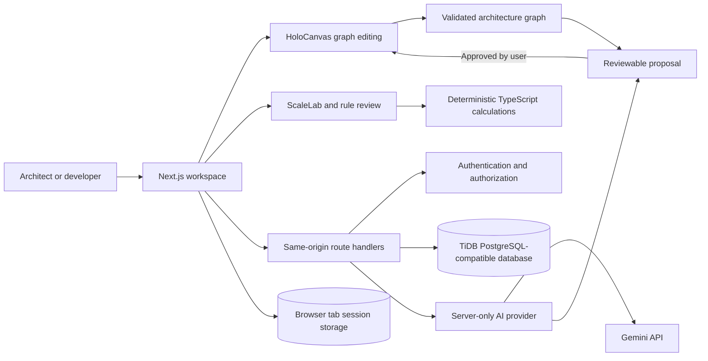

<div align="center">

# HoloStack AI

### Think about the architecture before you write the code.

Design, visualize, review, and improve software architectures in one interactive workspace.

[](https://nextjs.org/)
[](https://www.typescriptlang.org/)
[](https://reactflow.dev/)
[](https://www.postgresql.org/)
[](https://vercel.com/)

[Repository](https://github.com/Usman4Byte/HoloStack-AI) · [Report an issue](https://github.com/Usman4Byte/HoloStack-AI/issues) · [Developer profile](https://linkedin.com/in/usman4byte)

</div>

---

AI can produce application code quickly. Good architecture still takes deliberate thought: services, data flows, security boundaries, capacity assumptions, and the trade-offs that shape a system.

**HoloStack AI helps teams make those decisions visible before implementation.** Start with a product brief or template, shape the system on a canvas, explore workload assumptions, and ask AI for a proposal when you want architectural reasoning.

> **Design the system. Understand the trade-offs. Build with intent.**

## Contents

- [What you can do](#what-you-can-do)
- [How HoloStack works](#how-holostack-works)
- [Product principles](#product-principles)
- [Technology](#technology)
- [Quick start](#quick-start)
- [Database setup](#database-setup)
- [Configure AI](#configure-ai)
- [Deploy to Vercel](#deploy-to-vercel)
- [Security and data handling](#security-and-data-handling)
- [Project structure](#project-structure)
- [Development commands](#development-commands)
- [Documentation](#documentation)
- [Current limitations](#current-limitations)

## What you can do

### Design on HoloCanvas

Build an architecture as a graph of services, data stores, queues, identity boundaries, external systems, and other components. Move and inspect components, create or remove connections, edit connection details, arrange the graph, undo or redo changes, and import or export validated JSON. Export a diagram as PNG.

### Generate and refine with AI

- **Architecture generation** turns a natural-language brief into a structured design proposal.
- **AI Copilot** answers questions about the current architecture or proposes graph changes in response to a natural-language request.
- **Architecture optimization** explores changes for a selected design goal and explains the trade-offs.
- **Review before apply** keeps AI output separate from the current graph. HoloStack validates proposals locally; a person chooses whether to apply them.

AI requests are explicit actions. Opening a project, moving a component, changing a slider, loading a template, or exporting a diagram does not call the AI provider.

### Explore scenarios with ScaleLab

Adjust workload and capacity assumptions to see modeled request flow, utilization, and potential bottlenecks. Save scenarios to the current guest session or signed-in project.

ScaleLab uses deterministic TypeScript calculations. Its estimates are based on the assumptions shown in the UI; they are not load tests, benchmarks, or measurements of deployed infrastructure.

### Review risks and design decisions

Run predefined, evidence-based architecture checks. Findings include their evidence, confidence, assumptions, and recommendations. A clean result means no configured rule matched the current inputs; it is not a security certification or a guarantee that the system is risk-free.

### Keep and share your work

- Start with authored architecture templates or a blank canvas.
- Compare project versions and restore an earlier version.
- Keep project notes and saved scenarios with a signed-in workspace.
- Export architecture JSON, PNG diagrams, and Markdown engineering reports.

### Start as a guest

The guest workspace is available without an account. Guest projects, edits, versions, scenarios, and successful AI results stay in browser `sessionStorage`: they survive refreshes in the tab session and are cleared when that session ends. Sign in to keep projects and history in the database across visits.

## How HoloStack works



**AI is for reasoning. TypeScript is for repeatable work.** The browser owns canvas interactions and deterministic visual updates. Route handlers validate and authorize requests. The server-only AI service handles consented reasoning requests and validates structured output before it becomes a proposal.

## Product principles

1. **Make assumptions visible.** Estimates and trade-offs should be understandable and editable.
2. **Keep deterministic work deterministic.** Graph edits, validation, comparisons, simulations, exports, and risk rules use normal application code.
3. **Use AI only when it adds judgment.** No AI call happens automatically on page load or during routine interactions.
4. **Keep people in control.** AI changes are proposals; applying them requires user approval.
5. **Do not imply infrastructure exists.** HoloStack designs and models systems. It does not provision, deploy, or monitor them.

## Technology

| Area | Technology |
| --- | --- |
| Application | Next.js App Router, React, TypeScript |
| Interactive architecture canvas | React Flow (`@xyflow/react`) |
| Validation | Zod schemas for API input, AI output, and architecture graphs |
| Persistence | TiDB Cloud with PostgreSQL compatibility, `pg`, and Drizzle ORM |
| AI | Google Gemini through a server-only provider service |
| Styling and icons | Tailwind CSS, local UI primitives, Lucide |
| Hosting target | One Next.js application on Vercel |

The project does not split the frontend and backend into separately deployed applications. Browser requests use same-origin Next.js Route Handlers.

## Quick start

### Requirements

- Node.js **22.18.x** (Node 22 release line)
- npm
- A TiDB PostgreSQL-compatible database for authentication and cloud persistence
- A Gemini API key only if you want to enable live AI features

The landing page, guest workspace, canvas, templates, deterministic analysis, and exports can be explored without configuring Gemini. Signed-in persistence requires a database.

### Install and run

```bash
npm ci
```

Create a local environment file only if one does not already exist:

```bash
cp -n .env.example .env.local
```

In PowerShell:

```powershell
if (-not (Test-Path .env.local)) { Copy-Item .env.example .env.local }
```

Then start the development server:

```bash
npm run dev
```

Open [http://localhost:3000](http://localhost:3000) and choose **Continue as guest** to explore without setting up an account.

> Keep `.env.local` private. Never commit it, paste credentials into an issue, or expose server credentials through a `NEXT_PUBLIC_*` variable.

## Database setup

HoloStack expects a **PostgreSQL-compatible TiDB Cloud** instance. Do not use a MySQL connection string.

1. Create or select a TiDB Cloud PostgreSQL-compatible instance and database.
2. Set `DATABASE_URL` in `.env.local`. Keep TLS certificate verification enabled; `DATABASE_CA_CERT` is optional if your provider requires a CA certificate.
3. Check the connection before migrations:

   ```bash
   npm run db:check
   npm run db:verify
   ```

   `db:check` performs a read-only connection check. `db:verify` runs compatibility probes with isolated, randomly named scratch objects and removes only those objects.

4. For a new database or schema target, verify the exact checked-in migration schema and review its report:

   ```bash
   npm run db:verify-schema
   ```

5. Apply reviewed migrations only as a deliberate operator action:

   ```bash
   npm run db:migrate
   ```

Migrations never run during app startup, `next build`, or a public API request. See [Database notes](docs/DATABASE.md) for compatibility, connection, and recovery details.

## Configure AI

AI is off by default. To enable it, configure these **server-only** variables in `.env.local` or your deployment secret store:

| Variable | Purpose |
| --- | --- |
| `GEMINI_API_KEY` | Private provider credential |
| `GEMINI_ENABLED` | Explicit application opt-in (`true`) |
| `GEMINI_FREE_TIER_CONFIRMED` | Explicit confirmation of the provider project’s intended tier (`true`) |
| `GEMINI_MODELS` | Ordered list of supported generation models for rotation and fallback |

The project also uses `AUTH_SECRET` for server-side security and `APP_URL` for its canonical application origin. See [.env.example](.env.example) for variable names and safe local defaults. Never place credentials in source control or browser variables.

Each AI action requires user submission and consent. A shared server-side cursor rotates the first model across requests; a failed model can fall through the remaining configured pool once each. HoloStack imposes no daily application AI cap, while short-window abuse protection and provider quotas still apply. Provider access, free-tier eligibility, rate limits, and data terms depend on the configured Google project.

Guest prompts are sent to the provider only for the submitted request and are not stored by HoloStack. Successful signed-in conversations and candidates are saved as private project content. The AI provider may handle submitted content under its own terms; do not send secrets or confidential data unless that use is acceptable.

See [AI integration](docs/AI_INTEGRATION.md) for the request policy, current verification boundary, and live smoke-test procedure.

## Deploy to Vercel

HoloStack is designed to deploy as **one Next.js application** from the repository root. The included [`vercel.json`](vercel.json) configures the project’s Vercel deployment settings.

1. Import this repository into Vercel as a Next.js project.
2. Configure server-only environment values for the selected environment: `DATABASE_URL`, `AUTH_SECRET`, the canonical HTTPS `APP_URL`, and optional `DATABASE_CA_CERT`.
3. Enable AI only after the provider project, billing tier, model access, quotas, and data-sharing terms have been checked. Keep the API key server-side.
4. Deploy and verify `/api/health` and `/api/ready`. Health is liveness; readiness checks the database connection and required application tables.

Vercel’s HTTPS deployment hostname can supply the origin if `APP_URL` is missing or still points to localhost. For complete setup and release checks, see [Deployment preparation](docs/DEPLOYMENT.md) and the [deployment guide](docs/reports/DEPLOYMENT_GUIDE.md).

## Security and data handling

- Authentication, project access, AI calls, and database operations are enforced in server-side route handlers.
- Signed-in projects are scoped to their workspace; guests use browser tab-session storage.
- Request and response shapes are schema-validated. AI output is validated as an architecture graph before it can be applied.
- SQL operations use the Drizzle query API and parameterized PostgreSQL queries.
- AI provider credentials and database credentials are never sent to client code.
- AI actions require explicit consent. Manual canvas editing and deterministic analysis do not send project data to Gemini.
- API errors avoid serializing raw database and provider diagnostics to users.

For threat boundaries and operating assumptions, see [Architecture](docs/ARCHITECTURE.md) and [Known limitations](docs/reports/KNOWN_LIMITATIONS.md).

## Project structure

```text
src/
├── app/                  Next.js pages, layouts, and route handlers
├── components/           Workspace, canvas, AI, and UI components
├── domain/               Architecture schemas, templates, AI contracts, and guest storage
└── server/               Authentication, AI provider, persistence, and HTTP services
scripts/                  Database checks, compatibility probes, and migration runner
tests/
├── unit/                 Unit and boundary tests
└── e2e/                  Browser workflows
docs/                     Architecture, setup, AI, deployment, and audit documentation
```

## Development commands

| Command | Description |
| --- | --- |
| `npm run dev` | Start the local development server |
| `npm run typecheck` | Generate Next.js types and run TypeScript checking |
| `npm run lint` | Run ESLint |
| `npm test` | Run the unit test suite |
| `npm run build` | Build the production application |
| `npm run test:e2e` | Run Playwright browser workflows |
| `npm run db:check` | Check PostgreSQL-compatible database connectivity |
| `npm run db:verify` | Run isolated database compatibility probes |
| `npm run db:verify-schema` | Verify the checked-in schema in isolation |
| `npm run db:migrate` | Apply reviewed application migrations |
| `npm run db:verify-recovery` | Rehearse a synthetic logical export/restore flow |

## Documentation

- [Architecture decisions](docs/ARCHITECTURE.md)
- [Database setup and compatibility](docs/DATABASE.md)
- [AI integration and usage controls](docs/AI_INTEGRATION.md)
- [Deployment preparation](docs/DEPLOYMENT.md)
- [Build milestones](docs/MILESTONES.md)
- [Final audit report](docs/reports/FINAL_AUDIT_REPORT.md)
- [Release checklist](docs/reports/RELEASE_CHECKLIST.md)
- [Known limitations](docs/reports/KNOWN_LIMITATIONS.md)

## Current limitations

HoloStack models and documents architecture; it does not create cloud resources, deploy application infrastructure, run a real load test, or connect to live production telemetry. Capacity results depend on user-provided assumptions. Rule-based findings are design guidance, not a guarantee of security or availability.

TiDB Cloud’s PostgreSQL-compatible offering and free-tier AI availability may have provider-specific limits and terms. Review the current provider documentation and the project’s release notes before relying on the application for critical production decisions.

---

<div align="center">

**AI can help you write code faster. HoloStack helps you think about what you’re building.**

Made by [Usman (Usman4Byte)](https://github.com/usman4byte) · [LinkedIn](https://linkedin.com/in/usman4byte)

</div>
