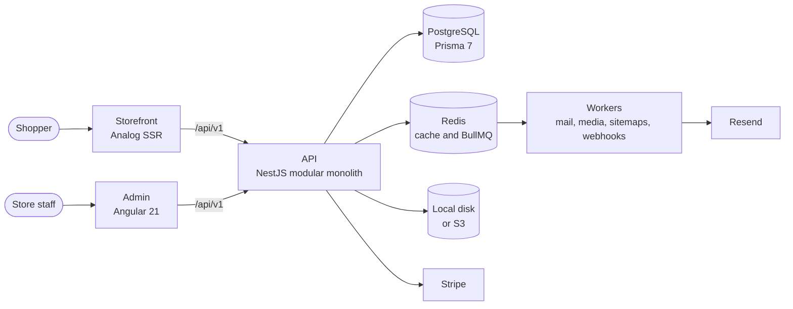

<p align="center">
  <picture>
    <source media="(prefers-color-scheme: dark)" srcset="docs/assets/readme/logo-dark.svg">
    
  </picture>
</p>

<p align="center">
  Open-source e-commerce: a NestJS backend, an Angular admin and an Analog storefront, installed by one stepper.
</p>

<p align="center">
  <a href="https://demo.themerchantengine.com">Storefront demo</a> ·
  <a href="https://demo-admin.themerchantengine.com">Admin demo</a> ·
  <a href="https://themerchantengine.com/docs">Docs</a> ·
  <a href="docs/site/getting-started/install-locally.md">Try it locally</a> ·
  <a href="https://github.com/Xdabier/themerchantengine/discussions">Discussions</a> ·
  <a href="https://badii.studio/themerchantengine">Have it built and run for you</a>
</p>

<p align="center">
  <a href="LICENSE"></a>
  <a href="https://github.com/Xdabier/themerchantengine/actions/workflows/ci.yml"></a>
  <a href="https://github.com/Xdabier/themerchantengine/releases"></a>
  <a href="https://github.com/Xdabier/themerchantengine/commits"></a>
  <a href="https://github.com/Xdabier/themerchantengine/stargazers"></a>
  <a href="https://github.com/Xdabier/themerchantengine/issues"></a>
  <a href="https://www.opensourcealternatives.to"></a>
  
</p>

## Why

- **One generic build.** Every store-specific value (identity, brand, locales, currency, domains, third-party keys) is entered once through the install stepper and lives in the database and the environment. No fork per client.
- **The whole stack in one repository.** API, admin and storefront share one schema, one set of types and one test suite, so a change lands everywhere at once.
- **Built for agencies.** A developer with a server, a bucket, a domain and the third-party accounts ready goes from clone to a live, empty store in one sitting.
- **MIT.** Use it for any store, paid or not. No license key, no tiers, no caps.

## Screenshots

<table>
  <tr>
    <td></td>
    <td></td>
  </tr>
  <tr>
    <td></td>
    <td></td>
  </tr>
</table>

## Features

- **Catalogue:** products, variants, categories, inventory, reviews and full-text search. See [What you get](docs/site/getting-started/what-you-get.md).
- **Orders:** cart, checkout, orders, returns, invoices, gift cards and promotions. See [Checkout and orders](docs/site/build-a-storefront/05-checkout-and-orders.md).
- **Content:** CMS pages, home sections, SEO and translatable fields in every locale you enable. See [Content and sections](docs/site/build-a-storefront/07-content-and-sections.md).
- **Payments:** Stripe (`STRIPE_API_KEY`), cash on delivery and manual payment. See [Environment variables](docs/site/reference/environment-variables.md).
- **Mail:** Resend (`RESEND_API_KEY`), plus a console transport that logs mail in development. See [Environment variables](docs/site/reference/environment-variables.md).
- **Storage:** local disk or any S3-compatible bucket (`S3_BUCKET`). See [Install on a server](docs/site/getting-started/install-on-a-server.md).
- **Shipping:** zones and methods with the rates you enter in the admin, and a carrier list for tracking links. See [Store settings](docs/site/operate/store-settings.md).
- **Admin:** Angular 21 with signals, `@angular/cdk` and Tailwind 3.4, themed at runtime from the store's brand settings. See [Store settings](docs/site/operate/store-settings.md).
- **Storefront:** Analog SSR with locale routing and a documented API contract, so you can also [build your own](docs/site/build-a-storefront/index.md).
- **Roles and permissions:** granular admin permissions, listed in [Permissions](docs/site/reference/permissions.md).

Planned, not built yet:

- More mail adapters, such as SMTP.
- Live shipping adapters that fetch carrier rates and labels.

## Quickstart

With Node 22 and Docker installed, three commands give you a local store:

```bash
git clone https://github.com/Xdabier/themerchantengine.git
cd themerchantengine
./setup.sh --local                 # or ./setup.ps1 on Windows
```

The stepper asks for the store's identity, brand, locales, money and owner account, then starts the stack. [Install locally](docs/site/getting-started/install-locally.md) walks through each question.

To work on the engine itself, run the services from source:

```bash
npm install && npm run docker:up && cp .env.example .env
npm run db:setup && SEED_DEV_OK=1 npm run db:seed
npx nx serve api                   # then admin and storefront in two more terminals
```

Sign in to the admin at `http://localhost:53200` as `superadmin@merchants.test` with `Admin123!`. [Development environment](docs/site/customize/development-environment.md) covers the env file, the test stack, everyday commands and what to do when the checkout misbehaves.

## Architecture



The API is one NestJS process split into modules that never touch each other's tables. The storefront reads the store's identity, brand, locales and money from `GET /v1/store/config` at runtime, so one build serves every store. [Topology](docs/site/operate/topology.md) shows how the pieces sit on one or two servers.

## Repository layout

```
themerchantengine/
├── apps/
│   ├── api/              # NestJS backend (port 53000)
│   ├── admin/            # Angular 21 admin (port 53200)
│   └── storefront/       # Analog.js SSR storefront (port 53300)
├── libs/                 # shared types, services and UI for the apps
├── prisma/               # schema and seeds
├── tools/setup/          # the install stepper behind setup.sh
├── docs/site/            # the documentation site
└── scripts/              # setup, release and maintenance scripts
```

[Repository layout](docs/site/customize/repository-layout.md) explains every folder and the rules each app follows.

## Documentation

The full guide lives at [themerchantengine.com/docs](https://themerchantengine.com/docs). Its source is [docs/site/](docs/site/):

- [Getting started](docs/site/getting-started/): what to have ready, what the stepper asks and the first hour after install.
- [Operate](docs/site/operate/): updates, rollback, backups, TLS, logs and store settings.
- [Customize](docs/site/customize/): the development environment, conventions, testing and gates, and releasing your fork.
- [Build a storefront](docs/site/build-a-storefront/): the storefront API contract, step by step.
- Reference: [environment variables](docs/site/reference/environment-variables.md), [CLI](docs/site/reference/cli.md), [error codes](docs/site/reference/error-codes.md), the [admin API](docs/site/reference/admin-api/) and the [storefront API](docs/site/reference/storefront-api/).
- [Troubleshooting](docs/site/getting-started/troubleshooting.md) for install problems.

## Deploy

Two commands on a prepared Linux box:

```bash
git clone https://github.com/Xdabier/themerchantengine.git /srv/themerchantengine
cd /srv/themerchantengine && ./setup.sh --profile engine
```

Use `--profile storefront` on a second box, or `--profile both` to run everything on one. The stepper verifies each third-party integration live, installs the stack and ends with `backend server installed successfully!` or `storefront server installed successfully!`, the admin URL and the owner login. A release tarball works the same way and skips the stepper build.

Read [Install on a server](docs/site/getting-started/install-on-a-server.md) first, then the [go-live checklist](docs/site/getting-started/go-live-checklist.md).

## Contributing, security and community

- [CONTRIBUTING.md](CONTRIBUTING.md) explains how to propose a change. Run `npm run gate` before you open a pull request; the public tree installs no git hooks.
- [SECURITY.md](SECURITY.md) explains how to report a vulnerability privately. Please do not open a public issue for one.
- [CODE_OF_CONDUCT.md](CODE_OF_CONDUCT.md) applies to every space of the project.
- Questions and ideas go to [Discussions](https://github.com/Xdabier/themerchantengine/discussions). Bugs go to [Issues](https://github.com/Xdabier/themerchantengine/issues).
- Every release is listed in the [CHANGELOG](CHANGELOG.md).

## Need it built or run for you?

The engine is free to use on your own. If you would rather not run it yourself, hire Badii Boutar, who builds the engine and works as [Badii Studio](https://badii.studio/themerchantengine). He installs, customizes, hosts and maintains stores built on it. Write to badii@badii.studio.

## License

themerchantengine is licensed under the MIT License. See [LICENSE](LICENSE) for the terms and [NOTICE](NOTICE) for the copyright and trademark note. Questions go to Badii Studio at badii@badii.studio.

## Contributors

<a href="https://github.com/Xdabier/themerchantengine/graphs/contributors">
  
</a>
