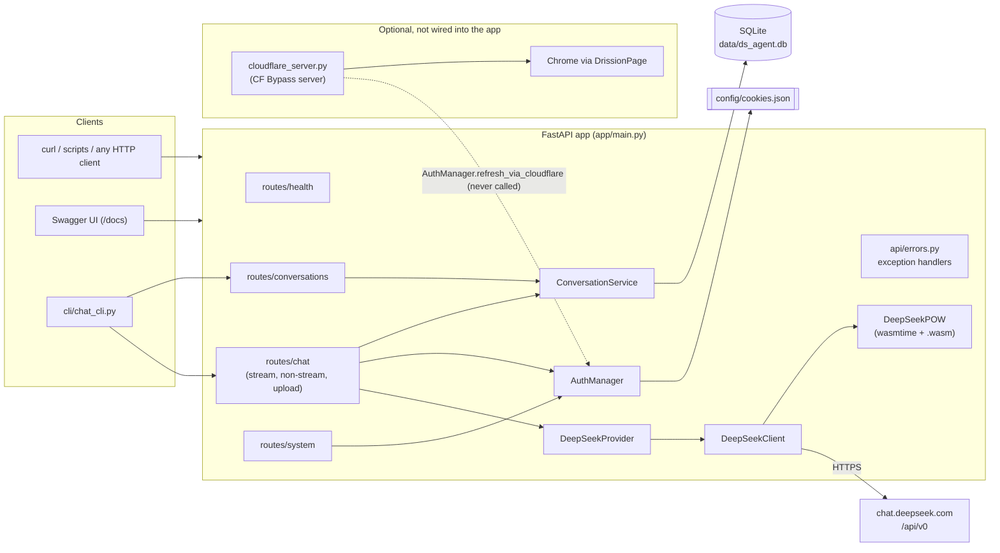
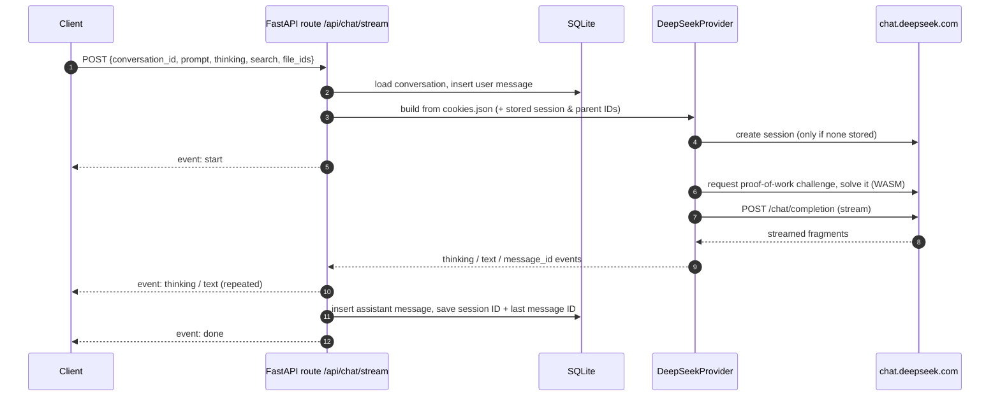
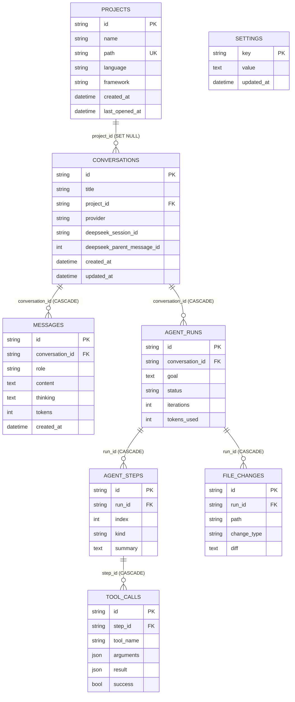

<div align="center">

# DS FastAPI Wrapper

**A local FastAPI backend that exposes your DeepSeek web-chat session as a REST + Server-Sent-Events API, with persistent conversations stored in SQLite.**

English | [فارسی](README.fa.md)

</div>

> **Status:** early-stage / work in progress (FastAPI metadata reports version `0.3.0`). There is no web UI, no API authentication and no automated agent loop yet. See [Limitations](#limitations) before using it for anything beyond local experiments.

---

<a id="toc"></a>
## Table of contents

1. [Introduction](#introduction)
2. [Features](#features)
3. [Architecture](#architecture)
4. [Project structure](#structure)
5. [Technology stack](#stack)
6. [Requirements and installation](#installation)
7. [Configuration](#configuration)
8. [Running the application](#running)
9. [API reference](#api)
10. [Conversation workflow](#conversation-workflow)
11. [Files and attachments](#files)
12. [DeepSeek provider integration](#deepseek)
13. [Authentication, cookies and the Cloudflare helper](#auth)
14. [Database](#database)
15. [Error handling and logging](#errors)
16. [Security](#security)
17. [Testing](#testing)
18. [Troubleshooting](#troubleshooting)
19. [Limitations and roadmap](#limitations)
20. [License and contribution](#license)

---

<a id="introduction"></a>
## 1. Introduction

### What it is

DS FastAPI Wrapper is a Python service (FastAPI + SQLAlchemy + SQLite) that sits between your own tools and the **DeepSeek web chat** (`https://chat.deepseek.com`). It does not use DeepSeek's official paid API. Instead it talks to the same private HTTP endpoints the DeepSeek website uses, authenticated with a session token and cookies that **you** supply.

### Problems it solves

The web endpoints are undocumented, require a proof-of-work challenge on every completion, return a custom streaming format, and keep conversation context on the server using session and parent-message identifiers. DS FastAPI Wrapper hides that complexity behind a small, documented local API:

- solves the proof-of-work challenge (via a bundled WebAssembly module);
- creates and remembers a DeepSeek chat session per local conversation;
- chains messages with the correct parent-message ID so context carries across turns;
- parses DeepSeek's streaming format into clean `thinking` and `text` events;
- stores conversations and messages (including the reasoning text) in a local SQLite database;
- uploads files to DeepSeek and returns file IDs you can attach to a prompt.

### Main capabilities

- Multiple independent conversations, each bound to its own DeepSeek chat session.
- Streaming (`text/event-stream`) and non-streaming chat endpoints.
- Optional reasoning ("thinking") and web-search flags, forwarded to DeepSeek.
- File upload (up to 20 MiB) with wait-until-processed handling.
- Conversation CRUD and message history endpoints.
- A minimal command-line chat client.
- An optional, stand-alone Cloudflare-challenge helper for obtaining browser cookies.

### Intended users

Developers who want a scriptable, local HTTP interface to their own DeepSeek web account for experiments, personal tooling, or as a starting point for a larger agent. It is single-user software: it has no accounts, no API keys and no multi-tenant isolation.

### Important notice

The service depends on undocumented endpoints and on a token taken from a logged-in browser session. Those endpoints can change or break without notice, and you are responsible for using it in line with DeepSeek's terms of service.

### Current project status

| Area | State |
|---|---|
| REST API (conversations, chat, upload, system) | Implemented |
| SSE streaming chat | Implemented |
| SQLite persistence | Implemented |
| Web interface | **Not present** (only the auto-generated Swagger UI at `/docs`) |
| API authentication | **Not present** |
| Agent runtime (tool calls, runs, file changes) | **Not implemented** — only database tables and unused settings exist |
| Automated cookie refresh | Helper code exists but is **not wired into** the application |

---

<a id="features"></a>
## 2. Features

Every item below is implemented in the current code. Items that only look implemented (because of a file name, a table or a setting) are listed in [Limitations](#limitations).

### 2.1 DeepSeek integration
A `DeepSeekProvider` (on top of `DeepSeekClient`) creates chat sessions, fetches and solves proof-of-work challenges, sends prompts and parses the streamed answer. See [section 12](#deepseek).

### 2.2 Conversation management
Create, list (paginated), fetch, rename and delete conversations; read the stored message history. A conversation without a custom title is automatically renamed from the first line of its first prompt (first 80 characters).

### 2.3 Independent conversation contexts
Each local conversation stores its own DeepSeek `chat_session_id` and the ID of the last assistant message (`parent_message_id`). Conversations never share a DeepSeek session, so their contexts are independent. Context is kept **on DeepSeek's side**; the local message table is not replayed into prompts.

### 2.4 Persistent history
Conversations and messages (user and assistant, including the reasoning text of assistant messages) are stored in `data/ds_agent.db` and survive restarts.

### 2.5 Streaming responses
`POST /api/chat/stream` returns Server-Sent Events: `start`, `thinking`, `text`, `error`, `done`. A non-streaming variant, `POST /api/chat`, collects the whole answer and returns JSON.

### 2.6 Thinking / reasoning output
When the request sets `"thinking": true`, DeepSeek is asked to reason first. Reasoning fragments are emitted as `thinking` events and stored in `messages.thinking`; the final answer is emitted as `text` events and stored in `messages.content`.

### 2.7 Search mode
When the request sets `"search": true`, the search flag is forwarded to DeepSeek. The application does not expose search results or sources; it only removes inline citation markers of the form `[citation: N]` from the text. See [12.5](#deepseek-search).

### 2.8 File uploads and attachments
`POST /api/chat/upload` uploads a file (≤ 20 MiB) to DeepSeek, waits until DeepSeek reports it as processed, and returns a `file_id`. Pass one or more IDs in `file_ids` when chatting. See [section 11](#files).

### 2.9 Session and authentication management
Credentials are read from `config/cookies.json` on every request, so editing the file takes effect without restarting. `POST /api/system/reload-token` reports whether a token is present without revealing it. See [section 13](#auth).

### 2.10 API and interfaces
- JSON/SSE HTTP API with OpenAPI docs (`/docs`, `/openapi.json`).
- Command-line client `cli/chat_cli.py`.
- No browser-based chat UI.

### 2.11 Error handling and recovery
Session creation is retried (3 attempts with back-off); provider errors are mapped to HTTP errors or SSE `error` events; upload temp files are always cleaned up. See [section 15](#errors).

---

<a id="architecture"></a>
## 3. Architecture

### 3.1 Components

| Layer | Module(s) | Responsibility |
|---|---|---|
| Entry point | `run.py`, `app/main.py` | Starts Uvicorn; builds the FastAPI app, CORS, routers, lifespan (logging + DB init) |
| API layer | `app/api/routes/*`, `app/api/errors.py`, `app/api/deps.py` | HTTP routes, request/response models, error handlers, dependency injection |
| Services | `app/services/conversation.py`, `app/services/streaming.py` | Conversation/message CRUD; SSE frame formatting |
| Auth / session | `app/services/auth/manager.py`, `app/services/auth/cloudflare_server.py`, `CloudflareBypasser.py` | Reads/writes `config/cookies.json`; optional stand-alone Cloudflare helper |
| Provider layer | `app/providers/base.py`, `app/providers/deepseek/*` | Provider interface; DeepSeek client, proof-of-work solver, stream parser |
| Database | `app/database/*` | SQLAlchemy engine/session, models, `init_db()` |
| Security | `app/security/secrets.py` | `redact()` helper (see [known issue](#known-issues)) |
| CLI | `cli/chat_cli.py` | Minimal streaming client for the HTTP API |

### 3.2 Architecture diagram



### 3.3 How the components communicate

1. A client calls an HTTP route.
2. The route obtains a `ConversationService` through FastAPI dependency injection (`get_db` → `Session`).
3. For chat and upload, the route builds a **new `DeepSeekProvider` per request** from `config/cookies.json` (via `AuthManager`).
4. The provider runs the blocking `requests`/`httpx` calls of `DeepSeekClient` in worker threads and forwards parsed events to the async route through an `asyncio.Queue`.
5. The route converts events to SSE frames (or collects them), then persists the assistant message and updated DeepSeek identifiers in a fresh DB session.

---

<a id="structure"></a>
## 4. Project structure

```text
.
├── run.py                       # CLI launcher for Uvicorn (--host, --port, --reload)
├── requirements.txt             # Dependencies (minimum versions, no lock file)
├── CloudflareBypasser.py        # Turnstile-click helper used by the Cloudflare server
├── app/
│   ├── main.py                  # FastAPI app, CORS, routers, lifespan, "/" route
│   ├── config.py                # pydantic-settings `Settings`, BASE_DIR, CONFIG_DIR
│   ├── logging_config.py        # setup_logging()
│   ├── api/
│   │   ├── deps.py              # get_conversation_service dependency
│   │   ├── errors.py            # DeepSeek exception -> JSON error handlers
│   │   └── routes/
│   │       ├── health.py        # GET /health
│   │       ├── conversations.py # /api/conversations CRUD + messages
│   │       ├── chat.py          # /api/chat, /api/chat/stream, /api/chat/upload
│   │       └── system.py        # /api/system/reload-token, /api/system/models
│   ├── database/
│   │   ├── base.py              # engine, SessionLocal, Base, get_db
│   │   ├── models.py            # ORM models
│   │   └── init_db.py           # create_all + one column migration
│   ├── providers/
│   │   ├── base.py              # LLMProvider ABC, ChatMessage, StreamEvent
│   │   └── deepseek/
│   │       ├── client.py        # HTTP client, stream parser, upload, error classes
│   │       ├── provider.py      # async provider wrapping the client
│   │       ├── pow.py           # proof-of-work solver (wasmtime)
│   │       └── wasm/sha3_wasm_bg.7b9ca65ddd.wasm
│   ├── security/
│   │   └── secrets.py           # redact(), redact_dict()
│   └── services/
│       ├── conversation.py      # ConversationService
│       ├── streaming.py         # sse_event()
│       └── auth/
│           ├── manager.py       # AuthManager (cookies file + helper control)
│           └── cloudflare_server.py  # stand-alone "CF Bypass" FastAPI app
├── cli/
│   └── chat_cli.py              # command-line chat client
├── config/
│   └── cookies.json             # YOUR credentials (secret, see section 13)
├── data/
│   └── ds_agent.db              # SQLite database (created automatically)
└── tests/
    ├── conftest.py
    ├── test_health.py
    ├── test_conversations.py
    └── test_chat.py
```

Directories created automatically at import/start-up: `config/`, `workspace/` (currently unused) and `data/`.

---

<a id="stack"></a>
## 5. Technology stack

`requirements.txt` declares **minimum** versions only; nothing is pinned and there is no lock file.

| Technology | Declared version | Role |
|---|---|---|
| Python | 3.10+ (code uses `str \| None` and `list[str]` annotations) | Runtime |
| FastAPI | `>=0.115.0` | HTTP framework |
| Uvicorn (`standard`) | `>=0.30.0` | ASGI server |
| Pydantic | `>=2.8.0` | Request/response models |
| pydantic-settings | `>=2.4.0` | Configuration / `.env` loading |
| SQLAlchemy | `>=2.0.30` | ORM (SQLite) |
| httpx | `>=0.27.0` | Streaming connection to DeepSeek |
| requests | `>=2.32.0` | Non-streaming DeepSeek calls, uploads, CLI client |
| wasmtime | `>=29.0.0` | Runs the proof-of-work WebAssembly module |
| numpy | `>=1.26.0` | Decodes the proof-of-work answer |
| DrissionPage | `>=4.3.0` | Browser automation (Cloudflare helper only) |
| pyvirtualdisplay | `>=3.0` | Virtual display (Cloudflare helper only, optional) |
| Jinja2, python-dotenv | `>=3.1.4`, `>=1.0.0` | Listed in `requirements.txt` but **not used** by the current code |
| SQLite | bundled with Python | Database |
| pytest | not listed | Needed to run the tests (`pip install pytest`) |

External services: `https://chat.deepseek.com` (required for chat/upload). Google Chrome/Chromium is needed **only** for the optional Cloudflare helper.

---

<a id="installation"></a>
## 6. Requirements and installation

### 6.1 Requirements

- Python 3.10 or newer.
- Network access to `https://chat.deepseek.com`.
- A DeepSeek web session token (see [section 13](#auth)).
- Optional: Chrome/Chromium (and, on a headless Linux host, Xvfb) for the Cloudflare helper.

### 6.2 Steps

Run all commands from the repository root (the directory containing `run.py`).

```bash
# 1. Create and activate a virtual environment
python3 -m venv .venv
source .venv/bin/activate            # Windows: .venv\Scripts\activate

# 2. Install dependencies
pip install -r requirements.txt

# 3. (Optional) install the test runner
pip install pytest
```

### 6.3 Credentials

Create `config/cookies.json` (the `config/` directory is created automatically on first start). Placeholders only:

```json
{
  "cookies": {
    "ds_session_id": "<YOUR_DEEPSEEK_SESSION_TOKEN>",
    "cf_clearance": "<OPTIONAL_CLOUDFLARE_CLEARANCE_COOKIE>"
  },
  "user_agent": "<OPTIONAL_BROWSER_USER_AGENT>"
}
```

- `cookies.ds_session_id` is **required**: it is used both as the `Authorization: Bearer` token and as a cookie.
- Every other entry in `cookies` is sent to DeepSeek as a cookie.
- `user_agent` is optional; a Chrome-like default is used when it is empty. If you supply `cf_clearance`, use the user agent of the browser that obtained it.
- The application does not obtain the token for you. Take it from your own logged-in DeepSeek browser session.

### 6.4 Database initialisation

Nothing to do: `init_db()` runs on application start-up, creates all tables and adds the `deepseek_parent_message_id` column if it is missing in an older database. To run it manually:

```bash
python -c "from app.database import init_db; init_db()"
```

---

<a id="configuration"></a>
## 7. Configuration

Settings are defined in `app/config.py` (`pydantic-settings`). Values come from process environment variables or from a `.env` file **in the current working directory**. Names are case-insensitive; unknown variables are ignored.

### 7.1 Application settings

| Variable | Type | Default | Required | Description |
|---|---|---|---|---|
| `APP_NAME` | string | `DS FastAPI Wrapper` | No | Used as the FastAPI title and in `/` and `/health` responses |
| `DEBUG` | bool (`true`/`false`, `1`/`0`) | `false` | No | Only affects `run.py`: Uvicorn log level `debug` instead of `info`. It does **not** change the application's own logging level |
| `HOST` | string | `127.0.0.1` | No | Default for `run.py --host` (ignored when you start `uvicorn` directly) |
| `PORT` | int | `8787` | No | Default for `run.py --port` (ignored when you start `uvicorn` directly) |
| `COOKIES_PATH` | path | `<repo>/config/cookies.json` | No | Location of the credentials file |
| `CLOUDFLARE_SERVER_SCRIPT` | path | `<repo>/app/services/auth/cloudflare_server.py` | No | Script launched by `AuthManager.refresh_via_cloudflare` |
| `CLOUDFLARE_SERVER_PORT` | int | `8000` | No | Defined but **not used** anywhere |
| `AGENT_MAX_ITERATIONS` | int | `25` | No | Defined but **not used** |
| `AGENT_MAX_RUNTIME_SECONDS` | int | `600` | No | Defined but **not used** |
| `AGENT_MAX_TOKENS` | int | `200000` | No | Defined but **not used** |
| `DEFAULT_WORKSPACE` | path | `<repo>/workspace` | No | Directory is created at start-up; otherwise **not used** |

### 7.2 Cloudflare helper variables

These are read with `os.getenv` by `cloudflare_server.py` from the **process environment only**; a `.env` file is *not* exported to the environment by this project.

| Variable | Default | Description |
|---|---|---|
| `DOCKERMODE` | `false` | `true` adds `--no-sandbox`, remote-debugging port 9222 and starts a virtual display |
| `SERVER_PORT` | `8000` | Default port of the helper (also settable with `--port`) |
| `BROWSER_PATH` | `/usr/bin/google-chrome` | Path to the Chrome/Chromium executable |

### 7.3 Fixed values (not configurable)

| Value | Where |
|---|---|
| Database file `data/ds_agent.db` (SQLite). A `DATABASE_URL` variable is **not** read | `app/database/base.py` |
| Upload limit 20 MiB | `app/api/routes/chat.py` |
| DeepSeek base URL `https://chat.deepseek.com/api/v0` | `providers/deepseek/client.py` |
| CORS: all origins, methods and headers, credentials allowed | `app/main.py` |
| Conversation list page size: default 50, max 200 | `routes/conversations.py` |

### 7.4 Example `.env`

Every variable below exists in `Settings`. Only the first four have any effect today; the rest are shown for completeness.

```dotenv
APP_NAME=DS FastAPI Wrapper
DEBUG=false
HOST=127.0.0.1
PORT=8787
COOKIES_PATH=config/cookies.json
# Defined but currently unused:
# CLOUDFLARE_SERVER_PORT=8000
# AGENT_MAX_ITERATIONS=25
# AGENT_MAX_RUNTIME_SECONDS=600
# AGENT_MAX_TOKENS=200000
# DEFAULT_WORKSPACE=workspace
```

> Never commit `config/cookies.json` or a `.env` containing real values. The repository has no `.gitignore`; add one.

---

<a id="running"></a>
## 8. Running the application

### 8.1 Start

```bash
python run.py                       # http://127.0.0.1:8787
python run.py --reload              # development: auto-reload on code changes
python run.py --host 0.0.0.0 --port 9000
```

Equivalent direct Uvicorn call (uses the `127.0.0.1:8787` you pass explicitly; `HOST`/`PORT` settings are not consulted):

```bash
uvicorn app.main:app --host 127.0.0.1 --port 8787
```

Defaults: host `127.0.0.1`, port `8787`.

### 8.2 Verify

```bash
curl http://127.0.0.1:8787/health
# {"ok":true,"app":"DS FastAPI Wrapper","version":"0.2.0"}
```

Interactive API docs: <http://127.0.0.1:8787/docs>.

To check that the credentials file is readable:

```bash
curl -X POST http://127.0.0.1:8787/api/system/reload-token
```

### 8.3 Stop

Press `Ctrl+C` in the terminal running the server.

### 8.4 Production considerations

- There is **no authentication** and CORS allows every origin. Keep the default loopback binding, or place the service behind a reverse proxy that adds authentication and TLS.
- Streaming responses already send `Cache-Control: no-cache` and `X-Accel-Buffering: no`; make sure your proxy does not buffer `text/event-stream`.
- SQLite is a single local file; back up `data/ds_agent.db` and protect `config/cookies.json`.
- Each chat request starts a worker thread that runs until DeepSeek finishes the stream; there is no explicit cancellation when a client disconnects.

### 8.5 Command-line client

```bash
python -m cli.chat_cli "Explain what a mutex is" [--base http://127.0.0.1:8787] [--no-thinking]
```

The client creates a new conversation titled `CLI chat`, prints its ID, and streams the answer to the terminal. Thinking is on by default (`--thinking` is the default, `--no-thinking` disables it); search is always off. Each thinking chunk is printed on a new line prefixed with `[thinking]`. The server must already be running.

---

<a id="api"></a>
## 9. API reference

Base URL: `http://127.0.0.1:8787`. All bodies are JSON unless noted. **None of the endpoints requires an API key or login**; chat and upload additionally need valid DeepSeek credentials in `config/cookies.json` on the server.

Timestamps are naive UTC values in ISO-8601 format without a timezone suffix (e.g. `2026-11-15T12:30:45.123456`). Conversation and message IDs are 32-character hexadecimal UUIDs.

Error bodies from `HTTPException` have the shape `{"detail": "..."}`. Request-validation failures return `422` with FastAPI's standard body. DeepSeek exception handlers use `{"error": "<code>", "detail": "..."}` (see [section 15](#errors)).

### 9.1 General

#### `GET /`
Returns application info. Auth: none.

```json
{"app": "DS FastAPI Wrapper", "version": "0.3.0", "docs": "/docs", "health": "/health"}
```

#### `GET /health`
Liveness check. Auth: none. Status: `200`.

```json
{"ok": true, "app": "DS FastAPI Wrapper", "version": "0.2.0"}
```

(The version string in this route is hard-coded and differs from `/` — see [known issues](#known-issues).)

FastAPI also serves `GET /docs`, `GET /redoc` and `GET /openapi.json`.

### 9.2 Conversations

Common response model `ConversationOut`:

| Field | Type | Notes |
|---|---|---|
| `id` | string | 32-char hex |
| `title` | string | |
| `project_id` | string \| null | See [Database](#database) |
| `provider` | string | Always `"deepseek"` currently |
| `created_at`, `updated_at` | string | ISO-8601 |

#### `POST /api/conversations` — create
Body: `{"title": "New chat", "project_id": null}` (both optional; defaults shown).
Status: `200`. Response: `ConversationOut`.

```bash
curl -s -X POST http://127.0.0.1:8787/api/conversations \
  -H "Content-Type: application/json" \
  -d '{"title": "My first chat"}'
```
```json
{
  "id": "3f2c9a1b7d4e4c0a9b5e1d2f6a7c8b90",
  "title": "My first chat",
  "project_id": null,
  "provider": "deepseek",
  "created_at": "2026-11-15T12:30:45.123456",
  "updated_at": "2026-11-15T12:30:45.123456"
}
```

#### `GET /api/conversations` — list
Query: `limit` (1–200, default 50), `offset` (≥ 0, default 0). Sorted by `updated_at`, newest first.
Status: `200` (array of `ConversationOut`); `422` for out-of-range parameters.

```bash
curl -s "http://127.0.0.1:8787/api/conversations?limit=20&offset=0"
```

#### `GET /api/conversations/{conv_id}` — fetch one
Status: `200` (`ConversationOut`) or `404` `{"detail": "conversation not found"}`.

#### `PATCH /api/conversations/{conv_id}` — rename
Body: `{"title": "New title"}` (required). Status: `200` (`ConversationOut`) or `404`.

```bash
curl -s -X PATCH http://127.0.0.1:8787/api/conversations/<conv_id> \
  -H "Content-Type: application/json" -d '{"title": "Renamed"}'
```

#### `DELETE /api/conversations/{conv_id}` — delete
Deletes the conversation and its messages from the local database. It does **not** delete the corresponding chat on DeepSeek. Status: `200` `{"ok": true}` or `404`.

#### `GET /api/conversations/{conv_id}/messages` — history
Returns all messages ordered by `created_at` (no pagination). Status: `200` or `404`.

```json
[
  {
    "id": "a1b2c3d4e5f60718293a4b5c6d7e8f90",
    "role": "user",
    "content": "Explain what a mutex is",
    "thinking": null,
    "created_at": "2026-11-15T12:31:02.000000"
  },
  {
    "id": "0f9e8d7c6b5a49382716f5e4d3c2b1a0",
    "role": "assistant",
    "content": "A mutex is a synchronization primitive ...",
    "thinking": "The user wants a short definition ...",
    "created_at": "2026-11-15T12:31:09.000000"
  }
]
```

### 9.3 Chat

All chat endpoints use the same request body:

| Field | Type | Default | Description |
|---|---|---|---|
| `conversation_id` | string | required | Must exist, otherwise `404` |
| `prompt` | string | required | Must not be empty/whitespace, otherwise `400` |
| `thinking` | bool | `false` | Ask DeepSeek to reason first |
| `search` | bool | `false` | Enable DeepSeek web search |
| `file_ids` | string[] | `[]` | IDs returned by `/api/chat/upload` |

Common pre-flight errors (returned as normal HTTP errors, also for the streaming endpoint): `404` conversation not found, `400` prompt is empty, `401` `No ds_session_id in config/cookies.json`.

The user message is saved to the database **before** DeepSeek is called.

#### `POST /api/chat/stream` — streaming chat
Response: `200`, `Content-Type: text/event-stream`, headers `Cache-Control: no-cache`, `Connection: keep-alive`, `X-Accel-Buffering: no`.

Each event is one SSE frame: an `event:` line, a single `data:` line containing JSON, and a blank line.

| Event | Data | Meaning |
|---|---|---|
| `start` | `{"conversation_id": "<id>"}` | DeepSeek session is ready; generation begins |
| `thinking` | `{"content": "<chunk>"}` | Reasoning chunk (only when DeepSeek emits reasoning) |
| `text` | `{"content": "<chunk>"}` | Answer chunk |
| `error` | `{"message": "<text>"}` | A failure occurred |
| `done` | `{"ok": true \| false}` | Stream finished |

Behaviour to be aware of:

- If the DeepSeek session cannot be created, the stream is `error` then `done {"ok": false}` (HTTP status is still `200`).
- If an error occurs **after** generation started, an `error` event is sent, whatever text was received so far is saved as the assistant message, and the stream still ends with `done {"ok": true}`. **Clients must treat any `error` event as a failure regardless of the final `done` value.**
- An unexpected exception inside the route itself (outside the provider loop) also produces `error` followed by `done {"ok": false}`.
- DeepSeek's internal message ID is not sent to the client; it is stored on the conversation.

```bash
curl -N -X POST http://127.0.0.1:8787/api/chat/stream \
  -H "Content-Type: application/json" \
  -d '{"conversation_id": "<conv_id>", "prompt": "Explain what a mutex is", "thinking": true, "search": false}'
```
```text
event: start
data: {"conversation_id": "3f2c9a1b7d4e4c0a9b5e1d2f6a7c8b90"}

event: thinking
data: {"content": "The user wants a short definition..."}

event: text
data: {"content": "A mutex is "}

event: text
data: {"content": "a lock that ..."}

event: done
data: {"ok": true}
```

After a successful stream the server stores the assistant message (answer + thinking), auto-titles the conversation if needed, and saves the DeepSeek session ID and last message ID.

#### `POST /api/chat` — non-streaming chat
Waits for the full answer. Status codes:

| Code | When |
|---|---|
| `200` | Success |
| `400` / `404` / `401` | Pre-flight errors listed above |
| `502` | Session creation failed (`ensure_session failed: ...`) or DeepSeek reported an error during generation |
| `422` | Invalid request body |

```bash
curl -s -X POST http://127.0.0.1:8787/api/chat \
  -H "Content-Type: application/json" \
  -d '{"conversation_id": "<conv_id>", "prompt": "Say hello", "thinking": false}'
```
```json
{
  "conversation_id": "3f2c9a1b7d4e4c0a9b5e1d2f6a7c8b90",
  "text": "Hello! How can I help you today?",
  "thinking": null,
  "ok": true
}
```

`thinking` is `null` when no reasoning text was received.

#### `POST /api/chat/upload` — file upload
Content type `multipart/form-data` with a single field named `file`. Details in [section 11](#files).

```bash
curl -s -X POST http://127.0.0.1:8787/api/chat/upload -F "file=@./report.pdf"
```
```json
{"ok": true, "file_id": "<file-id-returned-by-deepseek>", "filename": "report.pdf", "size": 123456}
```

| Code | When |
|---|---|
| `200` | Uploaded and processed by DeepSeek |
| `400` | Missing filename or empty file |
| `401` | No `ds_session_id` in the credentials file |
| `413` | File larger than 20 MiB (`File exceeds 20 MB limit`) |
| `422` | No `file` field |
| `502` | `DeepSeek upload failed: ...` (any upstream failure, including authentication errors, processing failure or processing timeout) |

### 9.4 System

#### `POST /api/system/reload-token`
Despite its name it does not cache or change anything: it reads `config/cookies.json` and reports what it found. The token itself is never returned.

| Code | When |
|---|---|
| `200` | Token present |
| `400` | `No ds_session_id in config/cookies.json` |
| `500` | Unexpected error while reading |

```json
{"ok": true, "token_len": 48, "has_cf_clearance": false, "user_agent_len": 111}
```
(Values are illustrative.)

#### `GET /api/system/models`
Returns a **static** list. The chat endpoints have no `model` parameter, so this list is informational only.

```json
[
  {"id": "default",  "name": "Default",  "description": "DeepSeek V3"},
  {"id": "reasoner", "name": "Reasoner", "description": "DeepSeek R1"}
]
```

---

<a id="conversation-workflow"></a>
## 10. Conversation workflow

### 10.1 Lifecycle

1. **Create** — `POST /api/conversations`. The row starts with `deepseek_session_id = NULL` and `deepseek_parent_message_id = NULL`.
2. **Send a message** — `POST /api/chat/stream` (or `/api/chat`).
   1. The user message is stored.
   2. A provider is built with the stored session ID and parent message ID.
   3. `ensure_session()` returns the stored session ID, or — for the first message — creates a new DeepSeek chat session.
   4. The prompt is sent with `parent_message_id`, so DeepSeek continues the same thread.
   5. Events are streamed/collected; the assistant message is stored; the session ID and the new last message ID are saved on the conversation.
3. **Next messages** reuse the saved session ID and parent message ID, so context is preserved on DeepSeek's side.
4. **Read history** — `GET /api/conversations/{id}/messages`.
5. **Rename** — `PATCH`; **delete** — `DELETE`.



### 10.2 Independent contexts
Context isolation comes from DeepSeek's per-session state. Each conversation has its own `deepseek_session_id`. Two conversations never share a session.

### 10.3 What is and is not sent to DeepSeek
Only the current `prompt`, the flags, the session ID, the parent message ID and `file_ids` are sent. Local history is **not** replayed. If you delete the database (or the stored IDs), DeepSeek will no longer continue the old thread; a conversation without a stored session ID starts a fresh DeepSeek chat.

### 10.4 Concurrency
Requests are not serialised per conversation. Sending two prompts to the same conversation at the same time uses the same parent message ID for both, which can fork the DeepSeek thread. Send one prompt at a time per conversation.

### 10.5 Persistence details
- Messages are saved in `messages`; assistant messages hold `content` and, if any, `thinking`.
- `updated_at` is refreshed whenever a message is added or the conversation is renamed.
- Auto-title: when the title at request time is `New chat` or empty, it becomes the first line of the prompt, truncated to 80 characters. Titles you set explicitly (including `CLI chat`) are not overwritten.

---

<a id="files"></a>
## 11. Files and attachments

### 11.1 Upload endpoint
`POST /api/chat/upload` (see [9.3](#api)).

1. The upload is streamed to a temporary file (`ds-upload-*`, keeping up to the first 16 characters of the original extension) in the system temp directory, 1 MiB at a time.
2. If the size exceeds **20 MiB (20 × 1024 × 1024 bytes)** the request fails with `413`; an empty file fails with `400`.
3. A provider is built and `DeepSeekClient.upload_file()` runs: it validates the file, obtains a proof-of-work challenge for the upload path, and POSTs a multipart request (timeout 120 s). The content type is guessed from the file name (`application/octet-stream` as fallback).
4. DeepSeek returns a file ID. The client then polls DeepSeek (`/file/fetch_files`, every 1.5 s, up to 60 s) until the file status is `SUCCESS`; `FAILED`/`ERROR` or a timeout raises an error.
5. The temporary file is always deleted and the provider closed, whether the upload succeeded or not.

### 11.2 File identifiers
The `file_id` is DeepSeek's own identifier, returned unchanged. The application does **not** store file IDs, file names or file contents in its database.

### 11.3 Association with conversations
There is none stored. A file is attached to a *message* by listing its ID in `file_ids` of a chat request; it is forwarded to DeepSeek as `ref_file_ids`. The same ID can be used in any conversation; IDs are not validated by the application.

### 11.4 Supported formats
- **Application level:** no whitelist or blacklist. Any non-empty file up to 20 MiB with a file name is accepted by the API.
- **DeepSeek level:** which formats DeepSeek can actually read (documents, images, size or page limits, per-account quotas) is decided by DeepSeek and is **not verified or documented by this project**. An unsupported file will surface as a processing failure (`502`) or as an unhelpful answer.

---

<a id="deepseek"></a>
## 12. DeepSeek provider integration

Code: `app/providers/deepseek/` (`client.py`, `provider.py`, `pow.py`, `wasm/`), interface in `app/providers/base.py`.

### 12.1 Provider interface
`LLMProvider` (abstract) defines `ensure_session()`, `chat()` and `close()`; `StreamEvent(type, content, meta)` is the common event type. `DeepSeekProvider` implements it and additionally accepts `file_ids` in `chat()` and offers `upload_file()`. Only the DeepSeek provider exists.

### 12.2 Authentication and requests
- Every API call carries `Authorization: Bearer <ds_session_id>` plus browser-like headers (`origin`, `referer`, `user-agent`, `x-client-*`).
- Cookies from `config/cookies.json` are attached to both the `requests` session and the streaming `httpx` client.
- Non-streaming calls (session creation, challenge, upload, file polling) use `requests`; the completion stream uses `httpx` with no timeout.
- A new `DeepSeekClient` (and therefore a new proof-of-work solver instance that loads the WASM module) is created for every HTTP request to the application.

### 12.3 Proof-of-work
Before each completion and each upload, the client asks DeepSeek for a challenge (`/chat/create_pow_challenge`) for the relevant target path, solves it with the bundled WASM module (`wasmtime`), and sends the base64-encoded JSON result in the `x-ds-pow-response` header.

### 12.4 Streaming parser and thinking/answer separation
`DeepSeekClient.stream_chat` reads the response line by line (`event:` / `data:` lines, incremental UTF-8 decoding) and interprets DeepSeek's JSON patches:

| Incoming data | Handling |
|---|---|
| Initial object with `response.message_id` and `fragments` | Emits `message_id`; fragments of type `THINK` become `thinking`, `RESPONSE` become `text` |
| `p == "response/fragments"` (list) | Same fragment handling; switches the current mode |
| `p == "response/fragments/-1/content"` with `APPEND`/`SET` | Appended to the current mode (`thinking` or `text`) |
| `p == "response/content"` | Emitted as `text` |
| `{"v": "<string>"}` without `p` | Appended to the current mode |
| `p == "response" and o == "BATCH"` | Fragment items handled as above; `quasi_status == "FINISHED"` ends the stream |
| `p == "response/status"` with value `FINISHED`, or `event: close` | Emits `done` |

The "current mode" is tracked per request: it becomes *thinking* when a `THINK` fragment is seen and *text* when a `RESPONSE` fragment is seen. Text matching `[citation: N]` is stripped from every chunk. The provider forwards `thinking`, `text` and `message_id` events to the route (the `fragment` branch in `provider.py` is never produced by the client).

### 12.5 <a id="deepseek-search"></a>Search behaviour
`search: true` only sets `search_enabled` in the DeepSeek payload. The application neither parses nor returns search results or source lists, and removes citation markers from the answer. What DeepSeek does with the flag is up to DeepSeek.

### 12.6 Retry and error handling
- `ensure_session()` makes up to **3 attempts** for `NetworkError`, `RateLimitError` and `APIError`, waiting 1.5 s and 3 s between attempts. `AuthenticationError` and Cloudflare errors are not retried.
- The generic request helper contains a two-iteration loop, but every failure path raises immediately, so there is effectively **no retry** there.
- Streaming completion and uploads are **not retried**.
- Error mapping in the client: HTTP 401 → `AuthenticationError`; 429 → `RateLimitError`; other non-200 → `APIError` (with status code); transport failures → `NetworkError`; an HTML "Just a moment" page → `CloudflareError`.
- Error text passed outwards goes through `redact()` (see [known issues](#known-issues)).

### 12.7 Provider limitations
- Depends on undocumented DeepSeek web endpoints and header values (e.g. fixed `x-app-version`, `x-client-version`), which can change.
- No model selection; `thinking` and `search` are the only generation switches.
- `delete_session()` exists in the client but is never called.
- Cloudflare challenges on DeepSeek endpoints are not solved automatically (see next section).

---

<a id="auth"></a>
## 13. Authentication, cookies and the Cloudflare helper

### 13.1 How credentials are loaded
`AuthManager` (`app/services/auth/manager.py`) reads `config/cookies.json` (or `COOKIES_PATH`) on **every** chat/upload/system request:

- `cookies` → dictionary of cookies; `ds_session_id` is the bearer token;
- `user_agent` → string used for the `user-agent` header.

A missing or unreadable file yields an empty set of cookies, which results in `401 No ds_session_id in config/cookies.json`. Parse errors are printed to stderr (after `redact()`).

### 13.2 Sessions
There are two kinds of "session":
1. **Your DeepSeek login session** — the token/cookies above, managed by you.
2. **DeepSeek chat sessions** — created per conversation and stored in `conversations.deepseek_session_id`.

### 13.3 The Cloudflare helper (optional, manual)
`app/services/auth/cloudflare_server.py` is a separate FastAPI app (title "CF Bypass") that launches a real Chrome via DrissionPage, opens a URL, clicks the Cloudflare verification checkbox through `CloudflareBypasser.py` until the page title no longer contains "just a moment", and returns the browser's cookies and user agent.

Endpoints of the helper: `GET /cookies?url=...&retries=5&proxy=...`, `GET /html?url=...`, `GET /health`.

Run it manually from the repository root (the root must be on `PYTHONPATH` because the script imports `CloudflareBypasser` from the root directory):

```bash
PYTHONPATH=. python app/services/auth/cloudflare_server.py --port 8000 --headless
# then, from another shell:
curl "http://127.0.0.1:8000/cookies?url=https://chat.deepseek.com"
```

Copy the relevant values (`cf_clearance`, and the user agent) into `config/cookies.json` yourself. Notes:

- The helper binds to `0.0.0.0` and has no authentication.
- It opens a visible (non-headless) browser; `--headless` (or `DOCKERMODE=true`) uses a virtual display via `pyvirtualdisplay`, which needs Xvfb on Linux.
- `AuthManager.refresh_via_cloudflare()` can start this helper automatically and overwrite `config/cookies.json`, but **no route, CLI or other code calls it** today. If it were called, it would also need the `PYTHONPATH` setting above, uses port `8000` regardless of `CLOUDFLARE_SERVER_PORT`, and replaces the whole file with the browser's cookies.

---

<a id="database"></a>
## 14. Database

- **Engine:** SQLite, file `data/ds_agent.db` (created automatically; fixed path).
- **ORM:** SQLAlchemy 2.x (`DeclarativeBase`, typed `Mapped` columns), `check_same_thread=False`.
- **Sessions:** one per request via the `get_db` dependency; the chat routes open an additional short-lived session to save results after streaming.
- **Initialisation / migration:** `init_db()` calls `Base.metadata.create_all()` and then, if the `conversations` table lacks `deepseek_parent_message_id`, runs `ALTER TABLE ... ADD COLUMN`. There is no Alembic or other migration framework.
- **Persistence:** data survives restarts; timestamps are naive UTC (`datetime.utcnow`).

### 14.1 Models

| Table | Used by the application? | Key columns |
|---|---|---|
| `conversations` | **Yes** | `id`, `title`, `project_id`, `provider` (`"deepseek"`), `deepseek_session_id`, `deepseek_parent_message_id`, `created_at`, `updated_at` |
| `messages` | **Yes** | `id`, `conversation_id`, `role`, `content`, `thinking`, `tokens` (never filled), `created_at` |
| `projects` | Partly (`ConversationService.ensure_project` exists but nothing calls it; no API) | `id`, `name`, `path` (unique), `language`, `framework`, `created_at`, `last_opened_at` |
| `agent_runs`, `agent_steps`, `tool_calls`, `file_changes`, `settings` | **No** — schema only | — |

### 14.2 ER diagram



### 14.3 Notes
- Deleting a conversation through the API removes its messages (ORM cascade).
- `conversations.project_id` accepts any string: the API has no project endpoints and SQLite foreign-key enforcement is not switched on in the code.
- To reset all local data, stop the app and delete `data/ds_agent.db`; it is recreated on the next start (this also drops the stored DeepSeek session links).

---

<a id="errors"></a>
## 15. Error handling and logging

### 15.1 Logging
`setup_logging()` (called in the application lifespan) configures the root logger with level **`ERROR`**, output to stdout, format `%(asctime)s | %(levelname)-7s | %(name)s | %(message)s`; `httpx`/`httpcore` are set to `WARNING`. Consequences:

- Only `ERROR`-level messages from the application appear (`logger.exception(...)` calls in the chat routes: `ensure_session failed`, `chat stream failed`, `file upload failed`).
- `warning`/`info` logs, such as the DeepSeek error handler's `logger.warning`, are not shown.
- `DEBUG=true` raises only Uvicorn's own log level (via `run.py`), not the application's.
- `AuthManager` reports cookie-file parse problems with `print(..., file=sys.stderr)`.

### 15.2 Error reporting

| Source | Response |
|---|---|
| Validation | `422` with FastAPI's standard body |
| Explicit `HTTPException` | `{"detail": "..."}` with the stated status |
| `AuthenticationError` / `RateLimitError` / `NetworkError` / `APIError` reaching the exception handlers | `401 auth_error` / `429 rate_limit` / `502 network_error` / `502 api_error`, body `{"error": "<code>", "detail": "<redacted message>"}` |
| `CloudflareError` | Has no handler. Inside the chat/upload routes it is converted to `502` or an SSE `error`; elsewhere it would be a generic `500` |

In practice the chat and upload routes catch provider failures themselves (as `502` responses or SSE `error` events), so the DeepSeek exception handlers are rarely reached — for example when the token value in `cookies.json` is not a string.

### 15.3 Common failure scenarios

| Symptom | Cause |
|---|---|
| `401 No ds_session_id in config/cookies.json` | Credentials file missing, malformed or without the token |
| `502 ensure_session failed: Invalid or expired token` / SSE `error` | Token rejected by DeepSeek |
| `502 ... Rate limit exceeded` | DeepSeek returned 429 (session creation was retried 3 times) |
| `... Just a moment ...` HTML fragment in the message | Cloudflare challenge; `cf_clearance` / user agent are missing or stale |
| `502 DeepSeek upload failed: File processing timed out` | DeepSeek did not finish processing within 60 s |

See [Troubleshooting](#troubleshooting) for fixes.

---

<a id="security"></a>
## 16. Security

### 16.1 What the code actually does
- Binds to `127.0.0.1` by default (`run.py`).
- Never returns the token: `/api/system/reload-token` returns only its length and booleans.
- Limits uploads to 20 MiB, streams them in chunks, rejects empty files, and always deletes temporary files.
- Keeps credentials in a separate file (`config/cookies.json`) read at request time, not in the database.
- The Cloudflare helper rejects `file:` URLs and the hostname `localhost` (see below for what it does not block).

### 16.2 What it does not do
- **No authentication or authorisation** on any endpoint, no rate limiting, no TLS. Anyone who can reach the port can read all conversations and use your DeepSeek account.
- **CORS is wide open** (`allow_origins=["*"]` with credentials allowed).
- Credentials are stored in **plain text** in `config/cookies.json`; messages are stored in **plain text** in SQLite. The repository has no `.gitignore`, so both files can be committed by accident — add one and rotate any credential that was ever committed or shared.
- The Cloudflare helper listens on `0.0.0.0` without authentication.

### 16.3 Known weaknesses (verified by execution)
- `redact()` does not redact ordinary secrets (see [known issues](#known-issues)). Do not rely on it to keep tokens out of logs or error messages.
- The private-IP check in the Cloudflare helper's `is_safe_url()` does not match IP addresses, so only `localhost` and `file:` URLs are actually blocked.

### 16.4 Deployment recommendations
Keep the loopback binding; if remote access is needed use a reverse proxy with authentication and TLS, restrict CORS, firewall the Cloudflare helper's port, and restrict file permissions on `config/` and `data/`.

---

<a id="testing"></a>
## 17. Testing

### 17.1 Running
```bash
pip install pytest
pytest
```
Run from the repository root; `tests/conftest.py` adds the root to `sys.path`.

### 17.2 What exists

| File | Tests | Covers |
|---|---|---|
| `tests/test_health.py` | `test_health`, `test_root` | `GET /health`, `GET /` |
| `tests/test_conversations.py` | `test_create_list_delete` | create, list, rename, delete and 404 after delete |
| `tests/test_chat.py` | `test_chat_non_stream` | `POST /api/chat` with a mocked provider (thinking + text aggregation) |

### 17.3 Not covered
Streaming endpoint, upload endpoint, messages endpoint, system endpoints, the DeepSeek client / stream parser / proof-of-work, `AuthManager`, `redact()`, error handlers, and any live DeepSeek call.

### 17.4 Known limitations of the test suite
- `conftest.py` sets `DATABASE_URL=sqlite:///:memory:`, but the application ignores that variable. The tests therefore run against the real `data/ds_agent.db`; `test_chat_non_stream` leaves a conversation with messages behind.
- By inspection, the fake `chat()` in `tests/test_chat.py` does not accept the `file_ids` keyword that the route now passes, so `test_chat_non_stream` is expected to fail with a `TypeError` until the fake is updated.
- `pytest` is not listed in `requirements.txt`.

---

<a id="troubleshooting"></a>
## 18. Troubleshooting

**Installation**

| Problem | Solution |
|---|---|
| `ModuleNotFoundError` on start | Activate the virtual environment and run `pip install -r requirements.txt` |
| `ModuleNotFoundError: No module named 'CloudflareBypasser'` when starting the helper | Run it with `PYTHONPATH=.` from the repository root (see [13.3](#auth)) |
| Chrome not found by the helper | Set `BROWSER_PATH` in the process environment (the default is the Linux path `/usr/bin/google-chrome`) |
| Helper fails on a server with no display | Use `--headless` (or `DOCKERMODE=true`) and install Xvfb |
| `Address already in use` | Choose another port: `python run.py --port 9000` |

**Configuration**

| Problem | Solution |
|---|---|
| `.env` values seem ignored | `.env` is read from the *current working directory*; start the app from the repository root. `HOST`/`PORT` only affect `run.py` |
| Changing `DEBUG` shows no extra application logs | By design: it only changes Uvicorn's level; the application logger stays at `ERROR` |
| `DATABASE_URL` has no effect | It is not supported; the database path is fixed |

**Authentication / provider**

| Problem | Solution |
|---|---|
| `401 No ds_session_id in config/cookies.json` | Create/fix `config/cookies.json` ([6.3](#installation)); check with `POST /api/system/reload-token` |
| `Invalid or expired token` | Replace `ds_session_id` with a fresh token; no restart needed |
| Cloudflare "Just a moment" errors | Obtain fresh `cf_clearance` **and** the matching `user_agent` (see [13.3](#auth)) and put both in `cookies.json` |
| Rate limit | Wait and retry; consider fewer parallel requests |
| Replies ignore earlier context | Conversation lost its stored IDs (e.g. new database) or two prompts ran concurrently; start a new conversation |

**Database**

| Problem | Solution |
|---|---|
| Need a clean state | Stop the app, delete `data/ds_agent.db`, start again |

**Streaming**

| Problem | Solution |
|---|---|
| Output arrives all at once | A proxy is buffering; disable buffering for `text/event-stream` |
| `error` event followed by `done` with `ok: true` | Expected behaviour (see [9.3](#api)); treat `error` as failure. Partial text may already be saved |
| Empty answer | DeepSeek returned no fragments; the (empty) assistant message is still stored |

**Uploads**

| Problem | Solution |
|---|---|
| `413` | File is larger than 20 MiB |
| `400 Empty files are not allowed` | Upload a non-empty file |
| `502 DeepSeek upload failed: ...` | Read the message: expired token, DeepSeek processing failure, or 60 s processing timeout |

---

<a id="limitations"></a>
## 19. Limitations and roadmap

### 19.1 Current limitations

- Single-user, unauthenticated, local-first design.
- Relies on undocumented DeepSeek web endpoints and a manually supplied token.
- No web chat interface (only Swagger UI), no model selection, no search-result output, no token counting (`messages.tokens` is never filled).
- Context lives on DeepSeek's side; local history is not re-sent and deleting a conversation does not delete the remote chat.
- No file metadata is stored; no conversation-level file association.
- No automated cookie refresh (helper exists but is not connected).
- Provider instances (and the WASM module) are created per request.
- No cancellation of upstream generation when a client disconnects.

<a id="known-issues"></a>
### 19.2 Known issues (found while documenting)

1. **`redact()` is ineffective.** Its patterns are raw strings with doubled backslashes (`\\s`), so they match a literal backslash and never match normal `Bearer <token>`, `ds_session_id=<value>` or `cookie: <value>` text. Executing it on such inputs returned them unchanged.
2. **`is_safe_url()` (Cloudflare helper)** has the same doubled-backslash problem, so IP-address and private-range checks never match.
3. **Mid-stream errors** end with `done {"ok": true}` and a partial assistant message is stored.
4. **The user message is stored before the provider call** and is not rolled back when the call fails.
5. **`/api/system/models`** is static and not wired to any chat parameter.
6. **Inconsistent versions:** `app/__init__.py` says `0.1.0`, `/health` says `0.2.0`, FastAPI and `/` say `0.3.0`.
7. **Tests** use the real database and `test_chat.py` appears outdated (see [17.4](#testing)).
8. **`CloudflareError`** is not mapped by the error handlers.
9. **Upload auth failures** are reported as `502`, not `401`.
10. The upload request hard-codes a client time-zone offset header (`12600`) and some client-version headers.

### 19.3 Not implemented (scaffolding only)

The following exist only as database tables or settings and have **no code behind them**: agent runs/steps/tool calls/file changes, project management, the `settings` table, `AGENT_*` limits, `DEFAULT_WORKSPACE`, `CLOUDFLARE_SERVER_PORT`, the `history` parameter of the provider interface, and the `jinja2`/`python-dotenv` dependencies. The repository contains no roadmap or plan document, so no future features are promised here.

---

<a id="license"></a>
## 20. License and contribution

- **License:** the repository contains no `LICENSE` file and no license statement. Without one, no permission to use, copy, modify or redistribute the code is granted by default — contact the repository owner before reusing it.
- **Contribution:** there is no `CONTRIBUTING` file or contribution policy.
- Git metadata lists `https://github.com/RashMD-Studio/DS-free-agent` as the `origin` remote.
